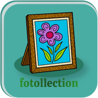
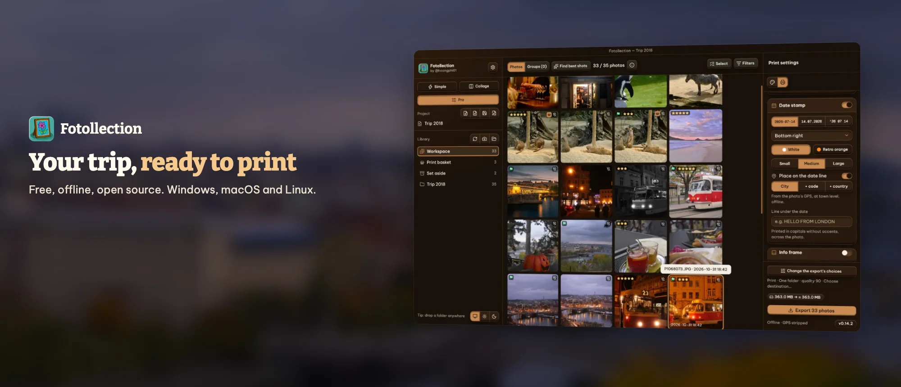
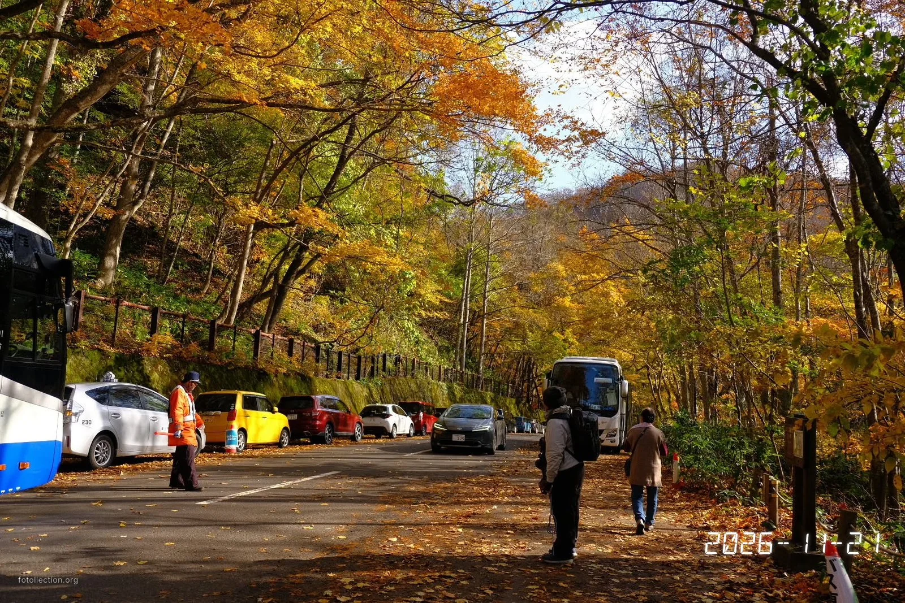
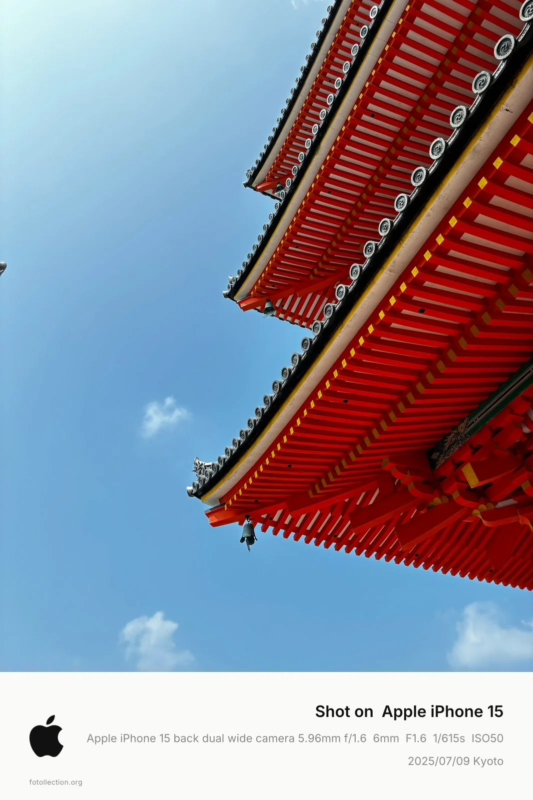
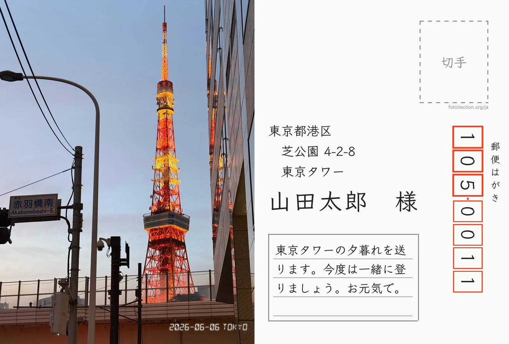

<div align="center">



# Fotollection

**旅の写真を、そのままプリントへ。**

Fotollectionは、ベストショットを選び、撮影日と場所を入れ、お店のプリントサイズに合わせます。無料で、完全にオフラインです。

**[⬇ macOS、Windows、Linux版をダウンロード](https://fotollection.org/ja/download/)**

<sub>macOSとWindowsは初回の起動時に一度だけ確認します。<b>このまま開く</b>を選んでください(<a href="#初回の起動">手順</a>)。</sub>

[ウェブサイト](https://fotollection.org/ja/) · [マニュアル](https://fotollection.org/ja/manual/) · [リリース](https://github.com/hoangphi01/fotollection/releases/latest) · [English](README.md) · [Tiếng Việt](README.vi.md) · [简体中文](README.zh-CN.md) · **日本語** · [한국어](README.ko.md)

</div>

<p align="center">
  
</p>

<p align="center">
  
  
  
</p>

## 作った理由

こんにちは、[hoangphi01](https://github.com/hoangphi01)です。ヨーロッパで学ぶベトナム人の学生です。旅行のあと何百枚もの写真があり、そのうち20枚ほどをプリントしたかったのですが、どの方法も不便でした。

- **プリントには、いつどこで撮ったかが残りません。** 数年たつと誰も覚えていません。
- **お店は写真を自動でトリミングします。** 2:3、3:4、1:1に切られ、顔が切れることもあります。
- **オンラインのツールは写真をアップロードさせます。** GPS情報から住んでいる場所がわかります。

そこで、すべてをパソコンの中で行うFotollectionを作りました。無料のオープンソースで、写真がパソコンの外に出ることはありません。

## 使い方

1. **旅行のフォルダーを開きます。** JPEG、iPhoneのHEIC、カメラのRAWを数千枚まとめて読み込み、ベストショットを提案します。
2. **プリントする写真を選びます。** 撮影日と場所をフィルムカメラ風の文字で入れ、トリミングをプリントサイズに合わせ、ルックで色を決めます。
3. **プリント用に書き出します。** フル画質、GPS情報は削除。セブン-イレブン、ローソン、ファミリーマートのマルチコピー機のサイズにも対応しています。

## 主な機能

- **撮影日と場所をプリントに**：š写真そのものから読み取り、場所はオフラインで検索します。
- **お店のプリントサイズ**：šL判、2L判、正方形など日本・韓国・ヨーロッパの21サイズ。
- **ベストショットの提案**：š連写や似た写真をまとめ、目を開いた一番シャープな一枚を理由付きで提案します。
- **RAW対応**：šFujifilm、Panasonic、Canon、Nikon、Sony、OlympusのカメラのRAWファイル。
- **ルック、プリセット、LUT**：šワンタップで写真の色が決まります。手持ちのLightroomプリセットやLUMIX Labのルックも使えます。
- **ポストカード**：š郵便はがきの宛名面、郵便番号から住所を入力(AddAssist)。
- **プライバシー**：šアカウント不要、クラウドなし、テレメトリなし。通信は更新の確認だけで、オフにできます。

画面の言語:日本語、English、Tiếng Việt、Deutsch、Magyar、한국어。

## まだできないこと

Fotollectionはまだ新しいソフトです。次のことはまだできません。

- **署名のないビルド:** macOSとWindowsは初回の起動前に一度だけ確認します([初回の起動](#初回の起動))。
- **LinuxでのiPhoneの写真(HEIC):** 今はJPEGに変換してください。
- **USBでつないだカメラでの撮影:** Windowsだけで使えます。
- **スマートフォン版はありません:** パソコンで使うソフトです。
- **不具合:** 見つけたら[issue](https://github.com/hoangphi01/fotollection/issues/new/choose)で教えてください。

## ダウンロード

[ダウンロードページ](https://fotollection.org/ja/download/)から、macOS 11以降(Apple SiliconとIntel)の`.dmg`、Windows 10/11の`-setup.exe`、64ビットLinuxのAppImageまたは`.deb`を入手できます。MacではHomebrewでも入れられます。

```sh
brew tap hoangphi01/tap && brew trust hoangphi01/tap
brew install --cask hoangphi01/tap/fotollection
```

### 初回の起動

ビルドにはまだ署名がないため([ADR-0009](docs/adr/0009-unsigned-distribution.md))、システムが一度だけ確認します。

- **macOS:** システム設定 → プライバシーとセキュリティ → **このまま開く**
- **Windows:** SmartScreen → **詳細情報** → **実行**
- **Linux:** 確認はありません。AppImageに実行権限を付けるか、`.deb`をインストールします。

## サポート

Fotollectionは無料で、学生が一人で開発しています。役に立ったら [GitHub Sponsors](https://github.com/sponsors/hoangphi01) または [Ko-fi](https://ko-fi.com/hoangphi01) で応援できます。

## ライセンス

[GPL-3.0-only](LICENSE) © hoangphi01。詳しい説明は [English README](README.md) をご覧ください。
