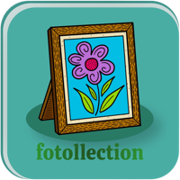
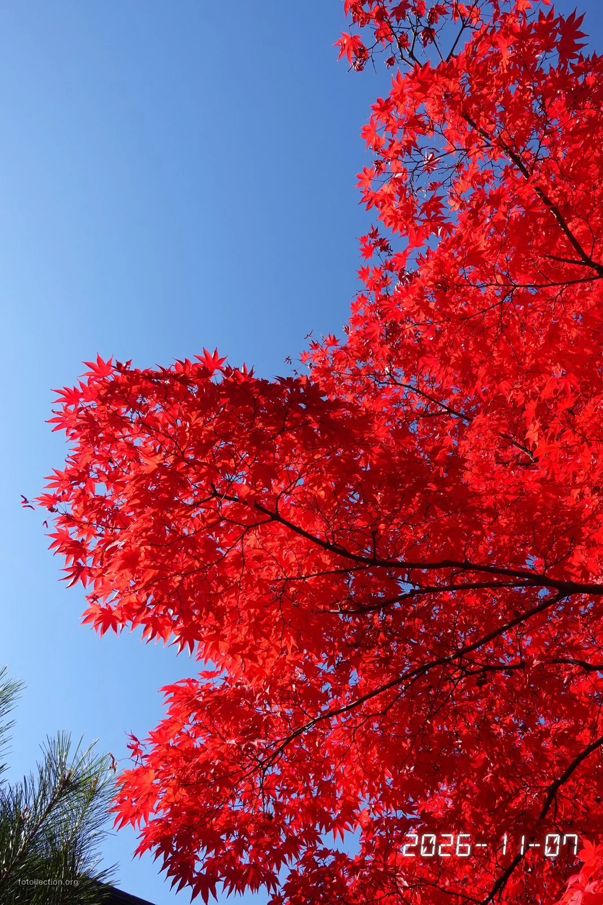
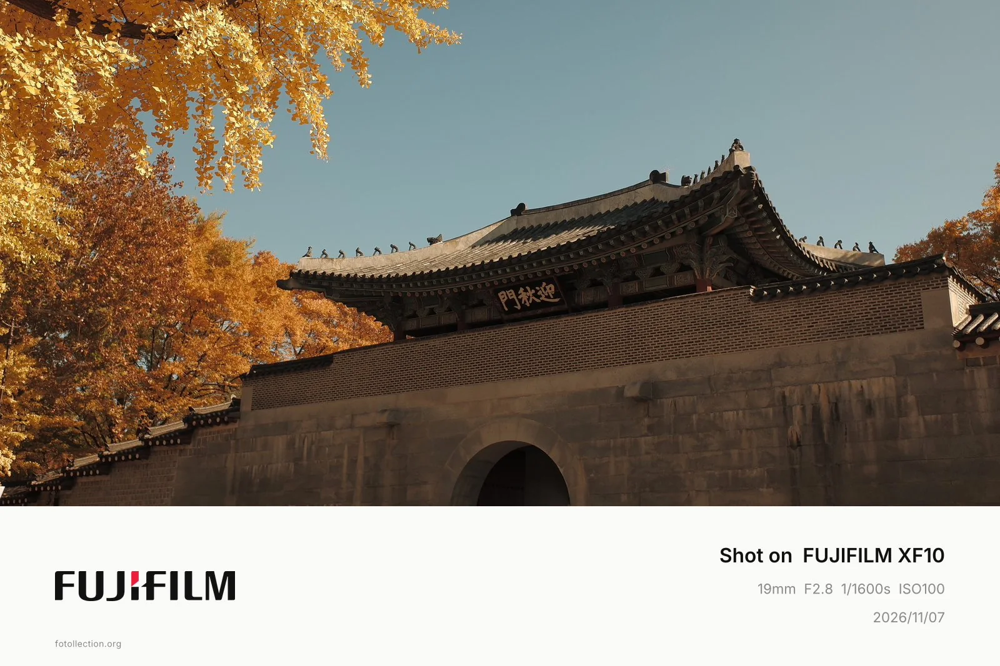
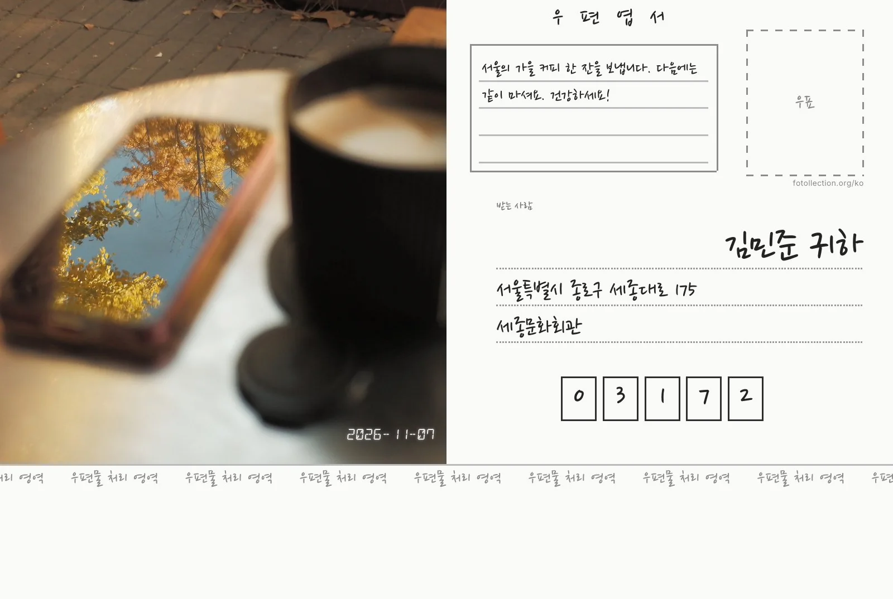

<div align="center">



# Fotollection

**여행 사진을, 그대로 프린트로.**

Fotollection은 베스트 샷을 고르고, 날짜와 장소를 넣고, 매장의 프린트 크기에 맞춥니다. 무료이고 완전히 오프라인입니다.

**[⬇ macOS, Windows, Linux용 다운로드](https://fotollection.org/ko/download/)**

<sub>macOS와 Windows는 처음 실행할 때 한 번 확인합니다. <b>그래도 열기</b>를 선택하세요(<a href="#처음-실행">방법</a>).</sub>

[웹사이트](https://fotollection.org/ko/) · [매뉴얼](https://fotollection.org/ko/manual/) · [릴리스](https://github.com/hoangphi01/fotollection/releases/latest) · [English](README.md) · [Tiếng Việt](README.vi.md) · [简体中文](README.zh-CN.md) · [日本語](README.ja.md) · **한국어**

</div>

<p align="center">
  
</p>

<p align="center">
  
  
  
</p>

## 만든 이유

안녕하세요, [hoangphi01](https://github.com/hoangphi01)입니다. 유럽에서 공부하는 베트남 학생이에요. 여행을 다녀오면 사진이 수백 장인데 그중 스무 장쯤만 인화하고 싶었고, 어떤 방법도 쉽지 않았어요.

- **인화한 사진에는 언제 어디서 찍었는지가 남지 않아요.** 몇 년 지나면 아무도 기억하지 못해요.
- **매장은 사진을 자동으로 잘라요.** 2:3, 3:4, 1:1로 잘리면서 얼굴이 잘리기도 해요.
- **온라인 도구는 사진을 업로드하게 해요.** GPS 정보로 사는 곳이 드러나요.

그래서 이 모든 일을 컴퓨터 안에서 하는 Fotollection을 만들었어요. 무료 오픈 소스이고, 사진은 컴퓨터 밖으로 나가지 않아요.

## 사용 방법

1. **여행 폴더를 엽니다.** JPEG, iPhone의 HEIC, 카메라 RAW를 수천 장 한 번에 불러오고 베스트 샷을 제안합니다.
2. **프린트할 사진을 고릅니다.** 촬영 날짜와 장소를 필름 카메라 글꼴로 넣고, 자르기를 프린트 크기에 맞추고, 룩으로 색을 정합니다.
3. **프린트용으로 내보냅니다.** 원본 화질, GPS 정보 제거. 한국과 일본, 유럽 매장의 프린트 크기를 지원합니다.

## 주요 기능

- **프린트에 촬영 날짜와 장소**: 사진 자체에서 읽고, 장소는 오프라인으로 찾습니다.
- **매장 프린트 크기**: 4×6, 5×7, 3×5, 8×10, 4×4 in 등 21가지 크기.
- **베스트 샷 제안**: 연사와 비슷한 사진을 묶고, 눈을 뜬 가장 선명한 사진을 이유와 함께 제안합니다.
- **RAW 지원**: Fujifilm, Panasonic, Canon, Nikon, Sony, Olympus 카메라의 RAW 파일.
- **룩, 프리셋, LUT**: 한 번에 사진의 색이 정해지고, 가지고 있는 Lightroom 프리셋과 LUMIX Lab 룩도 쓸 수 있습니다.
- **엽서**: 우편엽서 주소 면, 우편번호로 주소 입력(AddAssist).
- **개인 정보 보호**: 계정, 클라우드, 원격 측정 없음. 네트워크 요청은 업데이트 확인뿐이며 끌 수 있습니다.

화면 언어: 한국어, English, Tiếng Việt, Deutsch, Magyar, 日本語.

## 아직 없는 것

Fotollection은 아직 새 프로그램이라, 다음은 아직 없어요.

- **서명되지 않은 빌드:** macOS와 Windows는 처음 실행하기 전에 한 번 확인해요([처음 실행](#처음-실행)).
- **Linux의 iPhone 사진(HEIC):** 지금은 JPEG로 변환해 주세요.
- **USB로 연결한 카메라 촬영:** Windows에서만 돼요.
- **스마트폰 버전은 없어요:** 컴퓨터에서 쓰는 프로그램이에요.
- **버그:** 발견하면 [issue](https://github.com/hoangphi01/fotollection/issues/new/choose)로 알려 주세요.

## 다운로드

[다운로드 페이지](https://fotollection.org/ko/download/)에서 macOS 11 이상(Apple Silicon과 Intel)용 `.dmg`, Windows 10/11용 `-setup.exe`, 64비트 Linux용 AppImage 또는 `.deb`를 받을 수 있어요. Mac에서는 Homebrew로도 설치할 수 있어요.

```sh
brew tap hoangphi01/tap && brew trust hoangphi01/tap
brew install --cask hoangphi01/tap/fotollection
```

### 처음 실행

빌드에 아직 서명이 없어서([ADR-0009](docs/adr/0009-unsigned-distribution.md)) 시스템이 한 번 확인해요.

- **macOS:** 시스템 설정 → 개인정보 보호 및 보안 → **그래도 열기**
- **Windows:** SmartScreen → **추가 정보** → **실행**
- **Linux:** 확인은 없어요. AppImage에 실행 권한을 주거나 `.deb`를 설치하세요.

## 후원

Fotollection은 무료이며 학생 한 명이 개발합니다. 도움이 되었다면 [GitHub Sponsors](https://github.com/sponsors/hoangphi01) 또는 [Ko-fi](https://ko-fi.com/hoangphi01)로 후원할 수 있습니다.

## 라이선스

[GPL-3.0-only](LICENSE) © hoangphi01. 자세한 내용은 [English README](README.md)를 참고하세요.
