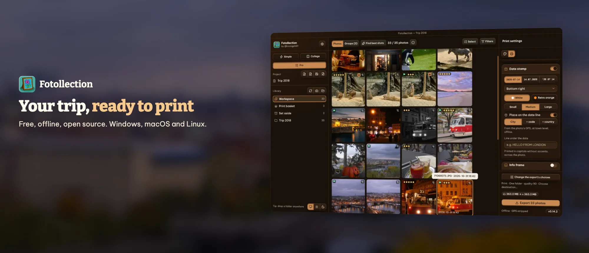

# Fotollection

**여행 사진을 바로 프린트로. 사진마다 촬영 날짜와 장소, 매장의 프린트 크기, 업로드 없음.**

무료 · 오프라인 · 오픈 소스 · macOS, Windows, Linux

**[⬇ macOS, Windows, Linux용 다운로드](https://fotollection.org/ko/download/)**

[웹사이트](https://fotollection.org/ko/) · [매뉴얼](https://fotollection.org/ko/manual/) · [릴리스](https://github.com/hoangphi01/fotollection/releases/latest) · [English](README.md) · [Tiếng Việt](README.vi.md) · [简体中文](README.zh-CN.md) · [日本語](README.ja.md) · **한국어**

  

## 사용 방법

1. **여행 폴더를 엽니다.** JPEG, iPhone의 HEIC, 카메라 RAW를 수천 장 한 번에 불러오고 베스트 샷을 제안합니다.
2. **프린트할 사진을 고릅니다.** 촬영 날짜와 장소를 필름 카메라 글꼴로 넣고, 자르기를 프린트 크기에 맞추고, 룩으로 색을 정합니다.
3. **프린트용으로 내보냅니다.** 원본 화질, GPS 정보 제거. 한국과 일본, 유럽 매장의 프린트 크기를 지원합니다.

## 주요 기능

- **프린트에 촬영 날짜와 장소**: EXIF에서 읽고, 장소는 오프라인으로 찾습니다.
- **매장 프린트 크기**: 4×6, 5×7, 3×5, 8×10, 4×4 in 등 21가지 크기.
- **베스트 샷 제안**: 연사와 비슷한 사진을 묶고, 눈을 뜬 가장 선명한 사진을 이유와 함께 제안합니다.
- **RAW 지원**: Fujifilm, Panasonic, Canon, Nikon, Sony, Olympus, DNG.
- **룩, 프리셋, LUT**: Lightroom 프리셋과 `.cube` LUT도 사용할 수 있습니다.
- **엽서**: 우편엽서 주소 면, 우편번호로 주소 입력(AddAssist).
- **개인 정보 보호**: 계정, 클라우드, 원격 측정 없음. 네트워크 요청은 업데이트 확인뿐이며 끌 수 있습니다.

화면 언어: 한국어, English, Tiếng Việt, Deutsch, Magyar, 日本語.

## 후원

Fotollection은 무료이며 학생 한 명이 개발합니다. 도움이 되었다면 [GitHub Sponsors](https://github.com/sponsors/hoangphi01) 또는 [Ko-fi](https://ko-fi.com/hoangphi01)로 후원할 수 있습니다.

## 라이선스

[GPL-3.0-only](LICENSE) © hoangphi01. 자세한 내용은 [English README](README.md)를 참고하세요.
