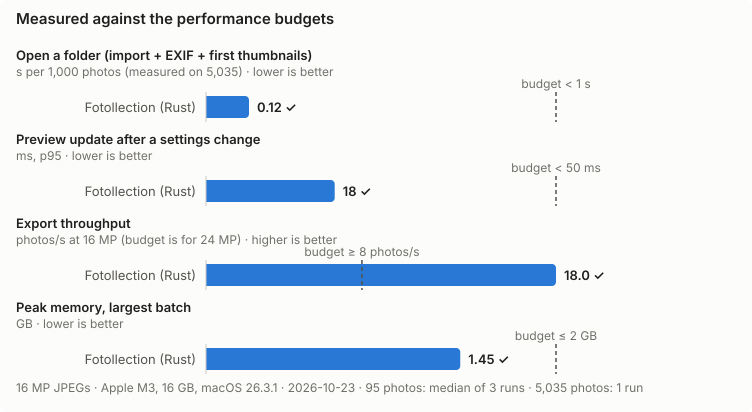
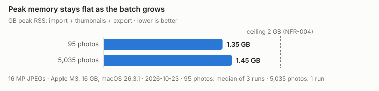
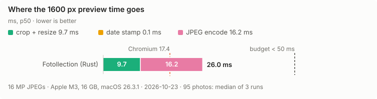
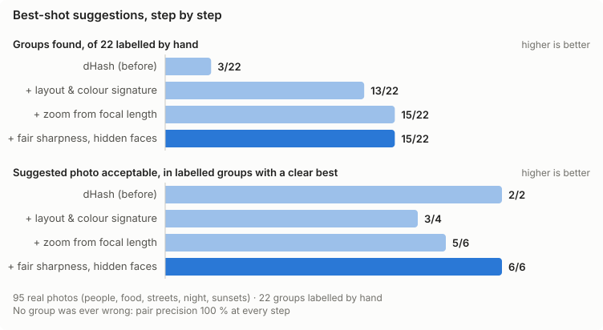

<div align="center">


# Fotollection

by [@hoangphi01](https://github.com/hoangphi01)

**English** · [VI](README.vi.md)

**Fast, private, offline photo-print preparation for macOS and Windows.**

Stamp the date and place on your photos, crop them to real print sizes, and get them ready for the lab, all without a single photo leaving your computer.

[](https://github.com/hoangphi01/fotollection/actions/workflows/ci.yml)
[](https://github.com/hoangphi01/fotollection/actions/workflows/docs.yml)
[](LICENSE)
[](docs/STATUS.md)
[](https://github.com/hoangphi01/fotollection/releases)

[](docs/RELEASE.md)
[](rust-toolchain.toml)
[](https://v2.tauri.app/)
[](https://react.dev/)
[](https://ui.shadcn.com/)
[](docs/SECURITY.md#5-privacy)

[](https://github.com/hoangphi01/fotollection/stargazers)
[](https://github.com/hoangphi01/fotollection/commits/main)
[](https://github.com/hoangphi01/fotollection/issues)
[](https://github.com/hoangphi01/fotollection)

</div>

---

> [!NOTE]
> **Fotollection is in early development.** It already works end to end for **JPEG, PNG and HEIC**: import → cull with stars and flags → preview with crop, date stamp and info frame → export. Projects save as one `.fotollection` file that opens the same on another machine. Offline place names and best-shot suggestions are on the way. Follow progress in [docs/STATUS.md](docs/STATUS.md) and [docs/ROADMAP.md](docs/ROADMAP.md).

<p align="center">
  
  
</p>

## Why Fotollection?

You shot 800 photos on a trip and want twenty of them on paper. Getting there today is tedious:

- **Prints don't say when or where.** In a few years, nobody remembers.
- **Labs auto-crop your photos** to 2:3, 3:4 or 1:1, and that can cut off heads.
- **Online tools upload your photos.** GPS data reveals where you live.

Fotollection does all of this **locally**, at the speed of native Rust.

## Features

| | Feature | Phase |
|---|---------|-------|
| 📅 | **Date and location stamps** from EXIF, in your own OTF/TTF font. Places are resolved offline, with no API calls | MVP |
| ✂️ | **Batch crop** to 8 EU print sizes (9×13 … 20×30, square, strip), your own sizes (e.g. 4 × 6 in) or the photo's **original** ratio, with an adjustable crop per photo | MVP |
| ⭐ | **Culling**: stars, pick/reject flags and filters; export writes exactly the filtered set | MVP |
| ✨ | **Best-shot suggestions**: groups bursts and similar shots and suggests the best of each (sharpest, eyes open, no shake), with reasons. Fully offline | MVP |
| 🏷️ | **"Shot on …" info frame** with camera, lens and exposure, LUMIX Lab style, at the exact print ratio | MVP |
| 🖼️ | **Original quality**: full resolution, ICC profile preserved, lossless crop when possible | MVP |
| 📱 | **JPEG, PNG and HEIC** (iPhone) input | MVP |
| 🔒 | **GPS stripped on export** by default. No account, no cloud, no telemetry | MVP |
| 🌐 | **English and Vietnamese** interface | MVP |
| 📦 | **Project files like `.docx`**: save, open on another machine with the same fonts, logos and settings, relink moved folders | MVP |
| 🧳 | **Trip grouping**, face-aware smart crop, duplicate detection | 2 |
| 🎞️ | RAW input, photo-book preview, QR codes on the back of prints | 3 |

Full specification: [docs/PRD.md](docs/PRD.md).

## Performance

Fotollection is built for enthusiast and professional photographers, so speed is a requirement, not a nice-to-have. **Every number below is measured, not estimated**, on an Apple M3 (8 cores, 16 GB) with real 16 MP JPEGs, 2026-10-23. Each chart has a reference to read it against: the budget, the memory ceiling, or the browser. Full results: [docs/RESULT.md](docs/RESULT.md).

### Against the budgets



| What | Budget | Measured | |
|------|--------|----------|---|
| Open a folder (import + EXIF + first thumbnails) | < 1 s per 1,000 photos | **0.12 s** per 1,000 (5,035 photos in 0.62 s) | ✓ |
| Preview update after a settings change | < 50 ms (p95) | **18 ms** p95, 17 ms p50 | ✓ |
| Export throughput | ≥ 8 photos/s at 24 MP | **18.0 photos/s** at 16 MP | ✓ |
| Peak memory | ≤ 2 GB at any batch size | **1.45 GB** with 5,035 photos | ✓ |
| Best-shot analysis, per photo (2026-10-24) | ≤ 20 ms, ≤ 40 ms with faces | **17 ms**, 28 ms with faces | ✓ |

### Large batches

Memory must not grow with the number of photos. A batch 53 times larger costs 0.1 GB more at peak:



| Photos | Peak memory | Export | Library in memory |
|-------:|------------:|-------:|------------------:|
| 95 | 1.35 GB | 18.0 photos/s | — |
| 5,035 | 1.45 GB | 15.4 photos/s | 13 MB |

The 5,035-photo export runs for more than 5 minutes, and the M3 throttles under that load, which explains the lower throughput.

### Against the browser

The obvious alternative is a web app that does the same work in the browser (`createImageBitmap` + `OffscreenCanvas`, one Web Worker per core). Both ran on the same 95 photos on the same machine:


| | Fotollection (Rust) | Browser (Chromium 156) | |
|---|---:|---:|---|
| Batch export | 18.0 photos/s | 17.9 photos/s | About the same |
| Warm preview, 1600 px (p50) | 17.4 ms | 18.5 ms | Fotollection faster |
| Peak memory | 1.35 GB | 1.78 GB | Fotollection 24 % lower |

On raw export speed the browser is just as fast, because Chromium uses libjpeg-turbo with SIMD. Fotollection is now faster on previews. Speed alone is not the argument for a native app, though:

- The browser can only encode JPEG with 4:2:0 chroma, which halves colour resolution. Fotollection exports 4:4:4, with twice the chroma data, in the same time.
- Fotollection uses 24 % less memory, and its export is bounded, as the large-batch test shows. A browser tab has a hard ceiling.
- Fotollection writes the files with atomic renames and writes no EXIF, so GPS never leaves your machine. The browser only produced blobs and never wrote them.
- Colour profiles (ICC), 16-bit RAW in Phase 3, and HEIC are out of reach in the browser.

### Where the preview time goes



| Step | Time | Share |
|------|-----:|------:|
| Crop + resize | 9.7 ms | 58 % |
| Date stamp | < 0.1 ms | ≈ 0 % |
| JPEG encode | 7.0 ms | 42 % |
| **Total** | **16.7 ms** | budget 50 ms · Chromium 18.5 ms |

The encoder used to be the bottleneck: 16.2 ms, 62 % of a 26 ms preview. Previews are only ever shown on screen, so they now encode with 4:2:0 chroma and plain Huffman tables, which looks the same at 3× zoom. Exports keep 4:4:4 and optimized tables. That one change took the preview from 26 ms to 17 ms.

### How good are the best-shot suggestions?

Speed is not enough for a feature that suggests which photo to keep, so best-shot suggestions are also scored for accuracy. 95 real photos (people, food, streets, night shots, sunsets) were labelled by hand: 22 groups of shots of one moment, and for 6 of them the photo that should be kept. `eval_bestshot` compares the app's groups and picks with those labels.



| Step | Groups found (of 22) | Pairs found | Wrong groups | Acceptable picks |
|------|-----:|-----:|-----:|-----:|
| dHash (before) | 3 | 9 % | 0 | 2/2 |
| + layout and colour signature | 13 | 67 % | 0 | 3/4 |
| + zoom from focal length | 15 | 73 % | 0 | 5/6 |
| + fair sharpness, hidden faces | **15** | **73 %** | **0** | **6/6** |

- **dHash** (a 64-bit hash of brightness steps) flips its bits in flat areas such as sky. Two near-identical shots of a hotel scored as far apart as two unrelated scenes. It is replaced by a 32 × 24 layout signature compared by correlation over small shifts and zooms, plus a colour histogram that separates different scenes with a similar layout.
- **Re-shooting closer is common**, for example 5 → 9.9 mm on the church at night. Zooming no longer splits a group: the focal lengths in EXIF tell the comparison how much closer the second shot is.
- **Fair comparisons.** A shot with the face turned away used to be compared on whole-image sharpness against eye sharpness in the other shot. Now every shot in a group is measured the same way, and a face turned away or hidden counts against a shot.
- **Still missed:** 7 groups where the pose or the framing changed a lot, such as a second pizza shot from the other side or a selfie taken upside down. Those need an image-understanding model, which is a next step. The 2 extra groups the app made are pairs labelled as ambiguous, not mistakes.

The analysis stays within its budget: 17.4 ms per photo, 27.6 ms with faces ([NFR-014](docs/PRD.md#nfr-014--best-shot-analysis-speed)). The labels hold file names only, since the photos are private: label your own folder in the same format (`bench/bestshot/truth-103_09.json`) to score it.

Reproduce everything with `bench/run.sh <photo-folder>` and `bench/batch.sh <photo-folder>`; score best-shot suggestions with `cargo run --release -p fotollection-core --example eval_bestshot -- <photo-folder> <labels.json>`. The method is in [docs/OPTIMIZATION.md §2](docs/OPTIMIZATION.md#2-why-native-rust-instead-of-a-web-app), and the budgets every change must respect are in [§3](docs/OPTIMIZATION.md#3-budgets).

## Download

There are no releases yet. When they arrive, they will be on the [Releases](https://github.com/hoangphi01/fotollection/releases) page.

> [!IMPORTANT]
> Builds are **unsigned** for now ([ADR-0009](docs/adr/0009-unsigned-distribution.md)). On first launch:
>
> - **macOS:** System Settings → Privacy & Security → **Open Anyway**
> - **Windows:** SmartScreen → **More info** → **Run anyway**
>
> Verify each download against `SHA256SUMS.txt` on the release page.

### System requirements

| | Minimum | Recommended | Notes |
|---|---|---|---|
| **Operating system** | macOS 11 Big Sur, or Windows 10 64-bit | macOS 13 or later, or Windows 11 | Apple Silicon and Intel Macs. Windows uses the WebView2 runtime, built into Windows 11 and installed automatically on Windows 10 |
| **Processor** | Any 64-bit CPU from the last ~8 years | Apple Silicon, or a recent 4+ core x64 | Work is spread over all cores. Every number in [Performance](#performance) is from an Apple M3 |
| **Memory (RAM)** | 4 GB | 8 GB or more | Fotollection stays under 2 GB even for 5,000+ photos (measured peak 1.45 GB, [NFR-004](docs/PRD.md#nfr-004--memory-ceiling)) |
| **Disk** | 100 MB free plus the cache | 1 GB free | The app is meant to stay under 25 MB ([NFR-008](docs/PRD.md#nfr-008--install-size)). The cache takes about 25 MB per 1,000 photos (thumbnails about 22 KB and best-shot analysis about 4 KB each) and is safe to delete. Exports need space for the full-resolution files |
| **Display** | 1280 × 800 | 1920 × 1080 or a Retina display | The toolbar adapts to narrow windows |
| **Internet** | Not needed | — | Everything runs offline: faces, places and previews included. Nothing is uploaded |
| **HEIC (iPhone photos)** | macOS: built in | — | Windows: install **HEIF Image Extensions** and **HEVC Video Extensions** from the Microsoft Store ([ADR-0017](docs/adr/0017-heic-through-os-codecs.md)) |

To build from source you also need about 10 GB free for Rust build files (a debug and a release build; `scripts/clean.sh` reclaims them), Rust (installed by `rustup`, version pinned in `rust-toolchain.toml`), Node.js 22 or later, and Xcode Command Line Tools (macOS) or the MSVC Build Tools (Windows). The full list is in [docs/DEVELOPMENT.md §1.3](docs/DEVELOPMENT.md#13-prerequisites).

## Build from source

```sh
git clone https://github.com/hoangphi01/fotollection.git
cd fotollection
scripts/bootstrap.sh --install     # macOS / Linux (Windows: scripts\bootstrap.ps1 -Install)
npm run dev                        # start the app
```

Every tool version is pinned: `rust-toolchain.toml`, `.node-version`, `Cargo.lock` and `package-lock.json`. A fresh clone therefore builds the same on any machine. See [docs/DEVELOPMENT.md](docs/DEVELOPMENT.md) for prerequisites, commands and build-disk cleanup (`scripts/clean.sh`).

## Tech stack

| Layer | Technology |
|-------|------------|
| Core (Rust) | Pure-Rust codecs: zune-jpeg, jpeg-encoder, png ([ADR-0012](docs/adr/0012-pure-rust-codecs-first.md)); HEIC through the OS (ImageIO / WIC, [ADR-0017](docs/adr/0017-heic-through-os-codecs.md)); fast_image_resize, ab_glyph, rayon; GeoNames for offline places ([ADR-0003](docs/adr/0003-offline-geocoding-geonames.md)). Planned: lcms2 for colour |
| Shell | [Tauri 2](https://v2.tauri.app/): the system webview, no bundled Chromium |
| UI | React 19, TypeScript, Tailwind CSS 4, [shadcn/ui](https://ui.shadcn.com/), [Lucide](https://lucide.dev/) |
| Typed IPC | [tauri-specta](https://github.com/specta-rs/tauri-specta): TypeScript bindings generated from Rust |

Design: [docs/ARCHITECTURE.md](docs/ARCHITECTURE.md). Decisions: [docs/adr/](docs/adr/README.md).

## Documentation

All docs live in [`docs/`](docs/README.md) and change together with the code ([ADR-0006](docs/adr/0006-docs-as-code.md)).

| Doc | What's inside |
|-----|---------------|
| [PRD](docs/PRD.md) | Requirements (`FR-xxx`, `NFR-xxx`) |
| [Architecture](docs/ARCHITECTURE.md) | Crates, pipeline, IPC contract |
| [Results](docs/RESULT.md) | Latest measured speed and memory |
| [Optimization](docs/OPTIMIZATION.md) | Budgets, methodology, benchmark log |
| [File formats](docs/EXTENSION.md) | `.fotollection`, `.fotopreset` and every other file type |
| [Style rules](docs/STYLE_RULE.md) | Rust, TypeScript, UI, git and docs conventions |
| [Security](docs/SECURITY.md) | Threat model, privacy, supply chain |
| [Roadmap](docs/ROADMAP.md) / [Status](docs/STATUS.md) | Phases and progress |

## Contributing

Contributions are welcome. Please read [CONTRIBUTING.md](CONTRIBUTING.md) first:

- Every change traces to a requirement ID.
- Docs are updated in the same PR.
- **Outside contributions require signing a CLA** ([ADR-0008](docs/adr/0008-license-gpl3-with-relicensing-option.md)).

Report security issues through a private [GitHub security advisory](https://github.com/hoangphi01/fotollection/security/advisories/new), not a public issue.

## License

[GPL-3.0-only](LICENSE) © hoangphi01.

### Third-party notices

- JPEG encoding uses [`jpeg-encoder`](https://github.com/vstroebel/jpeg-encoder), which is based in part on the work of the Independent JPEG Group.
- The text inside the photo uses [DSEG14 Classic](https://github.com/keshikan/DSEG) Italic by keshikan, and the info frame uses [Inter](https://rsms.me/inter/); both under the SIL Open Font License 1.1 (`crates/core/assets/fonts/`).
- Place names come from [GeoNames](https://www.geonames.org/) (CC BY 4.0), bundled for offline geocoding: towns and cities with at least 1,000 people, snapshot 2026-10-24 (`crates/core/assets/geo/`).
- **Trademarks.** The camera-brand logos in the info frame (Apple, Canon, Fujifilm, Hasselblad, Leica, Lumix, Nikon, Phase One, Ricoh, Samsung, Sony) are trademarks of their owners. They are public-domain renderings from Wikimedia Commons ([list and sources](crates/core/assets/brands/BRANDS.md)), used only to show which camera took a photo. Fotollection is not affiliated with, sponsored or endorsed by any of these companies, and a logo is removed on request.
- Best-shot suggestions bundle the [YuNet](https://github.com/opencv/opencv_zoo/tree/main/models/face_detection_yunet) face detector (MIT, © 2020 Shiqi Yu) and Google's MediaPipe FaceMesh V2 landmark model (Apache License 2.0), converted to ONNX. Licences and checksums: `crates/core/assets/models/`.
