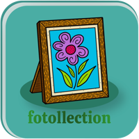
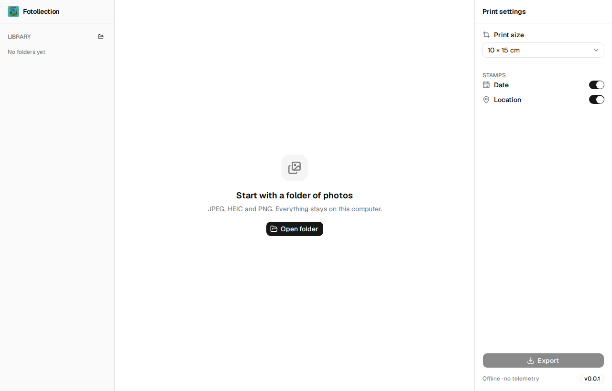
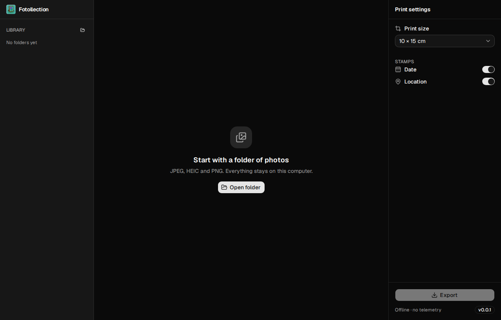
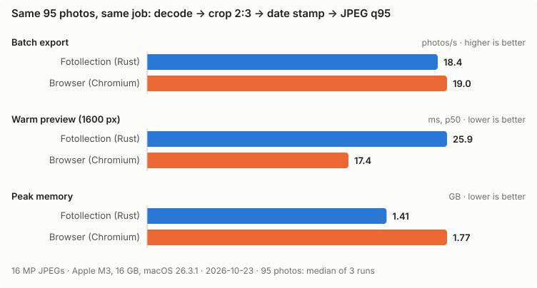

<div align="center">



# Fotollection

**Fast, private, offline photo-print preparation for macOS and Windows.**

Stamp the date and place on your photos, crop them to real print sizes, and get them ready for the lab, all without a single photo leaving your computer.

[](https://github.com/hoangphi01/fotollection/actions/workflows/ci.yml)
[](https://github.com/hoangphi01/fotollection/actions/workflows/docs.yml)
[](LICENSE)
[](docs/STATUS.md)
[](https://github.com/hoangphi01/fotollection/releases)

[](docs/RELEASE.md)
[](rust-toolchain.toml)
[](https://v2.tauri.app/)
[](https://react.dev/)
[](https://ui.shadcn.com/)
[](docs/SECURITY.md#5-privacy)

[](https://github.com/hoangphi01/fotollection/stargazers)
[](https://github.com/hoangphi01/fotollection/commits/main)
[](https://github.com/hoangphi01/fotollection/issues)
[](https://github.com/hoangphi01/fotollection)

</div>

---

> [!NOTE]
> **Fotollection is in early development.** The first working slice handles **JPEG** end to end: import → preview with crop and date stamp → export. HEIC, place names, culling and more are on the way. Follow progress in [docs/STATUS.md](docs/STATUS.md) and [docs/ROADMAP.md](docs/ROADMAP.md).

<p align="center">
  
  
</p>

## Why Fotollection?

You shot 800 photos on a trip and want twenty of them on paper. Getting there today is tedious:

- **Prints don't say when or where.** In a few years, nobody remembers.
- **Labs auto-crop your photos** to 2:3, 3:4 or 1:1, and that can cut off heads.
- **Online tools upload your photos.** GPS data reveals where you live.

Fotollection does all of this **locally**, at the speed of native Rust.

## Features

| | Feature | Phase |
|---|---------|-------|
| 📅 | **Date and location stamps** from EXIF. Places are resolved offline, with no API calls | MVP |
| ✂️ | **Batch crop** to 8 EU print sizes (9×13 … 20×30, square, strip), with an adjustable frame per photo | MVP |
| 🖼️ | **Original quality**: full resolution, ICC profile preserved, lossless crop when possible | MVP |
| 📱 | **JPEG, HEIC (iPhone) and PNG** input | MVP |
| 🔒 | **GPS stripped on export** by default. No account, no cloud, no telemetry | MVP |
| 🧳 | **Trip grouping**, face-aware smart crop, duplicate detection | 2 |
| 🎞️ | RAW input, photo-book preview, QR codes on the back of prints | 3 |

Full specification: [docs/PRD.md](docs/PRD.md).

## Performance

Fotollection is built for enthusiast and professional photographers, so speed is a requirement, not a nice-to-have.

We measured it against the obvious alternative, a web app doing the same work in the browser (`createImageBitmap` + `OffscreenCanvas` in Web Workers, one per core). Both ran on the same 95 photos on the same machine:



On raw speed, the browser is just as fast. Chromium uses libjpeg-turbo with SIMD, and it wins on small previews. That does not mean Fotollection could be a web page:

- The browser can only encode JPEG with 4:2:0 chroma, which halves colour resolution. Fotollection exports 4:4:4, with twice the chroma data, in the same time.
- Fotollection uses 20% less memory, and its export is bounded, so 5,000 photos fit in the same RAM. A browser tab has a hard ceiling.
- Fotollection writes the files: atomic renames, EXIF kept and GPS stripped. The browser only produced blobs and never wrote them.
- Colour profiles (ICC), 16-bit RAW in Phase 3, and HEIC are out of reach in the browser.

Faster previews are now a tracked optimization. Reproduce the chart with `bench/run.sh <photo-folder>`; the method is in [docs/OPTIMIZATION.md §2](docs/OPTIMIZATION.md#2-why-native-rust-instead-of-a-web-app).

The budgets every change must respect ([docs/OPTIMIZATION.md §3](docs/OPTIMIZATION.md#3-budgets)):

| Metric | Budget |
|--------|--------|
| First thumbnails for a folder of 1,000 photos | **< 1 s** |
| Preview update when changing settings | **< 50 ms** |
| Export throughput (24 MP JPEG, 8 cores) | **≥ 8 photos/s** |
| Peak memory, any batch size | **≤ 2 GB** |

## Download

There are no releases yet. When they arrive, they will be on the [Releases](https://github.com/hoangphi01/fotollection/releases) page.

> [!IMPORTANT]
> Builds are **unsigned** for now ([ADR-0009](docs/adr/0009-unsigned-distribution.md)). On first launch:
>
> - **macOS:** System Settings → Privacy & Security → **Open Anyway**
> - **Windows:** SmartScreen → **More info** → **Run anyway**
>
> Verify each download against `SHA256SUMS.txt` on the release page.

## Build from source

```sh
git clone https://github.com/hoangphi01/fotollection.git
cd fotollection
scripts/bootstrap.sh --install     # macOS / Linux (Windows: scripts\bootstrap.ps1 -Install)
npm run dev                        # start the app
```

Every tool version is pinned: `rust-toolchain.toml`, `.node-version`, `Cargo.lock` and `package-lock.json`. A fresh clone therefore builds the same on any machine. See [docs/DEVELOPMENT.md](docs/DEVELOPMENT.md) for prerequisites, commands and build-disk cleanup (`scripts/clean.sh`).

## Tech stack

| Layer | Technology |
|-------|------------|
| Core (Rust) | libjpeg-turbo, libheif, lcms2, fast_image_resize, rayon. Offline geocoding with GeoNames |
| Shell | [Tauri 2](https://v2.tauri.app/): the system webview, no bundled Chromium |
| UI | React 19, TypeScript, Tailwind CSS 4, [shadcn/ui](https://ui.shadcn.com/), [Lucide](https://lucide.dev/) |
| Typed IPC | [tauri-specta](https://github.com/specta-rs/tauri-specta): TypeScript bindings generated from Rust |

Design: [docs/ARCHITECTURE.md](docs/ARCHITECTURE.md). Decisions: [docs/adr/](docs/adr/README.md).

## Documentation

All docs live in [`docs/`](docs/README.md) and change together with the code ([ADR-0006](docs/adr/0006-docs-as-code.md)).

| Doc | What's inside |
|-----|---------------|
| [PRD](docs/PRD.md) | Requirements (`FR-xxx`, `NFR-xxx`) |
| [Architecture](docs/ARCHITECTURE.md) | Crates, pipeline, IPC contract |
| [Optimization](docs/OPTIMIZATION.md) | Budgets, methodology, benchmark log |
| [Style rules](docs/STYLE_RULE.md) | Rust, TypeScript, UI, git and docs conventions |
| [Security](docs/SECURITY.md) | Threat model, privacy, supply chain |
| [Roadmap](docs/ROADMAP.md) / [Status](docs/STATUS.md) | Phases and progress |

## Contributing

Contributions are welcome. Please read [CONTRIBUTING.md](CONTRIBUTING.md) first:

- Every change traces to a requirement ID.
- Docs are updated in the same PR.
- **Outside contributions require signing a CLA** ([ADR-0008](docs/adr/0008-license-gpl3-with-relicensing-option.md)).

Report security issues through a private [GitHub security advisory](https://github.com/hoangphi01/fotollection/security/advisories/new), not a public issue.

## License

[GPL-3.0-only](LICENSE) © hoangphi01.

### Third-party notices

- JPEG encoding uses [`jpeg-encoder`](https://github.com/vstroebel/jpeg-encoder), which is based in part on the work of the Independent JPEG Group.
- The date stamp uses the [Inter](https://rsms.me/inter/) typeface, under the SIL Open Font License 1.1 (`crates/core/assets/fonts/Inter-OFL.txt`).
- Geographic data from [GeoNames](https://www.geonames.org/) (CC BY 4.0) will be bundled for offline geocoding.
