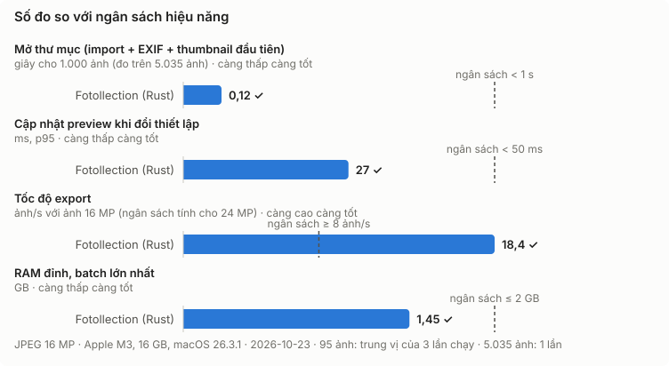
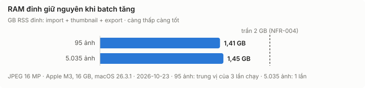
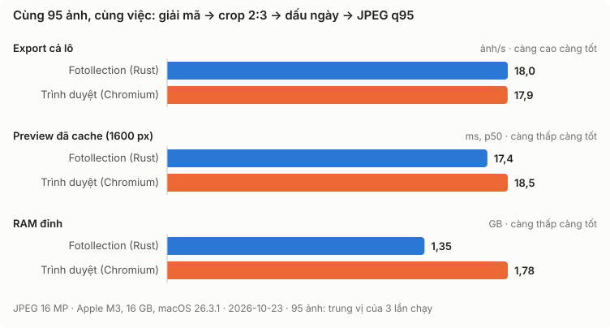
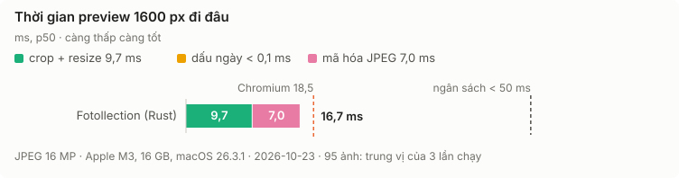
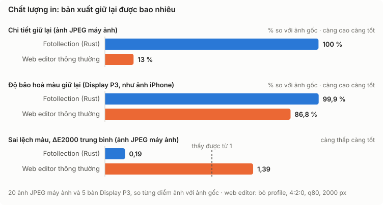
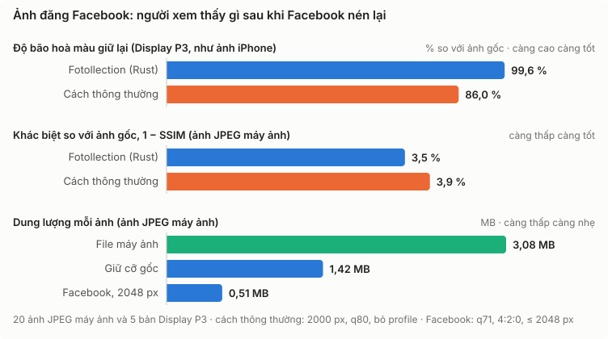
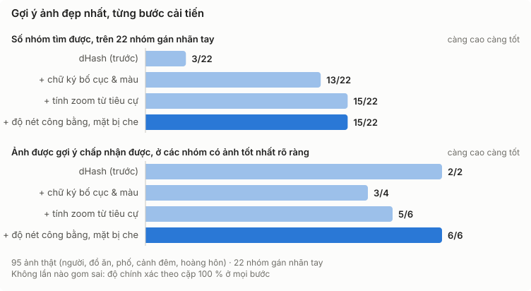

<!-- Bản tiếng Việt của README.md. Sửa README.md thì sửa file này trong cùng commit (docs/STYLE_RULE.md §6). -->
<div align="center">


# Fotollection

by [@hoangphi01](https://github.com/hoangphi01)

[EN](README.md) · **Tiếng Việt** · [Trang giới thiệu](https://fotollection.org/vi/)

**Chuẩn bị ảnh để in: nhanh, riêng tư, chạy offline trên macOS và Windows.**

In ngày và nơi chụp lên ảnh, crop đúng khổ in thật, rồi gửi đi tiệm in, mà không có tấm ảnh nào rời khỏi máy của bạn.

[](https://github.com/hoangphi01/fotollection/actions/workflows/ci.yml)
[](https://github.com/hoangphi01/fotollection/actions/workflows/docs.yml)
[](LICENSE)
[](docs/STATUS.md)
[](https://github.com/hoangphi01/fotollection/releases)

[](docs/RELEASE.md)
[](rust-toolchain.toml)
[](https://v2.tauri.app/)
[](https://react.dev/)
[](https://ui.shadcn.com/)
[](docs/SECURITY.md#5-privacy)

[](https://github.com/hoangphi01/fotollection/stargazers)
[](https://github.com/hoangphi01/fotollection/commits/main)
[](https://github.com/hoangphi01/fotollection/issues)
[](https://github.com/hoangphi01/fotollection)

</div>

---

> [!NOTE]
> **Fotollection đang trong giai đoạn phát triển sớm.** Ứng dụng đã chạy trọn vẹn với **JPEG, PNG, HEIC và ảnh RAW**: nhập ảnh → lọc ảnh bằng sao và cờ → xem trước với crop, dấu ngày và khung thông tin → export. Dự án được lưu thành một file `.fotollection`, mở trên máy khác vẫn y như cũ. Tên địa điểm offline và gợi ý ảnh tốt nhất đang được làm. Theo dõi tiến độ ở [docs/STATUS.md](docs/STATUS.md) và [docs/ROADMAP.md](docs/ROADMAP.md) (tiếng Anh).

<p align="center">
  
  
</p>

## Vì sao có Fotollection?

Bạn chụp 800 tấm trong một chuyến đi và muốn in ra hai mươi tấm. Hiện nay việc đó rất mất công:

- **Ảnh in không ghi khi nào, ở đâu.** Vài năm sau chẳng ai còn nhớ.
- **Tiệm in tự crop ảnh** về 2:3, 3:4 hay 1:1, và có thể cắt mất đầu người.
- **Công cụ online bắt tải ảnh lên.** Dữ liệu GPS để lộ nơi bạn sống.

Fotollection làm tất cả những việc đó **ngay trên máy bạn**, với tốc độ của Rust native.

## Tính năng

| | Tính năng | Giai đoạn |
|---|---------|-------|
| 📅 | **Dấu ngày và nơi chụp** lấy từ EXIF, dùng được font OTF/TTF của riêng bạn. Địa điểm tra offline, không gọi API nào | MVP |
| ✂️ | **Crop hàng loạt** theo 8 khổ in châu Âu (9×13 … 20×30, vuông, dải), khổ của riêng bạn (ví dụ 4 × 6 in) hoặc giữ **tỉ lệ gốc** của ảnh, chỉnh được khung crop từng ảnh | MVP |
| ⭐ | **Lọc ảnh**: chấm sao, cờ chọn/loại và bộ lọc; export đúng tập ảnh đang lọc | MVP |
| ✨ | **Gợi ý ảnh đẹp nhất**: gom các ảnh chụp liên tiếp và gần giống nhau, gợi ý ảnh đẹp nhất mỗi nhóm (nét nhất, mắt mở, không rung) kèm lý do. Chạy hoàn toàn offline | MVP |
| 🏷️ | **Khung thông tin "Shot on …"** với máy ảnh, ống kính và thông số phơi sáng, kiểu LUMIX Lab, đúng tỉ lệ khổ in | MVP |
| 🖼️ | **Giữ nguyên chất lượng**: độ phân giải đầy đủ, giữ ICC profile, crop không mất chất lượng khi có thể | MVP |
| 💬 | **Đăng mạng xã hội**: JPEG sRGB nhẹ ở kích thước gốc, 2048 px cho Facebook, 1080 px cho Instagram hoặc cỡ tuỳ chọn, giữ thông số máy và ghi "Fotollection" là app chỉnh ảnh, không bao giờ có GPS. Export một ảnh ngay trong preview | MVP |
| 📱 | Đầu vào **JPEG, PNG và HEIC** (iPhone) | MVP |
| 📷 | **Ảnh RAW** nguyên dạng, không cần DNG: RW2, CR2, CR3, NEF, ARW, RAF, ORF và DNG, qua codec có sẵn của hệ điều hành; ảnh thu nhỏ lấy từ bản xem trước trong mỗi tệp. **Windows: hiện vẫn cần cài Raw Image Extension miễn phí** (bộ đọc tích hợp sẵn đang được làm) | 3 |
| 🖱️ | **Mở ảnh bằng Fotollection** từ Finder hoặc Explorer: ảnh mở ngay, thư mục của ảnh thành một tab | 2 |
| ⏱️ | **Đồng hồ máy ảnh**: máy để sai giờ được chỉnh theo một ảnh điện thoại chụp cùng lúc; mọi ảnh của máy đó dịch theo, tệp ảnh không bị sửa | 2 |
| ⭐ | **Sao từ Lightroom**: số sao và cờ loại mà Lightroom, Bridge, Capture One hay darktable lưu trong tệp XMP đi kèm được nhập cùng ảnh; tệp XMP không bao giờ bị sửa | 2 |
| 🧭 | **Vị trí từ điện thoại**: ảnh máy ảnh không có GPS lấy vị trí từ ảnh điện thoại chụp cùng cảnh cách vài phút; cặp chắc chắn được điền ngay, cặp còn lại hiện cạnh nhau để bạn duyệt | 2 |
| 📍 | **Đặt ngày và nơi bằng tay**: gán ngày và nơi chụp cho ảnh scan, ảnh không có EXIF hay GPS, từng ảnh hoặc nhiều ảnh một lúc, tìm địa điểm offline; đổi tên một nơi ("Praha 1" → "Prague") thì mọi bản in đổi theo | 2 |
| 🎥 | **Chụp từ máy ảnh cắm dây**: xem trực tiếp với khung cỡ in, bấm Chụp, ảnh vào một tab để lưu hoặc xóa; không cần cài driver (Windows, Sony a6400 trước) | MVP |
| 🔒 | **Xóa GPS khi export** theo mặc định. Không tài khoản, không cloud, không telemetry | MVP |
| 🌐 | Giao diện **tiếng Anh và tiếng Việt** | MVP |
| 📦 | **File dự án như `.docx`**: lưu lại, mở trên máy khác với đúng font, logo và thiết lập, chỉ lại thư mục ảnh đã bị chuyển | MVP |
| 🧳 | **Gom ảnh theo chuyến đi**, crop thông minh theo khuôn mặt, phát hiện ảnh trùng | 2 |
| 🎞️ | Xem trước photobook, mã QR ở mặt sau ảnh in | 3 |

Đặc tả đầy đủ: [docs/PRD.md](docs/PRD.md) (tiếng Anh).

## Hiệu năng

Fotollection dành cho người chụp ảnh nghiêm túc và nhiếp ảnh gia, nên tốc độ là yêu cầu bắt buộc, không phải thứ có thì tốt. **Mọi con số dưới đây đều đo thật, không phải ước tính**, trên Apple M3 (8 nhân, 16 GB) với ảnh JPEG 16 MP thật, ngày 23/10/2026. Mỗi biểu đồ có một mốc tham chiếu để so: ngân sách hiệu năng, trần RAM, hoặc trình duyệt. Kết quả đầy đủ: [docs/RESULT.md](docs/RESULT.md) (tiếng Anh).

### So với ngân sách



| Việc | Ngân sách | Đo được | |
|------|--------|----------|---|
| Mở thư mục (import + EXIF + thumbnail đầu tiên) | < 1 giây cho 1.000 ảnh | **0,12 giây** cho 1.000 ảnh (5.035 ảnh trong 0,62 giây) | ✓ |
| Cập nhật preview khi đổi thiết lập | < 50 ms (p95) | **18 ms** p95, 17 ms p50 | ✓ |
| Tốc độ export | ≥ 8 ảnh/s với ảnh 24 MP | **18,0 ảnh/s** với ảnh 16 MP | ✓ |
| RAM đỉnh | ≤ 2 GB với batch bất kỳ | **1,45 GB** với 5.035 ảnh | ✓ |
| Phân tích ảnh đẹp nhất, mỗi ảnh (24/10/2026) | ≤ 20 ms, ≤ 40 ms khi có mặt người | **17 ms**, 28 ms khi có mặt người | ✓ |

### Batch lớn

RAM không được tăng theo số ảnh. Batch lớn gấp 53 lần chỉ tốn thêm 0,1 GB ở mức đỉnh:



| Số ảnh | RAM đỉnh | Export | Thư viện trong RAM |
|-------:|------------:|-------:|------------------:|
| 95 | 1,35 GB | 18,0 ảnh/s | — |
| 5.035 | 1,45 GB | 15,4 ảnh/s | 13 MB |

Lần export 5.035 ảnh chạy hơn 5 phút, và M3 tự giảm xung khi tải nặng kéo dài, nên tốc độ thấp hơn.

### So với trình duyệt

Phương án thay thế dễ thấy nhất là một web app làm đúng việc đó trong trình duyệt (`createImageBitmap` + `OffscreenCanvas`, mỗi nhân CPU một Web Worker). Cả hai chạy trên cùng 95 ảnh, cùng một máy:



| | Fotollection (Rust) | Trình duyệt (Chromium 156) | |
|---|---:|---:|---|
| Export cả lô | 18,0 ảnh/s | 17,9 ảnh/s | Gần như bằng nhau |
| Preview đã cache, 1600 px (p50) | 17,4 ms | 18,5 ms | Fotollection nhanh hơn |
| RAM đỉnh | 1,35 GB | 1,78 GB | Fotollection thấp hơn 24 % |

Về tốc độ export thô, trình duyệt nhanh ngang ngửa vì Chromium dùng libjpeg-turbo có SIMD. Giờ Fotollection đã preview nhanh hơn. Tuy vậy, tốc độ không phải lý do chính để làm app native:

- Trình duyệt chỉ mã hóa JPEG được ở chế độ màu 4:2:0, tức một nửa độ phân giải màu. Fotollection export 4:4:4, gấp đôi dữ liệu màu, trong cùng thời gian.
- Fotollection dùng ít hơn 24 % RAM, và việc export có giới hạn RAM, như bài thử batch lớn cho thấy. Một tab trình duyệt thì có trần cứng.
- Fotollection ghi file ra đĩa với rename nguyên tử và không ghi EXIF, nên GPS không bao giờ rời khỏi máy bạn. Trình duyệt chỉ tạo blob trong RAM và không ghi file nào.
- ICC profile, RAW 16-bit ở Phase 3, và HEIC nằm ngoài khả năng của trình duyệt.

### Thời gian preview đi đâu



| Bước | Thời gian | Tỉ lệ |
|------|-----:|------:|
| Crop + resize | 9,7 ms | 58 % |
| Dấu ngày | < 0,1 ms | ≈ 0 % |
| Mã hóa JPEG | 7,0 ms | 42 % |
| **Tổng** | **16,7 ms** | ngân sách 50 ms · Chromium 18,5 ms |

Trước đây bộ mã hóa là nút thắt: 16,2 ms, chiếm 62 % của 26 ms. Preview chỉ để xem trên màn hình, nên giờ được mã hóa ở chế độ màu 4:2:0 với bảng Huffman thường. Phóng to 3× vẫn nhìn giống hệt. Ảnh export vẫn giữ 4:4:4 và bảng Huffman tối ưu. Chỉ một thay đổi đó đã đưa preview từ 26 ms xuống 17 ms.

### Chất lượng in: bản xuất có giữ nguyên ảnh không?

Nhanh mà bản in bị nông màu thì cũng vô nghĩa. Ảnh in qua web editor thường trông nông, màu bị bệt và mất chiều sâu so với ảnh gốc. Vì vậy bản xuất của Fotollection được so từng điểm ảnh với ảnh gốc (`bench/quality/audit.py`), đặt cạnh bản xuất của một web editor thông thường.



| Đo so với ảnh gốc (trung vị) | Fotollection | Web editor thông thường |
|------|-----:|-----:|
| Sai lệch màu, ΔE2000 trung bình (ảnh JPEG máy ảnh; từ 1 trở lên là mắt thấy được) | **0,19** | 1,39 |
| Sai lệch màu, phân vị 95 | **1,06** | 3,50 |
| Chi tiết nhỏ giữ lại (ảnh JPEG máy ảnh) | **100 %** | 13 % |
| Độ bão hoà màu giữ lại (ảnh Display P3, như ảnh iPhone) | **99,9 %** | 86,8 % |
| Độ tương phản và số mức sáng tối giữ lại | 100 % | 100 % |
| Độ trung thực điểm ảnh (PSNR) | **52,6 dB** | 37,9 dB |
| Giữ colour profile (ICC) | 20 / 20 | bị bỏ |

Vì sao in qua web editor trông nông màu, và Fotollection làm khác thế nào:

- **Colour profile bị bỏ.** Ảnh điện thoại dùng Display P3, dải màu rộng hơn sRGB. Mất profile, tiệm in đọc màu như sRGB, nên ảnh in ra nhạt hơn khoảng 13 %. Fotollection giữ nguyên ICC profile của ảnh trong mọi bản xuất.
- **Ảnh bị thu nhỏ rồi phóng to lại.** Ảnh 2000 px in khổ 10 × 15 cm mất 87 % chi tiết nhỏ, nên bề mặt bị mịn đi và màu trông bệt. Fotollection xuất ở độ phân giải đầy đủ, và chỉ resize, bằng bộ lọc Lanczos3, khi khổ in cần.
- **Màu bị giảm một nửa và nén mạnh hơn.** Các web editor phổ biến dùng lấy mẫu màu 4:2:0, tức giảm một nửa độ phân giải màu, ở chất lượng 80. Fotollection xuất 4:4:4 ở chất lượng 95.

Bài kiểm tra dùng 20 ảnh từ máy Canon compact, cộng thêm 5 ảnh trong số đó được chuyển sang Display P3 bằng profile có sẵn của macOS. Web editor được mô phỏng theo cài đặt phổ biến (coi là sRGB, bỏ profile, 4:2:0, q80, 2000 px, phóng to lại khi in). Đo lại bằng `cargo run --release -p fotollection-core --example quality_export -- <thư-mục-xuất> <ảnh…>`, rồi `uv run bench/quality/audit.py <thư-mục-ảnh> <thư-mục-xuất>`.

### Ảnh đăng mạng xã hội

Kiểu xuất *Mạng xã hội* tạo file sRGB nhẹ, giữ thông số máy, đúng cỡ từng nền tảng. Đo trên cùng bộ ảnh, rồi nén lại như Facebook làm ([RESULT.md §10](docs/RESULT.md#10-photos-for-social-media), tiếng Anh):



| Trung vị | Giữ cỡ gốc | Facebook, 2048 px |
|------|-----:|-----:|
| Dung lượng (ảnh JPEG máy ảnh, 3,08 MB) | 1,42 MB | 0,51 MB |
| Độ giống ảnh gốc (SSIM, 1 = giống hệt) | 0,981 | 0,979 |
| Sai lệch màu, ΔE2000 trung bình | 0,96 | 1,27 |
| Sau khi Facebook nén: màu ảnh Display P3 giữ lại, so với cách thông thường | — | **99,6 %** so với 86 % |

### Gợi ý ảnh đẹp nhất chính xác đến đâu?

Với tính năng gợi ý nên giữ ảnh nào, nhanh thôi chưa đủ, nên gợi ý ảnh đẹp nhất còn được chấm điểm độ chính xác. 95 ảnh thật (người, đồ ăn, phố, cảnh đêm, hoàng hôn) được gán nhãn bằng tay: 22 nhóm ảnh chụp cùng một khoảnh khắc, và ở 6 nhóm có ghi rõ ảnh nên giữ. `eval_bestshot` so các nhóm và lựa chọn của app với các nhãn đó.



| Bước | Nhóm tìm được (trên 22) | Cặp tìm được | Nhóm sai | Lựa chọn chấp nhận được |
|------|-----:|-----:|-----:|-----:|
| dHash (trước) | 3 | 9 % | 0 | 2/2 |
| + chữ ký bố cục và màu | 13 | 67 % | 0 | 3/4 |
| + tính zoom từ tiêu cự | 15 | 73 % | 0 | 5/6 |
| + độ nét công bằng, mặt bị che | **15** | **73 %** | **0** | **6/6** |

- **dHash** (mã băm 64 bit theo bậc độ sáng) bị lật bit lung tung ở vùng phẳng như bầu trời. Hai ảnh khách sạn gần như y hệt bị coi là khác nhau chẳng kém hai cảnh không liên quan. Nó được thay bằng chữ ký bố cục 32 × 24, so bằng tương quan có cho phép xê dịch và zoom nhẹ, cộng với histogram màu để tách các cảnh khác nhau nhưng bố cục giống nhau.
- **Chụp lại gần hơn là chuyện thường**, ví dụ zoom 5 → 9,9 mm khi chụp nhà thờ ban đêm. Zoom không còn tách nhóm nữa: tiêu cự trong EXIF cho biết ảnh sau gần hơn bao nhiêu lần.
- **So sánh công bằng.** Trước đây ảnh có khuôn mặt quay đi bị so độ nét cả ảnh với độ nét vùng mắt của ảnh kia. Giờ mọi ảnh trong nhóm được đo cùng một cách, và ảnh có khuôn mặt bị quay đi hoặc che khuất bị trừ điểm.
- **Vẫn còn sót:** 7 nhóm có tư thế hoặc khung hình đổi nhiều, ví dụ chụp lại pizza từ phía bên kia hay selfie bị lộn ngược. Các trường hợp đó cần model hiểu nội dung ảnh, là bước tiếp theo. 2 nhóm "thừa" app tạo ra là các cặp đã được gán nhãn mơ hồ, không phải lỗi.

Phân tích vẫn nằm trong ngân sách: 17,4 ms mỗi ảnh, 27,6 ms khi có mặt người ([NFR-014](docs/PRD.md#nfr-014--best-shot-analysis-speed)). Nhãn chỉ chứa tên file vì ảnh là ảnh riêng tư: hãy gán nhãn thư mục của bạn theo cùng định dạng (`bench/bestshot/truth-103_09.json`) để chấm điểm.

Đo lại tất cả bằng `bench/run.sh <thư-mục-ảnh>` và `bench/batch.sh <thư-mục-ảnh>`; chấm điểm gợi ý ảnh đẹp nhất bằng `cargo run --release -p fotollection-core --example eval_bestshot -- <thư-mục-ảnh> <nhãn.json>`. Phương pháp đo ở [docs/OPTIMIZATION.md §2](docs/OPTIMIZATION.md#2-why-native-rust-instead-of-a-web-app), và các ngân sách mà mọi thay đổi phải tuân theo ở [§3](docs/OPTIMIZATION.md#3-budgets) (tiếng Anh).

## Tải về

Tải phiên bản mới nhất ở [trang giới thiệu](https://fotollection.org/vi/) hoặc trang [Releases](https://github.com/hoangphi01/fotollection/releases/latest): file `.dmg` cho macOS 11+ (Apple Silicon và Intel), file `-setup.exe` hoặc `.msi` cho Windows 10/11. Số phiên bản theo [Semantic Versioning](docs/RELEASE.md#1-versioning); các bản 0.x là bản xem trước cho tới khi xong MVP. App không tự kiểm tra cập nhật, nên hãy xem ở đây khi muốn bản mới; cài đè lên bản cũ vẫn giữ nguyên thiết lập và dự án của bạn.

> [!IMPORTANT]
> Các bản build hiện **chưa được ký số** ([ADR-0009](docs/adr/0009-unsigned-distribution.md)). Lần mở đầu tiên:
>
> - **macOS:** System Settings → Privacy & Security → **Open Anyway**
> - **Windows:** SmartScreen → **More info** → **Run anyway**
>
> Kiểm tra từng file tải về với `SHA256SUMS.txt` trên trang phát hành. Xem [chính sách ký mã và quyền riêng tư](https://fotollection.org/vi/code-signing/).

### Cấu hình yêu cầu

| | Tối thiểu | Khuyến nghị | Ghi chú |
|---|---|---|---|
| **Hệ điều hành** | macOS 11 Big Sur, hoặc Windows 10 64-bit | macOS 13 trở lên, hoặc Windows 11 | Máy Mac Apple Silicon và Intel. Windows dùng WebView2, có sẵn trên Windows 11 và tự cài trên Windows 10 |
| **Bộ xử lý** | CPU 64-bit bất kỳ trong khoảng 8 năm gần đây | Apple Silicon, hoặc x64 đời mới từ 4 nhân | Công việc được chia cho mọi nhân. Mọi số liệu trong [Hiệu năng](#hiệu-năng) đo trên Apple M3 |
| **RAM** | 4 GB | Từ 8 GB | Fotollection luôn dưới 2 GB kể cả với hơn 5.000 ảnh (đo được đỉnh 1,45 GB, [NFR-004](docs/PRD.md#nfr-004--memory-ceiling)) |
| **Ổ đĩa** | Trống 100 MB, cộng phần cache | Trống 1 GB | App được giữ dưới 25 MB ([NFR-008](docs/PRD.md#nfr-008--install-size)). Cache tốn khoảng 25 MB cho 1.000 ảnh (thumbnail khoảng 22 KB, phân tích ảnh đẹp nhất khoảng 4 KB mỗi ảnh) và xoá lúc nào cũng được. File export cần chỗ cho ảnh độ phân giải đầy đủ |
| **Màn hình** | 1280 × 800 | 1920 × 1080 hoặc màn Retina | Thanh công cụ tự co khi cửa sổ hẹp |
| **Internet** | Không cần | — | Mọi thứ chạy offline, kể cả nhận diện khuôn mặt, địa điểm và preview. Không có gì được tải lên |
| **HEIC (ảnh iPhone)** | macOS: có sẵn | — | Windows: cài **HEIF Image Extensions** và **HEVC Video Extensions** từ Microsoft Store ([ADR-0017](docs/adr/0017-heic-through-os-codecs.md)) |
| **Ảnh RAW** | macOS: có sẵn | — | Windows: cài **Raw Image Extension** miễn phí từ Microsoft Store ([ADR-0023](docs/adr/0023-raw-through-os-codecs.md)) |

Để build từ mã nguồn, bạn cần thêm khoảng 10 GB trống cho file build Rust (một bản debug và một bản release; `scripts/clean.sh` dọn lại được), Rust (cài qua `rustup`, phiên bản ghim trong `rust-toolchain.toml`), Node.js 22 trở lên, và Xcode Command Line Tools (macOS) hoặc MSVC Build Tools (Windows). Danh sách đầy đủ ở [docs/DEVELOPMENT.md §1.3](docs/DEVELOPMENT.md#13-prerequisites) (tiếng Anh).

## Build từ mã nguồn

```sh
git clone https://github.com/hoangphi01/fotollection.git
cd fotollection
scripts/bootstrap.sh --install     # macOS / Linux (Windows: scripts\bootstrap.ps1 -Install)
npm run dev                        # chạy app
```

Mọi phiên bản công cụ đều được ghim: `rust-toolchain.toml`, `.node-version`, `Cargo.lock`, `package-lock.json` và, với các công cụ Python quản lý bằng uv, `uv.lock`. Nhờ vậy một bản clone mới build ra giống hệt nhau trên mọi máy. Xem [docs/DEVELOPMENT.md](docs/DEVELOPMENT.md) (tiếng Anh) để biết yêu cầu, các lệnh và cách dọn dung lượng build (`scripts/clean.sh`).

## Công nghệ

| Lớp | Công nghệ |
|-------|------------|
| Lõi (Rust) | Codec thuần Rust: zune-jpeg, jpeg-encoder, png ([ADR-0012](docs/adr/0012-pure-rust-codecs-first.md)); HEIC và ảnh RAW qua hệ điều hành (ImageIO / WIC, [ADR-0017](docs/adr/0017-heic-through-os-codecs.md), [ADR-0023](docs/adr/0023-raw-through-os-codecs.md)); fast_image_resize, ab_glyph, rayon; GeoNames cho địa điểm offline ([ADR-0003](docs/adr/0003-offline-geocoding-geonames.md)). Dự kiến: lcms2 cho màu |
| Vỏ app | [Tauri 2](https://v2.tauri.app/): dùng webview của hệ điều hành, không kèm Chromium |
| Giao diện | React 19, TypeScript, Tailwind CSS 4, [shadcn/ui](https://ui.shadcn.com/), [Lucide](https://lucide.dev/) |
| IPC có kiểu | [tauri-specta](https://github.com/specta-rs/tauri-specta): binding TypeScript sinh ra từ Rust |

Thiết kế: [docs/ARCHITECTURE.md](docs/ARCHITECTURE.md). Các quyết định: [docs/adr/](docs/adr/README.md) (tiếng Anh).

## Tài liệu

Toàn bộ tài liệu nằm trong [`docs/`](docs/README.md), viết bằng tiếng Anh, và thay đổi cùng với code ([ADR-0006](docs/adr/0006-docs-as-code.md)).

| Tài liệu | Nội dung |
|-----|---------------|
| [PRD](docs/PRD.md) | Yêu cầu (`FR-xxx`, `NFR-xxx`) |
| [Architecture](docs/ARCHITECTURE.md) | Crate, pipeline, hợp đồng IPC |
| [Results](docs/RESULT.md) | Số đo tốc độ và RAM mới nhất |
| [Optimization](docs/OPTIMIZATION.md) | Ngân sách, phương pháp đo, nhật ký benchmark |
| [File formats](docs/EXTENSION.md) | `.fotollection`, `.fotopreset` và mọi loại file khác |
| [Style rules](docs/STYLE_RULE.md) | Quy ước Rust, TypeScript, UI, git và tài liệu |
| [Security](docs/SECURITY.md) | Mô hình mối đe dọa, quyền riêng tư, chuỗi cung ứng |
| [Roadmap](docs/ROADMAP.md) / [Status](docs/STATUS.md) | Các giai đoạn và tiến độ |

## Đóng góp

Rất hoan nghênh đóng góp. Vui lòng đọc [CONTRIBUTING.md](CONTRIBUTING.md) (tiếng Anh) trước:

- Mỗi thay đổi đều gắn với một mã yêu cầu.
- Tài liệu được cập nhật trong cùng PR.
- **Đóng góp từ bên ngoài cần ký CLA** ([ADR-0008](docs/adr/0008-license-gpl3-with-relicensing-option.md)).

Báo lỗi bảo mật qua [GitHub security advisory](https://github.com/hoangphi01/fotollection/security/advisories/new) riêng tư, không mở issue công khai.

## Giấy phép

[GPL-3.0-only](LICENSE) © hoangphi01.

### Ghi nhận bên thứ ba

- Mã hóa JPEG dùng [`jpeg-encoder`](https://github.com/vstroebel/jpeg-encoder), một phần dựa trên công trình của Independent JPEG Group.
- Chữ in trong ảnh dùng font [DSEG14 Classic](https://github.com/keshikan/DSEG) Italic của keshikan, khung thông tin dùng [Inter](https://rsms.me/inter/); cả hai theo giấy phép SIL Open Font License 1.1 (`crates/core/assets/fonts/`). Giao diện dùng [Geist và Geist Mono](https://vercel.com/font) (OFL 1.1), đóng gói sẵn để hiển thị giống nhau trên Windows và macOS.
- Tên địa điểm lấy từ [GeoNames](https://www.geonames.org/) (CC BY 4.0), đóng gói sẵn để tra offline: các thị trấn và thành phố từ 1.000 dân, bản chụp ngày 24/10/2026 (`crates/core/assets/geo/`).
- **Nhãn hiệu.** Logo các hãng máy ảnh trong khung thông tin (Apple, Canon, Fujifilm, Hasselblad, Leica, Lumix, Nikon, Noritsu, Phase One, Ricoh, Samsung, Sony) là nhãn hiệu của chủ sở hữu. Đây là các bản public domain trên Wikimedia Commons ([danh sách và nguồn](crates/core/assets/brands/BRANDS.md)), chỉ dùng để cho biết ảnh được chụp (hoặc scan phim) bằng máy nào. Fotollection không liên kết, không được tài trợ hay bảo trợ bởi các công ty này, và sẽ gỡ logo khi được yêu cầu.
- Ảnh RAW trên Windows (và trên macOS với những tệp ImageIO không đọc được), trừ các định dạng đã chuyển sang trình đọc riêng của Fotollection (hiện là DNG, [ADR-0030](docs/adr/0030-our-own-raw-decoder.md)), được giải mã bằng [rawler](https://github.com/dnglab/dnglab) của Daniel Vogelbacher và cộng sự, theo giấy phép GNU Lesser General Public License 2.1 ([ADR-0029](docs/adr/0029-raw-through-rawler-then-our-own-decoder.md)). Toàn bộ mã nguồn Fotollection được công bố, nên có thể xây dựng lại với một bản rawler đã sửa.
- Gợi ý ảnh tốt nhất đóng gói model phát hiện khuôn mặt [YuNet](https://github.com/opencv/opencv_zoo/tree/main/models/face_detection_yunet) (MIT, © 2020 Shiqi Yu) và model điểm mốc MediaPipe FaceMesh V2 của Google (Apache License 2.0), đã chuyển sang ONNX. License và checksum: `crates/core/assets/models/`.
