<!-- Bản tiếng Việt của README.md. Sửa README.md thì sửa file này trong cùng commit (docs/STYLE_RULE.md §6). -->
<div align="center">

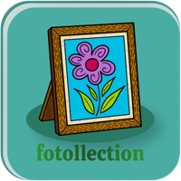

# Fotollection

by [@hoangphi01](https://github.com/hoangphi01)

[EN](README.md) · **Tiếng Việt** · [Trang giới thiệu](https://fotollection.org/vi/)

**Chuẩn bị ảnh để in: nhanh, riêng tư, chạy offline trên macOS, Windows và Linux.**

In ngày và nơi chụp lên ảnh, crop đúng khổ in thật, rồi gửi đi tiệm in, mà không có tấm ảnh nào rời khỏi máy của bạn.

[](https://github.com/hoangphi01/fotollection/actions/workflows/ci.yml)
[](https://github.com/hoangphi01/fotollection/actions/workflows/docs.yml)
[](LICENSE)
[](docs/STATUS.md)
[](https://github.com/hoangphi01/fotollection/releases)

[](docs/RELEASE.md)
[](rust-toolchain.toml)
[](https://v2.tauri.app/)
[](https://react.dev/)
[](https://ui.shadcn.com/)
[](docs/SECURITY.md#5-privacy)

[](https://github.com/hoangphi01/fotollection/stargazers)
[](https://github.com/hoangphi01/fotollection/commits/main)
[](https://github.com/hoangphi01/fotollection/issues)
[](https://github.com/hoangphi01/fotollection)

</div>

---

> [!NOTE]
> **Fotollection đang được phát triển tích cực (0.x), vài ngày lại có bản mới.** Ứng dụng đã chạy trọn vẹn trên macOS, Windows và Linux, với **JPEG, PNG, HEIC và ảnh RAW**, ở ba chế độ: **Đơn giản** (giữ hay bỏ, rồi in), **Ghép ảnh** (hai ảnh trên một tấm in, hoặc bưu thiếp) và **Pro** (sao, cờ, ảnh tốt nhất, crop, dấu ngày, khung thông tin), chế độ nào cũng có **look** một chạm. Dự án được lưu thành một file `.fotollection`, mở trên máy khác vẫn y như cũ, và một file `.fotosettings` mang thiết lập của bạn sang máy khác. Theo dõi tiến độ ở [docs/STATUS.md](docs/STATUS.md) và [docs/ROADMAP.md](docs/ROADMAP.md) (tiếng Anh); [trang hướng dẫn](https://fotollection.org/vi/manual/) chỉ từng bước.

<p align="center">
  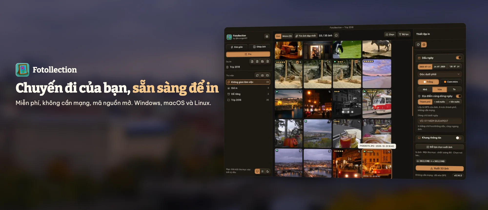
</p>

<p align="center">
  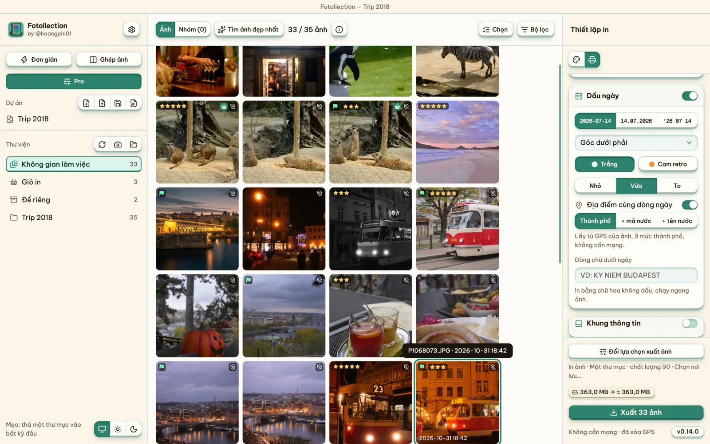
  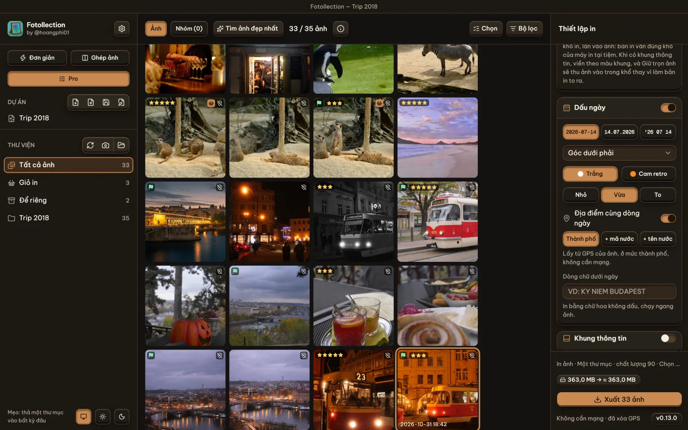
</p>

Có trên [VNLF App Explorer](https://apps.vietnamlinuxfamily.net/app/fotollection) và trong App Center của [CaramOS](https://github.com/VN-Linux-Family/CaramOS), bản phân phối Linux dành cho người Việt.

## Vì sao có Fotollection?

Bạn chụp 800 tấm trong một chuyến đi và muốn in ra hai mươi tấm. Hiện nay việc đó rất mất công:

- **Ảnh in không ghi khi nào, ở đâu.** Vài năm sau chẳng ai còn nhớ.
- **Tiệm in tự crop ảnh** về 2:3, 3:4 hay 1:1, và có thể cắt mất đầu người.
- **Công cụ online bắt tải ảnh lên.** Dữ liệu GPS để lộ nơi bạn sống.

Fotollection làm tất cả những việc đó **ngay trên máy bạn**, với tốc độ của Rust native.

## Tính năng

| | Tính năng | Giai đoạn |
|---|---------|-------|
| 📅 | **Dấu ngày và nơi chụp** lấy từ EXIF, bằng kiểu chữ LCD như máy ảnh phim. Địa điểm tra offline, không gọi API nào | 1 |
| ✂️ | **Crop hàng loạt** theo 11 khổ in châu Âu (9×13 … 20×30, vuông, dải), khổ của riêng bạn (ví dụ 4 × 6 in) hoặc giữ **tỉ lệ gốc** của ảnh, chỉnh được khung crop từng ảnh | 1 |
| 🎚️ | **Ba chế độ** (mới trong v0.9.0): **Đơn giản**, từng ảnh một, ↑ giữ, ↓ bỏ, rồi xuất; **Ghép ảnh**, hai ảnh trên một tấm in như máy half-frame (một tấm 10 × 15 chứa hai ảnh 10 × 7,5), có cỡ gợi ý, đường cắt và kéo-thả để đổi thứ tự; **Pro**, đủ mọi điều khiển | 1 |
| ✉️ | **Bưu thiếp** (mới trong v0.9.4): trong chế độ Ghép ảnh, mỗi tấm 10 × 15 có một ảnh và mặt sau bưu thiếp, ô dán tem nét đứt và dòng kẻ, chữ gõ bằng font máy đánh chữ hoặc font viết tay, hay tự viết tay, một địa chỉ cho cả bộ | 1 |
| 🌈 | **Look** (mới trong v0.14.0): một chạm là ảnh có màu, tám look của Fotollection hiện ngay trên ảnh của bạn, có chỉnh **Mức độ**; **Lưu thành look** giữ màu của riêng bạn; dải look dưới ảnh ở mọi chế độ, và ở chế độ Đơn giản một phím số chọn một look | 2 |
| 🎛️ | **Preset Lightroom và LUT** (mới trong v0.14.0): preset `.xmp`, `.lrtemplate`, `.zip` và LUT `.cube`, HaldCLUT hay LUMIX Lab của bạn thành look, đọc bằng Rust; **Color Mixer** như bảng HSL của Lightroom, **Khử sương**, và áp một look cho nhiều ảnh cùng lúc từ lưới ảnh | 2 |
| 💾 | **Cài đặt → Dữ liệu** (mới trong v0.14.0): chuyển sang máy khác bằng một file `.fotosettings`, xem Fotollection giữ gì trên máy này, đặt lại cài đặt hoặc xóa dữ liệu | 2 |
| 🎨 | **Chỉnh màu** (mới trong v0.9.9): **Cơ bản** (sáng, tương phản, ấm / lạnh, bão hoà, thêm vùng sáng, vùng tối, tint, rực màu) và **Công cụ** (fade, nhuộm vùng tối và vùng sáng, trắng đen qua kính lọc), cho mọi ảnh hoặc từng ảnh; dấu ngày và viền không bao giờ bị nhuộm, ảnh chưa chỉnh gì in ra như trước | 2 |
| 📊 | **Đọc ảnh** (mới trong v0.13.1): biểu đồ màu phía trên Điều hướng, thay đổi theo thanh trượt, **J** để thấy vùng mất chi tiết trên ảnh, **W** để cân bằng trắng từ một điểm xám; và **sao chép, dán, đặt lại thiết lập** cho một ảnh hay mọi ảnh đã chọn, mỗi lần là một bước hoàn tác | 1 |
| 🔲 | **Viền 3 mm** nằm trong khổ in cho mọi tấm in, có hay không có khung thông tin (mới trong v0.9.0) | 2 |
| ⭐ | **Lọc ảnh**: chấm sao, cờ chọn/loại và bộ lọc (cờ, sao, RAW hay không), ảnh RAW có badge trong gallery, dải ảnh dưới tấm ảnh trong preview, và chế độ chỉnh ảnh quen thuộc với người dùng Lightroom (phím tắt, so sánh trước/sau cạnh nhau hoặc chia đôi, Điều hướng và Lịch sử, phủ kín cửa sổ); export đúng tập ảnh đang lọc | 1 |
| ✨ | **Gợi ý ảnh đẹp nhất**: gom các ảnh chụp liên tiếp và gần giống nhau, gợi ý ảnh đẹp nhất mỗi nhóm (nét nhất, mắt mở, không rung) kèm lý do. Chạy hoàn toàn offline *Giữ ảnh tốt nhất* giữ tấm đẹp nhất trong Không gian làm việc và chuyển các tấm khác sang Để riêng (v0.13.1). | 1 |
| 🏷️ | **Khung thông tin "Shot on …"** với máy ảnh, ống kính và thông số phơi sáng, kiểu LUMIX Lab, đúng tỉ lệ khổ in | 1 |
| 🖼️ | **Giữ nguyên chất lượng**: export ở độ phân giải đầy đủ, giữ ICC profile, JPEG 4:4:4 cho ảnh in | 1 |
| 💬 | **Đăng mạng xã hội**: JPEG sRGB nhẹ ở kích thước gốc, 2048 px cho Facebook, 1080 px cho Instagram hoặc cỡ tuỳ chọn, có thể giữ trọn ảnh trong khung vuông hay tỷ lệ bất kỳ kèm nền, giữ thông số máy và ghi "Fotollection" là app chỉnh ảnh, không bao giờ có GPS. Export một ảnh ngay trong preview | 2 |
| 📱 | Đầu vào **JPEG, PNG và HEIC** (iPhone) | 1 |
| 📷 | **Ảnh RAW** nguyên dạng, không cần DNG: RW2, CR2, CR3, NEF, ARW, RAF, ORF và DNG, xử lý bằng bộ xử lý của riêng Fotollection (demosaic sạch hơn, màu trung tính hoặc màu của máy chỉ với một cú nhấp, độ sáng, vùng sáng, vùng tối và cân bằng trắng chỉnh trên chính dữ liệu của máy ảnh, màu của bầu trời bị cháy sáng được dựng lại); trên macOS, Panasonic và Olympus do hệ điều hành xử lý, có hiệu chỉnh ống kính; ảnh thu nhỏ lấy từ bản xem trước trong mỗi tệp. Trên Windows không cần cài gì thêm | 3 |
| 🖱️ | **Mở ảnh bằng Fotollection** từ Finder hoặc Explorer: ảnh mở ngay, thư mục của ảnh thành một tab | 2 |
| ⏱️ | **Đồng hồ máy ảnh**: máy để sai giờ được chỉnh theo một ảnh điện thoại chụp cùng lúc; mọi ảnh của máy đó dịch theo, tệp ảnh không bị sửa | 1 |
| ⭐ | **Sao từ Lightroom**: số sao và cờ loại mà Lightroom, Bridge, Capture One hay darktable lưu trong tệp XMP đi kèm được nhập cùng ảnh; tệp XMP không bao giờ bị sửa | 2 |
| 🧭 | **Vị trí từ điện thoại**: ảnh máy ảnh không có GPS lấy vị trí từ ảnh điện thoại chụp cùng cảnh cách vài phút; cặp chắc chắn được điền ngay, cặp còn lại hiện cạnh nhau để bạn duyệt | 2 |
| 📍 | **Đặt ngày và nơi bằng tay**: gán ngày và nơi chụp cho ảnh scan, ảnh không có EXIF hay GPS, từng ảnh hoặc nhiều ảnh một lúc, tìm địa điểm offline; đổi tên một nơi ("Praha 1" → "Prague") thì mọi bản in đổi theo | 1 |
| 🎥 | **Chụp từ máy ảnh cắm dây**: xem trực tiếp với khung cỡ in, bấm Chụp, ảnh vào một tab để lưu hoặc xóa; không cần cài driver (Windows, Sony a6400 trước) | 2 |
| 🔒 | **Xóa GPS khi export** theo mặc định. Không tài khoản, không cloud, không telemetry | 1 |
| 🌐 | Giao diện **tiếng Anh, tiếng Đức, tiếng Hung, tiếng Việt, tiếng Nhật và tiếng Hàn**, theo ngôn ngữ của máy ở lần chạy đầu | 1 |
| 📦 | **File dự án như `.docx`**: lưu lại, mở trên máy khác với đúng font, logo và thiết lập, chỉ lại thư mục ảnh đã bị chuyển | 1 |
| 🧳 | **Gom ảnh theo chuyến đi**, crop thông minh theo khuôn mặt, phát hiện ảnh trùng | 2 |
| 🎞️ | Xem trước photobook, mã QR ở mặt sau ảnh in | 3 |

Đặc tả đầy đủ: [docs/PRD.md](docs/PRD.md) (tiếng Anh).

## Hiệu năng

Fotollection dành cho người chụp ảnh nghiêm túc và nhiếp ảnh gia, nên tốc độ là yêu cầu bắt buộc, không phải thứ có thì tốt. **Mọi con số dưới đây đều đo thật, không phải ước tính**, trên Apple M3 (8 nhân, 16 GB) với ảnh JPEG 16 MP thật, ngày 23/10/2026. Mỗi biểu đồ có một mốc tham chiếu để so: ngân sách hiệu năng, trần RAM, hoặc trình duyệt. Kết quả đầy đủ: [docs/RESULT.md](docs/RESULT.md) (tiếng Anh).

### So với ngân sách

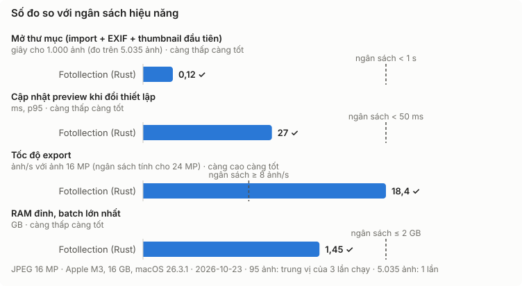

| Việc | Ngân sách | Đo được | |
|------|--------|----------|---|
| Mở thư mục (import + EXIF + thumbnail đầu tiên) | < 1 giây cho 1.000 ảnh | **0,12 giây** cho 1.000 ảnh (5.035 ảnh trong 0,62 giây) | ✓ |
| Cập nhật preview khi đổi thiết lập | < 50 ms (p95) | **18 ms** p95, 17 ms p50 | ✓ |
| Tốc độ export | ≥ 8 ảnh/s với ảnh 24 MP | **18,0 ảnh/s** với ảnh 16 MP | ✓ |
| RAM đỉnh | ≤ 2 GB với batch bất kỳ | **1,45 GB** với 5.035 ảnh | ✓ |
| Phân tích ảnh đẹp nhất, mỗi ảnh (24/10/2026) | ≤ 20 ms, ≤ 40 ms khi có mặt người | **17 ms**, 28 ms khi có mặt người | ✓ |

Với một chuyến đi thật (một thư mục ảnh 20 MP từ Lumix GX9, 422 tệp), ngày 03/11/2026 export chỉ đạt 7,6 ảnh/s với RAM đỉnh 2,14 GB. Bản sửa trong v0.9.7 export phần JPEG ở 10,1 ảnh/s, và cả lượt chạy dùng RAM tối đa 1,31 GB, nằm trong cả hai ngân sách ([RESULT.md §20](docs/RESULT.md#20-a-real-trip-prague-gx9)).

### Mở một tấm ảnh

Từ v0.11.0, bản xem trước của mọi ảnh được chuẩn bị sẵn ở chế độ nền và giữ trên đĩa, nên mở ảnh nào cũng hiện ngay, kể cả RAW ([FR-091](docs/PRD.md#fr-091--instant-previews-standard-previews-on-disk-and-memory-used-well)). Trên 422 ảnh của một chuyến đi, mỗi phiên bản đo trên chính mã nguồn của nó:

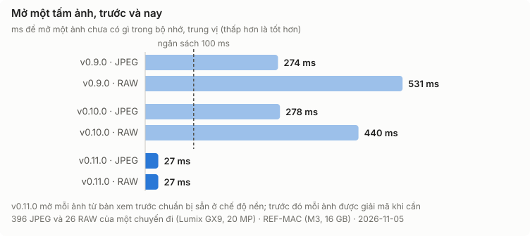

### Batch lớn

RAM không được tăng theo số ảnh. Batch lớn gấp 53 lần chỉ tốn thêm 0,1 GB ở mức đỉnh:

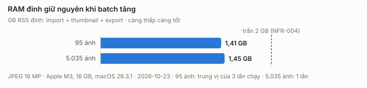

| Số ảnh | RAM đỉnh | Export | Thư viện trong RAM |
|-------:|------------:|-------:|------------------:|
| 95 | 1,35 GB | 18,0 ảnh/s | — |
| 5.035 | 1,45 GB | 15,4 ảnh/s | 13 MB |

Lần export 5.035 ảnh chạy hơn 5 phút, và M3 tự giảm xung khi tải nặng kéo dài, nên tốc độ thấp hơn.

### So với trình duyệt

Phương án thay thế dễ thấy nhất là một web app làm đúng việc đó trong trình duyệt (`createImageBitmap` + `OffscreenCanvas`, mỗi nhân CPU một Web Worker). Cả hai chạy trên cùng 95 ảnh, cùng một máy:

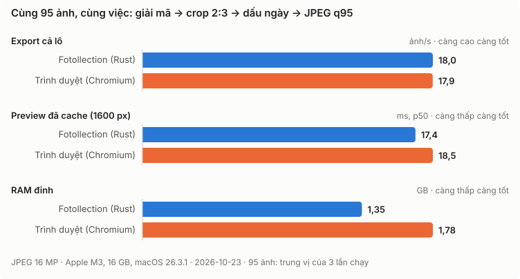

| | Fotollection (Rust) | Trình duyệt (Chromium 156) | |
|---|---:|---:|---|
| Export cả lô | 18,0 ảnh/s | 17,9 ảnh/s | Gần như bằng nhau |
| Preview đã cache, 1600 px (p50) | 17,4 ms | 18,5 ms | Fotollection nhanh hơn |
| RAM đỉnh | 1,35 GB | 1,78 GB | Fotollection thấp hơn 24 % |

Về tốc độ export thô, trình duyệt nhanh ngang ngửa vì Chromium dùng libjpeg-turbo có SIMD. Giờ Fotollection đã preview nhanh hơn. Tuy vậy, tốc độ không phải lý do chính để làm app native:

- Trình duyệt chỉ mã hóa JPEG được ở chế độ màu 4:2:0, tức một nửa độ phân giải màu. Fotollection export ảnh in ở 4:4:4, gấp đôi dữ liệu màu, trong cùng thời gian.
- Fotollection dùng ít hơn 24 % RAM, và việc export có giới hạn RAM, như bài thử batch lớn cho thấy. Một tab trình duyệt thì có trần cứng.
- Fotollection ghi file ra đĩa với rename nguyên tử và không ghi EXIF, nên GPS không bao giờ rời khỏi máy bạn. Trình duyệt chỉ tạo blob trong RAM và không ghi file nào.
- ICC profile, RAW 16-bit ở Phase 3, và HEIC nằm ngoài khả năng của trình duyệt.

### Thời gian preview đi đâu

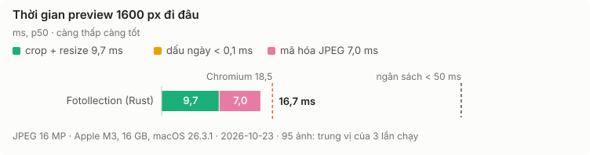

| Bước | Thời gian | Tỉ lệ |
|------|-----:|------:|
| Crop + resize | 9,7 ms | 58 % |
| Dấu ngày | < 0,1 ms | ≈ 0 % |
| Mã hóa JPEG | 7,0 ms | 42 % |
| **Tổng** | **16,7 ms** | ngân sách 50 ms · Chromium 18,5 ms |

Trước đây bộ mã hóa là nút thắt: 16,2 ms, chiếm 62 % của 26 ms. Preview chỉ để xem trên màn hình, nên giờ được mã hóa ở chế độ màu 4:2:0 với bảng Huffman thường. Phóng to 3× vẫn nhìn giống hệt. Ảnh export để in vẫn giữ 4:4:4. Chỉ một thay đổi đó đã đưa preview từ 26 ms xuống 17 ms.

### Card đồ hoạ khi chỉnh ảnh, mọi nhân CPU khi xuất

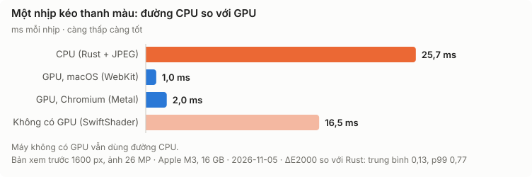

Khi kéo một thanh chỉnh màu, card đồ hoạ vẽ look từ đúng bảng màu Rust dựng, nên mỗi nhịp chỉ tốn 1–2 ms thay vì khoảng 26 ms, và ảnh chạy theo thanh trượt; dấu ngày, khung và viền được giữ nguyên, rồi Rust dựng lại bản chính xác khi thả tay (ΔE2000 so với nó: trung bình 0,13, p99 0,77). Máy không có GPU đủ mạnh vẫn dùng đường CPU; app tự quyết. Xuất ảnh vẫn chạy trên bộ xử lý, để ảnh in giống hệt nhau trên mọi máy ([ADR-0039](docs/adr/0039-gpu-for-editing-cpu-for-exports.md)).

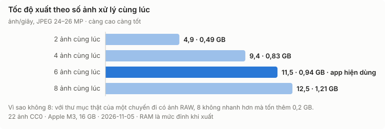

Mỗi ảnh được giải mã và mã hoá trên một nhân, nên tốc độ đi theo số ảnh xử lý cùng lúc, trong hạn mức RAM. App chọn sáu: với thư mục thật của một chuyến đi có ảnh RAW, tám không nhanh hơn mà tốn thêm 0,2 GB.

### Chất lượng in: bản xuất có giữ nguyên ảnh không?

Nhanh mà bản in bị nông màu thì cũng vô nghĩa. Ảnh in qua web editor thường trông nông, màu bị bệt và mất chiều sâu so với ảnh gốc. Vì vậy bản xuất của Fotollection được so từng điểm ảnh với ảnh gốc (`bench/quality/audit.py`), đặt cạnh bản xuất của một web editor thông thường.

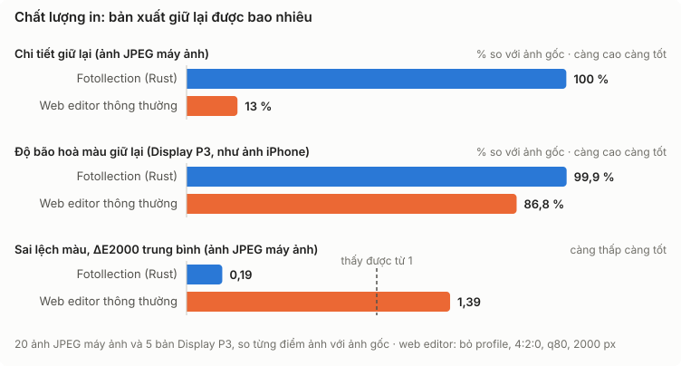

| Đo so với ảnh gốc (trung vị) | Fotollection | Web editor thông thường |
|------|-----:|-----:|
| Sai lệch màu, ΔE2000 trung bình (ảnh JPEG máy ảnh; từ 1 trở lên là mắt thấy được) | **0,19** | 1,39 |
| Sai lệch màu, phân vị 95 | **1,06** | 3,50 |
| Chi tiết nhỏ giữ lại (ảnh JPEG máy ảnh) | **100 %** | 13 % |
| Độ bão hoà màu giữ lại (ảnh Display P3, như ảnh iPhone) | **99,9 %** | 86,8 % |
| Độ tương phản và số mức sáng tối giữ lại | 100 % | 100 % |
| Độ trung thực điểm ảnh (PSNR) | **52,6 dB** | 37,9 dB |
| Giữ colour profile (ICC) | 20 / 20 | bị bỏ |

Vì sao in qua web editor trông nông màu, và Fotollection làm khác thế nào:

- **Colour profile bị bỏ.** Ảnh điện thoại dùng Display P3, dải màu rộng hơn sRGB. Mất profile, tiệm in đọc màu như sRGB, nên ảnh in ra nhạt hơn khoảng 13 %. Fotollection giữ nguyên ICC profile của ảnh trong mọi bản xuất.
- **Ảnh bị thu nhỏ rồi phóng to lại.** Ảnh 2000 px in khổ 10 × 15 cm mất 87 % chi tiết nhỏ, nên bề mặt bị mịn đi và màu trông bệt. Fotollection xuất ở độ phân giải đầy đủ, và chỉ resize, bằng bộ lọc Lanczos3, khi khổ in cần.
- **Màu bị giảm một nửa và nén mạnh hơn.** Các web editor phổ biến dùng lấy mẫu màu 4:2:0, tức giảm một nửa độ phân giải màu, ở chất lượng 80. Fotollection xuất ảnh in ở 4:4:4, chất lượng mặc định 90, chỉnh được tới 100.

Bài kiểm tra dùng 20 ảnh từ máy Canon compact, cộng thêm 5 ảnh trong số đó được chuyển sang Display P3 bằng profile có sẵn của macOS. Web editor được mô phỏng theo cài đặt phổ biến (coi là sRGB, bỏ profile, 4:2:0, q80, 2000 px, phóng to lại khi in). Đo lại bằng `cargo run --release -p fotollection-core --example quality_export -- <thư-mục-xuất> <ảnh…>`, rồi `uv run bench/quality/audit.py <thư-mục-ảnh> <thư-mục-xuất>`.

### Ảnh đăng mạng xã hội

Kiểu xuất *Mạng xã hội* tạo file sRGB nhẹ, giữ thông số máy, đúng cỡ từng nền tảng. Đo trên cùng bộ ảnh, rồi nén lại như Facebook làm ([RESULT.md §10](docs/RESULT.md#10-photos-for-social-media), tiếng Anh):

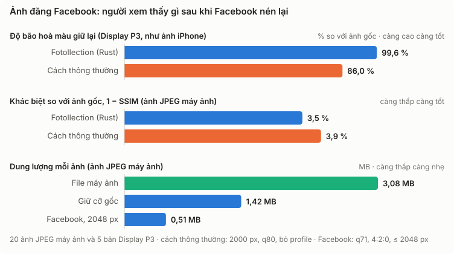

| Trung vị | Giữ cỡ gốc | Facebook, 2048 px |
|------|-----:|-----:|
| Dung lượng (ảnh JPEG máy ảnh, 3,08 MB) | 1,42 MB | 0,51 MB |
| Độ giống ảnh gốc (SSIM, 1 = giống hệt) | 0,981 | 0,979 |
| Sai lệch màu, ΔE2000 trung bình | 0,96 | 1,27 |
| Sau khi Facebook nén: màu ảnh Display P3 giữ lại, so với cách thông thường | — | **99,6 %** so với 86 % |

### Gợi ý ảnh đẹp nhất chính xác đến đâu?

Với tính năng gợi ý nên giữ ảnh nào, nhanh thôi chưa đủ, nên gợi ý ảnh đẹp nhất còn được chấm điểm độ chính xác. 95 ảnh thật (người, đồ ăn, phố, cảnh đêm, hoàng hôn) được gán nhãn bằng tay: 22 nhóm ảnh chụp cùng một khoảnh khắc, và ở 6 nhóm có ghi rõ ảnh nên giữ. `eval_bestshot` so các nhóm và lựa chọn của app với các nhãn đó.

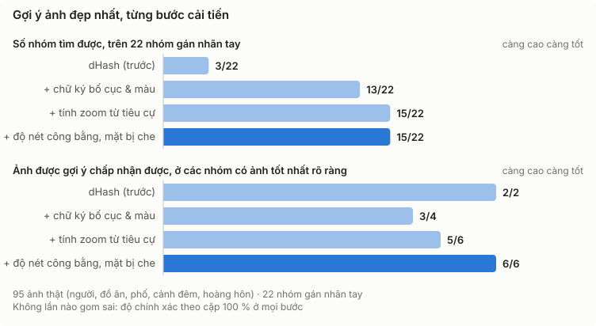

| Bước | Nhóm tìm được (trên 22) | Cặp tìm được | Nhóm sai | Lựa chọn chấp nhận được |
|------|-----:|-----:|-----:|-----:|
| dHash (trước) | 3 | 9 % | 0 | 2/2 |
| + chữ ký bố cục và màu | 13 | 67 % | 0 | 3/4 |
| + tính zoom từ tiêu cự | 15 | 73 % | 0 | 5/6 |
| + độ nét công bằng, mặt bị che | **15** | **73 %** | **0** | **6/6** |

- **dHash** (mã băm 64 bit theo bậc độ sáng) bị lật bit lung tung ở vùng phẳng như bầu trời. Hai ảnh khách sạn gần như y hệt bị coi là khác nhau chẳng kém hai cảnh không liên quan. Nó được thay bằng chữ ký bố cục 32 × 24, so bằng tương quan có cho phép xê dịch và zoom nhẹ, cộng với histogram màu để tách các cảnh khác nhau nhưng bố cục giống nhau.
- **Chụp lại gần hơn là chuyện thường**, ví dụ zoom 5 → 9,9 mm khi chụp nhà thờ ban đêm. Zoom không còn tách nhóm nữa: tiêu cự trong EXIF cho biết ảnh sau gần hơn bao nhiêu lần.
- **So sánh công bằng.** Trước đây ảnh có khuôn mặt quay đi bị so độ nét cả ảnh với độ nét vùng mắt của ảnh kia. Giờ mọi ảnh trong nhóm được đo cùng một cách, và ảnh có khuôn mặt bị quay đi hoặc che khuất bị trừ điểm.
- **Vẫn còn sót:** 7 nhóm có tư thế hoặc khung hình đổi nhiều, ví dụ chụp lại pizza từ phía bên kia hay selfie bị lộn ngược. Các trường hợp đó cần model hiểu nội dung ảnh, là bước tiếp theo. 2 nhóm "thừa" app tạo ra là các cặp đã được gán nhãn mơ hồ, không phải lỗi.

Phân tích vẫn nằm trong ngân sách: 17,4 ms mỗi ảnh, 27,6 ms khi có mặt người ([NFR-014](docs/PRD.md#nfr-014--best-shot-analysis-speed)). Nhãn chỉ chứa tên file vì ảnh là ảnh riêng tư: hãy gán nhãn thư mục của bạn theo cùng định dạng (`bench/bestshot/truth-103_09.json`) để chấm điểm.

Đo lại tất cả bằng `bench/run.sh <thư-mục-ảnh>` và `bench/batch.sh <thư-mục-ảnh>`; chấm điểm gợi ý ảnh đẹp nhất bằng `cargo run --release -p fotollection-core --example eval_bestshot -- <thư-mục-ảnh> <nhãn.json>`. Phương pháp đo ở [docs/OPTIMIZATION.md §2](docs/OPTIMIZATION.md#2-why-native-rust-instead-of-a-web-app), và các ngân sách mà mọi thay đổi phải tuân theo ở [§3](docs/OPTIMIZATION.md#3-budgets) (tiếng Anh).

## Tải về

Tải phiên bản mới nhất ở [trang Tải về](https://fotollection.org/vi/download/) hoặc trang [Releases](https://github.com/hoangphi01/fotollection/releases/latest): file `.dmg` cho macOS 11+ (Apple Silicon và Intel), file `-setup.exe` hoặc `.msi` cho Windows 10/11, và AppImage hoặc `.deb` cho Linux 64-bit ([những distro nào](#linux)). Số phiên bản theo [Semantic Versioning](docs/RELEASE.md#1-versioning); các bản 0.x là bản xem trước cho tới khi xong MVP. Lúc khởi động, app hỏi GitHub một lần xem có bản mới không (tắt được trong Cài đặt → Cập nhật, FR-103) và không bao giờ tự tải gì về. Cài đè lên bản cũ vẫn giữ nguyên thiết lập và dự án của bạn.

> [!IMPORTANT]
> Các bản build hiện **chưa được ký số** ([ADR-0009](docs/adr/0009-unsigned-distribution.md)). Lần mở đầu tiên:
>
> - **macOS:** System Settings → Privacy & Security → **Open Anyway**
> - **Windows:** SmartScreen → **More info** → **Run anyway**
> - **Linux:** không cần bấm gì thêm; cho AppImage quyền chạy, hoặc cài file `.deb` (bên dưới)
>
> Kiểm tra từng file tải về với `SHA256SUMS.txt` trên trang phát hành. Xem [chính sách ký mã và quyền riêng tư](https://fotollection.org/vi/code-signing/).

### Theo hệ điều hành

Cùng một app trên mọi hệ điều hành, với các khác biệt sau ([ADR-0034](docs/adr/0034-linux-lean.md)):

| | macOS | Windows | Linux |
|---|:-:|:-:|:-:|
| Lọc ảnh, sao, cờ, ảnh đẹp nhất, giỏ in | ✓ | ✓ | ✓ |
| Khổ in, cắt, cân ngang, phóng to, dấu ngày, khung thông tin | ✓ | ✓ | ✓ |
| Địa điểm offline, ngày và nơi chụp đặt tay, đồng hồ máy ảnh | ✓ | ✓ | ✓ |
| Xuất để in và để đăng mạng xã hội | ✓ | ✓ | ✓ |
| Look, preset Lightroom và LUT | ✓ | ✓ | ✓ |
| JPEG và PNG | ✓ | ✓ | ✓ |
| Ảnh RAW | ✓ ¹ | ✓ | ✓ |
| HEIC (ảnh iPhone) | ✓ | ✓ ² | chưa có ³ |
| Chụp qua cáp USB từ máy ảnh | chưa có | ✓ ⁴ | — |
| "Mở bằng" từ trình quản lý file | ✓ | ✓ | ✓ ⁵ |
| *Kiểm tra cập nhật* tải bản mới | ✓ | ✓ | ✓ ⁶ |

1. Mọi hệ điều hành đều xử lý RAW bằng bộ xử lý của riêng Fotollection; trên macOS, ảnh RAW Panasonic và Olympus do hệ điều hành xử lý trước để được sửa méo ống kính, việc bộ xử lý của Fotollection chưa làm. Trên Windows, Raw Image Extension của Microsoft, nếu đã cài, chỉ là phương án dự phòng cuối cùng.
2. Cần cài miễn phí **HEIF Image Extensions** và **HEVC Video Extensions** của Microsoft.
3. HEIC cần bộ giải mã HEVC, thứ Linux không có sẵn và Fotollection không đóng gói kèm (vì bằng sáng chế). Bản sau sẽ dùng `libheif` mà distro của bạn cài (FR-068). Trước đó, hãy chuyển ảnh HEIC sang JPEG.
4. Sony a6400 trước ([FR-063](docs/PRD.md#fr-063--tethered-capture-over-usb)).
5. Với bản `.deb`. AppImage không tự đăng ký với trình quản lý file, trừ khi dùng công cụ như AppImageLauncher.
6. AppImage tải AppImage mới; bản `.deb` mở trang phát hành.

### Linux

**Chạy được** trên Linux 64-bit có glibc 2.35 trở lên, x86_64 hoặc ARM64:

- **AppImage:** Ubuntu 22.04+, Debian 12+, Linux Mint 21+, Pop!_OS 22.04+, elementary OS 7+, Zorin OS 17+, Fedora 36+, openSUSE Tumbleweed, Arch, Manjaro và các distro cùng thời.
- **`.deb`:** Ubuntu, Debian, Mint, Pop!_OS, elementary OS và Zorin OS.

**Chạy được, cần thêm một bước:**

- **Ubuntu 24.04 trở lên:** AppImage cần FUSE 2, cài một lần: `sudo apt install libfuse2t64`. Cũng có thể chạy với `--appimage-extract-and-run`.
- **NixOS:** `appimage-run Fotollection_*.AppImage`.
- **Fedora Silverblue và các hệ bất biến khác:** dùng AppImage.
- **Card đồ hoạ Nvidia:** Fotollection tự tắt bộ dựng DMA-BUF của WebKit, tránh lỗi cửa sổ trắng.

**Không chạy** trên:

- glibc cũ hơn 2.35: Ubuntu 20.04, Debian 11, RHEL, CentOS, Rocky hoặc Alma 8, openSUSE Leap 15;
- hệ dùng musl như Alpine;
- máy 32-bit;
- ChromeOS khi chưa bật Linux.

**Cài đặt:**

```sh
# Một dòng cho mọi distro ở trên: kho APT có ký trên Ubuntu, Debian, Mint và họ hàng
# (cập nhật sau đó bằng sudo apt upgrade), AppImage trong ~/.local ở các distro khác
curl -fsSL https://fotollection.org/install.sh | sh

# Hoặc tự thêm kho APT
curl -fsSL https://fotollection.org/apt/fotollection.gpg | sudo tee /usr/share/keyrings/fotollection.gpg > /dev/null
echo "deb [signed-by=/usr/share/keyrings/fotollection.gpg] https://fotollection.org/apt stable main" | sudo tee /etc/apt/sources.list.d/fotollection.list
sudo apt update && sudo apt install fotollection

# AppImage (các distro trên), x86_64; máy ARM dùng file _aarch64
chmod +x Fotollection_*_amd64.AppImage && ./Fotollection_*_amd64.AppImage

# .deb (Ubuntu, Debian, Mint…), trong thư mục đã tải về; máy ARM dùng _arm64.deb
sudo apt install ./Fotollection_*_amd64.deb
```

### Cấu hình yêu cầu

| | Tối thiểu | Khuyến nghị | Ghi chú |
|---|---|---|---|
| **Hệ điều hành** | macOS 11 Big Sur, Windows 10 64-bit, hoặc Linux 64-bit có glibc 2.35 ([những distro nào](#linux)) | macOS 13 trở lên, Windows 11, hoặc Ubuntu 24.04 | Máy Mac Apple Silicon và Intel. Windows dùng WebView2, có sẵn trên Windows 11 và tự cài trên Windows 10. Linux dùng WebKitGTK 4.1, có sẵn trong AppImage và được cài kèm bản `.deb` |
| **Bộ xử lý** | CPU 64-bit bất kỳ trong khoảng 8 năm gần đây | Apple Silicon, hoặc x64 đời mới từ 4 nhân | Công việc được chia cho mọi nhân. Mọi số liệu trong [Hiệu năng](#hiệu-năng) đo trên Apple M3 |
| **RAM** | 4 GB | Từ 8 GB | Khi xuất ảnh, Fotollection luôn dưới 2 GB kể cả với hơn 5.000 ảnh (đo được đỉnh 1,45 GB, [NFR-004](docs/PRD.md#nfr-004--memory-ceiling)). Từ v0.11.0, bản xem trước giữ tối đa một phần tư bộ nhớ để ảnh mở ngay ([FR-091](docs/PRD.md#fr-091--instant-previews-standard-previews-on-disk-and-memory-used-well)) |
| **Ổ đĩa** | Trống 100 MB, cộng phần cache | Trống 1 GB | App được giữ dưới 25 MB ([NFR-008](docs/PRD.md#nfr-008--install-size)). Cache tốn khoảng 25 MB cho 1.000 ảnh (thumbnail khoảng 22 KB, phân tích ảnh đẹp nhất khoảng 4 KB mỗi ảnh) và xoá lúc nào cũng được. File export cần chỗ cho ảnh độ phân giải đầy đủ |
| **Màn hình** | 1280 × 800 | 1920 × 1080 hoặc màn Retina | Thanh công cụ tự co khi cửa sổ hẹp |
| **Internet** | Không cần | — | Mọi thứ chạy offline, kể cả nhận diện khuôn mặt, địa điểm và preview. Không có gì được tải lên |
| **HEIC (ảnh iPhone)** | macOS: có sẵn | — | Windows: cài **HEIF Image Extensions** và **HEVC Video Extensions** từ Microsoft Store ([ADR-0017](docs/adr/0017-heic-through-os-codecs.md)). Linux: chưa có ([ADR-0034](docs/adr/0034-linux-lean.md)) |
| **Ảnh RAW** | macOS: có sẵn | — | Windows và Linux: có sẵn trong Fotollection, không cần cài gì ([ADR-0029](docs/adr/0029-raw-through-rawler-then-our-own-decoder.md)). Trên Windows, nếu đã cài **Raw Image Extension** của Microsoft, codec của hệ điều hành là phương án dự phòng cuối cùng ([ADR-0023](docs/adr/0023-raw-through-os-codecs.md)) |

Để build từ mã nguồn, bạn cần thêm khoảng 10 GB trống cho file build Rust (một bản debug và một bản release; `scripts/clean.sh` dọn lại được), Rust (cài qua `rustup`, phiên bản ghim trong `rust-toolchain.toml`), Node.js 22 trở lên, và Xcode Command Line Tools (macOS), MSVC Build Tools (Windows), hoặc các gói phát triển WebKitGTK 4.1 và GTK 3 (Linux, như `scripts/bootstrap.sh` cài). Danh sách đầy đủ ở [docs/DEVELOPMENT.md §1.3](docs/DEVELOPMENT.md#13-prerequisites) (tiếng Anh).

## Build từ mã nguồn

```sh
git clone https://github.com/hoangphi01/fotollection.git
cd fotollection
scripts/bootstrap.sh --install     # macOS / Linux (Windows: scripts\bootstrap.ps1 -Install)
npm run dev                        # chạy app
```

Mọi phiên bản công cụ đều được ghim: `rust-toolchain.toml`, `.node-version`, `Cargo.lock`, `package-lock.json` và, với các công cụ Python quản lý bằng uv, `uv.lock`. Nhờ vậy một bản clone mới build ra giống hệt nhau trên mọi máy. Xem [docs/DEVELOPMENT.md](docs/DEVELOPMENT.md) (tiếng Anh) để biết yêu cầu, các lệnh và cách dọn dung lượng build (`scripts/clean.sh`).

## Công nghệ

| Lớp | Công nghệ |
|-------|------------|
| Lõi (Rust) | Codec thuần Rust: zune-jpeg kèm jpeg-decoder cho các cấu trúc JPEG hiếm, jpeg-encoder, png ([ADR-0012](docs/adr/0012-pure-rust-codecs-first.md), [ADR-0033](docs/adr/0033-reference-jpeg-decoder.md)); HEIC qua hệ điều hành (ImageIO / WIC, [ADR-0017](docs/adr/0017-heic-through-os-codecs.md)); ảnh RAW qua bộ đọc riêng của Fotollection và rawler, trên macOS dùng codec của hệ thống trước ([ADR-0029](docs/adr/0029-raw-through-rawler-then-our-own-decoder.md), [ADR-0030](docs/adr/0030-our-own-raw-decoder.md)); quản lý màu bằng qcms ([FR-027](docs/PRD.md#fr-027--srgb-conversion-for-labs)); fast_image_resize, ab_glyph, rayon; GeoNames cho địa điểm offline ([ADR-0003](docs/adr/0003-offline-geocoding-geonames.md)) |
| Vỏ app | [Tauri 2](https://v2.tauri.app/): dùng webview của hệ điều hành, không kèm Chromium |
| Giao diện | React 19, TypeScript, Tailwind CSS 4, [shadcn/ui](https://ui.shadcn.com/), [Lucide](https://lucide.dev/), [react-markdown](https://github.com/remarkjs/react-markdown) cho hướng dẫn trong app |
| IPC có kiểu | [tauri-specta](https://github.com/specta-rs/tauri-specta): binding TypeScript sinh ra từ Rust |

Thiết kế: [docs/ARCHITECTURE.md](docs/ARCHITECTURE.md). Các quyết định: [docs/adr/](docs/adr/README.md) (tiếng Anh).

## Tài liệu

Toàn bộ tài liệu nằm trong [`docs/`](docs/README.md), viết bằng tiếng Anh, và thay đổi cùng với code ([ADR-0006](docs/adr/0006-docs-as-code.md)).

| Tài liệu | Nội dung |
|-----|---------------|
| [PRD](docs/PRD.md) | Yêu cầu (`FR-xxx`, `NFR-xxx`) |
| [Architecture](docs/ARCHITECTURE.md) | Crate, pipeline, hợp đồng IPC |
| [Results](docs/RESULT.md) | Số đo tốc độ và RAM mới nhất |
| [Optimization](docs/OPTIMIZATION.md) | Ngân sách, phương pháp đo, nhật ký benchmark |
| [File formats](docs/EXTENSION.md) | `.fotollection`, `.fotosettings`, `.fotopreset` và mọi loại file khác |
| [Style rules](docs/STYLE_RULE.md) | Quy ước Rust, TypeScript, UI, git và tài liệu |
| [Security](docs/SECURITY.md) | Mô hình mối đe dọa, quyền riêng tư, chuỗi cung ứng |
| [Roadmap](docs/ROADMAP.md) / [Status](docs/STATUS.md) | Các giai đoạn và tiến độ |
| [Hướng dẫn sử dụng](docs/USER_GUIDE.vi.md) | Cách dùng app từng bước, bằng tiếng Việt; cũng là [trang hướng dẫn trên web](https://fotollection.org/vi/manual/) |
| [Error codes](docs/ERROR_CONTROL.md) | Mọi mã `ERR-…` app có thể hiện: nguyên nhân và cách xử lý |
| [Docs guide](docs/DOCS_GUIDE.md) | Cần cập nhật những gì khi có thay đổi |
| [Development](docs/DEVELOPMENT.md) / [Testing](docs/TESTING.md) / [Release](docs/RELEASE.md) | Cài đặt môi trường, kiểm thử, cách phát hành một bản |
| [Lessons](docs/LESSONS.md) | Bài học từ mỗi lần gỡ lỗi |
| [Changelog](CHANGELOG.md) | Những gì thay đổi ở mỗi phiên bản |

## Đóng góp

Rất hoan nghênh đóng góp, của người hay của AI agent. Vui lòng đọc [CONTRIBUTING.md](CONTRIBUTING.md) (tiếng Anh) trước: tệp này giải thích mỗi thông tin nằm ở đâu, cách giữ tài liệu khớp với code, cách đọc và thêm mã lỗi, cách mở issue và pull request. Tóm tắt:

- Mỗi thay đổi đều gắn với một mã yêu cầu (`FR-…`, `NFR-…`), và mã không bao giờ dùng lại.
- Tài liệu được cập nhật trong cùng commit, theo [docs/DOCS_GUIDE.md](docs/DOCS_GUIDE.md).
- Báo lỗi kèm mã `ERR-…` và nội dung *Sao chép thông tin chẩn đoán* của app.
- **Đóng góp từ bên ngoài cần ký CLA** ([ADR-0008](docs/adr/0008-license-gpl3-with-relicensing-option.md)).

Báo lỗi bảo mật qua [GitHub security advisory](https://github.com/hoangphi01/fotollection/security/advisories/new) riêng tư, không mở issue công khai.

## Ủng hộ

Fotollection miễn phí, do một sinh viên làm giữa giờ học và giờ làm thêm. Nếu ứng dụng giúp bạn đỡ thời gian, bạn có thể [tài trợ qua GitHub](https://github.com/sponsors/hoangphi01) hoặc [mời cà phê qua Ko-fi](https://ko-fi.com/hoangphi01), hằng tháng hoặc một lần, hoặc quét mã VietQR trên [trang web](https://fotollection.org/vi/#support).

## Giấy phép

[GPL-3.0-only](LICENSE) © hoangphi01.

### Ghi nhận bên thứ ba

- Phần kiểm thử giao diện (`scripts/ui-check.sh`, không bao giờ đi kèm bản cài) dùng [axe-core](https://github.com/dequelabs/axe-core) của Deque Systems theo Mozilla Public License 2.0, chỉ là công cụ khi phát triển ([ADR-0042](docs/adr/0042-axe-core-for-ui-tests-only.md)).
- Mã hóa JPEG dùng [`jpeg-encoder`](https://github.com/vstroebel/jpeg-encoder), một phần dựa trên công trình của Independent JPEG Group.
- Chữ in trong ảnh dùng font [DSEG14 Classic](https://github.com/keshikan/DSEG) Italic của keshikan, khung thông tin dùng [Inter](https://rsms.me/inter/); cả hai theo giấy phép SIL Open Font License 1.1 (`crates/core/assets/fonts/`). Giao diện dùng [Be Vietnam Pro](https://github.com/bettergui/BeVietnamPro) và, cho các con số dạng mono, [Geist Mono](https://vercel.com/font) (cả hai theo OFL 1.1), đóng gói sẵn để hiển thị giống nhau trên Windows, macOS và Linux; tiếng Nhật và tiếng Hàn dùng [Noto Sans JP và KR](https://github.com/notofonts/noto-cjk) (OFL 1.1), cắt theo các ký tự giao diện dùng (`ui/src/assets/fonts/`, `scripts/cjk-font.sh`).
- Mục ủng hộ trên trang web vẽ mã VietQR bằng [qrcode-generator](https://github.com/kazuhikoarase/qrcode-generator) của Kazuhiko Arase, giấy phép MIT (`site/assets/js/qrcode.js`, giữ nguyên bản phát hành). QR Code là nhãn hiệu đã đăng ký của DENSO WAVE INCORPORATED.
- Chữ trên bưu thiếp dùng font [Xanh Mono](https://github.com/yellow-type-foundry/xanhmono) Regular và Italic của Yellow Type Foundry, và [Patrick Hand](https://github.com/google/fonts/tree/main/ofl/patrickhand) của Patrick Wagesreiter, cả hai theo giấy phép SIL Open Font License 1.1 (`crates/core/assets/fonts/`, nguồn và mã kiểm tra trong `FONTS.md`).
- Tên địa điểm lấy từ [GeoNames](https://www.geonames.org/) (CC BY 4.0), đóng gói sẵn để tra offline: các thị trấn và thành phố từ 1.000 dân, bản chụp ngày 24/10/2026 (`crates/core/assets/geo/`).
- **Nhãn hiệu.** Logo các hãng máy ảnh trong khung thông tin (Apple, Canon, Fujifilm, Hasselblad, Leica, Lumix, Nikon, Noritsu, Phase One, Ricoh, Samsung, Sony) là nhãn hiệu của chủ sở hữu. Đây là các bản public domain trên Wikimedia Commons ([danh sách và nguồn](crates/core/assets/brands/BRANDS.md)), chỉ dùng để cho biết ảnh được chụp (hoặc scan phim) bằng máy nào. Fotollection không liên kết, không được tài trợ hay bảo trợ bởi các công ty này, và sẽ gỡ logo khi được yêu cầu. Adobe và Lightroom là nhãn hiệu của Adobe Inc.; LUMIX là nhãn hiệu của Panasonic Holdings Corporation. Fotollection đọc preset và LUT làm bằng phần mềm của họ nhưng không liên quan tới và không được hai công ty này bảo trợ.
- Ảnh RAW trên Windows (và trên macOS với những tệp ImageIO không đọc được), trừ các định dạng đã chuyển sang trình đọc riêng của Fotollection (hiện là DNG, [ADR-0030](docs/adr/0030-our-own-raw-decoder.md)), được giải mã bằng [rawler](https://github.com/dnglab/dnglab) của Daniel Vogelbacher và cộng sự, theo giấy phép GNU Lesser General Public License 2.1 ([ADR-0029](docs/adr/0029-raw-through-rawler-then-our-own-decoder.md)). Toàn bộ mã nguồn Fotollection được công bố, nên có thể xây dựng lại với một bản rawler đã sửa.
- Gợi ý ảnh tốt nhất đóng gói model phát hiện khuôn mặt [YuNet](https://github.com/opencv/opencv_zoo/tree/main/models/face_detection_yunet) (MIT, © 2020 Shiqi Yu) và model điểm mốc MediaPipe FaceMesh V2 của Google (Apache License 2.0), đã chuyển sang ONNX. License và checksum: `crates/core/assets/models/`.
