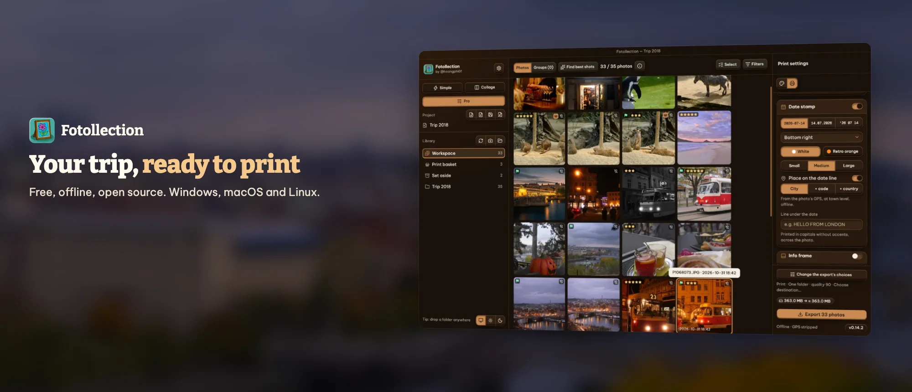
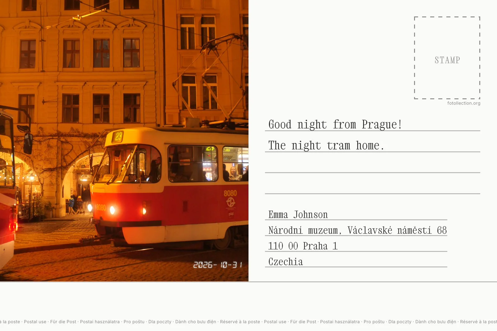

<div align="center">


# Fotollection

**成千上万张照片，只在回程的飞机上看过一遍？**

Fotollection 帮你挑出最好的照片，印上日期和地点，并按冲印机的尺寸裁好。完全免费，完全离线。

**[⬇ 下载 macOS、Windows 或 Linux 版](https://fotollection.org/download/)**

<sub>macOS 和 Windows 首次打开时会询问一次：选择<b>仍要打开</b>（<a href="#首次打开">方法</a>）。</sub>

[网站](https://fotollection.org/) · [使用手册](https://fotollection.org/manual/) · [发行版](https://github.com/hoangphi01/fotollection/releases/latest) · [English](README.md) · [Tiếng Việt](README.vi.md) · **简体中文** · [日本語](README.ja.md) · [한국어](README.ko.md)

</div>

<p align="center">
  
</p>

<p align="center">
  
  
  
</p>

## 我为什么做它

你好，我是 [hoangphi01](https://github.com/hoangphi01)，一名在欧洲读书的越南学生。旅行回来后我有几百张照片，只想冲印其中二十张左右，可是每种方法都不顺手：

- **冲印的照片不记录时间和地点。** 几年后就没人记得了。
- **冲印店会自动裁剪照片**，裁成 2:3、3:4 或 1:1，可能会裁掉人物的头部。
- **在线工具要上传照片。** GPS 信息会暴露你住在哪里。

所以我做了 Fotollection，让这一切都在你的电脑上完成。它免费、开源，照片从不离开你的电脑。

## 使用方法

1. **打开旅行照片文件夹。** 一次导入数千张 JPEG、iPhone 的 HEIC 或相机 RAW，并推荐最佳照片。
2. **选出要冲印的照片。** 以胶片相机字体印上拍摄日期和地点，裁剪适配冲印尺寸，用风格调整色彩。
3. **导出冲印文件。** 全画质，移除 GPS 信息，支持欧洲、日本和韩国冲印店的尺寸。

## 主要功能

- **照片印上日期和地点**：从照片本身读取，地点离线查找。
- **冲印店尺寸**：欧洲、日本和韩国的 21 种冲印尺寸，四周留 3 mm 边，裁切时不丢内容。
- **最佳照片推荐**：将连拍和相似照片分组，推荐睁眼且最清晰的一张，并说明理由。
- **支持 RAW**：Fujifilm、Panasonic、Canon、Nikon、Sony、Olympus 相机的 RAW 文件。
- **风格、预设和 LUT**：一键为照片调色；也能使用你自己的 Lightroom 预设和 LUMIX Lab 风格。
- **明信片**：一面是照片，一面是地址；支持日本的はがき和韩国的우편엽서，可按邮政编码自动填写地址（AddAssist）。
- **隐私**：无需账号，无云端，无遥测；唯一的网络请求是检查更新，可以关闭。

界面语言：English、Tiếng Việt、Deutsch、Magyar、日本語、한국어（暂无中文界面）。

## 还没有的功能

Fotollection 还很年轻，以下功能暂时没有：

- **未签名的版本：** macOS 和 Windows 首次打开前会询问一次（[首次打开](#首次打开)）。
- **Linux 上的 iPhone 照片（HEIC）：** 暂时请先转换为 JPEG。
- **通过 USB 连接相机拍摄：** 目前只支持 Windows。
- **没有手机版：** Fotollection 在电脑上运行。
- **Bug：** 你可能会遇到一些；欢迎提交 [issue](https://github.com/hoangphi01/fotollection/issues/new/choose)，谢谢。

## 下载

在[下载页面](https://fotollection.org/download/)获取 macOS 11 及以上（Apple Silicon 和 Intel）的 `.dmg`、Windows 10/11 的 `-setup.exe`，以及 64 位 Linux 的 AppImage 或 `.deb`。Mac 上也可以用 Homebrew 安装。

```sh
brew tap hoangphi01/tap && brew trust hoangphi01/tap
brew install --cask hoangphi01/tap/fotollection
```

### 首次打开

这些版本还没有签名（[ADR-0009](docs/adr/0009-unsigned-distribution.md)），所以系统会询问一次：

- **macOS：** 系统设置 → 隐私与安全性 → **仍要打开**
- **Windows：** SmartScreen → **更多信息** → **仍要运行**
- **Linux：** 无需确认；给 AppImage 加上执行权限，或安装 `.deb`。

## 支持

Fotollection 免费，由一名学生独立开发。如果它对你有帮助，可以通过 [GitHub Sponsors](https://github.com/sponsors/hoangphi01) 或 [Ko-fi](https://ko-fi.com/hoangphi01) 支持。

## 许可证

[GPL-3.0-only](LICENSE) © hoangphi01。完整说明请见 [English README](README.md)。
