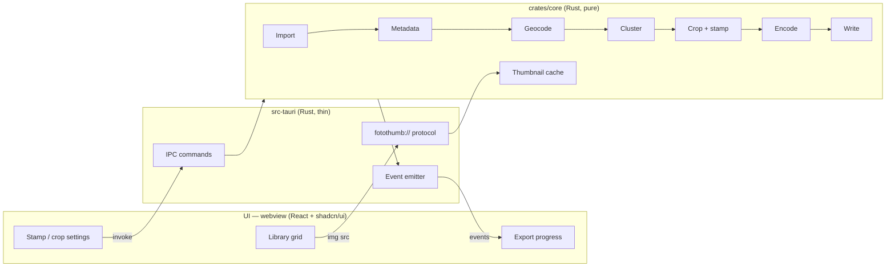

# Architecture — Fotollection

> **Status:** Draft v0.1 · **Last reviewed:** 2026-10-23
>
> This document describes **how** the system is built. Requirements live in [PRD.md](PRD.md).
> Performance design rationale lives in [OPTIMIZATION.md](OPTIMIZATION.md).
> Significant decisions are recorded as ADRs in [adr/](adr/README.md).
> When code and this document disagree, the disagreement is a bug: fix one of them in the same PR.

## 1. Overview

Fotollection is a **Tauri 2** desktop application ([ADR-0001](adr/0001-desktop-tauri-over-web.md)):

- A **Rust core** does all image work: decoding, metadata, geocoding, clustering, cropping, stamping, encoding and file I/O.
- A **thin web UI** (Vite + React + TypeScript, styled with Tailwind CSS, shadcn/ui components and Lucide icons; see [ADR-0007](adr/0007-ui-react-shadcn-lucide.md)) renders inside the operating system's own webview: WKWebView on macOS, WebView2 on Windows. No Chromium and no Node.js runtime are bundled.
- The core is a plain Rust library with **no dependency on Tauri** ([ADR-0002](adr/0002-rust-core-crate-separation.md)), so it can be unit-tested, benchmarked and fuzzed on its own.



## 2. Repository layout

Files marked † exist today (Phase 0 scaffold). Everything else is the target layout.

```text
Cargo.toml               † # Cargo workspace, shared lints, build-size profiles
rust-toolchain.toml      † # pinned Rust version
deny.toml                † # cargo-deny license/advisory policy (ADR-0008)
package.json             † # npm workspace root: Tauri CLI + scripts (npm run dev)
assets/                 † # logo-source.png (master), logo-square.png (app icons ≥ 128 px), logo-small.png (simplified tile, no wordmark: every size ≤ 64 px), logo-mark.png (older crop)
crates/
  core/                  † # fotollection-core: all domain logic, no Tauri
    src/
      lib.rs             †
      print_size.rs      † # CEWE/EU print sizes (FR-006)
      import.rs          † # discovery, magic bytes, size + polyglot checks (FR-001)
      codec.rs           † # JpegCodec trait + pure-Rust implementation (ADR-0012); decode_image/image_dimensions dispatch by magic bytes (PNG via `png`, RAW and HEIC via `oscodec`); decode_for_screen gives a RAW's embedded preview for thumbnails and analysis; EncodeOptions::print (4:4:4, optimized Huffman) for exports vs ::screen (4:2:0, plain) for previews/thumbnails
      image.rs           † # RgbImage + EXIF orientation transforms
      metadata.rs        † # EXIF allowlist + validation, embedded thumbnail (FR-002)
      settings.rs        † # RenderSettings (in memory until projects land)
      plan.rs            † # RenderPlan: centred crop, stamp, optional frame plan (FR-004/006/040)
      frame.rs           † # info frame: settings, camera profiles, text, ratio-safe layout (FR-040)
      logo.rs            † # user PNG logos: validation + decode (ADR-0014)
      fonts.rs           † # user OTF/TTF fonts: validation + FontArc (FR-042)
      settings_store.rs  † # settings.json v1: load/validate/atomic save (DATABASE.md §6)
      preview.rs         † # T2 LRU + preview rendering (FR-007)
      cancel.rs          † # CancellationToken
      stamp.rs           † # text inside the photo: DSEG14 Italic, date · place line + caption, LED glow (FR-004/005/033/036)
      text.rs            † # text measuring/drawing shared by stamp and frame, ASCII folding
      print_advice.rs    † # how large a photo prints well; sharp / acceptable / pixelated per print size (FR-026)
      straighten.rs      † # ±15° levelling: largest inscribed crop, bicubic resampling of the crop only (FR-006)
      brands.rs          † # bundled brand logos, EXIF make → brand, Classic/Original/Mono recolouring (ADR-0020)
      share.rs           † # share export targets: Original / Facebook / Instagram / custom sizes, JPEG settings (FR-053)
      colour.rs          † # ICC → sRGB with qcms, parallel over rows (FR-027, ADR-0022)
      sharpen.rs         † # light unsharp mask after a downscale (FR-053)
      exif_out.rs        † # minimal EXIF writer from an allowlist, never GPS; APP1 insertion (FR-010, FR-053)
      culling/           † # best-shot suggestions (FR-041): metrics.rs (sharpness, shake, exposure, noise, dHash),
                           # faces.rs (YuNet + FaceMesh eye aspect ratio), models.rs (bundled ONNX, BLAKE3, tract),
                           # similar.rs (layout + colour signature, ADR-0019), group.rs (bursts),
                           # score.rs (robust z within the group + reasons), cache.rs (analysis/)
      timeline.rs          # clock offsets, manual date/place, GPS borrowing + GPX (FR-030/031/032)
      geocode.rs         † # offline reverse geocoder + place search: bundled GeoNames, BLAKE3-checked, 1° grid index (FR-005/032)
      cluster.rs           # trip DBSCAN (Phase 2)
      library.rs         † # columnar in-memory library (DATABASE.md §3.3) + sparse per-photo edits (crop, rating, flag)
      project.rs         † # project tables v2: snapshot/restore by folder+path, FK validation, relocate/resolve folders
      bundle.rs          † # .fotollection ZIP bundle: manifest + BLAKE3, allowlisted parts, zip-bomb limits (ADR-0016)
      cache_limit.rs     † # the disk cache's 2 GB limit: usage, LRU prune by modification time, clear, touch on hit (DATABASE.md §8)
      history.rs         † # undo/redo stack of inverse edits (FR-023)
      atomic.rs          † # tmp + fsync + .bak + rename
      presets.rs           # preset library: partial/stackable, linked, .fotopreset I/O (FR-033/034/038)
      quality.rs           # effective-DPI checks (FR-026)
      render/              # (target) crop.rs, style.rs (Photo Style → 3D LUT + tone curve + grain, FR-039),
                           # border.rs, stamp.rs (incl. retro LED), caption.rs,
                           # color.rs (ICC → sRGB), sharpen.rs (Phase 3)
      layout/              # multi-photo sheets + contact sheet (Phase 3, FR-035/037)
      render.rs          † # crop/resize + stamp drawing today; splits into render/* as features land
      export.rs          † # bounded parallel export, cancel, per-photo errors, no overwrite (FR-008/009/011)
      thumbs.rs          † # T0 (embedded) + T1 disk cache (DATABASE.md §8)
    benches/               # criterion benchmarks (see OPTIMIZATION.md)
    fuzz/                  # cargo-fuzz targets (see TESTING.md)
  oscodec/               † # HEIC and camera RAW via ImageIO (macOS) / WIC (Windows): decode, dimensions, embedded preview; one of the two crates allowed `unsafe` (ADR-0017, ADR-0023)
  oscamera/              † # cameras over USB (ADR-0026, proposed): `ptp` (pure, tested on hand-made answers), `vendor/sony.rs` (Sony's handshake, shutter, settings block and live view from `docs/cameras/sony.md`; pure, tested), `macos` (ImageCaptureCore: browse, session, any PTP operation, events), `windows` (WPD through its MTP extension commands, the same API, one thread per open camera); `examples/probe_camera.rs` (Step 0, macOS) and `examples/sony_remote.rs` (handshake, shot, live view). Not used by the app yet; the other maker drivers come next. The other crate allowed `unsafe`
  geodata/               † # build-time packer for the GeoNames dataset (scripts/geodata/fetch-and-pack.sh); never shipped
src-tauri/               † # app shell: commands, protocol, capabilities
  src/lib.rs             † # tauri-specta builder + bindings export
  src/commands.rs        † # IPC commands (§6)
  src/document.rs        † # New / Open / Save / Save As / Relink of .fotollection documents (FR-023)
  src/menu.rs            † # native File/Edit/Window menu (macOS), rebuilt on language change
  src/open_with.rs       † # "Open with" (FR-054, ADR-0024): one route for macOS Opened events, command-line paths and second launches; the photo's folder as a tab
  src/timing.rs          † # start-up milestones printed only with FOTOLLECTION_TIMING (NFR-010, scripts/measure-startup.sh)
  src/updates.rs         † # "Check for updates" (FR-061, ADR-0025): one GitHub request on click, the installer opened in the browser from Rust
  src/cache.rs           † # the disk cache's size, Clear cache, and the background prune under 2 GB (DATABASE.md §8)
  src/i18n.rs            † # the shell's own strings: menu, window title, dialogs (FR-020)
  src/demo.rs            † # debug builds only: records IPC answers for demo photos, for the website screenshots
  capabilities/          † # Tauri 2 permission sets (see SECURITY.md)
  icons/                 † # generated: npx tauri icon assets/logo-square.png, then uv run scripts/small-icons.py for the ≤ 64 px layers
  tauri.conf.json        † # window, CSP, bundle config
ui/                      † # Vite + React + TS frontend (npm workspace member)
  components.json        † # shadcn/ui config (style radix-nova, Lucide)
  .oxlintrc.json         † # lint rules (bans dangerouslySetInnerHTML / eval)
  src/
    components/ui/       † # shadcn/ui components (copied in via the shadcn CLI, owned by us)
    features/            † # library/, settings/, export/, culling/, frame/, viewer/ — feature components + hooks
    i18n/                † # i18next setup + typed keys (FR-020, ADR-0015)
    locales/             † # en.json (default), vi.json — bundled, never fetched
    ipc/bindings.ts      † # GENERATED from Rust types — do not edit
    lib/                 † # small UI utilities (theme sync, shadcn's cn re-export)
    index.css            † # Tailwind layers + shadcn theme tokens (CSS variables)
scripts/                 † # bootstrap, clean, check-docs, release.sh (RELEASE.md §4), small-icons.py (≤ 64 px icons from assets/logo-small.png)
site/                    † # the website (Jekyll, GitHub Pages, EN + VI); screenshots/ makes its images from the real app on CC0 demo photos (site/README.md)
.github/workflows/       † # ci.yml, docs.yml, release.yml (release on a version change, ADR-0021), pages.yml (website)
bench/                   † # run.sh (Rust vs Chromium, 6 vs 8 in flight), batch.sh (5,000-photo memory check), lib.sh, web/ (Chromium via Playwright), chart.mjs (EN + VI SVG charts), results/ (numbers only, incl. budgets.json mirrored from OPTIMIZATION §3)
```

## 3. Tech stack

| Concern | Choice | Notes |
|---------|--------|-------|
| App shell | Tauri 2 | OS webview, small binary, capability-based permissions |
| UI framework | Vite + React 19 + TypeScript | Required by shadcn/ui ([ADR-0007](adr/0007-ui-react-shadcn-lucide.md)) |
| UI components | shadcn/ui (Radix primitives) + Tailwind CSS v4 | Components are copied into the repo, so we own and audit them |
| UI localization | `i18next` + `react-i18next` (MIT), bundled JSON locales | Typed keys, CLDR plurals, no runtime fetch ([ADR-0015](adr/0015-ui-localization-i18next.md)) |
| Project bundle | `zip` (MIT), deflate only via `flate2` + pure-Rust `miniz_oxide` | One-file `.fotollection` like `.docx`, readable by any unzip tool ([ADR-0016](adr/0016-self-contained-project-bundle.md)) |
| Icons | Lucide (`lucide-react`) | Tree-shaken: import individual icons only |
| Virtualized grid | `@tanstack/react-virtual` | Required for 1,000+ thumbnails ([NFR-001](PRD.md#nfr-001--library-load-time)) |
| UI state | React state + a small store (`zustand`) | Server state lives in Rust. The UI only caches it |
| IPC type bindings | `specta` + `tauri-specta` | TS types generated from Rust and checked in CI |
| JPEG decode/encode | **Today:** `zune-jpeg` + `jpeg-encoder` (pure Rust) behind the `JpegCodec` trait ([ADR-0012](adr/0012-pure-rust-codecs-first.md)). **Candidate:** `turbojpeg` for DCT scaling and lossless crop ([ADR-0004](adr/0004-libjpeg-turbo-default-codec.md)) | 4:4:4, quality 95, ICC copied |
| JPEG max-quality encode | `mozjpeg` (optional) | Opt-in "smallest file" mode |
| HEIC/HEIF | OS codecs via `fotollection-oscodec`: ImageIO (`objc2-image-io`) on macOS, WIC (`windows`) on Windows | Nothing linked, no LGPL; Windows needs the HEIF/HEVC Store extensions ([ADR-0017](adr/0017-heic-through-os-codecs.md)) |
| Camera RAW | The same OS codecs; `crates/core/src/raw.rs` recognises the format by its bytes; one full develop at a time | Nothing linked, no LGPL; Windows needs the Raw Image Extension ([ADR-0023](adr/0023-raw-through-os-codecs.md)) |
| PNG | `png` | |
| Face models (FR-041) | `tract-onnx` (MIT/Apache), pure Rust; YuNet + FaceMesh V2 ONNX compiled in | One code path on macOS and Windows, no native runtime; BLAKE3-checked at load ([ADR-0018](adr/0018-face-models-and-runtime.md)) |
| Resize | `fast_image_resize` | SIMD (NEON/AVX2) |
| Colour management | `lcms2` | Preserve or convert the ICC profile |
| Text rendering | `ab_glyph` `FontArc`: bundled Inter (OFL, variable weights) or a user OTF/TTF (FR-042) | `cosmic-text` if complex shaping is ever needed |
| EXIF read | `kamadak-exif` | Allowlisted fields only. Also extracts the IFD1 thumbnail for T0 |
| EXIF write | `little_exif` (candidate) | Writes the privacy-filtered metadata |
| Reverse geocoding | GeoNames `cities1000`, packed by `crates/geodata`, indexed in a 1° grid at first use | Offline, 5.4 MB packed, no extra dependency ([ADR-0003](adr/0003-offline-geocoding-geonames.md)) |
| Trip clustering | DBSCAN over (lat, lon, time) | Phase 2 |
| Perceptual hash | `image_hasher` | Phase 2 |
| Face detection | ONNX model via `ort` | Phase 2, on-device |
| Parallelism | `rayon` + bounded `crossbeam-channel` | See [§5](#5-concurrency-and-memory-model) |
| Errors | `thiserror` (core), `anyhow` (shell only) | See [STYLE_RULE.md](STYLE_RULE.md) |
| Project file | `serde_json` + versioned schema | [ADR-0010](adr/0010-project-file-format.md) |
| GPX tracks | `gpx` (candidate; license checked by `cargo deny`) | Phase 2, [FR-031](PRD.md#fr-031--borrow-gps-from-a-phone-or-gpx-track) |
| PDF contact sheet | `pdf-writer` or `printpdf` (candidate, permissive license) | Phase 3, [FR-037](PRD.md#fr-037--contact-sheet) |
| Stamp fonts | Bundled OFL/MIT fonts, including a seven-segment LED face | [FR-033](PRD.md#fr-033--retro-film-date-stamp-and-stamp-presets) |
| Photo Style engine | Own code: parameters baked into a 33³ 3D LUT (trilinear, SIMD) + 1D tone curve + seeded grain | [ADR-0011](adr/0011-photo-style-looks.md) |
| Persisted data model | Normalized tables in JSON (3NF, integer keys, sparse rows) | [DATABASE.md](DATABASE.md) |
| PNG decoding (logos) | `png` (pure Rust) | [ADR-0014](adr/0014-user-supplied-brand-logos.md) |

Crates marked *candidate* are confirmed by Phase 0 benchmarks. The result is logged in [OPTIMIZATION.md](OPTIMIZATION.md#5-benchmark-log).

## 4. Processing pipeline

```text
import → metadata → adjust → geocode → (cluster) → cull/select → plan → render (crop → style → border/stamp) → color → (sharpen) → encode → write
```

| Stage | Input → Output | Notes |
|-------|----------------|-------|
| **import** | paths → `PhotoRef { id, path, kind, size, mtime }` | Magic-byte check only, no decoding |
| **metadata** | `PhotoRef` → `PhotoMeta` | Allowlisted EXIF, validated values ([SECURITY.md §3](SECURITY.md#3-input-and-metadata-defense)) |
| **adjust** | `PhotoMeta` + project → `EffectiveMeta` | Clock offset per camera, manual date/place, borrowed GPS. Originals are kept for reference ([FR-030](PRD.md#fr-030--camera-clock-offset)–[FR-032](PRD.md#fr-032--manual-date-and-place)) |
| **geocode** | `(lat, lon)` → `Place` | The town whose reach the photo is deepest in (reach grows with √population), about 5 µs per lookup |
| **cluster** | `[PhotoMeta]` → `[Trip]` | Phase 2 |
| **cull/select** | library + filter → export set | Ratings, flags and copies come from the project ([FR-022](PRD.md#fr-022--culling-rate-flag-filter)) |
| **plan** | meta + settings → `RenderPlan` | Pure function: print size per photo, crop rect, border, safe area, stamp/caption text and position, colour intent, output path. Also yields the effective-DPI check ([FR-026](PRD.md#fr-026--resolution-warning)) |
| **frame** | photo + `FramePlan` → canvas | When enabled: a canvas at the print ratio; the photo is cropped to fill or fitted above the info bar; brand + lines drawn (FR-040) |
| **render** | `RenderPlan` + pixels → pixels | Crop, then the **Photo Style look** (one 3D-LUT pass + tone curve + grain, [FR-039](PRD.md#fr-039--photo-style-looks)), then fit into the border, then stamp/caption inside the safe area. Overlays come after the look, so they are never tinted |
| **color** | pixels + source ICC → sRGB pixels | `lcms2` transform, with a configurable rendering intent ([FR-027](PRD.md#fr-027--srgb-conversion-for-labs)) |
| **sharpen** | pixels → pixels | Output sharpening for size and paper (Phase 3, [FR-029](PRD.md#fr-029--output-sharpening)) |
| **encode** | pixels → bytes | turbojpeg, ICC re-embedded, metadata filtered ([FR-010](PRD.md#fr-010--metadata-privacy-on-export)) |
| **write** | bytes → file | Written to a temp file, then atomically renamed. Removed if the user cancels |

`RenderPlan` is pure and serializable. The **preview** and the **export** both consume the same plan, so what the user sees is what gets printed.

## 5. Concurrency and memory model

- The UI thread only renders the UI. The Tauri command handlers return immediately and run jobs on the core's worker pool.
- **Export** is a staged pipeline connected by **bounded channels** (back-pressure). The number of decoded full-resolution buffers in flight is capped (`max_inflight`, default `num_cpus`, then clamped by the memory budget in [NFR-004](PRD.md#nfr-004--memory-ceiling)).
- Each job carries a `CancellationToken`. Every stage checks it between photos and between expensive steps.
- Progress events are coalesced to at most 30 per second.
- Three pools never compete:
  - the **interactive** pool (2 threads) serves `fotothumb://` requests for what is on screen;
  - the **background** pool (2 threads) reads EXIF during import and pre-generates T1 thumbnails;
  - **export** has its own bounded pool.

  Visible thumbnails therefore never wait behind background work. A request for a photo whose T1 isn't ready gets the embedded T0 at once.

## 6. IPC contract

All types are defined in Rust and exported to `ui/src/ipc/bindings.ts` through `tauri-specta`. CI fails if the bindings are stale.

### Commands (UI → core)

Commands marked † are implemented.

| Command | Purpose | Requirement |
|---------|---------|-------------|
| `app_info() -> AppInfo` † | App and core versions for the About section, and the OS (Windows draws its own title bar) | FR-021, FR-052 |
| `list_print_sizes() -> [PrintSize]` † | Print sizes for the settings panel | FR-006 |
| `pick_and_import_folder() -> ImportSummary?` † | Opens the folder dialog **in Rust** and imports it. Drag-and-drop on the window uses the same import path | FR-001, FR-002 |
| `remove_folder(folder) -> DocumentState` † | Takes a folder out of the library like closing a tab: rebuilds the library from the other folders and re-applies their edits; files are untouched; ids and undo history reset | FR-001 |
| `refresh_library() -> ImportSummary` † | Scans the library's folders again and adds photos that appeared since; photos already known keep every edit, and a refresh that finds nothing marks nothing as edited | FR-001, FR-023 |
| `list_photos(filter) -> { photos: [PhotoSummary], total, customStamps, folders: [FolderSummary], printCount, asideCount }` † | Data for the grid, sorted by capture time and filtered in Rust by flag, minimum rating, folders (empty = all) and view (`gallery` hides photos set aside; `print` and `aside` show one holding area). Summaries carry `rating`, `flag` and `queue`; `folders` lists every source folder with its unfiltered count | FR-003, FR-022, FR-050, FR-056 |
| `get_settings()` / `set_settings(settings) -> SettingsState` † | Validated render settings plus a `revision` used to refresh previews | FR-004, FR-006 |
| `get_ui_settings()` / `set_ui_settings(ui) -> UiSettings` † | Interface language (`en` / `vi`), stored per machine in `settings.json` v3 | FR-020 |
| `set_photo_override(id, override)` | Per-photo crop frame or place name | FR-005, FR-006 |
| `pick_export_folder() -> String?` † | Opens the destination dialog **in Rust** and remembers the choice | FR-009 |
| `estimate_export(filter, only) -> ExportEstimate` † | The originals' total and the export's estimated size, from up to four photos encoded in memory with the current settings; nothing is written | FR-053 |
| `start_export(filter, only, separate) -> JobId` † | Exports exactly the photos `filter` keeps (the set the grid shows, including its folders), or only the photo `only` (the preview), to the chosen destination, as prints or share files (`render.exportTarget`); `separate` gives each source folder its own subfolder | FR-008, FR-009, FR-010, FR-022, FR-053, FR-055, FR-056 |
| `cancel_job(job_id)` † | Cancel a running job | FR-011 |
| `get_frame_config()` / `set_frame_settings(settings)` † | Info frame settings plus camera profiles (with EXIF-derived defaults) | FR-040 |
| `set_camera_profile(profile)` † | Per-camera overrides: name, brand, lens, focal, aperture, photo style, logo kind | FR-040 |
| `list_cameras() -> CameraClock[]` † / `set_camera_clock(id, offset_s, tz_minutes?) -> CameraClock[]` † | Camera bodies (make, model, serial) and their clock corrections; offsets beyond a month and time zones beyond ±14 h are rejected in Rust; every photo of the body moves (effective time, [ADR-0027](adr/0027-effective-time-and-place.md)) | FR-030 |
| `clock_offset_between(photo, reference) -> f64` † / `clock_match_candidates(photo, limit ≤ 24)` † | The helper: the offset that makes a photo match another device's photo of the same moment, and the other devices' photos closest in time (within a day) to pick from | FR-030 |
| `pick_camera_logo(camera_id)` / `clear_camera_logo(camera_id)` † | Choose a PNG with a **Rust-side** dialog, validate it, copy it into `config/logos/` | FR-040 |
| `get_crop_geometry(id) -> CropGeometry` † | Upright size, target ratio, printed cm of the crop area, current crop | FR-006 |
| `set_photo_crop(id, crop?, straighten)` † | Set or reset a photo's crop (centre + zoom) and straightening angle (±15°, clamped in Rust), undoable | FR-006, FR-023 |
| `rotate_photos(ids, clockwise)` † | Lossless quarter turns on top of the EXIF orientation, composed into one pass (`image::compose_orientation`); crops turn with the photo; undoable | FR-006 |
| `set_photo_rating(ids, 0–5)` † / `set_photo_flag(ids, pick\|reject\|null)` † | Culling: one undoable step for 1–10,000 photos; ratings above 5 and unknown IDs are rejected | FR-022, FR-023 |
| `set_photo_queue(ids, print\|aside\|null)` † | The print basket and set aside (`null` back to the gallery): one undoable step for 1–10,000 photos; nothing is deleted | FR-050, FR-023 |
| `get_photo_stamp(id)` / `set_photo_stamp(id, stamp?)` † | One photo's own date stamp from the preview (FR-044); `null` follows the settings again. Undoable; the caption is validated in Rust | FR-044 |
| `apply_stamp_to_all(id)` / `reset_photo_stamps()` † | "Apply to all" in the preview (the photo's stamp becomes the setting and no photo keeps its own) and "Reset" in the settings panel (every photo follows the settings again) | FR-044 |
| `undo()` / `redo()` † | History (also Cmd/Ctrl+Z, Shift+Cmd/Ctrl+Z) | FR-023 |
| `list_fonts()` / `import_font()` / `remove_font(id)` † | User fonts; import opens a **Rust-side** dialog and copies a validated file | FR-042 |
| `photo_details(id) -> PhotoDetails` † | Inspector data: pixel size (header only), file size, GPS, effective DPI at the current print size | FR-002, FR-007, FR-026 |
| `print_advice(id) -> PrintAdvice` † | Largest sharp (300 DPI) and acceptable (150 DPI) print of a photo, and a sharp / acceptable / pixelated verdict per built-in and custom size | FR-026 |
| `get_document() -> DocumentState` † | Current document: name, unsaved flag, library generation, folders still to relink | FR-023 |
| `new_document()` / `open_document()` / `save_document()` / `save_document_as()` † | Project lifecycle. Open and Save As use **Rust-side** dialogs; Save writes the current document or falls back to Save As. Open validates the whole bundle before changing anything | FR-023 |
| `document_requested() -> bool` † | Whether the OS handed over a project the UI has not opened yet; asked after `startup-finished`, since a cold launch can announce it before the page listens | FR-023, FR-054 |
| `open_requested_document()` † | Opens the file the OS handed over (file association), after the UI settled unsaved changes. The path is stored in Rust, never sent by the webview | FR-023 |
| `take_photo_request() -> OpenPhoto?` † | The photo the OS asked to show ("Open with"), once: `{ id, folder }`, kept in Rust until taken, so a request made during start-up is not lost | FR-054 |
| `startup_finished() -> bool` † | Whether the last session is back, for a page that loaded after `startup-finished`; the start-up screen waits for it | FR-060 |
| `check_for_update() -> UpdateCheck` † / `open_update_download()` † | On click only: asks GitHub for the latest release (`{ current, latest, newer, pageUrl }`) and keeps the installer link for this system in Rust; the second opens it in the browser. Errors: `update.offline`, `update.unreadable`, `update.none` | FR-061 |
| `cache_usage() -> CacheUsage` † / `clear_cache() -> CacheUsage` † | The thumbnail and analysis cache's size against its 2 GB limit (`{ bytes, files, limitBytes }`), and emptying it | DATABASE §8 |
| `rename_document(name) -> DocumentState` † | Renames the project: the saved file in its folder (never over another file), or the name an untitled project will be saved under. The name is validated in Rust as a portable file name | FR-023 |
| `relink_folder(folder_id)` † | Picks the new location of a missing folder (Rust-side dialog), re-scans it and restores its edits | FR-023 |
| `analyze_library() -> JobId` † | Best-shot analysis of every photo on the background pool, reusing the analysis cache; cancel with `cancel_job`. A second call while one runs returns the running job | FR-041, NFR-014 |
| `list_groups() -> [Group]` † | Groups of similar shots from the last analysis: `{ id, result: { photos (best first, with score parts, closed eyes, faces), reasons, tooClose } }`. `id` is the group's first photo | FR-041 |
| `keep_best(group_ids) -> HistoryState` † | Picks each group's best photo and rejects the rest as one undoable step; 1–5,000 groups, unknown groups are rejected | FR-041, FR-022 |
| `keep_one(group_id, photo_id) -> HistoryState` † | Keeps the chosen photo of one group and rejects the others, one undoable step (for "Too close to call" or a different preference) | FR-041, FR-022 |
| Filters by date, camera, GPS, DPI in `list_photos` | Planned culling filters | FR-022, FR-026 |
| `set_copies(ids, n)` / `order_summary() -> OrderSummary` | Copies and cost estimate | FR-024 |
| `set_print_size(ids, size_id)` | Per-photo print size | FR-025 |
| `set_clock_offset(camera, offset)` / `match_clock(photo_id, reference_id)` | Clock correction | FR-030 |
| `borrow_gps(source, window)` | Infer GPS from another device or a GPX file | FR-031 |
| `set_manual_meta(ids, date?, place?)` / `search_places(query) -> [Place]` | Manual date and place, offline place search | FR-032 |
| `list_presets()` / `save_preset(preset)` / `delete_preset(id)` | Preset library (stamp, lab, style and print groups) | FR-033, FR-034, FR-038 |
| `apply_preset(ids, preset_id)` / `detach_preset(ids)` / `reset_to_preset(ids)` | Link, detach or reset photos | FR-038 |
| `preview_preset(id, preset_id) -> PreviewHandle` | Hover preview without applying | FR-038 |
| `import_preset(path)` / `export_preset(id, path)` | Share `.fotopreset` files | FR-038 |
| `set_style(ids, style)` | Per-photo Photo Style override | FR-039 |

### Events (core → UI)

Events are typed through `tauri-specta` and named in kebab-case. Events marked † are implemented.

| Event | Payload |
|-------|---------|
| `library-changed` † | `{ count }`. Sent after imports and after every edit, undo and redo (ratings and flags are part of the list). The UI refetches `list_photos` |
| `thumb-ready` † | `{ id }`. The T1 thumbnail is cached, so the UI bumps the image URL |
| `export-progress` † | `{ jobId, done, total }`, coalesced to ≤ 30 per second |
| `export-finished` † | `{ jobId, summary: { exported, failed[], cancelled, destination, sourceBytes, outputBytes } }`. Per-photo failures are reported here; the two sizes let the UI say how much lighter the export is |
| `revision-changed` † | `{ revision, canUndo, canRedo }` after any render-affecting edit; previews refresh |
| `document-changed` † | `{ document }` after any edit, save, open, new or relink; the window title follows (`Trip — Edited — Fotollection`) |
| `menu-action` † | `{ action: new \| open \| save \| saveAs \| openRequested }` from the native File menu (macOS) or a file handed over by the OS; the UI runs its own flow, unsaved-changes question included |
| `open-photo` † | `{ id, folder }`: a photo handed over by the OS is in the library; the UI takes it with `take_photo_request`, shows its folder's tab and opens the preview once that folder is listed |
| `startup-finished` † | The last session is back (or there was none): the start-up screen fades out (FR-060) |
| `task-progress` † | `{ task: "import" \| "thumbnails" \| "analyze", done, total }`, coalesced to ≤ 30 per second. Drives the progress bar |
| `analysis-finished` † | `{ jobId, analyzed, failed, groups, cancelled }`. The UI refetches `list_groups` |
| `project://saved` | `{ path, at }`, for the autosave indicator |
| `history://changed` | `{ can_undo, can_redo }` |

### Binary data

Pixels **never** cross IPC as JSON or base64. Thumbnails and previews are served by the asynchronous custom URI scheme `fotothumb` on a low-priority worker pool. On Windows it is addressed as `http://fotothumb.localhost/…`:

- `fotothumb://localhost/thumb/{id}?v={n}`: the cached T1, else the embedded T0, else a T1 generated on the spot. `v` bumps on `thumb-ready`.
- `fotothumb://localhost/source/{id}?rev={n}`: the upright, **uncropped**, unstamped T2 image, the crop editor's background.
- `fotothumb://localhost/preview/{id}?rev={n}`: about 1600 px, rendered from the T2 cache with the **same** `RenderPlan` code as the export. `rev` is the settings revision.
- `fotothumb://localhost/preview/{id}?rev={n}&region={x},{y},{w},{h}&px={n}`: one part of the **full-resolution** render, for zoom past the preview's pixels (FR-057). The region is in fractions of the photo and `px` the widest it should come back (at most 4,096); both are checked in Rust before any work. The original is decoded on the first such request into a second cache bounded at about 200 MB (`PreviewCache::full`; the photo on screen always stays), rendered with the export's plan, and only the region is encoded. The UI lays that part over the zoomed preview at its final on-screen size and only translates it: a CSS `scale()` would make WebKit rasterise it at its small layout size first and lose the detail.

The UI just sets ``. Routes are parsed strictly: anything other than `/thumb/<u32>` or `/preview/<u32>` returns 404.

## 7. Persistence

All persisted data (project files, settings, presets, the thumbnail cache, built-in datasets), with schemas, versioning and write protocol, is specified in **[DATABASE.md](DATABASE.md)**. In short: there is no database server or SQL database. Work lives in a versioned JSON project file ([ADR-0010](adr/0010-project-file-format.md)), writes are atomic, and source files are never modified.

## 8. Platform notes

| | macOS | Windows |
|---|---|---|
| Webview | WKWebView (system) | WebView2 (evergreen, bootstrapped by installer) |
| Native deps | None (ImageIO and Core Graphics are system frameworks) | None (WIC is part of Windows; HEIC needs the Store extensions) |
| Target | `universal-apple-darwin` | `x86_64-pc-windows-msvc` |

Release packaging and signing are described in [RELEASE.md](RELEASE.md).
