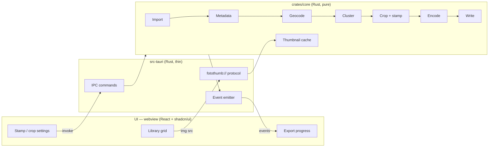

# Architecture — Fotollection

> **Status:** Draft v0.1 · **Last reviewed:** 2026-10-23
>
> This document describes **how** the system is built. Requirements live in [PRD.md](PRD.md).
> Performance design rationale lives in [OPTIMIZATION.md](OPTIMIZATION.md).
> Significant decisions are recorded as ADRs in [adr/](adr/README.md).
> When code and this document disagree, the disagreement is a bug: fix one of them in the same PR.

## 1. Overview

Fotollection is a **Tauri 2** desktop application ([ADR-0001](adr/0001-desktop-tauri-over-web.md)):

- A **Rust core** does all image work: decoding, metadata, geocoding, clustering, cropping, stamping, encoding and file I/O.
- A **thin web UI** (Vite + React + TypeScript, styled with Tailwind CSS, shadcn/ui components and Lucide icons; see [ADR-0007](adr/0007-ui-react-shadcn-lucide.md)) renders inside the operating system's own webview: WKWebView on macOS, WebView2 on Windows. No Chromium and no Node.js runtime are bundled.
- The core is a plain Rust library with **no dependency on Tauri** ([ADR-0002](adr/0002-rust-core-crate-separation.md)), so it can be unit-tested, benchmarked and fuzzed on its own.



## 2. Repository layout

Files marked † exist today (Phase 0 scaffold). Everything else is the target layout.

```text
Cargo.toml               † # Cargo workspace, shared lints, build-size profiles
rust-toolchain.toml      † # pinned Rust version
deny.toml                † # cargo-deny license/advisory policy (ADR-0008)
package.json             † # npm workspace root: Tauri CLI + scripts (npm run dev)
assets/                 † # logo-source.png (master), logo-square.png (app icons), logo-mark.png (small-size mark, no wordmark)
crates/
  core/                  † # fotollection-core: all domain logic, no Tauri
    src/
      lib.rs             †
      print_size.rs      † # CEWE/EU print sizes (FR-006)
      import.rs            # discovery, magic-byte validation
      decode/              # jpeg.rs (turbojpeg), heic.rs (libheif), png.rs
      metadata.rs          # EXIF allowlist + validation
      timeline.rs          # clock offsets, manual date/place, GPS borrowing + GPX (FR-030/031/032)
      geocode.rs           # offline reverse geocoder + offline place search (GeoNames + k-d tree)
      cluster.rs           # trip DBSCAN (Phase 2)
      library.rs           # ratings, flags, filters, copies, per-photo overrides (FR-022/024/025)
      project.rs           # .fotollection file: versioned schema, autosave, migrations (ADR-0010)
      history.rs           # undo/redo command stack (FR-023)
      presets.rs           # built-in lab + stamp presets, static data (FR-033/034)
      quality.rs           # effective-DPI checks (FR-026)
      render/              # crop.rs, border.rs, stamp.rs (incl. retro LED), caption.rs,
                           # color.rs (ICC → sRGB), sharpen.rs (Phase 3)
      layout/              # multi-photo sheets + contact sheet (Phase 3, FR-035/037)
      encode.rs
      export.rs            # pipeline orchestration, back-pressure, cancel
      thumbs.rs            # multi-tier thumbnail generation + disk cache
    benches/               # criterion benchmarks (see OPTIMIZATION.md)
    fuzz/                  # cargo-fuzz targets (see TESTING.md)
  geodata/                 # build-time packer for the GeoNames dataset
src-tauri/               † # app shell: commands, protocol, capabilities
  src/lib.rs             † # tauri-specta builder + bindings export
  src/commands.rs        † # IPC commands (§6)
  capabilities/          † # Tauri 2 permission sets (see SECURITY.md)
  icons/                 † # generated: npx tauri icon assets/logo-square.png
  tauri.conf.json        † # window, CSP, bundle config
ui/                      † # Vite + React + TS frontend (npm workspace member)
  components.json        † # shadcn/ui config (style radix-nova, Lucide)
  .oxlintrc.json         † # lint rules (bans dangerouslySetInnerHTML / eval)
  src/
    components/ui/       † # shadcn/ui components (copied in via the shadcn CLI, owned by us)
    features/            † # library/, settings/, export/ — feature components + hooks
    ipc/bindings.ts      † # GENERATED from Rust types — do not edit
    lib/                 † # small UI utilities (theme sync, shadcn's cn re-export)
    index.css            † # Tailwind layers + shadcn theme tokens (CSS variables)
scripts/                 † # bootstrap, clean, check-docs
```

## 3. Tech stack

| Concern | Choice | Notes |
|---------|--------|-------|
| App shell | Tauri 2 | OS webview, small binary, capability-based permissions |
| UI framework | Vite + React 19 + TypeScript | Required by shadcn/ui ([ADR-0007](adr/0007-ui-react-shadcn-lucide.md)) |
| UI components | shadcn/ui (Radix primitives) + Tailwind CSS v4 | Components are copied into the repo, so we own and audit them |
| Icons | Lucide (`lucide-react`) | Tree-shaken: import individual icons only |
| Virtualized grid | `@tanstack/react-virtual` | Required for 1,000+ thumbnails ([NFR-001](PRD.md#nfr-001--library-load-time)) |
| UI state | React state + a small store (`zustand`) | Server state lives in Rust. The UI only caches it |
| IPC type bindings | `specta` + `tauri-specta` | TS types generated from Rust and checked in CI |
| JPEG decode/encode | `turbojpeg` (libjpeg-turbo) | SIMD, DCT-domain scaling, lossless transforms ([ADR-0004](adr/0004-libjpeg-turbo-default-codec.md)) |
| JPEG max-quality encode | `mozjpeg` (optional) | Opt-in "smallest file" mode |
| HEIC/HEIF | `libheif-rs` | libheif + libde265, statically linked ([ADR-0005](adr/0005-input-formats-jpeg-heic-png.md)) |
| PNG | `png` | |
| Resize | `fast_image_resize` | SIMD (NEON/AVX2) |
| Colour management | `lcms2` | Preserve or convert the ICC profile |
| Text rendering | `ab_glyph` (or `cosmic-text` if shaping is needed) | Bundled fonts only |
| EXIF read | `nom-exif` (candidate; benchmark against `kamadak-exif`) | Allowlisted fields only |
| EXIF write | `little_exif` (candidate) | Writes the privacy-filtered metadata |
| Reverse geocoding | GeoNames `cities1000` + `kiddo` k-d tree | Offline, about 5 MB packed ([ADR-0003](adr/0003-offline-geocoding-geonames.md)) |
| Trip clustering | DBSCAN over (lat, lon, time) | Phase 2 |
| Perceptual hash | `image_hasher` | Phase 2 |
| Face detection | ONNX model via `ort` | Phase 2, on-device |
| Parallelism | `rayon` + bounded `crossbeam-channel` | See [§5](#5-concurrency-and-memory-model) |
| Errors | `thiserror` (core), `anyhow` (shell only) | See [STYLE_RULE.md](STYLE_RULE.md) |
| Project file | `serde_json` + versioned schema | [ADR-0010](adr/0010-project-file-format.md) |
| GPX tracks | `gpx` (candidate; license checked by `cargo deny`) | Phase 2, [FR-031](PRD.md#fr-031--borrow-gps-from-a-phone-or-gpx-track) |
| PDF contact sheet | `pdf-writer` or `printpdf` (candidate, permissive license) | Phase 3, [FR-037](PRD.md#fr-037--contact-sheet) |
| Stamp fonts | Bundled OFL/MIT fonts, including a seven-segment LED face | [FR-033](PRD.md#fr-033--retro-film-date-stamp-and-stamp-presets) |

Crates marked *candidate* are confirmed by Phase 0 benchmarks. The result is logged in [OPTIMIZATION.md](OPTIMIZATION.md#5-benchmark-log).

## 4. Processing pipeline

```text
import → metadata → adjust → geocode → (cluster) → cull/select → plan → render → color → (sharpen) → encode → write
```

| Stage | Input → Output | Notes |
|-------|----------------|-------|
| **import** | paths → `PhotoRef { id, path, kind, size, mtime }` | Magic-byte check only, no decoding |
| **metadata** | `PhotoRef` → `PhotoMeta` | Allowlisted EXIF, validated values ([SECURITY.md §3](SECURITY.md#3-input-and-metadata-defense)) |
| **adjust** | `PhotoMeta` + project → `EffectiveMeta` | Clock offset per camera, manual date/place, borrowed GPS. Originals are kept for reference ([FR-030](PRD.md#fr-030--camera-clock-offset)–[FR-032](PRD.md#fr-032--manual-date-and-place)) |
| **geocode** | `(lat, lon)` → `Place` | Nearest-city lookup, memoized per ~1 km cell |
| **cluster** | `[PhotoMeta]` → `[Trip]` | Phase 2 |
| **cull/select** | library + filter → export set | Ratings, flags and copies come from the project ([FR-022](PRD.md#fr-022--culling-rate-flag-filter)) |
| **plan** | meta + settings → `RenderPlan` | Pure function: print size per photo, crop rect, border, safe area, stamp/caption text and position, colour intent, output path. Also yields the effective-DPI check ([FR-026](PRD.md#fr-026--resolution-warning)) |
| **render** | `RenderPlan` + pixels → pixels | Crop, then fit into the border, then stamp/caption inside the safe area, at output resolution |
| **color** | pixels + source ICC → sRGB pixels | `lcms2` transform, with a configurable rendering intent ([FR-027](PRD.md#fr-027--srgb-conversion-for-labs)) |
| **sharpen** | pixels → pixels | Output sharpening for size and paper (Phase 3, [FR-029](PRD.md#fr-029--output-sharpening)) |
| **encode** | pixels → bytes | turbojpeg, ICC re-embedded, metadata filtered ([FR-010](PRD.md#fr-010--metadata-privacy-on-export)) |
| **write** | bytes → file | Written to a temp file, then atomically renamed. Removed if the user cancels |

`RenderPlan` is pure and serializable. The **preview** and the **export** both consume the same plan, so what the user sees is what gets printed.

## 5. Concurrency and memory model

- The UI thread only renders the UI. The Tauri command handlers return immediately and run jobs on the core's worker pool.
- **Export** is a staged pipeline connected by **bounded channels** (back-pressure). The number of decoded full-resolution buffers in flight is capped (`max_inflight`, default `num_cpus`, then clamped by the memory budget in [NFR-004](PRD.md#nfr-004--memory-ceiling)).
- Each job carries a `CancellationToken`. Every stage checks it between photos and between expensive steps.
- Progress events are coalesced to at most 30 per second.
- Thumbnails come from a separate low-priority pool, so they never starve export or preview.

## 6. IPC contract

All types are defined in Rust and exported to `ui/src/ipc/bindings.ts` through `tauri-specta`. CI fails if the bindings are stale.

### Commands (UI → core)

Commands marked † are implemented.

| Command | Purpose | Requirement |
|---------|---------|-------------|
| `app_info() -> AppInfo` † | App and core versions for the About section | — |
| `list_print_sizes() -> [PrintSize]` † | Print sizes for the settings panel | FR-006 |
| `import_paths(paths) -> ImportSummary` | Add files and folders to the library | FR-001 |
| `list_photos(filter) -> [PhotoSummary]` | Data for the grid | FR-003 |
| `set_settings(settings)` | Stamp, crop and export settings | FR-004, FR-006 |
| `set_photo_override(id, override)` | Per-photo crop frame or place name | FR-005, FR-006 |
| `render_preview(id, max_edge) -> PreviewHandle` | Render a preview on demand | FR-007 |
| `start_export(dest, options) -> JobId` | Begin an export | FR-008, FR-009, FR-010 |
| `cancel_job(job_id)` | Cancel a running job | FR-011 |
| `set_rating(ids, stars)` / `set_flag(ids, flag)` | Culling | FR-022 |
| `query_library(filter) -> [PhotoSummary]` | Filtered view (rating, flag, date, camera, GPS, DPI) | FR-022, FR-026 |
| `new_project` / `open_project(path)` / `save_project_as(path)` | Project lifecycle (autosave runs internally) | FR-023 |
| `undo()` / `redo()` | History | FR-023 |
| `set_copies(ids, n)` / `order_summary() -> OrderSummary` | Copies and cost estimate | FR-024 |
| `set_print_size(ids, size_id)` | Per-photo print size | FR-025 |
| `set_clock_offset(camera, offset)` / `match_clock(photo_id, reference_id)` | Clock correction | FR-030 |
| `borrow_gps(source, window)` | Infer GPS from another device or a GPX file | FR-031 |
| `set_manual_meta(ids, date?, place?)` / `search_places(query) -> [Place]` | Manual date and place, offline place search | FR-032 |
| `list_presets()` / `save_stamp_preset(preset)` / `apply_lab_preset(id)` | Stamp and lab presets | FR-033, FR-034 |

### Events (core → UI)

| Event | Payload |
|-------|---------|
| `import://progress` | `{ scanned, accepted, rejected }` |
| `thumb://ready` | `{ id, tier }` |
| `job://progress` | `{ job_id, done, total, eta_ms }` |
| `job://photo-error` | `{ job_id, photo_id, code, message }` |
| `job://finished` | `{ job_id, summary }` |
| `project://saved` | `{ path, at }`, for the autosave indicator |
| `history://changed` | `{ can_undo, can_redo }` |

### Binary data

Pixels **never** cross IPC as JSON or base64. Thumbnails and previews are served through a custom URI scheme, `fotothumb://{id}/{tier}`, that streams the cached JPEG bytes. The UI just sets ``.

## 7. Persistence

- **Settings:** JSON in the OS config directory.
- **Thumbnail cache:** in the OS cache directory, keyed by `blake3(path ‖ size ‖ mtime) + tier`, with LRU eviction at a configurable size (default 2 GB).
- **Project file** (`.fotollection`, [ADR-0010](adr/0010-project-file-format.md)): versioned JSON that holds source folders (relative to the project when possible), ratings, flags, copies, per-photo overrides, clock offsets and settings. Autosave is debounced and atomic (temp file + rename, [NFR-013](PRD.md#nfr-013--project-safety)). The last open project is restored on launch.
- **Undo/redo:** an in-memory command stack of at least 200 steps. It is not persisted across sessions.
- **Presets:** built-in lab and stamp presets are compiled into the binary. User presets are JSON in the OS config directory.
- **No database.** The photo list is rebuilt by scanning the project's folders, which the thumbnail cache makes fast.
- Source files are never modified. Ratings never go into EXIF or XMP.

## 8. Platform notes

| | macOS | Windows |
|---|---|---|
| Webview | WKWebView (system) | WebView2 (evergreen, bootstrapped by installer) |
| Native deps | libheif/libde265 static, via vendored build | libheif via vcpkg static triplet |
| Target | `universal-apple-darwin` | `x86_64-pc-windows-msvc` |

Release packaging and signing are described in [RELEASE.md](RELEASE.md).
