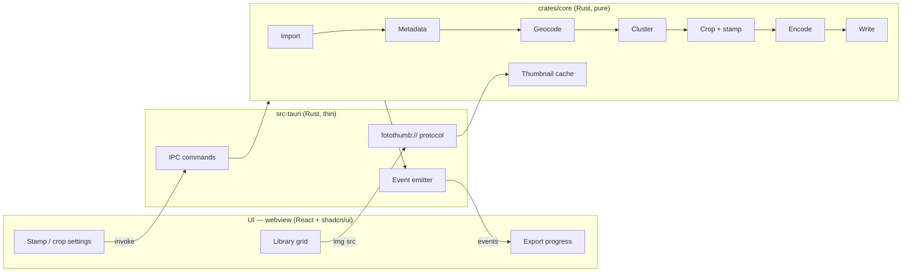

# Architecture — Fotollection

> **Status:** Draft v0.1 · **Last reviewed:** 2026-11-05
>
> This document describes **how** the system is built. Requirements live in [PRD.md](PRD.md).
> Performance design rationale lives in [OPTIMIZATION.md](OPTIMIZATION.md).
> Significant decisions are recorded as ADRs in [adr/](adr/README.md).
> When code and this document disagree, the disagreement is a bug: fix one of them in the same PR.

## 1. Overview

Fotollection is a **Tauri 2** desktop application ([ADR-0001](adr/0001-desktop-tauri-over-web.md)):

- A **Rust core** does all image work: decoding, metadata, geocoding, clustering, cropping, stamping, encoding and file I/O.
- A **thin web UI** (Vite + React + TypeScript, styled with Tailwind CSS, shadcn/ui components and Lucide icons; see [ADR-0007](adr/0007-ui-react-shadcn-lucide.md)) renders inside the operating system's own webview: WKWebView on macOS, WebView2 on Windows, WebKitGTK on Linux. No Chromium and no Node.js runtime are bundled.
- The core is a plain Rust library with **no dependency on Tauri** ([ADR-0002](adr/0002-rust-core-crate-separation.md)), so it can be unit-tested, benchmarked and fuzzed on its own.



## 2. Repository layout

Files marked † exist today. Everything else is planned.

```text
Cargo.toml               † # Cargo workspace, shared lints, build-size profiles
rust-toolchain.toml      † # pinned Rust version
deny.toml                † # cargo-deny license/advisory policy (ADR-0008)
package.json             † # npm workspace root: Tauri CLI + scripts (npm run dev)
assets/                 † # logo-source.png (master), logo-square.png (app icons ≥ 128 px), logo-small.png (simplified tile, no wordmark: every size ≤ 64 px), logo-mark.png (older crop)
crates/
  core/                  † # fotollection-core: all domain logic, no Tauri
    src/
      lib.rs             †
      print_size.rs      † # CEWE/EU print sizes (FR-006)
      import.rs          † # discovery, magic bytes, size + polyglot checks (FR-001)
      codec.rs           † # JpegCodec trait + pure-Rust implementation (ADR-0012); decode_image/image_dimensions dispatch by magic bytes (PNG via `png`, RAW and HEIC via `oscodec`); decode_for_screen gives a RAW's embedded preview for thumbnails and analysis; EncodeOptions::print (4:4:4, standard Huffman tables) for exports vs ::screen (4:2:0, plain) for previews/thumbnails
      jpeg_layout.rs     † # a JPEG's layout from its header (frame, sampling, first scan), which picks zune-jpeg or the reference decoder (ADR-0033); `ends_early` refuses a file cut short; `read_header` adds the Adobe transform and the ICC profile (FR-071)
      errors.rs          † # the ERR-<KIND>-<NNNN> code of every stable error code, held equal to docs/ERROR_CONTROL.md by its tests
      error_log.rs       † # the offline error log: one line per error and panic, rotated 5 × 1 MB, paths and file names cut to their extension; the text of Copy diagnostics
      raw.rs             † # camera RAW: the format from its bytes, the `RawDecoder`s tried in order (our own DNG reader, rawler, the OS codec; the OS codec second on macOS, last elsewhere), one full develop at a time (FR-016, ADR-0029, ADR-0030)
      raw_finish.rs      † # a rawler develop finished to the camera's look: per-channel curves matched to the embedded JPEG, or an automatic exposure and S curve (ADR-0029)
      image.rs           † # RgbImage + EXIF orientation transforms
      metadata.rs        † # EXIF allowlist + validation, embedded thumbnail (FR-002); one 128 KB head read gives the EXIF and the facts
      facts.rs           † # what each file is (FR-071): chroma subsampling, coding, bits, colour space by ICC name, sensor filter, DNG kind, decoder; `unusual()` for the grid badge
      settings.rs        † # RenderSettings and the UI settings, the recent postcard addresses (`remember_address`)
      plan.rs            † # RenderPlan: centred crop, stamp, optional frame plan, 3 mm border (FR-004/006/040/067), a shared photo's fill round it all (`pad`, FR-075)
      sheet.rs           † # collage sheets: cells, photo areas, pairing, render (FR-035, ADR-0032); a postcard sheet's one photo and card half (FR-073)
      postcard.rs        † # a postcard's back: dashed stamp box, the message's and the address's lines, typed text in Xanh Mono (its italic), Patrick Hand (drawn with Xanh Mono's capital height, FR-076) or the user's font, Inter for missing letters, bold, oblique and underline (FR-073)
      frame.rs           † # info frame: settings, camera profiles, text, ratio-safe layout (FR-040)
      logo.rs            † # user PNG logos: validation + decode (ADR-0014)
      fonts.rs           † # user OTF/TTF fonts: validation + FontArc (FR-042)
      settings_store.rs  † # settings.json v14: load/validate/atomic save (DATABASE.md §6)
      preview.rs         † # T2 LRU + preview rendering (FR-007)
      cancel.rs          † # CancellationToken
      stamp.rs           † # text inside the photo: DSEG14 Italic, date · place line + caption, LED glow (FR-004/005/033/036)
      text.rs            † # text measuring/drawing shared by stamp and frame, ASCII folding
      print_advice.rs    † # how large a photo prints well; sharp / acceptable / pixelated per print size (FR-026)
      straighten.rs      † # ±15° levelling: largest inscribed crop, bicubic resampling of the crop only (FR-006)
      brands.rs          † # bundled brand logos, EXIF make → brand, Classic/Original/Mono recolouring (ADR-0020)
      share.rs           † # share export targets: Original / Facebook / Instagram / custom sizes, JPEG settings (FR-053)
      colour.rs          † # ICC → sRGB with qcms (profiles from the decoders: JPEG APP2, PNG iCCP or gAMA/cHRM, ImageIO, WIC colour contexts), parallel over rows, one cached transform per profile (FR-027, ADR-0022); `screen` gives every in-app image sRGB (FR-072): thumbnails convert after the resize, previews their 2048 px copy, zoom the full image once
      sharpen.rs         † # light unsharp mask after a downscale (FR-053)
      exif_out.rs        † # minimal EXIF writer from an allowlist, never GPS; APP1 insertion (FR-010, FR-053)
      culling/           † # best-shot suggestions (FR-041): metrics.rs (sharpness, shake, exposure, noise, dHash),
                           # faces.rs (YuNet + FaceMesh eye aspect ratio), models.rs (bundled ONNX, BLAKE3, tract),
                           # similar.rs (layout + colour signature, ADR-0019), group.rs (bursts),
                           # score.rs (robust z within the group + reasons), cache.rs (analysis/)
      geocode.rs         † # offline reverse geocoder + place search: bundled GeoNames, BLAKE3-checked, 1° grid index (FR-005/032)
      xmp.rs             † # XMP sidecars of other apps, read only on import: `xmp:Rating` → stars or reject; ≤ 1 MB, no DTD (FR-058)
      places.rs          † # a photo's effective place (ADR-0027): set by hand → borrowed → GPS → none, with the user's names for renamed places; borrowing from another device's photo of the same scene (FR-005/031/032). GPX tracks are planned (FR-066)
      cluster.rs           # trip DBSCAN (Phase 2)
      library.rs         † # columnar in-memory library (DATABASE.md §3.3) + sparse per-photo edits (crop, rating, flag, date set by hand); the effective time with each body's clock offset (FR-030, ADR-0027)
      project.rs         † # project tables v11: snapshot/restore by folder+path, FK validation, relocate/resolve folders
      bundle.rs          † # .fotollection ZIP bundle: manifest + BLAKE3, allowlisted parts, zip-bomb limits (ADR-0016)
      cache_limit.rs     † # the disk cache's 2 GB limit: usage, LRU prune by modification time, clear, touch on hit (DATABASE.md §8)
      history.rs         † # undo/redo stack of inverse edits (FR-023)
      atomic.rs          † # tmp + fsync + .bak + rename
      presets.rs           # preset library: partial/stackable, linked, .fotopreset I/O (FR-033/034/038)
      looks.rs           † # colour looks (FR-079, FR-070, ADR-0038): the 33³ table, integer tetrahedral interpolation on rayon, a cache of the last 8 tables; the sliders and `.cube` LUTs bake into it
      render.rs          † # crop/resize (in linear light for share exports, `RenderPlan::linear_light`), border, a shared photo's fill (`compose_mat` for both) and the drawing of stamp and frame; the stamp, colour and sharpening live in stamp.rs, colour.rs and sharpen.rs. 4-up sheets and the contact sheet (FR-035, FR-037) will extend sheet.rs
      export.rs          † # bounded parallel export, cancel, per-photo errors, no overwrite (FR-008/009/011)
      thumbs.rs          † # T0 (embedded) + T1 disk cache (DATABASE.md §8)
    examples/          † # measure_* benchmarks named in OPTIMIZATION.md §3/§5, quality_export (print quality audit), eval_bestshot, raw_* and render_one helpers
    tests/             † # integration tests: pipeline.rs (import → export), jpeg_layouts.rs (every JPEG layout decodes, ADR-0033); fixtures/
  oscodec/               † # HEIC and camera RAW via ImageIO (macOS) / WIC (Windows): decode, dimensions, embedded preview; one of the two crates allowed `unsafe` (ADR-0017, ADR-0023)
  rawcore/               † # our own camera RAW decoder (ADR-0030), pure Rust, no `unsafe`: `tiff` (bounded IFD reader), `ljpeg` (lossless JPEG), `dng`, `cfa`, `demosaic` (Malvar–He–Cutler), `color` (the DNG colour model), `tone` (the camera's look from its embedded JPEG); `examples/mutate.rs` (mutation testing). `develop_mosaic` develops any Bayer mosaic, so it is first in `raw::decoders(kind)` for every Bayer format (ADR-0040); notes per format in `docs/raw/`
  rawlgpl/               † # camera RAW through rawler (LGPL-2.1, ADR-0029): `unpack` (the sensor's samples, levels, areas, white balance and matrices, in our own types, for our develop), embedded preview, size, and rawler's own develop as a fallback (X-Trans for now); panics caught; the only crate with an LGPL dependency, removed before any relicensing
  oscamera/              † # cameras over USB (ADR-0026, ADR-0028): `ptp` (pure, tested on hand-made answers), `vendor/sony.rs` (Sony's handshake, shutter, settings block and live view from `docs/cameras/sony.md`; pure, tested), `macos` (ImageCaptureCore: browse, session, any PTP operation, events), `windows` (WPD through its MTP extension commands, the same API, one thread per open camera); `examples/probe_camera.rs` (Step 0, macOS) and `examples/sony_remote.rs` (handshake, shot, live view). Used by the app through `src-tauri/src/camera.rs`; the other maker drivers come next. The other crate allowed `unsafe`
  geodata/               † # build-time packer for the GeoNames dataset (scripts/geodata/fetch-and-pack.sh); never shipped
src-tauri/               † # app shell: commands, protocol, capabilities
  src/lib.rs             † # tauri-specta builder + bindings export
  src/commands.rs        † # IPC commands (§6)
  src/state.rs           † # shared app state (library, settings, jobs); heavy work never on the UI thread (NFR-005)
  src/events.rs          † # typed events, core → UI (§6)
  src/protocol.rs        † # the `fotothumb://` protocol: thumbnails, previews, zoom regions, sources and collage sheets as JPEG bytes (§6)
  src/culling.rs         † # best-shot commands: analyse in the background, list groups, keep the best (FR-041)
  src/collage.rs         † # Collage mode: sheets, their order, turning, Auto turn and Revert, sheet facts, the `sheet` preview (FR-035)
  src/places.rs          † # place search, dates and places set by hand, renamed places (FR-005, FR-032); every input checked here
  src/document.rs        † # New / Open / Save / Save As / Relink of .fotollection documents (FR-023)
  src/menu.rs            † # native File/Edit/View/Window menu (macOS), rebuilt on language change
  src/camera.rs          † # tethered capture (FR-062, FR-063, ADR-0028): connect, a session thread that owns the camera (live view, settings every 300 ms, queued jobs), shots written atomically into a session folder that becomes a tab, Save all and Delete photos, `quit_app` after the closing question; the Sony logic is written against a `CameraLink` trait and tested with a scripted camera
  src/open_with.rs       † # "Open with" (FR-054, ADR-0024): one route for macOS Opened events, command-line paths and second launches; the photo's folder as a tab
  src/timing.rs          † # start-up milestones printed only with FOTOLLECTION_TIMING (NFR-010, scripts/measure-startup.sh)
  src/updates.rs         † # "Check for updates" (FR-061, ADR-0025): one GitHub request on click, the installer opened in the browser from Rust; "Report a problem" opens the fixed issue page (FR-069); "Copy diagnostics" reads the error log
  src/cache.rs           † # the disk cache's size, Clear cache, and the background prune under 2 GB (DATABASE.md §8)
  src/i18n.rs            † # the shell's own strings: menu, window title, dialogs (FR-020)
  src/demo.rs            † # debug builds only: records IPC answers for demo photos, for the website screenshots
  capabilities/          † # Tauri 2 permission sets (see SECURITY.md)
  icons/                 † # generated: npx tauri icon assets/logo-square.png, then uv run scripts/small-icons.py for the ≤ 64 px layers
  tauri.conf.json        † # window, CSP, bundle config
ui/                      † # Vite + React + TS frontend (npm workspace member)
  components.json        † # shadcn/ui config (style radix-nova, Lucide)
  .oxlintrc.json         † # lint rules (bans dangerouslySetInnerHTML / eval)
  src/
    components/ui/       † # shadcn/ui components (copied in via the shadcn CLI, owned by us)
    components/layout/   † # shared layout pieces (STYLE_RULE §4): side-panel, section-card, inspector-section, panel-note, collapse, viewer-frame, stage-spinner, hint-layer, key-hints, keys-info (the keys popover behind the info button), notice-stack (the main view's notices: an error with its dismiss button, a camera session, a task's progress)
    components/forms/    † # the lego blocks (STYLE_RULE §4): commit-input, field (Field, FieldLabel, Hint, Inset, ValueRow, RowList, FactLines, Stack), switch-field, segmented-toggle, swatch-toggle
    features/            † # one folder per feature (components + hooks): library/, culling/, best-shot/, viewer/, settings/, stamp/, frame/, fonts/, export/, places/, cameras/, capture/, project/, history/, open-with/, startup/, appearance/, about/, print-advice/, modes/, simple/, collage/. Among them: about/panel-footer.tsx (the panel's version line and its popover), about/report-issue.tsx (Report a problem, FR-069), collage/auto-turn-buttons.tsx (Auto turn and Revert, FR-035)
    i18n/                † # i18next setup + typed keys (FR-020, ADR-0015)
    locales/             † # en.json (default), vi.json — bundled, never fetched
    ipc/bindings.ts      † # GENERATED from Rust types — do not edit
    lib/                 † # small UI utilities (theme sync, shadcn's cn re-export)
    index.css            † # Tailwind layers + shadcn theme tokens (CSS variables)
scripts/                 † # bootstrap, clean, check-docs, release.sh (RELEASE.md §4), small-icons.py (≤ 64 px icons from assets/logo-small.png)
site/                    † # the website (Jekyll, GitHub Pages, EN + VI); screenshots/ makes its images from the real app on CC0 demo photos (site/README.md)
.github/workflows/       † # ci.yml, docs.yml, docs-with-code.yml (a code change comes with docs), release.yml (release on a version change, ADR-0021), installers.yml (builds the Windows MSI and NSIS installers when their configuration changes, publishes nothing), pages.yml (website, also every 6 hours)
bench/                   † # run.sh (Rust vs Chromium, 6 vs 8 in flight), batch.sh (5,000-photo memory check), lib.sh, web/ (Chromium via Playwright), chart.mjs (EN + VI SVG charts), results/ (numbers only, incl. budgets.json mirrored from OPTIMIZATION §3)
```

## 3. Tech stack

| Concern | Choice | Notes |
|---------|--------|-------|
| App shell | Tauri 2 | OS webview, small binary, capability-based permissions |
| UI framework | Vite + React 19 + TypeScript | Required by shadcn/ui ([ADR-0007](adr/0007-ui-react-shadcn-lucide.md)) |
| UI components | shadcn/ui (Radix primitives) + Tailwind CSS v4 | Components are copied into the repo, so we own and audit them |
| UI localization | `i18next` + `react-i18next` (MIT), bundled JSON locales | Typed keys, CLDR plurals, no runtime fetch ([ADR-0015](adr/0015-ui-localization-i18next.md)) |
| Project bundle | `zip` (MIT), deflate only via `flate2` + pure-Rust `miniz_oxide` | One-file `.fotollection` like `.docx`, readable by any unzip tool ([ADR-0016](adr/0016-self-contained-project-bundle.md)) |
| Icons | Lucide (`lucide-react`) | Tree-shaken: import individual icons only |
| Virtualized grid | `@tanstack/react-virtual` | Required for 1,000+ thumbnails ([NFR-001](PRD.md#nfr-001--library-load-time)) |
| UI state | React state and hooks | Server state lives in Rust. The UI only caches it |
| IPC type bindings | `specta` + `tauri-specta` | TS types generated from Rust and checked in CI |
| JPEG decode/encode | **Today:** `zune-jpeg` + `jpeg-encoder` (pure Rust) behind the `JpegCodec` trait ([ADR-0012](adr/0012-pure-rust-codecs-first.md)). `jpeg_layout` reads the header first: zune decodes only the layouts the corpus test proves, `jpeg-decoder` every other one and any file zune refuses ([ADR-0033](adr/0033-reference-jpeg-decoder.md)). **Candidate:** `turbojpeg` behind the same trait for DCT scaling and lossless crop ([ADR-0004](adr/0004-libjpeg-turbo-default-codec.md), superseded by ADR-0012) | Prints: 4:4:4, quality 95, ICC copied. Share exports: 4:2:0 (`share.rs`). Previews: 4:2:0 |
| JPEG max-quality encode | `mozjpeg` (optional) | Opt-in "smallest file" mode |
| HEIC/HEIF | OS codecs via `fotollection-oscodec`: ImageIO (`objc2-image-io`) on macOS, WIC (`windows`) on Windows | Nothing linked, no LGPL; Windows needs the HEIF/HEVC Store extensions ([ADR-0017](adr/0017-heic-through-os-codecs.md)) |
| Camera RAW | `crates/core/src/raw.rs` recognises the format by its bytes and tries its decoders in order: our own develop (`crates/rawcore`; DNG read by our reader, other formats unpacked by `rawlgpl::unpack`), rawler's develop (`crates/rawlgpl`), then the OS codecs (on macOS ImageIO comes before rawler, and first of all for RW2 and ORF, which it corrects for lens distortion); one full develop at a time | rawler is the only LGPL dependency ([ADR-0029](adr/0029-raw-through-rawler-then-our-own-decoder.md)); Windows needs no Raw Image Extension, which is only a last fallback when installed ([ADR-0023](adr/0023-raw-through-os-codecs.md), [ADR-0030](adr/0030-our-own-raw-decoder.md)) |
| PNG | `png` | |
| Face models (FR-041) | `tract-onnx` (MIT/Apache), pure Rust; YuNet + FaceMesh V2 ONNX compiled in | One code path on macOS and Windows, no native runtime; BLAKE3-checked at load ([ADR-0018](adr/0018-face-models-and-runtime.md)) |
| Resize | `fast_image_resize` | SIMD (NEON/AVX2) |
| Colour management | `qcms` | Preserve or convert the ICC profile (`colour.rs`) |
| Text rendering | `ab_glyph` `FontArc`: bundled Inter (OFL, variable weights) or a user OTF/TTF (FR-042) | `cosmic-text` if complex shaping is ever needed |
| EXIF read | `kamadak-exif` | Allowlisted fields only. Also extracts the IFD1 thumbnail for T0 |
| EXIF write | our own `exif_out.rs` (`little_exif` only in tests) | Writes the privacy-filtered metadata |
| Reverse geocoding | GeoNames `cities1000`, packed by `crates/geodata`, indexed in a 1° grid at first use | Offline, 5.4 MB packed, no extra dependency ([ADR-0003](adr/0003-offline-geocoding-geonames.md)) |
| Trip clustering | DBSCAN over (lat, lon, time) | Phase 2 |
| Perceptual hash | our own dHash and layout signature (`culling/`) | FR-024 |
| Face detection | ONNX model via `tract-onnx` ([ADR-0018](adr/0018-face-models-and-runtime.md)) | On-device |
| Parallelism | `rayon`, photos in flight bounded by memory (`export::inflight_for`) | See [§5](#5-concurrency-and-memory-model) |
| Errors | `thiserror` (core), `anyhow` (shell only) | See [STYLE_RULE.md](STYLE_RULE.md) |
| Project file | `serde_json` + versioned schema | [ADR-0010](adr/0010-project-file-format.md) |
| GPX tracks | `gpx` (candidate; license checked by `cargo deny`) | Phase 2, [FR-031](PRD.md#fr-031--borrow-gps-from-a-phone-or-gpx-track) |
| PDF contact sheet | `pdf-writer` or `printpdf` (candidate, permissive license) | Phase 3, [FR-037](PRD.md#fr-037--contact-sheet) |
| Stamp fonts | Bundled OFL/MIT fonts, including a seven-segment LED face | [FR-033](PRD.md#fr-033--retro-film-date-stamp-and-stamp-presets) |
| Photo Style engine | Own code: parameters baked into a 33³ 3D LUT (trilinear, SIMD) + 1D tone curve + seeded grain | [ADR-0011](adr/0011-photo-style-looks.md) |
| Persisted data model | Normalized tables in JSON (3NF, integer keys, sparse rows) | [DATABASE.md](DATABASE.md) |
| PNG decoding (logos) | `png` (pure Rust) | [ADR-0014](adr/0014-user-supplied-brand-logos.md) |

Crates marked *candidate* are confirmed by Phase 0 benchmarks. The result is logged in [OPTIMIZATION.md](OPTIMIZATION.md#5-benchmark-log).

## 4. Processing pipeline

```text
import → metadata → adjust → geocode → (cluster) → cull/select → plan → render (crop → style → border/stamp) → color → (sharpen) → encode → write
```

| Stage | Input → Output | Notes |
|-------|----------------|-------|
| **import** | paths → `PhotoRef { id, path, kind, size, mtime }` | Magic-byte check only, no decoding |
| **metadata** | `PhotoRef` → `PhotoMeta` | Allowlisted EXIF, validated values ([SECURITY.md §3](SECURITY.md#3-input-and-metadata-defense)) |
| **adjust** | `PhotoMeta` + project → `EffectiveMeta` | Clock offset per camera, manual date/place, borrowed GPS. Originals are kept for reference ([FR-030](PRD.md#fr-030--camera-clock-offset)–[FR-032](PRD.md#fr-032--manual-date-and-place)) |
| **geocode** | `(lat, lon)` → `Place` | The town whose reach the photo is deepest in (reach grows with √population), about 5 µs per lookup |
| **cluster** | `[PhotoMeta]` → `[Trip]` | Phase 2 |
| **cull/select** | library + filter → export set | Ratings, flags and copies come from the project ([FR-022](PRD.md#fr-022--culling-rate-flag-filter)) |
| **plan** | meta + settings → `RenderPlan` | Pure function: print size per photo, crop rect, border, safe area, stamp/caption text and position, colour intent, output path. Also yields the effective-DPI check ([FR-026](PRD.md#fr-026--resolution-warning)) |
| **frame** | photo + `FramePlan` → canvas | When enabled: a canvas at the print ratio; the photo is cropped to fill or fitted above the info bar; brand + lines drawn (FR-040) |
| **render** | `RenderPlan` + pixels → pixels | Crop, then the **Photo Style look** (one 3D-LUT pass + tone curve + grain, [FR-039](PRD.md#fr-039--photo-style-looks)), then fit into the border, then stamp/caption inside the safe area. Overlays come after the look, so they are never tinted |
| **color** | pixels + source ICC → sRGB pixels | `qcms` transform, one cached per profile ([FR-027](PRD.md#fr-027--srgb-conversion-for-labs), [FR-072](PRD.md#fr-072--our-own-develop-core)) |
| **sharpen** | pixels → pixels | Output sharpening for size and paper (Phase 3, [FR-029](PRD.md#fr-029--output-sharpening)) |
| **encode** | pixels → bytes | `jpeg-encoder` behind `JpegCodec` ([ADR-0012](adr/0012-pure-rust-codecs-first.md)), ICC re-embedded, metadata filtered ([FR-010](PRD.md#fr-010--metadata-privacy-on-export)) |
| **write** | bytes → file | Written to a temp file, then atomically renamed. Removed if the user cancels |

`RenderPlan` is pure and serializable. The **preview** and the **export** both consume the same plan, so what the user sees is what gets printed.

## 5. Concurrency and memory model

- The UI thread only renders the UI. The Tauri command handlers return immediately and run jobs on the core's worker pool.
- **Export** is a staged pipeline connected by **bounded channels** (back-pressure). The number of decoded full-resolution buffers in flight is capped (`max_inflight`, default `num_cpus`, then clamped by the memory budget in [NFR-004](PRD.md#nfr-004--memory-ceiling)).
- Each job carries a `CancellationToken`. Every stage checks it between photos and between expensive steps.
- Progress events are coalesced to at most 30 per second.
- Three pools never compete:
  - the **interactive** pool (2 threads) serves `fotothumb://` requests for what is on screen;
  - the **background** pool (2 threads) reads EXIF during import and pre-generates T1 thumbnails;
  - **export** has its own bounded pool.

  Visible thumbnails therefore never wait behind background work. A request for a photo whose T1 isn't ready gets the embedded T0 at once.
- A RAW develop runs one at a time (`raw::DEVELOP`, NFR-004), on a plain thread of its own, never on a pool thread: a pool thread waiting for the develop's rayon work would take up other requests meanwhile, and one asking for a develop would wait for the lock its own thread holds (LESSONS 2026-11-03). Its parallel work runs on a pool of its own (`raw::develop_pool`), never the global one, where callers waiting for the lock could hold every thread (LESSONS 2026-11-05).

## 6. IPC contract

All types are defined in Rust and exported to `ui/src/ipc/bindings.ts` through `tauri-specta`. CI fails if the bindings are stale.

Every command fails with an `IpcError { code, err, message }`: `code` is the stable key the interface translates (`errors.<code>` in the locales), `err` its permanent `ERR-<KIND>-<NNNN>` code from [ERROR_CONTROL.md](ERROR_CONTROL.md), shown after the message (`ui/src/lib/errors.ts`), and `message` the English detail. Camera problems carry the same pair (`CameraIssue`).

### Commands (UI → core)

Commands marked † are implemented.

| Command | Purpose | Requirement |
|---------|---------|-------------|
| `app_info() -> AppInfo` † | App and core versions for the About section, and the OS (Windows draws its own title bar) | FR-021, FR-052 |
| `list_print_sizes() -> [PrintSize]` † | Print sizes for the settings panel | FR-006 |
| `pick_and_import_folder() -> ImportSummary?` † | Opens the folder dialog **in Rust** and imports it. Drag-and-drop on the window uses the same import path | FR-001, FR-002 |
| `remove_folder(folder) -> DocumentState` † | Takes a folder out of the library like closing a tab: rebuilds the library from the other folders and re-applies their edits; files are untouched; ids and undo history reset | FR-001 |
| `refresh_library() -> ImportSummary` † | Scans the library's folders again and adds photos that appeared since; photos already known keep every edit, and a refresh that finds nothing marks nothing as edited | FR-001, FR-023 |
| `list_photos(filter) -> { photos: [PhotoSummary], total, customStamps, folders: [FolderSummary], printCount, asideCount }` † | Data for the grid, sorted by capture time and filtered in Rust by flag, minimum rating, folders (empty = all) and view (`gallery` hides photos set aside; `print` and `aside` show one holding area). Summaries carry `rating`, `flag` and `queue`; `folders` lists every source folder with its unfiltered count | FR-003, FR-022, FR-050, FR-056 |
| `get_settings()` / `set_settings(settings) -> SettingsState` † | Validated render settings plus a `revision` used to refresh previews | FR-004, FR-006 |
| `get_ui_settings()` / `set_ui_settings(ui) -> UiSettings` † | Interface language (`en` / `vi`, v3), theme (v6), mode (`simple` / `collage` / `professional`, v10) and export folders (`oneFolder` / `byDay`, v12, FR-009), stored per machine in `settings.json` | FR-020, FR-052, FR-048 |
| `pick_export_folder() -> String?` † | Opens the destination dialog **in Rust** and remembers the choice | FR-009 |
| `estimate_export(filter, only, ticked, sheets) -> ExportEstimate` † | For the same photos as `start_export`: the originals' total and the export's estimated size, from up to four photos encoded in memory with the current settings; nothing is written | FR-053 |
| `start_export(filter, only, ticked, separate, sheets) -> JobId` † | `ticked` (the photos ticked in select mode, when there are some) exports only those (FR-050, v0.8.3). With `sheets`, the photos go out two to a print, one file `<first>+<second>.jpg` per sheet, or with `only` just the sheet holding that photo (FR-035). Exports exactly the photos `filter` keeps (the set the grid shows, including its folders), or only the photo `only` (the preview), to the chosen destination, as prints or share files (`render.exportTarget`); `separate` gives each source folder its own subfolder; inside, everything goes into one folder or a folder per day, as `ui.exportFolders` says (FR-009); with `sheets` and postcards on, each sheet is a postcard (FR-073) | FR-008, FR-009, FR-010, FR-022, FR-053, FR-055, FR-056 |
| `cancel_job(job_id)` † | Cancel a running job | FR-011 |
| `get_frame_config()` / `set_frame_settings(settings)` † | Info frame settings plus camera profiles (with EXIF-derived defaults) | FR-040 |
| `set_camera_profile(profile)` † | Per-camera overrides: name, brand, lens, focal, aperture, photo style, logo kind | FR-040 |
| `list_cameras() -> CameraClock[]` † / `set_camera_clock(id, offset_s, tz_minutes?) -> CameraClock[]` † | Camera bodies (make, model, serial) and their clock corrections; offsets beyond a month and time zones beyond ±14 h are rejected in Rust; every photo of the body moves (effective time, [ADR-0027](adr/0027-effective-time-and-place.md)) | FR-030 |
| `search_places(query ≤ 100 chars, limit ≤ 50) -> Place[]` † | Offline search of the bundled places, diacritics ignored, largest first | FR-032 |
| `set_photo_date(ids, date?)` † / `set_photo_place(ids, geonames_id?)` † | A date (1826–2100) or a place (an id in the bundled data) set by hand on 1–10,000 photos, or cleared; one undoable step. The effective date and place follow ADR-0027 | FR-032 |
| `find_borrowed_places(window_min 1–60) -> BorrowReport` † / `accept_borrowed_places(accepted[])` † | Places for photos without one from another device's photo of the same scene (signatures from the best-shot analysis, computed and cached when missing): high confidence applied as one undoable step, medium returned to review; also run after every analysis. Accepting never replaces a place set by hand or a photo's own GPS | FR-031 |
| `list_places() -> PlaceUse[]` † / `rename_place(geonames_id, name?)` † | The places of the library's photos with their counts, and the name printed for one (≤ 80 characters; `None` back to the dataset's); not in the undo history | FR-005 |
| `clock_offset_between(photo, reference) -> f64` † / `clock_match_candidates(photo, limit ≤ 24)` † | The helper: the offset that makes a photo match another device's photo of the same moment, and the other devices' photos closest in time (within a day) to pick from | FR-030 |
| `pick_camera_logo(camera_id)` / `clear_camera_logo(camera_id)` † | Choose a PNG with a **Rust-side** dialog, validate it, copy it into `config/logos/` | FR-040 |
| `get_crop_geometry(id, sheet?) -> CropGeometry` † | Upright size, target ratio, printed cm of the crop area, current crop; with a collage `sheet`, the photo's area in its cell | FR-006, FR-035 |
| `set_photo_crop(id, crop?, straighten, amend)` † | Set or reset a photo's crop (centre + zoom) and straightening angle (±15°, clamped in Rust), undoable; with `amend`, folded into the same photo's previous step, as a drag in the preview does | FR-006, FR-023 |
| `rotate_photos(ids, clockwise)` † | Lossless quarter turns on top of the EXIF orientation, composed into one pass (`image::compose_orientation`); crops turn with the photo; undoable | FR-006 |
| `set_photo_rating(ids, 0–5)` † / `set_photo_flag(ids, pick\|reject\|null)` † | Culling: one undoable step for 1–10,000 photos; ratings above 5 and unknown IDs are rejected | FR-022, FR-023 |
| `set_photo_queue(ids, print\|aside\|null)` † | The print basket and set aside (`null` back to the gallery): one undoable step for 1–10,000 photos; nothing is deleted | FR-050, FR-023 |
| `list_sheets(filter) -> SheetPair[]` † / `set_collage_order(ids)` † / `turn_sheet(first)` † / `set_collage_crop(id, crop?, straighten)` † / `rotate_collage_photo(id)` † | Collage mode: the sheets of the photos shown, paired in collage order (`photos[].collage`, then the view's); a drag sends the photos shown in their new order, which take back their slots in the library's one order; turning a sheet flips `sheet_turned`; a cell's crop is `collage_crop`, apart from the print crop; a photo's quarter turns in its cell are `collage_rotation` (its crop editor reads `fotothumb://…/source/{id}?sheet=1`, turned the same way). Each change is one undoable step | FR-035, FR-048 |
| `auto_turn_collage(filter, revert) -> u32` † | Auto turn: every sheet shown lies landscape, each photo turned to stand if it lies; with `revert`, every sheet and photo back to its own orientation. One undoable step; returns how many photos changed | FR-035 |
| `sheet_info(sheet) -> SheetInfo` † | A sheet's size and, per photo, its area, the suggested size, the photo left inside the 3 mm border and its DPI band, from the photos' header sizes | FR-035, FR-026 |
| `get_photo_stamp(id)` / `set_photo_stamp(id, stamp?)` † | One photo's own date stamp from the preview (FR-044); `null` follows the settings again. Undoable; the caption is validated in Rust | FR-044 |
| `set_photo_caption(ids, caption?)` † | Photos' own line under the date (FR-036), from a collage sheet's preview; `null` uses the stamp's again. One undo step; validated in Rust like the stamp's caption | FR-036 |
| `set_postcard_text(id, part, text?)` †, `get_postcard_text(id)` † | One part of a photo's postcard (FR-073), `message` or `address`; `null` or blanks leave its lines blank. At most 400 characters and 8 lines for the message, 200 and 4 for the address, no control character but line breaks, checked in Rust (`ERR-IPC-0022`). One undo step | FR-073 |
| `postcard_cuts()` † | The postcards whose message or address does not all fit its lines as the print sets them (`postcard::fit`), for the red warning on the card, its preview and the part's field; empty while postcards are off. Read only | FR-073 |
| `postcard_text_gaps(filter, source, part, ticked) -> TextGaps` †, `apply_postcard_text(filter, source, part, overwrite, ticked) -> u32` † | How many other postcards shown (or ticked) lack this card's message or address, or have another; and putting it on them, the blank ones or all, in one undo step (`edit_photos`). The text is the card's own, read in Rust, never sent by the webview; `ERR-IPC-0023` when it is blank | FR-077 |
| `recent_addresses() -> Vec<String>` †, `forget_address(address)` † | The addresses last typed on this machine's postcards, newest first, at most 8 (`settings::remember_address`, saved in `settings.json`); forgetting one saves the list | FR-077 |
| `apply_stamp_to_all(id)` / `reset_photo_stamps()` † | "Apply to all" in the preview (the photo's stamp becomes the setting and no photo keeps its own) and "Reset" in the settings panel (every photo follows the settings again) | FR-044 |
| `set_raw_look(id, look)` †, `apply_raw_look_to_all(look)` † | How a camera RAW is finished (FR-072, ADR-0040): neutral or like the camera's JPEG, for one photo or every RAW of the library, one undo step each; `PhotoLook.raw` and `PhotoSummary.rawLook` tell the UI | FR-072 |
| `get_photo_look(id) -> PhotoLook` †, `set_photo_look(id, look?, amend)` †, `apply_look_to_all(id)` † | A photo's own colour look in the preview (FR-079): its look and whether it is its own; set (sanitized in Rust) or `null` to follow the settings, `amend` folding a slider's drag into one undo step; *Apply to all* makes it the setting and clears every photo's own, one undo step | FR-079 |
| `undo()` / `redo()` † | History (also Cmd/Ctrl+Z, Shift+Cmd/Ctrl+Z) | FR-023 |
| `list_fonts()` / `import_font()` / `remove_font(id)` † | User fonts; import opens a **Rust-side** dialog and copies a validated file | FR-042 |
| `photo_details(id) -> PhotoDetails` † | Inspector data: the camera, lens and exposure as the info frame names them (`frame::shot_summary`, FR-078), pixel size (header only), file size, GPS, effective DPI at the current print size, the image facts (a RAW's sensor read here once, from the whole file, and kept) | FR-002, FR-007, FR-026, FR-071 |
| `print_advice(id) -> PrintAdvice` † | Largest sharp (300 DPI) and acceptable (150 DPI) print of a photo, and a sharp / acceptable / pixelated verdict per built-in and custom size | FR-026 |
| `get_document() -> DocumentState` † | Current document: name, unsaved flag, library generation, folders still to relink | FR-023 |
| `new_document()` / `open_document()` / `save_document()` / `save_document_as()` † | Project lifecycle. Open and Save As use **Rust-side** dialogs; Save writes the current document or falls back to Save As. Open validates the whole bundle before changing anything | FR-023 |
| `document_requested() -> bool` † | Whether the OS handed over a project the UI has not opened yet; asked after `startup-finished`, since a cold launch can announce it before the page listens | FR-023, FR-054 |
| `open_requested_document()` † | Opens the file the OS handed over (file association), after the UI settled unsaved changes. The path is stored in Rust, never sent by the webview | FR-023 |
| `camera_connect() -> CameraInfo` † | Finds a camera (Windows, WPD), runs the maker's handshake and starts a session: `{ name, settings }`. Errors: `camera.not_found`, `camera.unsupported` (not a Sony body yet), `camera.busy` (another app such as Imaging Edge Remote holds it), `camera.already_connected`, `camera.timeout`; on macOS `camera.unavailable_platform` | FR-062, FR-063 |
| `camera_disconnect()` † | Ends the session; the session folder and its tab stay | FR-063 |
| `camera_capture()` † | Queues one shot and returns at once; the result is `camera-shot` or `camera-shot-failed` | FR-063 |
| `camera_step(setting: "iso" \| "shutter", delta)` † / `camera_set_format("jpeg" \| "raw")` † | Moves ISO or shutter speed by steps (−10…10) / sets the file format; queued like a shot | FR-063 |
| `camera_sessions() -> [u16]` † | The folders (tab ids) that are camera sessions, which offer Save all | FR-063 |
| `save_camera_session(folder) -> DocumentState?` † | Save all: picks the destination with a Rust-side dialog, moves the session's files there without overwriting any (copy, size check, then delete across volumes) and rebuilds the library with every edit kept; `None` when cancelled. Errors: `camera.still_connected`, `camera.bad_destination`, `camera.destination_open`, `camera.save_failed` | FR-063, ADR-0028 |
| `discard_camera_session(folder) -> DocumentState` † | Delete photos: removes the session folder (only one under the app's `camera/` directory) and closes its tab | FR-063, ADR-0028 |
| `take_photo_request() -> OpenPhoto?` † | The photo the OS asked to show ("Open with"), once: `{ id, folder }`, kept in Rust until taken, so a request made during start-up is not lost | FR-054 |
| `startup_finished() -> bool` † | Whether the last session is back, for a page that loaded after `startup-finished`; the start-up screen waits for it | FR-060 |
| `check_for_update() -> UpdateCheck` † / `open_update_download()` † | On click only: asks GitHub for the latest release (`{ current, latest, newer, pageUrl }`) and keeps the installer link for this system in Rust; the second opens it in the browser. Errors: `update.offline`, `update.unreadable`, `update.none` | FR-061 |
| `open_issue_page()` † | Report a problem: opens the project's issue page in the browser; the address is fixed in Rust, so the webview cannot open another, and the app sends nothing | FR-069 |
| `diagnostics() -> string` † | Copy diagnostics: the version, the system and the last 20 lines of the error log, without paths ([ERROR_CONTROL.md §3](ERROR_CONTROL.md#3-status-of-the-plan-v091)) | FR-069 |
| `quit_app()` † | Closes the app after the user answered the closing question: the camera is let go and the app waits (at most 10 s) for the last shot to be written | FR-063, ADR-0028 |
| `cache_usage() -> CacheUsage` † / `clear_cache() -> CacheUsage` † | The thumbnail and analysis cache's size against its 2 GB limit (`{ bytes, files, limitBytes }`), and emptying it | DATABASE §8 |
| `rename_document(name) -> DocumentState` † | Renames the project: the saved file in its folder (never over another file), or the name an untitled project will be saved under. The name is validated in Rust as a portable file name | FR-023 |
| `relink_folder(folder_id)` † | Picks the new location of a missing folder (Rust-side dialog), re-scans it and restores its edits | FR-023 |
| `analyze_library() -> JobId` † | Best-shot analysis of every photo on the background pool, reusing the analysis cache; cancel with `cancel_job`. A second call while one runs returns the running job | FR-041, NFR-014 |
| `list_groups() -> [Group]` † | Groups of similar shots from the last analysis: `{ id, result: { photos (best first, with score parts, closed eyes, faces), reasons, tooClose } }`. `id` is the group's first photo | FR-041 |
| `keep_best(groups) -> HistoryState` † | Picks each group's best photo and rejects the rest as one undoable step; 1–5,000 groups, unknown groups are rejected | FR-041, FR-022 |
| `keep_one(group, photo) -> HistoryState` † | Keeps the chosen photo of one group and rejects the others, one undoable step (for "Too close to call" or a different preference) | FR-041, FR-022 |
| Filters by date, camera, GPS, DPI in `list_photos` | Planned culling filters | FR-022, FR-026 |
| `set_copies(ids, n)` / `order_summary() -> OrderSummary` | Copies and cost estimate | FR-024 |
| `set_print_size(ids, size_id)` | Per-photo print size | FR-025 |
| A GPX track command (name to be decided) | Places from a GPX track, interpolated along it | FR-066 |
| `list_presets()` / `save_preset(preset)` / `delete_preset(id)` | Preset library (stamp, lab, style and print groups) | FR-033, FR-034, FR-038 |
| `apply_preset(ids, preset_id)` / `detach_preset(ids)` / `reset_to_preset(ids)` | Link, detach or reset photos | FR-038 |
| `preview_preset(id, preset_id) -> PreviewHandle` | Hover preview without applying | FR-038 |
| `import_preset(path)` / `export_preset(id, path)` | Share `.fotopreset` files | FR-038 |
| `set_style(ids, style)` | Per-photo Photo Style override | FR-039 |

### Events (core → UI)

Events are typed through `tauri-specta` and named in kebab-case. Events marked † are implemented.

| Event | Payload |
|-------|---------|
| `library-changed` † | `{ count }`. Sent after imports and after every edit, undo and redo (ratings and flags are part of the list). The UI refetches `list_photos` |
| `thumb-ready` † | `{ id }`. The T1 thumbnail is cached, so the UI bumps the image URL |
| `export-progress` † | `{ jobId, done, total }`, coalesced to ≤ 30 per second |
| `export-finished` † | `{ jobId, summary: { exported, failed[], cancelled, destination, sourceBytes, outputBytes } }`. Per-photo failures are reported here; the two sizes let the UI say how much lighter the export is |
| `revision-changed` † | `{ revision, canUndo, canRedo }` after any render-affecting edit; previews refresh |
| `document-changed` † | `{ document }` after any edit, save, open, new or relink; the window title follows (`Trip — Edited — Fotollection`) |
| `menu-action` † | `{ action: new \| open \| save \| saveAs \| modeSimple \| modeCollage \| modeProfessional \| openRequested }` from the native File and View menus (macOS) or a file handed over by the OS; the UI runs its own flow, unsaved-changes question included |
| `quit-blocked` † | `{ sessions, connected }`: closing the app was held back because shots exist only in Fotollection's data (a camera connected, or session tabs not saved); the UI asks *Save all*, *Delete photos* or *Cancel*, then calls `quit_app` (ADR-0028) |
| `camera-status` † | `{ connected, name, issue? }`: a session started, or ended (`issue` says why: unplugged, failed calls) |
| `camera-frame` † | `{ seq }`: a new live-view frame at `fotothumb://localhost/camera/live?seq={n}` |
| `camera-settings-changed` † | `{ settings: { iso?, isoAuto, shutter?: { numerator, denominator }, aperture?, format? } }`, only when a value changed |
| `camera-shot` † | `{ id, folder, ms }`: a shot is in the session tab; `ms` from the press (NFR-018), 0 when the camera's own shutter took it |
| `camera-shot-failed` † | `{ issue }`: a press did not give a photo (`camera.no_shot`), or a step or format change was refused |
| `open-photo` † | `{ id, folder }`: a photo handed over by the OS is in the library; the UI takes it with `take_photo_request`, shows its folder's tab and opens the preview once that folder is listed |
| `startup-finished` † | The last session is back (or there was none): the start-up screen fades out (FR-060) |
| `task-progress` † | `{ task: "import" \| "thumbnails" \| "analyze", done, total }`, coalesced to ≤ 30 per second. Drives the progress bar |
| `analysis-finished` † | `{ jobId, analyzed, failed, groups, cancelled }`. The UI refetches `list_groups` |
| `project://saved` | `{ path, at }`, for the autosave indicator |
| `history://changed` | `{ can_undo, can_redo }` |

### Binary data

Pixels **never** cross IPC as JSON or base64. Thumbnails and previews are served by the asynchronous custom URI scheme `fotothumb` on a low-priority worker pool. On Windows it is addressed as `http://fotothumb.localhost/…`:

- `fotothumb://localhost/thumb/{id}?v={n}`: the cached T1, else the embedded T0, else a T1 generated on the spot. `v` bumps on `thumb-ready`.
- `fotothumb://localhost/source/{id}?rev={n}`: the upright, **uncropped**, unstamped T2 image, the crop editor's background.
- `fotothumb://localhost/preview/{id}?rev={n}`: about 1600 px, rendered from the T2 cache with the **same** `RenderPlan` code as the export. `rev` is the settings revision; `&plain=1` leaves the colour look out, for *Before* (FR-079); `&mask=1` gives a grey PNG of where the photo itself is (the stamp, frame, border and fill left out), and `fotothumb://localhost/look/{id}?rev={n}` the photo's look as a 33³ RGBA8 table (empty when it changes nothing), for the look drawn on the GPU while a slider is dragged (`ui/src/features/viewer/gpu-look.ts`, [ADR-0039](adr/0039-gpu-for-editing-cpu-for-exports.md)).
- `fotothumb://localhost/preview/{id}?rev={n}&region={x},{y},{w},{h}&px={n}`: one part of the **full-resolution** render, for zoom past the preview's pixels (FR-057). The region is in fractions of the photo and `px` the widest it should come back (at most 4,096); both are checked in Rust before any work. The full image the preview was decoded from is kept in a second cache bounded at about 200 MB (`PreviewCache::full`; the newest photo always stays), so the first region decodes nothing again, rendered with the export's plan, and only the region is encoded. The UI lays that part over the zoomed preview at its final on-screen size and only translates it: a CSS `scale()` would make WebKit rasterise it at its small layout size first and lose the detail.

- `fotothumb://localhost/sheet/{first}/{second}?rev={n}[&small=1]`: a collage sheet (FR-035), both photos from the T2 cache through `sheet::render_sheet`, the same code as its export; 1600 px, or 640 px with `small=1` for the sheet grid, which renders from the photos' T1 thumbnails (no photo decoded again when a setting changes, OPTIMIZATION §4.2). `{second}` is left out for an odd last photo.
- `fotothumb://localhost/camera/live?seq={n}`: the connected camera's latest live-view frame, a JPEG already in memory (FR-062). It is never decoded, cached or written to disk; `seq` only defeats the webview's cache.

The UI just sets ``. Routes are parsed strictly: anything other than these routes returns 404. A photo that cannot be shown answers 500 with its `IpcError` as JSON (`{ code, err, message }`, also written to the error log); the stage reads it on the image's `error` and shows the reason with its `ERR-` code (`useShownSrc`), never a spinner for good.

## 7. Persistence

All persisted data (project files, settings, presets, the thumbnail cache, built-in datasets), with schemas, versioning and write protocol, is specified in **[DATABASE.md](DATABASE.md)**. In short: there is no database server or SQL database. Work lives in a versioned JSON project file ([ADR-0010](adr/0010-project-file-format.md)), writes are atomic, and source files are never modified.

## 8. Platform notes

| | macOS | Windows | Linux ([ADR-0034](adr/0034-linux-lean.md)) |
|---|---|---|---|
| Webview | WKWebView (system) | WebView2 (evergreen, bootstrapped by installer) | WebKitGTK 4.1 (bundled in the AppImage, a dependency of the `.deb`); DMA-BUF renderer off with Nvidia's driver (`main.rs`) |
| Native deps | None (ImageIO and Core Graphics are system frameworks) | None (WIC is part of Windows; HEIC needs the Store extensions) | GTK 3 and WebKitGTK; no OS codec (`oscodec` answers unsupported), no camera module |
| Target | `universal-apple-darwin` | `x86_64-pc-windows-msvc` | `x86_64-unknown-linux-gnu`, `aarch64-unknown-linux-gnu`, built on Ubuntu 22.04 (glibc 2.35) |
| Packages | `.dmg` | `-setup.exe`, `.msi` | AppImage, `.deb` (`tauri.linux.conf.json`) |

Release packaging and signing are described in [RELEASE.md](RELEASE.md).
