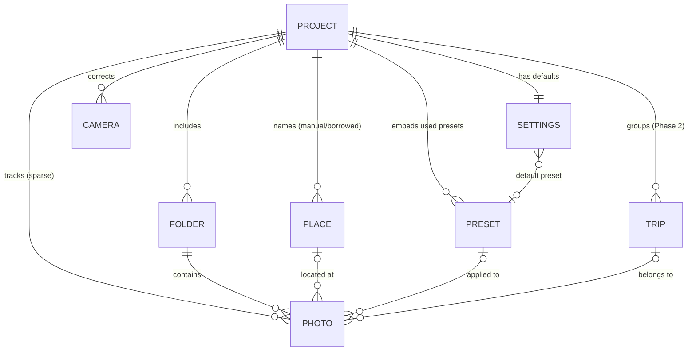

# Data & Persistence — Fotollection

> **Status:** Draft v0.2 · **Last reviewed:** 2026-11-12
>
> This document is the single source of truth for **everything Fotollection stores**: where it lives, the **normalized data model**, the schemas, versioning and migration, safe writes, the in-memory layout, and retention.
> Fotollection has **no database server and no embedded SQL database** ([ADR-0010](adr/0010-project-file-format.md)). Persistent state is a small set of versioned files, modelled **as if they were relational tables** and normalized to 3NF ([§2](#2-normalization-rules)).
> Any change to a persisted format updates this document, the schema version and a migration **in the same commit** ([§9](#9-change-procedure)).
> File types as a whole (extensions, MIME types, UTIs, how each file is recognized, compatibility rules) are registered in [EXTENSION.md](EXTENSION.md).

## 1. Storage map

| Store | Format | Location | Owner (core module) | Lifetime | Personal data? |
|-------|--------|----------|---------------------|----------|----------------|
| **Project document** `*.fotollection` † | ZIP bundle: `project.json` (the tables, [§4](#4-project-file-schema)) + `settings.json` + used fonts, logos and, since manifest v2 (v0.14.0), the LUTs its looks use ([ADR-0016](adr/0016-self-contained-project-bundle.md), [EXTENSION.md §2.1](EXTENSION.md#21-project-fotollection)) | Chosen by the user with Save As (default: next to the photos) | `bundle.rs`, `project.rs` | Until the user deletes it | **Yes**: folder paths, places, coordinates |
| Session autosave † `<app data>/projects/session.fotollection` | JSON project tables ([§4](#4-project-file-schema)) | App data dir | `project.rs` | Overwritten while working; crash safety only | Yes: folder paths |
| Project backup `*.fotollection.bak` | Same as the project | Next to the project file | `project.rs` | Replaced on each successful save | Yes |
| App settings `settings.json` † | JSON, versioned ([§6](#6-app-settings)) | App config dir | `settings_store.rs` | Until uninstall or reset | Camera names/lenses only |
| Settings copies `settings.json.bak`, `.json.corrupt`, `.json.corrupt-<time>` | The previous good file; a file that could not be read; a damaged file kept before its recovered settings replaced it (ADR-0048) | App config dir | `atomic.rs`, `settings_store.rs` | Replaced on each save (`.bak`); until removed | Yes, as `settings.json` |
| Error log `logs/errors.log` … `errors.4.log` † | Text, one line per error or panic ([ERROR_CONTROL.md §3](ERROR_CONTROL.md#3-status-of-the-plan-v091)) | App data dir | `error_log.rs` | Rotated at 1 MB, 5 files at most | No: paths and file names are cut to their extension |
| Camera sessions `<app data>/camera/<date time>/` † | The shots of a tethered camera not yet saved ([ADR-0028](adr/0028-camera-sessions-saved-on-demand.md)) | App data dir | `camera.rs` | Until saved or discarded | Yes: the photos |
| Best-shot analysis `analysis/` † | JSON per photo ([§8](#8-thumbnail-cache)) | App cache dir | `culling/cache.rs` | Until *Clear cache* or the limit | No |
| Camera logos `logos/<id>.png` † | PNG, validated copy | App config dir | `logo.rs` | Until removed | No |
| User fonts `fonts/<id>.ttf\|otf` † | TTF/OTF, validated copy | App config dir | `fonts.rs` | Until removed | No |
| Looks `looks/<hash>.cube` or `.png`, since v0.14.0 ([FR-070](PRD.md#fr-070--looks-from-lut-files)) | `.cube` text, validated copy named by content hash; the settings gain `render.look` (the sliders of FR-079, an optional LUT and its strength, an amount) and the user's saved looks, photos a sparse `look` override (settings and project schema bumps); a project embeds the LUTs it uses | App config dir | `lut.rs` (the files), `look_library.rs` (the saved looks), `looks.rs` (the table) | Until removed, *Remove unused LUTs* or *Erase data* | No |
| Settings bundle `*.fotosettings` † (v0.14.0, [FR-082](PRD.md#fr-082--the-apps-brain-in-one-file-fotosettings)) | ZIP: `manifest.json`, `settings.json` whole (its `ui` group and the recent addresses included), the user's looks and LUTs, fonts and logos ([EXTENSION.md §2.3](EXTENSION.md#23-settings-bundle-fotosettings)) | Chosen by the user with *Export settings…* | `settings_bundle.rs`, `zip_parts.rs` | Until the user deletes it | **Yes**: postcard addresses |
| Thumbnail cache `thumbs/` † | JPEG files, no index file ([§8](#8-thumbnail-cache)): T1 thumbnails and T2 standard previews | App cache dir | `thumbs.rs`, `preview.rs` | LRU, 5 GB cap, can be cleared at any time | **Yes**: image content |
| Built-in data | Compiled into the binary ([§5](#5-built-in-datasets)) | — | `geocode.rs`, `presets.rs`, `print_size.rs` | Per release | No |
| In-memory state | Columnar arenas ([§3.3](#33-in-memory-layout)) | RAM | `library.rs`, `history.rs` | Process lifetime | — |

### What Settings → Data removes and keeps (FR-116)

Each button is asked first, and each leaves the previous `settings.json` as `settings.json.bak` (`fr_116_*` in `src-tauri/src/data.rs`):

| Button | Removes | Keeps |
|---|---|---|
| *Remove unused LUTs* | LUT files in `looks/` that no saved look, the defaults, the open document, its photos or a folder waiting for a relink refers to | every LUT in use; a project saved before v0.14.0 carries none, which is why it is asked first |
| *Forget recent addresses* | `recent_addresses` | everything else |
| *Reset settings* | the interface, the export choices, the defaults for new projects, the cameras' typed names, back to their defaults | the user's data: saved looks, LUTs, fonts, logos, addresses, custom print sizes |
| *Erase data* | saved looks, LUT files, fonts, logos and addresses, as on a new install | projects and photos on disk, the cache (cleared from *RAM & cache*); only files in the app's own folders are touched |

### Directories per platform

These are resolved through Tauri's path API with the identifier `com.hoangphi01.fotollection`. Never hard-code them.

| Directory | macOS | Windows | Linux |
|-----------|-------|---------|-------|
| Config | `~/Library/Application Support/com.hoangphi01.fotollection/` | `%APPDATA%\com.hoangphi01.fotollection\` | `~/.config/com.hoangphi01.fotollection/` |
| App data (the session, camera sessions, the error log) | `~/Library/Application Support/com.hoangphi01.fotollection/` | `%APPDATA%\com.hoangphi01.fotollection\` | `~/.local/share/com.hoangphi01.fotollection/` |
| Cache | `~/Library/Caches/com.hoangphi01.fotollection/` | `%LOCALAPPDATA%\com.hoangphi01.fotollection\` | `~/.cache/com.hoangphi01.fotollection/` |
| Logs (not used: the error log is in the app data folder's `logs/`) | `~/Library/Logs/com.hoangphi01.fotollection/` | `%LOCALAPPDATA%\com.hoangphi01.fotollection\logs\` | `~/.local/share/com.hoangphi01.fotollection/logs/` |

**Sources are never written.** No store contains a copy of an original photo, and nothing is written into source folders, except a project file if the user saves it there.

## 2. Normalization rules

Fotollection processes thousands of large images. RAM is reserved for pixels ([NFR-004](PRD.md#nfr-004--memory-ceiling)), so the metadata model must be small, duplicate-free and fast to filter. Every persisted collection is treated as a relational table, and these rules apply:

| # | Rule | Why | Example |
|---|------|-----|---------|
| N1 | **Atomic values (1NF).** No lists or composite strings inside a field. Repeating data becomes its own table | Queryable, no parsing | Camera identity is the fields `make`, `model`, `serial`, never a `"make\|model"` string |
| N2 | **Integer surrogate keys.** Every table has a compact `u32` `id`. Natural keys (folder + relative path, camera make/model/serial) are enforced as **unique**, but not used as references | References cost 4 bytes instead of a 60-byte path. Renames touch one row | `photos[].folder` → `folders[].id` |
| N3 | **One fact, one place (2NF/3NF).** No field depends on anything but its own row's key. Shared values live in their own table and are referenced by ID | No update anomalies: renaming a place or editing a preset changes one row | A place used by 300 photos is stored **once** in `places` |
| N4 | **Never persist derivable data.** EXIF values, geocoding results, effective DPI, effective metadata and pixels are recomputed (and cached in RAM or the thumbnail cache) | Smaller files, never stale | The project stores a clock offset, not 800 corrected timestamps |
| N5 | **Store deltas, not copies (sparse rows).** A photo row exists only if it deviates from the project defaults, and holds only the deviating fields. Defaults live once in `settings` | 10,000 untouched photos cost 0 bytes | `photos[]` has no `print_size` unless it differs from `settings.default_print_size` |
| N6 | **Reference presets, don't copy them.** Photos point at a preset by ID, plus sparse overrides ([§7](#7-presets)) | Editing a preset updates every photo that uses it | `photos[].preset` → `presets[].id` |
| N7 | **Referential integrity on load.** Every foreign key must resolve. A dangling reference fails validation rather than being guessed | Corruption is detected early | `photos[].place` must exist in `places` |

**Allowed denormalization: RAM only.** Derived indexes (by date, by rating, the filtered view, the per-photo *effective* settings after defaults → preset → override) may be cached in memory for speed. They are rebuilt from the normalized data and **never written to disk**.

## 3. Data model

### 3.1 Entities



| Table | Key | Unique (natural key) | Columns (persisted) | References |
|-------|-----|----------------------|---------------------|------------|
| `folders` | `id` | `path` | `path`, `path_kind`, `absolute` (v2) | — |
| `photos` | `id` | (`folder`, `path`) | `folder`, `path`, `fp_size`, `fp_mtime`, `fp_head`, then sparse: `rating`, `flag`, `copies`, `print_size`, `crop_x/y/w/h`, `manual_date`, `place`, `place_source`, `preset`, `overrides`, `trip` | `folder` → `folders`, `place` → `places`, `preset` → `presets`, `trip` → `trips` |
| `cameras` | `id` | (`make`, `model`, `serial`) | `make`, `model`, `serial`, `offset_s`, `time_zone` | — |
| `places` | `geonames_id` | `geonames_id` | `name` (v8: only places the user renamed; everything else comes from the bundled GeoNames data, [ADR-0003](adr/0003-offline-geocoding-geonames.md)) | — |
| `presets` | `id` (UUID string, shared with the library) | `id` + `revision` | `revision`, `name`, `group`, `kind`, `includes`, values ([§7](#7-presets)) | — |
| `trips` | `id` | — | `name`, `start`, `end` | — |
| `settings` | — (singleton) | — | `default_print_size`, `default_preset`, `safe_area_mm`, `color_*`, `export_*` | `default_preset` → `presets` |

**Not persisted** (N4): EXIF fields, the camera a photo came from (read from EXIF at scan time and matched to `cameras` in RAM), geocoded place names for photos with GPS, effective (corrected) timestamps, which are recomputed from the camera's time and its body's offset ([ADR-0027](adr/0027-effective-time-and-place.md)), effective DPI and thumbnails.

### 3.2 Effective value resolution

For any setting, the value used to render a photo is resolved in a fixed order, and the result is cached in RAM only:

```text
built-in default → settings (project default) → preset (photos.preset, or settings.default_preset) → photos.overrides
```

### 3.3 In-memory layout

The library loads into **columnar arenas**: a structure of arrays indexed by a dense `PhotoIdx(u32)`. Filtering and sorting then touch only the bytes they need, and the whole metadata model stays tiny next to the pixel budget.

| Column | Type | Bytes per photo |
|--------|------|-----------------|
| `folder` | `FolderIdx(u16)` | 2 |
| `path` | interned `Sym(u32)` into one `String` arena | 4 + path bytes, stored once |
| `capture_time` | `i64` (UTC seconds, after offsets) | 8 |
| `rating`, `flag`, `print_size` | `u8` each (`print_size` = index into `PrintSize::ALL`) | 3 |
| `camera` | `CameraIdx(u16)` | 2 |
| `preset`, `place`, `trip` | `Option<NonZeroU32>`-style indices | 12 |
| `copies` | `u8` | 1 |
| `lat`, `lon` | `f32` (≈ 1 m precision, plenty for stamping) | 8 |
| `flags` | `u16` bitfield: has GPS, GPS inferred, manual date, DPI band, missing file… | 2 |
| `facts` | `ImageFacts` (FR-071): chroma, coding, bits, colour space, sensor, Bayer pattern, DNG kind, decoder; read at import, **never saved** (N4) | 12 |
| Sparse `overrides` | `HashMap<PhotoIdx, OverrideIdx>` → a separate arena | 0 for photos without overrides |

That is **about 42 bytes per photo, plus the path**: roughly 1 MB for 10,000 photos. Filters such as "pick + ≥ 3 stars + has GPS" are evaluated as **bitsets** over these columns. Undo/redo stores **inverse operations** (for example `SetRating { idx, old, new }`), never snapshots.

## 4. Project file schema

These tables are `project.json` inside the project bundle ([ADR-0016](adr/0016-self-contained-project-bundle.md)), and the whole content of the JSON session autosave. The container is described in [EXTENSION.md §2.1](EXTENSION.md#21-project-fotollection).

### 4.1 Example (`schema_version: 1`)

```json
{
  "format": "fotollection-project",
  "schema_version": 1,
  "app_version": "0.1.0",
  "created_at": "2026-10-23T18:00:00Z",
  "modified_at": "2026-10-23T19:12:04Z",

  "settings": {
    "default_print_size": "10x15",
    "default_preset": "b3f1c2de-0000-4000-8000-c200c200c200",
    "safe_area_mm": 2.0,
    "color_convert_to_srgb": true,
    "color_intent": "perceptual",
    "export_jpeg_quality": 95,
    "export_metadata": "strip_gps",
    "export_organize_by": "date"
  },

  "folders": [
    { "id": 1, "path": "../Lisbon 2026", "path_kind": "relative" }
  ],

  "cameras": [
    { "id": 1, "make": "Panasonic", "model": "DC-GX9", "serial": "WG8LA001234",
      "offset_s": -3600, "time_zone": "Europe/Lisbon" }
  ],

  "places": [
    { "id": 1, "name": "Sintra", "country": "PT", "lat": 38.8029, "lon": -9.3817, "geonames_id": 2262963 }
  ],

  "presets": [
    { "id": "b3f1c2de-0000-4000-8000-c200c200c200", "revision": 3, "...": "see §7" }
  ],

  "photos": [
    { "id": 17, "folder": 1, "path": "P1010042.JPG",
      "fp_size": 8123456, "fp_mtime": "2026-07-14T10:22:31Z", "fp_head": "9f2c…",
      "rating": 4, "flag": "pick", "copies": 2, "print_size": "20x30",
      "crop": { "cx": 0.46, "cy": 0.5, "zoom": 1.25 },
      "place": 1, "place_source": "manual" },
    { "id": 18, "folder": 1, "path": "P1010043.JPG",
      "fp_size": 7990211, "fp_mtime": "2026-07-14T10:24:02Z", "fp_head": "41aa…",
      "flag": "reject" }
  ],

  "trips": []
}
```

The `folders` rows are written in the order the folder list shows (FR-107, v0.13.0), and a project opens its folders in that order; ids do not follow it, and photo rows point to a folder by its id. Older files open in their own order, so no version change was needed.

Photo 18 stores only its flag. Every other value comes from `settings` (rule N5). If 300 photos are in Sintra, `places` still has **one** row (rule N3).

### 4.2 Field rules

| Field | Type | Rule |
|-------|------|------|
| `format` | string | Always `"fotollection-project"`. Checked before any other field |
| `schema_version` | integer | See [§4.3](#43-versioning-and-migration) |
| `*.id` | `u32` ≥ 1 (presets: UUID) | Unique within the table, and never reused within a file |
| `folders[].path` + `path_kind` | string + `relative`/`absolute` | Relative to the project file's directory when on the same volume. Absolute paths are kept as data and never trusted as a write target ([SECURITY.md §3](SECURITY.md#other-untrusted-inputs)) |
| `document` | `{ path, edited }`, optional (v2) | **Session autosave only**, never in a bundle: the `.fotollection` document the session belongs to and whether it had unsaved changes, so a restart shows `Trip — Edited` again (FR-023) |
| `folders[].absolute` | string, optional (v2) | Only on `relative` rows: where the folder was when the project was saved. On open, the relative path is tried first, then this one, then the user relinks the folder |
| `photos[].path` | string | Relative to its folder, with `/` separators on every OS |
| `fp_size`, `fp_mtime`, `fp_head` | fingerprint: size, mtime, BLAKE3 of the first 64 KB | Used to **relink** moved files and to detect replaced files ([FR-023](PRD.md#fr-023--projects-autosave-and-undo)) |
| `rating` | 0–5 | Omitted when 0 |
| `flag` | `pick` / `reject` | Omitted when unflagged |
| `copies` | 1–99 | Omitted when 1 ([FR-024](PRD.md#fr-024--copies-and-order-summary)) |
| `print_size` | `PrintSize.id` | Omitted when equal to the default ([FR-025](PRD.md#fr-025--mixed-print-sizes-per-order)) |
| `crop` | `{ cx, cy, zoom }`: centre 0–1 of the upright photo, zoom 1–8 | **Ratio-independent** (N4): the rectangle is derived at render time for the current print size or framed photo area, so changing size never invalidates it. Sanitized on load |
| `date` (planned as `manual_date`) | camera-local `YYYY-MM-DDTHH:MM:SS`, 1826–2100 (v8) | A date set by hand; it wins over the camera's time and any clock offset ([FR-032](PRD.md#fr-032--manual-date-and-place)). Unreadable or out-of-range values are dropped on load |
| `place` + `place_source` | GeoNames id + `manual` / `borrowed` (v8) | Only for **manual or borrowed** places ([FR-031](PRD.md#fr-031--borrow-gps-from-a-phone-or-gpx-track), [FR-032](PRD.md#fr-032--manual-date-and-place)). GPS read from EXIF is never copied here (N4). An id not in the bundled data, or any other source, drops both on load |
| `queue` | `print` / `aside` (v6) | The print basket or set aside ([FR-050](PRD.md#fr-050--print-basket)); omitted in the gallery |
| `collage` | `u32` (v9) | The photo's place in the library's one collage order ([FR-035](PRD.md#fr-035--multi-photo-layouts)); omitted until the user reorders |
| `sheet_turned` | `true` (v9) | The sheet this photo starts is turned against it; omitted when not |
| `collage_crop` | `{ cx, cy, zoom }` (v9) | The photo's crop on a collage sheet, apart from `crop`; omitted to use `crop` |
| `collage_straighten` | degrees, ±15 (v9) | The photo's straightening on a collage sheet, apart from `straighten`; omitted to use it |
| `collage_rotation` | 1–3 (v9) | Quarter turns clockwise of the photo in its collage cell, on top of `rotation`; the print is not turned by it. Omitted when 0 |
| `caption` | string, ≤ 80 characters (v9) | The photo's own line under the date ([FR-036](PRD.md#fr-036--custom-captions)), over the stamp's; the rest of the stamp follows the settings or `stamp`. Control characters dropped on load; omitted to use the stamp's |
| `places[].name` | string, 1–80 characters (v8) | The name printed for a place the user renamed ([FR-005](PRD.md#fr-005--location-stamp-offline)), trimmed on load; empty names are dropped. Not part of the undo history, like camera clocks |
| `preset` | FK → `presets` | Omitted when it equals `settings.default_preset` ([FR-038](PRD.md#fr-038--print-presets)) |
| `overrides` | object of setting paths → values | Only the values that differ from the effective preset (N5) |
| `cameras[].offset_s` | integer seconds | [FR-030](PRD.md#fr-030--camera-clock-offset) |
| Times | RFC 3339 UTC strings | Camera-local times live only in EXIF. Offsets are in `cameras` |

Parsing is strict: `serde` with `deny_unknown_fields`, typed enums, and range checks plus **foreign-key checks** (N7) after parsing. A file that fails validation is **not** modified. The user is offered to open the `.bak` instead.

### 4.3 Versioning and migration

- `schema_version` is a monotonically increasing integer. Every **released** version is frozen and never edited.
- Migrations live in `crates/core/src/project.rs`: each version only adds optional fields, so an older file loads with their defaults when a project is opened. The migrated file is written back only on the next save, and the original stays as `.bak`.
- An app that sees a `schema_version` newer than it knows never writes the file ([NFR-013](PRD.md#nfr-013--project-safety)): a newer session is not opened (and never overwritten), a newer bundle is refused with *Update Fotollection* (`ERR-PRJ-0004`), a newer `settings.json` gives the defaults without saving (`ERR-CFG-0012`). Read-only viewing is not built.
- Every version has a fixture `crates/core/tests/fixtures/project/v{N}.fotollection`. Tests load each fixture, migrate it to the current version, and compare with a golden result ([TESTING.md §5](TESTING.md#5-golden-images)).

| Version | App version | Change |
|---------|-------------|--------|
| 1 | 0.0.x (slice 3) | **Implemented subset:** `folders` (absolute paths for the session project) and sparse `photos` rows with `fp_size`, `fp_mtime`, `crop`, `rating`, `flag`. The other tables (`settings`, `cameras`, `places`, `presets`, `trips`) are added by later schema versions with migrations; app-wide settings and camera profiles live in `settings.json` for now (§6) |
| 2 | 0.0.x (Stage 2) | `document` (session autosave only) and `folders[].absolute`: the absolute path kept next to a `relative` row, used when a project moved without its photos. Written inside bundles, where folders are stored relative to the bundle. **Migration v1 → v2:** the field is optional, so v1 files are read as is (`fr_023_v1_fixture_still_opens`, fixture `crates/core/tests/fixtures/project/v1.fotollection`) |
| 3 | 0.0.x (Stage 3) | `photos[].stamp`: a photo's own date stamp set in the preview (FR-044), the same object as `settings.json` `render.stamp`; absent when the photo follows the settings. Captions are cleaned on load (control characters dropped, 80 characters). **Migration v2 → v3:** the field is optional, so v2 files are read as is. Fixture `crates/core/tests/fixtures/project/v3.fotollection`, test `fr_044_v3_fixture_keeps_a_photos_own_stamp` |
| 4 | 0.0.x (Stage 3) | `photos[].rotation`: the user's quarter turns clockwise, 1–3, on top of the EXIF orientation (FR-006); absent when not turned. Values from a file are taken modulo 4. **Migration v3 → v4:** optional field, read as is. Fixture `v4.fotollection`, test `fr_006_v4_fixture_keeps_quarter_turns` |
| 5 | 0.0.x (Stage 3) | `photos[].straighten`: the straightening angle in degrees, −15 to 15 (FR-006); absent when level. Values out of range are clamped and non-finite ones dropped on load. The crop's centre and zoom are then read in the straightened frame. **Migration v4 → v5:** optional field, read as is. Fixture `v5.fotollection`, test `fr_006_v5_fixture_keeps_straightening_within_limits` |
| 6 | 0.5.x | `photos[].queue`: `print` (the print basket) or `aside` (set aside, out of the gallery, never deleted) (FR-050); absent when the photo is in the gallery. **Migration v5 → v6:** optional field, read as is, so older projects have nothing in either area. Fixtures `v5.fotollection` and `v6.fotollection`, test `fr_050_v6_keeps_the_basket_and_v5_files_have_none` |
| 7 | 0.8.x | `cameras[]`: corrected camera clocks (FR-030, [ADR-0027](adr/0027-effective-time-and-place.md)), one row per body with `make`, `model`, `serial` (when the camera writes one), `offset_s` (seconds added to the camera's time, at most a month either way) and `tz_minutes` (optional, ±14 h); bodies without a correction are not written. Rows outside the limits are dropped on load. **Migration v6 → v7:** optional table, read as is, so older projects have no correction. Fixture `v7.fotollection`, test `fr_030_v7_fixture_keeps_camera_clocks_and_drops_impossible_ones` |
| 8 | 0.8.x | `photos[].date` (a date set by hand, FR-032), `photos[].place` + `place_source` (a GeoNames id set by hand or borrowed, FR-032, FR-031) and `places[]` (`geonames_id`, `name`: places the user renamed, FR-005), following [ADR-0027](adr/0027-effective-time-and-place.md). Dates outside 1826–2100, unknown place ids, sources other than `manual`/`borrowed` and empty names are dropped on load. **Migration v7 → v8:** optional fields, read as is. Fixture `v8.fotollection`, tests `fr_032_v8_fixture_keeps_dates_places_and_names_and_drops_impossible_ones` and `fr_032_dates_and_places_round_trip_through_the_project` |
| 9 | 0.9.x | `photos[].collage` (the photo's position in the collage order, one order for the whole library, set when the user drags a photo onto another cell), `photos[].sheet_turned` (the sheet this photo starts is turned against it) `photos[].collage_crop` and `photos[].collage_straighten` (the photo's own crop and straightening on a sheet; absent, its print's), FR-035, `photos[].caption` (the photo's own line under the date, FR-036) and `photos[].collage_rotation` (its quarter turns in its collage cell, FR-035). **Migration v8 → v9:** optional fields, read as is (absent: the view's own order, not turned). Fixture `v9.fotollection`, test `fr_035_v9_fixture_keeps_the_collage_order_and_v8_has_none` |
| 10 | 0.9.4 | `photos[].postcard`: `{message, address}`, the text typed on the photo's postcard (FR-073), the message at most 400 characters and 8 lines, the address 200 and 4; line breaks kept, other control characters dropped on load, both blank means none. **Migration v9 → v10:** optional, absent means blank lines. Fixture `v10.fotollection`, test `fr_073_v10_fixture_keeps_postcard_texts_within_limits` |
| 11 | 0.10.0 | `photos[].look`: a photo's own colour look set in the preview (FR-079), the same object as `render.look` in the settings (§6, v14), clamped on load (`LookSettings::sanitized`); absent follows the settings. **Migration v10 → v11:** optional, absent means none. Also `photos[].raw_look`, how a camera RAW is finished: `"camera"` like the camera's JPEG, absent neutral (FR-072, ADR-0040). **Migration v10 and older → v11:** absent means none, and every RAW photo of the project's folders, edited or not, opens as `"camera"`, the way it printed then. Fixture `v11.fotollection`, tests `fr_079_v11_fixture_keeps_each_photos_look_within_range`, `fr_072_old_projects_keep_the_cameras_look_for_raw` |
| 12 | 0.14.0 | `photos[].look.adjust.mixer` (FR-079, the Color Mixer): `hue`, `sat`, `lum`, eight values each (red, orange, yellow, green, aqua, blue, purple, magenta), −100…100, brought within on load, absent untouched; fixture `v12.fotollection` (one out of range). `photos[].look.name` and `photos[].look.base` (FR-079): the name of the look a photo's look came from (for the info frame's photo-style line) and its library reference (`builtin:<slug>`, `user:<id>` or `lut:<hash>`, 1–64 lowercase letters, digits or dashes after the kind), neither part of its colours (the table's cache key leaves them out). A bad reference is dropped and the name cleaned on load. `photos[].look.adjust.dehaze` (FR-115, added 2026-11-09 before the release): −100…100, brought within on load, absent 0 (`fr_115_a_looks_dehaze_is_read_clamped_and_kept_out_of_the_table`). **Migration v11 → v12:** absent means none. Fixture `project/v12.fotollection`, test `fr_079_v12_fixture_keeps_each_looks_name_and_base` Also `settings` (session autosave only, owner 2026-11-09: "a project keeps its own settings"): the document's `render` and `frame` (`DocumentSettings`), restored with the session; absent in older sessions, which keep the machine's defaults; a bundle carries them in its `settings.json` part instead (`a_session_keeps_its_documents_settings`). |
| 13 | 0.14.1 | `photos[].print_turned` (FR-120): the print size laid the other way from the photo (a portrait photo on a flat 15 × 5), `true` or absent; written only when true; ignored on a collage sheet, which keeps `sheet_turned`. **Migration v12 → v13:** absent means the photo's own orientation. Fixture `project/v13.fotollection`, test `fr_120_v13_keeps_a_turned_print_size`. A photo's own look (`photos[].look`) carries `adjust.grain.roughness` and `adjust.vignetteShape` too (FR-079 session 13), absent before: Lightroom's defaults |

### 4.4 Write protocol

1. The in-memory state changes. A dirty flag is set and the autosave timer starts (debounce 1 s, at most 5 s after the first change).
2. Take a snapshot under the project lock, then serialize **outside** the lock. Tables are written sorted by `id`, so diffs between versions stay small and readable.
3. Write `name.fotollection.tmp` in the **same directory**, then `fsync` it.
4. Copy the current file to `.bak`, then rename `.tmp` to the final name (atomic on the same volume), then `fsync` the folder so the rename survives a power cut (v0.14.0; best effort on Windows, where NTFS journals it).
5. Emit `project://saved`.

If any step fails, the previous file remains intact and the UI shows the error with a retry. On launch, leftover `.tmp` and `.part` files are deleted before anything writes (`atomic::sweep_leftovers`: the config folder, `logos/`, `fonts/`, `looks/` and the session's `projects/`).

**Files the user made** (a font, a logo, a LUT) are written by `atomic::write_durable` (v0.14.0, ADR-0048): a `.part`, fsynced, renamed, the folder fsynced; never changed once written under their name, so no `.bak`. Thumbnails and the analysis cache keep their plain `.part` + rename: they can be made again.

**The session keeps missing folders** (v0.14.0): a folder of the session not on this machine at launch (a drive not plugged in) waits for a relink, as in a project, and every autosave writes its rows back (`keep_missing_rows`); before, the next autosave dropped its photos' edits.

**LUT files are never deleted automatically** (owner's plan, 2026-11-09): a project saved before v0.14.0 carries none, and undo may still name one, so removing a look leaves its LUT; FR-116's Data section shows their size and offers to remove the unused ones with a warning.

### 4.5 Size and performance

Because rows are sparse and shared values are normalized, the file size grows with the number of **edited** photos, not the number of photos in the folders.

| Photos with state | Typical file size | Save time budget |
|-------------------|-------------------|------------------|
| 1,000 | ~0.15 MB | < 10 ms |
| 10,000 | ~1.5 MB | < 50 ms ([OPTIMIZATION.md §3](OPTIMIZATION.md#3-budgets)) |

These budgets are measured by `crates/core/examples/measure_project.rs`. If they are exceeded, see [§10](#10-when-to-adopt-a-real-database).

## 5. Built-in datasets

These are read-only and compiled into the binary or bundled as resources, so they need no migration. They change only with app releases.

| Dataset | Source | Format | Size | Notes |
|---------|--------|--------|------|-------|
| Print sizes | `print_size.rs` | Rust constants | — | [PRD §5](PRD.md#5-print-sizes-cewe--eu-standard) |
| Places | GeoNames `cities1000` + admin1/country names | Packed binary built by `crates/geodata` (custom layout, version header, BLAKE3-checked at load; [GEODATA.md](../crates/core/assets/geo/GEODATA.md)), indexed in a 1° grid when first used. Country names are stored **once** and referenced by index | 5.4 MB | CC BY 4.0, attribution in About ([ADR-0003](adr/0003-offline-geocoding-geonames.md)). Also serves offline place search ([FR-032](PRD.md#fr-032--manual-date-and-place)) |
| Built-in presets | `presets/builtin/*.fotopreset`, embedded with `include_str!` | Same schema as user presets ([§7](#7-presets)) | < 100 KB | Lab, stamp and Photo Style presets, including "C200 Natural" ([FR-039](PRD.md#fr-039--photo-style-looks)). Never fetched from the network |
| Fonts | `fonts/` | TTF/OTF | < 2 MB | OFL/MIT only |

## 6. App settings

`settings.json` in the app config dir is the **first persisted file** (implemented). It holds app-wide state that must survive restarts. A print setting changed in the app is written by the autosave thread within 250 ms, one write for a whole slider drag, and at once when the app quits (`AppState::persist`, `flush_settings`, v0.10.0):

```json
{
  "format": "fotollection-settings",
  "schema_version": 19,
  "ui": { "language": "vi", "theme": "system", "mode": "professional", "exportFolders": "oneFolder",
          "previewMemoryPercent": 25, "cacheLimitGb": 5, "preparePreviews": true,
          "filmstrip": true, "previewLayout": "dialog",
          "exportQuality": 90, "exportAsk": true, "exportSeparate": false, "exportDestination": null,
          "exportSubfolder": null, "exportNaming": { "template": "original", "text": "", "start": 1 },
          "exportExisting": "addNumber", "exportMetadata": "camera", "exportLimitKb": null,
          "checkUpdatesAtStart": true, "motion": "system", "printCredit": true },
  "render": {
    "printSize": "custom-1",
    "stamp": { "enabled": true, "format": "retro", "corner": "bottomRight", "color": "retroOrange",
               "place": true, "caption": "Summer in Debrecen", "size": "medium" },
    "customSizes": [ { "id": "custom-1", "name": "4×6 US", "shortMm": 102, "longMm": 152, "unit": "in" } ],
    "placeFormat": "city",
    "exportTarget": { "kind": "print" },
    "shareFill": { "enabled": false, "ratio": [1, 1], "color": [255, 255, 255] },
    "look": { "adjust": { "brightness": 10, "warmth": 20, "fade": 15, "mono": "off" }, "lut": null, "lutStrength": 100, "amount": 100 },
    "border": false,
    "collage": { "ratio": "photo", "marginMm": 5, "size": null, "lockRatio": true, "cutLine": true, "fill": false,
                 "postcard": { "enabled": false, "orientation": "landscape", "lines": 4, "font": null,
                               "face": "typewriter", "credit": "", "ink": "auto", "textSize": "medium" } }
  },
  "frame": {
    "enabled": true, "fit": "crop", "color": "white", "dateFormat": "slash", "font": 1, "logoStyle": "classic",
    "fields": { "logo": true, "camera": true, "lens": true, "focal": true, "aperture": true,
                "shutter": true, "iso": true, "photoStyle": true, "date": true, "place": true }
  },
  "cameras": [
    { "id": 1, "make": "Panasonic", "model": "DC-GX9", "displayName": "LUMIX GX9", "brandText": "LUMIX",
      "lens": "Индустар-50-2", "focalMm": 50.0, "fNumber": 4.0, "photoStyle": "L. Monochrome D", "logo": "text" }
  ],
  "fonts": [ { "id": 1, "name": "DSEG7 Classic", "format": "ttf" } ],
  "recent_addresses": [ "Národní muzeum\nVáclavské náměstí 68\n110 00 Praha 1" ]
}
```

`render.printSize` is a built-in `PrintSize.id`, a `customSizes[].id`, or `"original"`, which keeps each photo's own ratio ([FR-045](PRD.md#fr-045--original-aspect-ratio)). `"original"` needs no new field, so it did not change the schema version. Builds from before FR-045 reject the value and fall back to defaults; none of them was released.

- **`cameras` is a table** (N1–N3): the key is `id`, `(make, model)` is unique, and every override is optional (sparse, N5). A missing value falls back to EXIF or to a derived default, which is computed and never stored (N4). A row is created the first time a camera is imported.
- **`fonts` is a table** (FR-042): `id` is the key, and the file lives at `fonts/<id>.<ttf|otf>`. `frame.font` and `render.collage.postcard.font` are foreign keys (`render.stamp.font` was dropped in v5). A dangling key falls back to Inter on load (N7) rather than failing.
- **`render.customSizes`** (FR-043): values are in mm, `unit` only affects labels, and `printSize` may reference a custom `id`.
- **`ui`** (FR-020): per-machine interface preferences: `language` (`"en"` or `"vi"`, default `"en"`), `theme` (v6), `mode` (v10: `simple`, `collage` or `professional`, the default) and `exportFolders` (v12: `oneFolder`, the default, or `byDay`, FR-009); since v15 the memory and cache settings of the Settings window (FR-086): `previewMemoryPercent`, `cacheLimitGb`, `preparePreviews`, and the photo preview's `filmstrip` (FR-090) and `previewLayout` (FR-095); since v16 the export dialog's `exportQuality`, `exportAsk`, `exportSeparate` and `exportDestination` (FR-092, FR-093). They are never copied into a project file, so opening a project on another machine keeps that machine's language. **Since v0.14.0 `render` and `frame` here are the machine's defaults for a new project** (`AppState.defaults`): the open document's own are in its bundle and the session (§4, v12), and opening a project never writes them here; only *Use this project's settings* does. Custom print sizes made in any project are joined into this file's, so a size is offered in every project.
- **Logos** live next to the file as `logos/<camera-id>.png`, copied in after validation ([ADR-0014](adr/0014-user-supplied-brand-logos.md)). The JSON never references paths outside the config dir. `logo: "image"` means the file exists.
- **Writes** use the same atomic protocol as projects ([§4.4](#44-write-protocol)): `.json.tmp`, then fsync, then the previous file copied to `.json.bak`, then rename. A write happens on every settings change; changes are rare and the file is tiny.
- **Load rules:**
  - A missing file means defaults.
  - A `schema_version` newer than the app understands means defaults, and the file is **never overwritten**.
  - An invalid file (bad JSON, unknown fields, duplicate camera rows, unknown print size) is recovered as far as it can be (v0.14.0, ADR-0048, `settings_store::load_machine`): its `.json.bak` is used if that reads (`ERR-CFG-0011`); else each top-level part (`render`, `frame`, `cameras`, `fonts`, `ui`, `recent_addresses`, `looks`) is read and checked alone and only the bad ones go back to their defaults (`ERR-CFG-0010`); either way the damaged file is copied to `.json.corrupt-<unix time>` first. Only a file that is not a settings file at all, with no readable `.bak`, is moved to `.json.corrupt` with defaults (`ERR-CFG-0013`). A newer file is `ERR-CFG-0012`. The user is told once, after start-up (`take_startup_notices`). A project bundle's `settings.json` stays strict: it is untrusted input.
- **Not here:** per-project choices (ratings, per-photo sizes and crops) belong in the project file ([§4](#4-project-file-schema)).

| Version | App version | Change |
|---------|-------------|--------|
| 1 | 0.0.x (slice 2) | `render`, `frame`, `cameras` |
| 2 | 0.0.x (slice 4) | `fonts` table; `render.customSizes`, `render.stamp.font`, `frame.font`. **Migration v1 → v2:** every new field has a default, so v1 files are read as is (tested by `migrates_v1_files`) |
| 3 | 0.0.x (Stage 2) | `ui.language` (FR-020). **Migration v2 → v3:** `ui` defaults to English, so v2 files are read as is. Fixtures `crates/core/tests/fixtures/settings/v1.json` and `v2.json` are loaded by `migrates_v1_files` and `fr_020_migrates_v2_files_to_english` |
| 4 | 0.0.x (Stage 3) | Bundled brand logos ([ADR-0020](adr/0020-bundled-brand-logos.md)): `cameras[].logo` may be `"brand"`; `frame.logoStyle` (`classic` \| `original` \| `mono`, default `classic`). **Migration v3 → v4:** cameras still on the default typeset name (`logo: "text"`, no `brandText`) whose make has a bundled logo become `"brand"`; typed names are kept. Fixture `v3.json`, test `fr_040_migrates_v3_cameras_to_bundled_logos` |
| 5 | 0.0.x (Stage 3) | `render.stamp.place` and `render.stamp.caption` (FR-005, FR-036), `render.placeFormat` (`city` \| `cityCountryCode` \| `cityCountry`). `render.stamp.font` is dropped: the stamp always uses the bundled DSEG14 Italic, and user fonts are for the frame. **Migration v4 → v5:** new fields default to off/empty; a v4 `stamp.font` is ignored, and the font stays installed. Fixture `v4.json`, test `fr_036_migrates_v4_files_without_the_stamp_font` |
| 6 | 0.1.x | `ui.theme`: `system` \| `light` \| `dark` (FR-052). **Migration v5 → v6:** absent means `system`. Fixture `v5.json`, test `fr_052_v5_files_follow_the_system_theme` |
| 7 | 0.2.x | `frame.logoScale`: the camera logo's size in the info frame, 0.5–2.0 (FR-040). **Migration v6 → v7:** absent means 1.0; values out of range are clamped. Fixture `v6.json`, test `fr_040_v6_files_get_the_default_logo_scale` |
| 8 | 0.4.x | `render.exportTarget`: `{"kind": "print"}` or `{"kind": "share", "preset": {"kind": "original" \| "facebook" \| "instagram" \| "custom", "longEdge": 640–6000}}` (FR-053). **Migration v7 → v8:** absent means print; a custom edge out of range is clamped. Fixture `v7.json`, test `fr_053_v7_files_default_to_print_and_a_share_target_round_trips` |
| 9 | 0.8.x | `frame.border`: in Crop to fill, a 3 mm border in the frame colour on the top and sides, inside the print size (FR-065). **Migration v8 → v9:** absent means off. Fixture `v8.json`, test `fr_065_v8_files_have_no_border_and_the_border_round_trips` |
| 10 | 0.9.x | `render.border`: the 3 mm border on every print, with or without the info frame, inside the print size (FR-067). `ui.mode`: `simple` \| `collage` \| `professional` (FR-048), absent means `professional`. `render.collage`: `ratio` (`photo` \| `sheet` \| `fourThree` \| `square`), `marginMm` (0–20, default 5), `size` (`null` for the suggested size, or `{shortMm, longMm}`, 10–1000), `lockRatio`, `cutLine`, `fill` (each photo fills its cell, no white) (FR-035); absent means the defaults, and values out of range are clamped. `render.borderColor`: `white` \| `black`, the 3 mm border's colour and a collage sheet's paper round its photos (FR-067, FR-035), absent means `white`; an info frame keeps its own colour. `render.stamp.size`: `small` \| `medium` \| `large` (FR-004), absent means `medium`; the same field in a photo's own stamp (`photos[].stamp.size` in the project, read with the same default). **Migration v9 → v10:** a v9 `frame.border: true` becomes `render.border: true` only when the info frame was on in Crop to fill, where the border showed (test `fr_067_a_v9_border_without_the_frame_stays_off`); `frame.border` is then always written as `false` and ignored. Fixture `v9.json`, test `fr_067_a_v9_border_moves_to_every_print_and_round_trips` |
| 11 | 0.9.4 | `render.collage.postcard` (FR-073): `enabled`, `orientation` (`landscape` \| `portrait`), `lines` (3–4, clamped, default 4), `font` (a user font id, or `null` for the bundled Xanh Mono), `credit` (a small line under every card's writing lines, at most 80 characters, no control characters; empty prints nothing), `ink` (`auto` \| `blue` \| `sepia` \| `red`, the typed text's colour; `auto` is near-black on white paper and near-white on black), `textSize` (`small` \| `medium` \| `large`, 3.4, 4.2 or 5.2 mm, smaller when the lines are closer), `messageStyle` and `addressStyle` (`{bold, italic, underline}`), and `lines` now counts the message's lines (the address has 3, or 4 when its text needs them, since v0.9.5). **Migration v10 → v11:** absent means off. Fixture `v10.json`, test `fr_073_v10_files_have_no_postcard_and_it_round_trips` |
| 12 | 0.9.6 | `render.shareFill` (FR-075): `enabled`, `ratio` (`[w, h]`, each 1–100 and at most 4:1, clamped), `color` (`[r, g, b]`, sRGB); absent means off, 1:1, white. `ui.exportFolders` (FR-009): `oneFolder` (every file straight into the destination) \| `byDay` (a `YYYY-MM-DD` folder per day). **Migration v11 → v12:** an absent fill is off; an absent `exportFolders` means `oneFolder`, also for an update from a version that always exported by day (owner's choice, 2026-11-04). Fixture `v11.json`, tests `fr_009_v11_files_export_into_one_folder_and_by_day_round_trips` and `fr_075_v11_files_have_no_fill_and_it_round_trips` |
| 13 | 0.9.7 | `render.collage.postcard.face` (FR-076): `typewriter` (Xanh Mono) \| `handwriting` (Patrick Hand), the bundled face used when `font` is `null`. Top-level `recent_addresses` (FR-077): the addresses last typed on this machine's postcards, newest first, at most 8, each checked like a typed address (200 characters, 4 lines, no control characters) and kept only when valid and distinct; never written into a project bundle. **Migration v12 → v13:** an absent face means `typewriter`, absent addresses none. Fixture `v12.json`, test `fr_076_v12_files_type_in_the_typewriter_and_the_face_round_trips` |
| 14 | 0.10.0 | `render.look` (FR-079, [ADR-0038](adr/0038-moderate-colour-editor-on-one-lut-engine.md)): `adjust` (`brightness`, `contrast`, `highlights`, `shadows`, `warmth`, `tint`, `saturation`, `vibrance`, `balance`, `vignette` −100…100; `fade` 0…100; `shadowTint` and `highlightTint` `{hue 0–359, amount 0–100}`; `mono` `off` \| `neutral` \| `yellow` \| `orange` \| `red` \| `green`; `grain` `{amount, size}` 0…100), `lut` (a 64-hex content hash in `looks/`, or `null`), `lutStrength` and `amount` 0–100 (default 100). Every value is clamped on load and over IPC (`LookSettings::sanitized`); a `lut` that is not a hash is dropped. **Migration v13 → v14:** absent means no look. Fixtures `v13.json`, `v14.json`, test `fr_079_v13_files_have_no_look_and_v14_keeps_it` |
| 15 | 0.12.0 | `ui.previewMemoryPercent` (FR-086, FR-091): the share of the machine's RAM the previews keep, one of 15, 25, 40 (the nearest is kept on load and over IPC), default 25; `ui.cacheLimitGb`: the disk cache's limit, one of 2, 5, 10, 20 (the nearest is kept), default 5; `ui.preparePreviews`: standard previews made in the background, default on; `ui.filmstrip`: the filmstrip under the photo in Pro mode's preview (FR-090), default on; `ui.previewLayout`: `dialog` (the default) or `window`, the preview filling the app window (FR-095). Each is absent in v14 files and takes its default. Fixture `v15.json` (out-of-range values), test `fr_086_memory_settings_default_clamp_and_round_trip` |
| 16 | 0.13.0 | `ui.exportQuality` (FR-092, FR-008): the JPEG quality of an export, 60–100 (clamped on load and over IPC), default 90 (RESULT §30), for prints and sharing alike; `ui.exportAsk` (FR-093): *Export* opens the export dialog first, default on, off once *Don't ask again* is ticked; `ui.exportSeparate` (FR-056): several source folders each to a subfolder, default off; `ui.exportDestination` (FR-093): the folder exports go to, kept across launches, dropped if empty, longer than 4,096 bytes or holding a NUL, and refused at export time if it no longer exists (`ERR-EXP-0004`). Each is absent in v15 files and takes its default. Fixture `v16.json`, test `fr_093_export_settings_default_clamp_and_round_trip`; `ui.exportSubfolder` (FR-009, one cleaned name or null), `ui.exportNaming` (FR-104: `template` `original`, `dateOriginal`, `textSequence`, `textDateSequence` or `dateSequence`, cleaned `text`, `start` 1–999,999), `ui.exportExisting` (FR-009: `addNumber`, `skip`, `replace`), `ui.exportMetadata` (FR-010: `camera`, `dateOnly`, `nothing`), `ui.exportLimitKb` (FR-105: 100–50,000 or null), `ui.checkUpdatesAtStart` (FR-103, default true). The fixture `v16.json` carries bad values for each, cleaned or clamped on load |
| 17 | 0.13.1 | `ui.welcomeSeen` (FR-109): the welcome screen was seen on this machine, absent before: `false`, so it shows once after the update; `ui.welcomeEveryStart`: its last page's *Show at every start* tick, default `false`. Fixture `settings/v17.json`, test `fr_109_the_welcome_shows_once_unless_asked_every_start` |
| 18 | 0.14.0 | Top-level `looks` (FR-079): the looks saved with *Save as look* on this machine, oldest first, at most 1,000 (since presets), each `{id, name, look, group, source, unapplied}`: `id` 1–32 lowercase hex characters, distinct; `name` cleaned (no control characters, trimmed, at most 60 characters); `look` as `render.look`, clamped, its `name` and `base` (`user:<id>`) set from the entry; `group` the group *Presets & LUTs* lists it under (cleaned as a name, or null), `source` `saved` \| `lut` \| `preset`, `unapplied` a preset's settings no look holds with their reasons (at most 40 lines of 160 characters); each absent means null, `saved`, none. Anything else is dropped on load. Never written into a project bundle (each photo keeps its look's values). `render.look` and `photos[].look` gain `name` and `base` (project v12). `ui.motion` (FR-100): `system` \| `reduce`, how much the interface moves. A saved look's `adjust.mixer` and `adjust.dehaze` as a project's (FR-079, FR-115). **Migration v17 → v18:** absent means none and `system`. Fixture `settings/v18.json` (a twin id, a bad id, an out-of-range value, `motion: reduce`), test `fr_079_v17_files_have_no_saved_looks_and_v18_keeps_them` |
| 19 | 0.14.1 | `ui.printCredit` (FR-121): the small "fotollection.org" on every print, `true` \| `false`, kept per machine (never in a project or its bundle; carried by `.fotosettings` with the rest of `ui`). **Migration v18 → v19:** absent means `true`, as the owner decided. Fixture `settings/v19.json` (`printCredit: false`), test `fr_121_v18_files_print_the_credit_and_v19_keeps_it_off`. Also `ui.language` may be `"hu"` (FR-123) or `"de"` (FR-127), tests `fr_123_hungarian_survives_a_round_trip` and `fr_127_german_survives_a_round_trip`; with no file yet, the language comes from the system's locale (FR-124). And in every saved look (`look`, `looks[]`): `adjust.grain.roughness` (50) and `adjust.vignetteShape` (`midpoint` 50, `roundness` 0, `feather` 50, `highlights` 0), FR-079 session 13, absent before: those defaults. And `collage.postcard.postalUse` (FR-073), the post's zone kept free on a card made to be posted, absent before: `true` |

## 7. Presets

Presets work like Lightroom presets, applied to *print* settings ([FR-038](PRD.md#fr-038--print-presets)) and to *Photo Style* looks ([FR-039](PRD.md#fr-039--photo-style-looks)).

### 7.1 Preset file (`.fotopreset`)

```json
{
  "format": "fotollection-preset",
  "schema_version": 1,
  "id": "b3f1c2de-0000-4000-8000-c200c200c200",
  "revision": 3,
  "name": "C200 Natural — 10×15 retro",
  "group": "Film looks",
  "includes": ["style", "stamp", "border"],
  "values": {
    "style":  { "base": "natural", "contrast": -1, "sharpness": -3, "saturation": 1, "hue": 0,
                "highlight": -1, "shadow": 1, "wb_ab": 3, "wb_gm": 1, "grain": "low" },
    "stamp":  { "kind": "retro_led", "format": "'YY MM DD", "color": "#ff8a1f", "position": "bottom_right" },
    "border": { "kind": "none" }
  }
}
```

- **Partial presets:** `includes` lists the setting groups the preset owns: `size`, `crop`, `border`, `safe_area`, `stamp`, `caption`, `style`, `color`, `sharpen`, `export`. Groups that are not listed are left untouched when the preset is applied, so presets can be **stacked** (for example a "Film look" preset plus a "dm 10×15" preset).
- **Normalized reference (N6):** applying a preset sets `photos[].preset`. It does not copy values. Editing a preset bumps its `revision` and updates every photo that uses it. The UI shows how many photos will change and asks for confirmation. **Detach** copies the effective values into `overrides` and clears the reference.
- **Portability:** the project embeds a copy of each **user** preset it references (`presets` table, keyed by `id` + `revision`), so a project opened on another machine renders identically. Built-in presets are referenced by ID only. When the library holds a newer `revision` of an embedded preset, the UI offers to update it. Updates never happen silently.
- **Library:** user presets are stored as one file per preset in `presets/`. Built-ins are read-only, and "Edit" creates a user copy. Import and export use the same `.fotopreset` file, which is untrusted input on import ([SECURITY.md §3](SECURITY.md#other-untrusted-inputs)). A preset that fails to parse is skipped with a warning and never deleted automatically.

## 8. Thumbnail cache

- **Layout:** `thumbs/<first 2 hex chars>/<blake3(version ‖ path ‖ size ‖ mtime)>.<tier>.jpg`, where `version` is `thumbs::CACHE_VERSION` (4 since v0.9.3, for the sRGB screen images; 3 since v0.9.1, 2 since v0.8.1; v0.8.0 and before had none). Tiers T1 and T2 are defined in [OPTIMIZATION.md §4.1](OPTIMIZATION.md#41-multi-tier-preview). Thumbnails are of the **unstyled** source. Photo Style and stamps are applied live in the preview, so changing a preset never invalidates the cache.
- **Recency:** no index file: each cache file's modification time is its last use. A hit refreshes it at most once a day (`cache_limit::touch`), so browsing does not write to disk.
- **Eviction:** over `thumbs/` and `analysis/` together, when the total passes the user's limit (`ui.cacheLimitGb`, **5 GB** by default, in GB of 10⁹ bytes as the Settings window shows them, since v0.12.0; 5 GiB in v0.11.x, 2 GiB before FR-091), down to 90 % of it: the standard previews used longest ago first, then the thumbnails and analyses used longest ago, so a pass of previews never pushes out the grid's thumbnails (since v0.11.1). It runs on a plain thread after start-up, after each batch of thumbnails and every 100 standard previews during their pass (since v0.11.1); it also removes `.part` files older than an hour (writes that never finished). Measured: 0.22 s to walk 70,000 files; deleting 38,500 takes 7 s, in the background (OPTIMIZATION.md §5).
- **Invalidation:** the key includes size and mtime, so a changed source automatically misses the cache. A decoder fix that changes the pixels of files already seen bumps `CACHE_VERSION`, which changes every key: thumbnails and analyses (§8.1, same key) are made again once ([ADR-0033](adr/0033-reference-jpeg-decoder.md)). Old entries age out through LRU.
- **Clearing:** *Clear cache*, in *Settings → RAM & cache*, empties `thumbs/` and `analysis/` and shows the size against the limit. This is safe at any time.
- **Implementation status (2026-10-23):** T0 (served directly from EXIF, never cached) and T1 (cached as `thumbs/<aa>/<key>.t1.jpg`, written atomically through `.part` + rename) are live. Since FR-091 (v0.11.0, [ADR-0041](adr/0041-instant-previews-disk-and-memory.md)), **T2 standard previews** are kept on disk too, as `thumbs/<aa>/<key>.t2v<version>-o<orientation>-<neutral|camera>.jpg`: the 2048 px upright sRGB source before any look, JPEG q90, about 0.66 MB; for a RAW, finished with its RAW colour (the last part of the name) and no linear slider. The version (`preview::STANDARD_VERSION`, 4 since v0.14.1 for RAW highlights rebuilt instead of faded to white, 3 since v0.14.0 for the RAW curve without steps, 2 since v0.11.1; v0.11.0 wrote `.t2-o…`, read as version 1 and never read again) is bumped when a RAW develop or finish changes its pixels without `thumbs::CACHE_VERSION` changing; older files go with the limit. They are made in the background after the thumbnails and written atomically through a `.part` of each writer's own (`<name>.<pid>-<n>.part`), so two writers of one photo never mix. In memory, the preview keeps up to a quarter of the machine's RAM by bytes. Since 2026-10-26 the limit, the LRU eviction and *Clear cache* are live (`crates/core/src/cache_limit.rs`, `src-tauri/src/cache.rs`).

### 8.1 Analysis cache

- **Layout:** `analysis/<first 2 hex chars>/<blake3(path ‖ size ‖ mtime)>.json`, next to `thumbs/` in the cache directory, with the same content key. One small JSON object per photo (about 3 KB): `version`, `metrics`, `signature` (32 × 24 luma layout and a 37-bin colour histogram, [ADR-0019](adr/0019-grouping-by-visual-signature.md)) and `faces` (boxes as fractions of the image, eye aspect ratio, eye sharpness) of best-shot suggestions ([FR-041](PRD.md#fr-041--best-shot-suggestions)). No landmarks or face images are stored.
- **Versioning:** `version` is the core's `ANALYSIS_VERSION`, now 2 (version 1 stored a dHash instead of the signature). A different version, a file over 64 KB, unparsable JSON or out-of-range values are treated as a miss and recomputed, never trusted. No migration: it is derived data.
- **Writes:** atomic (`.part` + rename). A failed write only means the photo is analysed again next time.
- **Not in the project file:** groups and suggestions are recomputed from the cache; only the flags the user accepts with **Keep best** are stored, as ordinary FR-022 flags (rule N4).
- **Clearing:** safe at any time, like `thumbs/`. *Clear cache* will remove both.

## 9. Change procedure

When a change touches any persisted format (project, settings, presets, cache layout), the **same commit** must:

1. Update this document: the table definitions ([§3.1](#31-entities)), the example, the field rules and the version table.
2. Check that the change keeps the normalization rules N1–N7. Any exception must be justified here.
3. Bump the relevant `schema_version` (or the cache layout version, which simply invalidates the cache).
4. Add the migration `v(N) → v(N+1)` and a fixture `v{N+1}`, and keep every older fixture loading in tests.
5. Add a CHANGELOG entry if users can notice the change.
6. If the file type itself changes (extension, container, MIME/UTI, limits), update [EXTENSION.md](EXTENSION.md).

This is part of the Definition of Done ([CONTRIBUTING.md](../CONTRIBUTING.md#8-branches-commits-and-pull-requests)).

## 10. When to adopt a real database

Normalized JSON tables are the right tool while projects hold up to tens of thousands of edited photos. Revisit this, with a superseding ADR, if **any** of these happen:

- Saving a project exceeds the 50 ms budget at realistic sizes, even after incremental serialization.
- A feature needs queries across projects, for example a global library or search across all past orders.
- Concurrent writers are needed (multiple windows editing one project).

The model is already relational, so the move is mechanical. The preferred candidate is **SQLite via `rusqlite`** with the `bundled` feature. It is MIT/public domain, so it fits the license policy ([ADR-0008](adr/0008-license-gpl3-with-relicensing-option.md)). Each table in [§3.1](#31-entities) becomes a SQL table with the same keys, `UNIQUE` constraints and `FOREIGN KEY`s, in WAL mode, with migrations through `PRAGMA user_version`.
