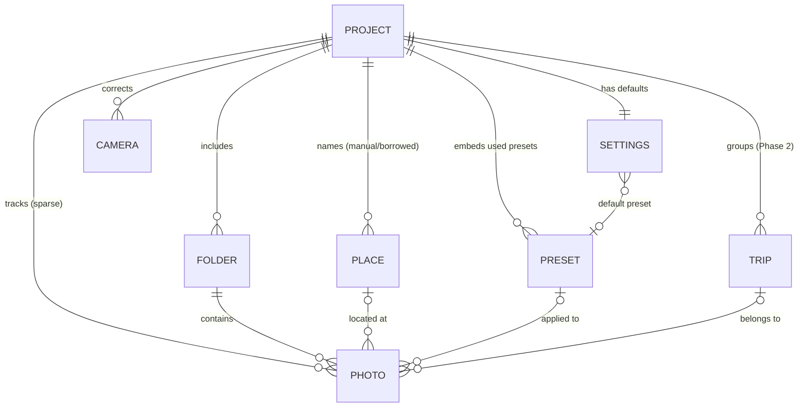

# Data & Persistence — Fotollection

> **Status:** Draft v0.2 · **Last reviewed:** 2026-10-23
>
> This document is the single source of truth for **everything Fotollection stores**: where it lives, the **normalized data model**, the schemas, versioning and migration, safe writes, the in-memory layout, and retention.
> Fotollection has **no database server and no embedded SQL database** ([ADR-0010](adr/0010-project-file-format.md)). Persistent state is a small set of versioned files, modelled **as if they were relational tables** and normalized to 3NF ([§2](#2-normalization-rules)).
> Any change to a persisted format updates this document, the schema version and a migration **in the same commit** ([§9](#9-change-procedure)).
> File types as a whole (extensions, MIME types, UTIs, how each file is recognized, compatibility rules) are registered in [EXTENSION.md](EXTENSION.md).

## 1. Storage map

| Store | Format | Location | Owner (core module) | Lifetime | Personal data? |
|-------|--------|----------|---------------------|----------|----------------|
| **Project document** `*.fotollection` † | ZIP bundle: `project.json` (the tables, [§4](#4-project-file-schema)) + `settings.json` + used fonts and logos ([ADR-0016](adr/0016-self-contained-project-bundle.md), [EXTENSION.md §2.1](EXTENSION.md#21-project-fotollection)) | Chosen by the user with Save As (default: next to the photos) | `bundle.rs`, `project.rs` | Until the user deletes it | **Yes**: folder paths, places, coordinates |
| Session autosave † `<app data>/projects/session.fotollection` | JSON project tables ([§4](#4-project-file-schema)) | App data dir | `project.rs` | Overwritten while working; crash safety only | Yes: folder paths |
| Project backup `*.fotollection.bak` | Same as the project | Next to the project file | `project.rs` | Replaced on each successful save | Yes |
| App settings `settings.json` † | JSON, versioned ([§6](#6-app-settings)) | App config dir | `settings_store.rs` | Until uninstall or reset | Camera names/lenses only |
| Camera logos `logos/<id>.png` † | PNG, validated copy | App config dir | `logo.rs` | Until removed | No |
| User fonts `fonts/<id>.ttf\|otf` † | TTF/OTF, validated copy | App config dir | `fonts.rs` | Until removed | No |
| Recent projects `recent.json` | JSON array of up to 10 paths | App config dir | `settings.rs` | Until cleared | Yes: paths |
| Preset library `presets/*.fotopreset` | JSON, one file per preset ([§7](#7-presets)) | App config dir | `presets.rs` | Until the user deletes them | No |
| Thumbnail cache `thumbs/` | JPEG files + `index.bin` ([§8](#8-thumbnail-cache)) | App cache dir | `thumbs.rs` | LRU, 2 GB cap, can be cleared at any time | **Yes**: image content |
| Logs `logs/*.log` | Text, rotated (3 × 5 MB) | App log dir | shell | Rotated | File names only ([SECURITY.md §5](SECURITY.md#5-privacy)) |
| Built-in data | Compiled into the binary ([§5](#5-built-in-datasets)) | — | `geocode.rs`, `presets.rs`, `print_size.rs` | Per release | No |
| In-memory state | Columnar arenas ([§3.3](#33-in-memory-layout)) | RAM | `library.rs`, `history.rs` | Process lifetime | — |

### Directories per platform

These are resolved through Tauri's path API with the identifier `com.hoangphi01.fotollection`. Never hard-code them.

| Directory | macOS | Windows | Linux |
|-----------|-------|---------|-------|
| Config | `~/Library/Application Support/com.hoangphi01.fotollection/` | `%APPDATA%\com.hoangphi01.fotollection\` | `~/.config/com.hoangphi01.fotollection/` |
| Cache | `~/Library/Caches/com.hoangphi01.fotollection/` | `%LOCALAPPDATA%\com.hoangphi01.fotollection\` | `~/.cache/com.hoangphi01.fotollection/` |
| Logs | `~/Library/Logs/com.hoangphi01.fotollection/` | `%LOCALAPPDATA%\com.hoangphi01.fotollection\logs\` | `~/.local/share/com.hoangphi01.fotollection/logs/` |

**Sources are never written.** No store contains a copy of an original photo, and nothing is written into source folders, except a project file if the user saves it there.

## 2. Normalization rules

Fotollection processes thousands of large images. RAM is reserved for pixels ([NFR-004](PRD.md#nfr-004--memory-ceiling)), so the metadata model must be small, duplicate-free and fast to filter. Every persisted collection is treated as a relational table, and these rules apply:

| # | Rule | Why | Example |
|---|------|-----|---------|
| N1 | **Atomic values (1NF).** No lists or composite strings inside a field. Repeating data becomes its own table | Queryable, no parsing | Camera identity is the fields `make`, `model`, `serial`, never a `"make\|model"` string |
| N2 | **Integer surrogate keys.** Every table has a compact `u32` `id`. Natural keys (folder + relative path, camera make/model/serial) are enforced as **unique**, but not used as references | References cost 4 bytes instead of a 60-byte path. Renames touch one row | `photos[].folder` → `folders[].id` |
| N3 | **One fact, one place (2NF/3NF).** No field depends on anything but its own row's key. Shared values live in their own table and are referenced by ID | No update anomalies: renaming a place or editing a preset changes one row | A place used by 300 photos is stored **once** in `places` |
| N4 | **Never persist derivable data.** EXIF values, geocoding results, effective DPI, effective metadata and pixels are recomputed (and cached in RAM or the thumbnail cache) | Smaller files, never stale | The project stores a clock offset, not 800 corrected timestamps |
| N5 | **Store deltas, not copies (sparse rows).** A photo row exists only if it deviates from the project defaults, and holds only the deviating fields. Defaults live once in `settings` | 10,000 untouched photos cost 0 bytes | `photos[]` has no `print_size` unless it differs from `settings.default_print_size` |
| N6 | **Reference presets, don't copy them.** Photos point at a preset by ID, plus sparse overrides ([§7](#7-presets)) | Editing a preset updates every photo that uses it | `photos[].preset` → `presets[].id` |
| N7 | **Referential integrity on load.** Every foreign key must resolve. A dangling reference fails validation rather than being guessed | Corruption is detected early | `photos[].place` must exist in `places` |

**Allowed denormalization: RAM only.** Derived indexes (by date, by rating, the filtered view, the per-photo *effective* settings after defaults → preset → override) may be cached in memory for speed. They are rebuilt from the normalized data and **never written to disk**.

## 3. Data model

### 3.1 Entities



| Table | Key | Unique (natural key) | Columns (persisted) | References |
|-------|-----|----------------------|---------------------|------------|
| `folders` | `id` | `path` | `path`, `path_kind`, `absolute` (v2) | — |
| `photos` | `id` | (`folder`, `path`) | `folder`, `path`, `fp_size`, `fp_mtime`, `fp_head`, then sparse: `rating`, `flag`, `copies`, `print_size`, `crop_x/y/w/h`, `manual_date`, `place`, `place_source`, `preset`, `overrides`, `trip` | `folder` → `folders`, `place` → `places`, `preset` → `presets`, `trip` → `trips` |
| `cameras` | `id` | (`make`, `model`, `serial`) | `make`, `model`, `serial`, `offset_s`, `time_zone` | — |
| `places` | `id` | (`name`, `lat`, `lon`) | `name`, `country`, `lat`, `lon`, `geonames_id?` | — |
| `presets` | `id` (UUID string, shared with the library) | `id` + `revision` | `revision`, `name`, `group`, `kind`, `includes`, values ([§7](#7-presets)) | — |
| `trips` | `id` | — | `name`, `start`, `end` | — |
| `settings` | — (singleton) | — | `default_print_size`, `default_preset`, `safe_area_mm`, `color_*`, `export_*` | `default_preset` → `presets` |

**Not persisted** (N4): EXIF fields, the camera a photo came from (read from EXIF at scan time and matched to `cameras` in RAM), geocoded place names for photos with GPS, corrected timestamps, effective DPI and thumbnails.

### 3.2 Effective value resolution

For any setting, the value used to render a photo is resolved in a fixed order, and the result is cached in RAM only:

```text
built-in default → settings (project default) → preset (photos.preset, or settings.default_preset) → photos.overrides
```

### 3.3 In-memory layout

The library loads into **columnar arenas**: a structure of arrays indexed by a dense `PhotoIdx(u32)`. Filtering and sorting then touch only the bytes they need, and the whole metadata model stays tiny next to the pixel budget.

| Column | Type | Bytes per photo |
|--------|------|-----------------|
| `folder` | `FolderIdx(u16)` | 2 |
| `path` | interned `Sym(u32)` into one `String` arena | 4 + path bytes, stored once |
| `capture_time` | `i64` (UTC seconds, after offsets) | 8 |
| `rating`, `flag`, `print_size` | `u8` each (`print_size` = index into `PrintSize::ALL`) | 3 |
| `camera` | `CameraIdx(u16)` | 2 |
| `preset`, `place`, `trip` | `Option<NonZeroU32>`-style indices | 12 |
| `copies` | `u8` | 1 |
| `lat`, `lon` | `f32` (≈ 1 m precision, plenty for stamping) | 8 |
| `flags` | `u16` bitfield: has GPS, GPS inferred, manual date, DPI band, missing file… | 2 |
| Sparse `overrides` | `HashMap<PhotoIdx, OverrideIdx>` → a separate arena | 0 for photos without overrides |

That is **about 42 bytes per photo, plus the path**: roughly 1 MB for 10,000 photos. Filters such as "pick + ≥ 3 stars + has GPS" are evaluated as **bitsets** over these columns. Undo/redo stores **inverse operations** (for example `SetRating { idx, old, new }`), never snapshots.

## 4. Project file schema

These tables are `project.json` inside the project bundle ([ADR-0016](adr/0016-self-contained-project-bundle.md)), and the whole content of the JSON session autosave. The container is described in [EXTENSION.md §2.1](EXTENSION.md#21-project-fotollection).

### 4.1 Example (`schema_version: 1`)

```json
{
  "format": "fotollection-project",
  "schema_version": 1,
  "app_version": "0.1.0",
  "created_at": "2026-10-23T18:00:00Z",
  "modified_at": "2026-10-23T19:12:04Z",

  "settings": {
    "default_print_size": "10x15",
    "default_preset": "b3f1c2de-0000-4000-8000-c200c200c200",
    "safe_area_mm": 2.0,
    "color_convert_to_srgb": true,
    "color_intent": "perceptual",
    "export_jpeg_quality": 95,
    "export_metadata": "strip_gps",
    "export_organize_by": "date"
  },

  "folders": [
    { "id": 1, "path": "../Lisbon 2026", "path_kind": "relative" }
  ],

  "cameras": [
    { "id": 1, "make": "Panasonic", "model": "DC-GX9", "serial": "WG8LA001234",
      "offset_s": -3600, "time_zone": "Europe/Lisbon" }
  ],

  "places": [
    { "id": 1, "name": "Sintra", "country": "PT", "lat": 38.8029, "lon": -9.3817, "geonames_id": 2262963 }
  ],

  "presets": [
    { "id": "b3f1c2de-0000-4000-8000-c200c200c200", "revision": 3, "...": "see §7" }
  ],

  "photos": [
    { "id": 17, "folder": 1, "path": "P1010042.JPG",
      "fp_size": 8123456, "fp_mtime": "2026-07-14T10:22:31Z", "fp_head": "9f2c…",
      "rating": 4, "flag": "pick", "copies": 2, "print_size": "20x30",
      "crop": { "cx": 0.46, "cy": 0.5, "zoom": 1.25 },
      "place": 1, "place_source": "manual" },
    { "id": 18, "folder": 1, "path": "P1010043.JPG",
      "fp_size": 7990211, "fp_mtime": "2026-07-14T10:24:02Z", "fp_head": "41aa…",
      "flag": "reject" }
  ],

  "trips": []
}
```

Photo 18 stores only its flag. Every other value comes from `settings` (rule N5). If 300 photos are in Sintra, `places` still has **one** row (rule N3).

### 4.2 Field rules

| Field | Type | Rule |
|-------|------|------|
| `format` | string | Always `"fotollection-project"`. Checked before any other field |
| `schema_version` | integer | See [§4.3](#43-versioning-and-migration) |
| `*.id` | `u32` ≥ 1 (presets: UUID) | Unique within the table, and never reused within a file |
| `folders[].path` + `path_kind` | string + `relative`/`absolute` | Relative to the project file's directory when on the same volume. Absolute paths are kept as data and never trusted as a write target ([SECURITY.md §3](SECURITY.md#other-untrusted-inputs)) |
| `document` | `{ path, edited }`, optional (v2) | **Session autosave only**, never in a bundle: the `.fotollection` document the session belongs to and whether it had unsaved changes, so a restart shows `Trip — Edited` again (FR-023) |
| `folders[].absolute` | string, optional (v2) | Only on `relative` rows: where the folder was when the project was saved. On open, the relative path is tried first, then this one, then the user relinks the folder |
| `photos[].path` | string | Relative to its folder, with `/` separators on every OS |
| `fp_size`, `fp_mtime`, `fp_head` | fingerprint: size, mtime, BLAKE3 of the first 64 KB | Used to **relink** moved files and to detect replaced files ([FR-023](PRD.md#fr-023--projects-autosave-and-undo)) |
| `rating` | 0–5 | Omitted when 0 |
| `flag` | `pick` / `reject` | Omitted when unflagged |
| `copies` | 1–99 | Omitted when 1 ([FR-024](PRD.md#fr-024--copies-and-order-summary)) |
| `print_size` | `PrintSize.id` | Omitted when equal to the default ([FR-025](PRD.md#fr-025--mixed-print-sizes-per-order)) |
| `crop` | `{ cx, cy, zoom }`: centre 0–1 of the upright photo, zoom 1–8 | **Ratio-independent** (N4): the rectangle is derived at render time for the current print size or framed photo area, so changing size never invalidates it. Sanitized on load |
| `manual_date` | RFC 3339 | Overrides EXIF ([FR-032](PRD.md#fr-032--manual-date-and-place)) |
| `place` + `place_source` | FK → `places` + `manual` / `device` / `gpx` | Only for **manual or inferred** places ([FR-031](PRD.md#fr-031--borrow-gps-from-a-phone-or-gpx-track), [FR-032](PRD.md#fr-032--manual-date-and-place)). GPS read from EXIF is never copied here (N4) |
| `preset` | FK → `presets` | Omitted when it equals `settings.default_preset` ([FR-038](PRD.md#fr-038--print-presets)) |
| `overrides` | object of setting paths → values | Only the values that differ from the effective preset (N5) |
| `cameras[].offset_s` | integer seconds | [FR-030](PRD.md#fr-030--camera-clock-offset) |
| Times | RFC 3339 UTC strings | Camera-local times live only in EXIF. Offsets are in `cameras` |

Parsing is strict: `serde` with `deny_unknown_fields`, typed enums, and range checks plus **foreign-key checks** (N7) after parsing. A file that fails validation is **not** modified. The user is offered to open the `.bak` instead.

### 4.3 Versioning and migration

- `schema_version` is a monotonically increasing integer. Every **released** version is frozen and never edited.
- Migrations are pure functions `v(N) → v(N+1)` in `crates/core/src/project/migrate.rs`, applied in sequence when a project is opened. The migrated file is written back only on the next save, and the original stays as `.bak`.
- An app that sees a `schema_version` newer than it knows **refuses to open the file read-write** and offers read-only viewing ([NFR-013](PRD.md#nfr-013--project-safety)).
- Every version has a fixture `crates/core/tests/fixtures/project/v{N}.fotollection`. Tests load each fixture, migrate it to the current version, and compare with a golden result ([TESTING.md §5](TESTING.md#5-golden-images)).

| Version | App version | Change |
|---------|-------------|--------|
| 1 | 0.0.x (slice 3) | **Implemented subset:** `folders` (absolute paths for the session project) and sparse `photos` rows with `fp_size`, `fp_mtime`, `crop`, `rating`, `flag`. The other tables (`settings`, `cameras`, `places`, `presets`, `trips`) are added by later schema versions with migrations; app-wide settings and camera profiles live in `settings.json` for now (§6) |
| 2 | 0.0.x (Stage 2) | `document` (session autosave only) and `folders[].absolute`: the absolute path kept next to a `relative` row, used when a project moved without its photos. Written inside bundles, where folders are stored relative to the bundle. **Migration v1 → v2:** the field is optional, so v1 files are read as is (`fr_023_v1_fixture_still_opens`, fixture `crates/core/tests/fixtures/project/v1.fotollection`) |

### 4.4 Write protocol

1. The in-memory state changes. A dirty flag is set and the autosave timer starts (debounce 1 s, at most 5 s after the first change).
2. Take a snapshot under the project lock, then serialize **outside** the lock. Tables are written sorted by `id`, so diffs between versions stay small and readable.
3. Write `name.fotollection.tmp` in the **same directory**, then `fsync` it.
4. Rename the current file to `.bak`, then rename `.tmp` to the final name. Both renames are atomic on the same volume.
5. Emit `project://saved`.

If any step fails, the previous file remains intact and the UI shows the error with a retry. On launch, a leftover `.tmp` is ignored and deleted.

### 4.5 Size and performance

Because rows are sparse and shared values are normalized, the file size grows with the number of **edited** photos, not the number of photos in the folders.

| Photos with state | Typical file size | Save time budget |
|-------------------|-------------------|------------------|
| 1,000 | ~0.15 MB | < 10 ms |
| 10,000 | ~1.5 MB | < 50 ms ([OPTIMIZATION.md §3](OPTIMIZATION.md#3-budgets)) |

These budgets are measured by `bench_project_save`. If they are exceeded, see [§10](#10-when-to-adopt-a-real-database).

## 5. Built-in datasets

These are read-only and compiled into the binary or bundled as resources, so they need no migration. They change only with app releases.

| Dataset | Source | Format | Size | Notes |
|---------|--------|--------|------|-------|
| Print sizes | `print_size.rs` | Rust constants | — | [PRD §5](PRD.md#5-print-sizes-cewe--eu-standard) |
| Places | GeoNames `cities1000` + admin1/country names | Packed binary built by `crates/geodata` (custom layout, version header, BLAKE3-checked at load; [GEODATA.md](../crates/core/assets/geo/GEODATA.md)), indexed in a 1° grid when first used. Country names are stored **once** and referenced by index | 5.4 MB | CC BY 4.0, attribution in About ([ADR-0003](adr/0003-offline-geocoding-geonames.md)). Also serves offline place search ([FR-032](PRD.md#fr-032--manual-date-and-place)) |
| Built-in presets | `presets/builtin/*.fotopreset`, embedded with `include_str!` | Same schema as user presets ([§7](#7-presets)) | < 100 KB | Lab, stamp and Photo Style presets, including "C200 Natural" ([FR-039](PRD.md#fr-039--photo-style-looks)). Never fetched from the network |
| Fonts | `fonts/` | TTF/OTF | < 2 MB | OFL/MIT only |

## 6. App settings

`settings.json` in the app config dir is the **first persisted file** (implemented). It holds app-wide state that must survive restarts:

```json
{
  "format": "fotollection-settings",
  "schema_version": 3,
  "ui": { "language": "vi" },
  "render": {
    "printSize": "custom-1",
    "stamp": { "enabled": true, "format": "iso", "corner": "bottomRight", "color": "white", "font": 1 },
    "customSizes": [ { "id": "custom-1", "name": "4×6 US", "shortMm": 102, "longMm": 152, "unit": "in" } ]
  },
  "frame": {
    "enabled": true, "fit": "crop", "color": "white", "dateFormat": "slash", "font": null,
    "fields": { "logo": true, "camera": true, "lens": true, "focal": true, "aperture": true,
                "shutter": true, "iso": true, "photoStyle": true, "date": true, "place": true }
  },
  "cameras": [
    { "id": 1, "make": "Panasonic", "model": "DC-GX9", "displayName": "LUMIX GX9", "brandText": "LUMIX",
      "lens": "Индустар-50-2", "focalMm": 50.0, "fNumber": 4.0, "photoStyle": "L. Monochrome D", "logo": "text" }
  ],
  "fonts": [ { "id": 1, "name": "DSEG7 Classic", "format": "ttf" } ]
}
```

`render.printSize` is a built-in `PrintSize.id`, a `customSizes[].id`, or `"original"`, which keeps each photo's own ratio ([FR-045](PRD.md#fr-045--original-aspect-ratio)). `"original"` needs no new field, so it did not change the schema version. Builds from before FR-045 reject the value and fall back to defaults; none of them was released.

- **`cameras` is a table** (N1–N3): the key is `id`, `(make, model)` is unique, and every override is optional (sparse, N5). A missing value falls back to EXIF or to a derived default, which is computed and never stored (N4). A row is created the first time a camera is imported.
- **`fonts` is a table** (FR-042): `id` is the key, and the file lives at `fonts/<id>.<ttf|otf>`. `render.stamp.font` and `frame.font` are foreign keys. A dangling key falls back to Inter on load (N7) rather than failing.
- **`render.customSizes`** (FR-043): values are in mm, `unit` only affects labels, and `printSize` may reference a custom `id`.
- **`ui`** (FR-020): per-machine interface preferences, today only `language` (`"en"` or `"vi"`, default `"en"`). They are never copied into a project file, so opening a project on another machine keeps that machine's language.
- **Logos** live next to the file as `logos/<camera-id>.png`, copied in after validation ([ADR-0014](adr/0014-user-supplied-brand-logos.md)). The JSON never references paths outside the config dir. `logo: "image"` means the file exists.
- **Writes** use the same atomic protocol as projects ([§4.4](#44-write-protocol)): `.json.tmp`, then fsync, then the previous file copied to `.json.bak`, then rename. A write happens on every settings change; changes are rare and the file is tiny.
- **Load rules:**
  - A missing file means defaults.
  - A `schema_version` newer than the app understands means defaults, and the file is **never overwritten**.
  - An invalid file (bad JSON, unknown fields, duplicate camera rows, unknown print size) is moved to `.json.corrupt`, and defaults are used.
- **Not here:** per-project choices (ratings, per-photo sizes and crops) belong in the project file ([§4](#4-project-file-schema)) once FR-023 lands.

| Version | App version | Change |
|---------|-------------|--------|
| 1 | 0.0.x (slice 2) | `render`, `frame`, `cameras` |
| 2 | 0.0.x (slice 4) | `fonts` table; `render.customSizes`, `render.stamp.font`, `frame.font`. **Migration v1 → v2:** every new field has a default, so v1 files are read as is (tested by `migrates_v1_files`) |
| 3 | 0.0.x (Stage 2) | `ui.language` (FR-020). **Migration v2 → v3:** `ui` defaults to English, so v2 files are read as is. Fixtures `crates/core/tests/fixtures/settings/v1.json` and `v2.json` are loaded by `migrates_v1_files` and `fr_020_migrates_v2_files_to_english` |

## 7. Presets

Presets work like Lightroom presets, applied to *print* settings ([FR-038](PRD.md#fr-038--print-presets)) and to *Photo Style* looks ([FR-039](PRD.md#fr-039--photo-style-looks)).

### 7.1 Preset file (`.fotopreset`)

```json
{
  "format": "fotollection-preset",
  "schema_version": 1,
  "id": "b3f1c2de-0000-4000-8000-c200c200c200",
  "revision": 3,
  "name": "C200 Natural — 10×15 retro",
  "group": "Film looks",
  "includes": ["style", "stamp", "border"],
  "values": {
    "style":  { "base": "natural", "contrast": -1, "sharpness": -3, "saturation": 1, "hue": 0,
                "highlight": -1, "shadow": 1, "wb_ab": 3, "wb_gm": 1, "grain": "low" },
    "stamp":  { "kind": "retro_led", "format": "'YY MM DD", "color": "#ff8a1f", "position": "bottom_right" },
    "border": { "kind": "none" }
  }
}
```

- **Partial presets:** `includes` lists the setting groups the preset owns: `size`, `crop`, `border`, `safe_area`, `stamp`, `caption`, `style`, `color`, `sharpen`, `export`. Groups that are not listed are left untouched when the preset is applied, so presets can be **stacked** (for example a "Film look" preset plus a "dm 10×15" preset).
- **Normalized reference (N6):** applying a preset sets `photos[].preset`. It does not copy values. Editing a preset bumps its `revision` and updates every photo that uses it. The UI shows how many photos will change and asks for confirmation. **Detach** copies the effective values into `overrides` and clears the reference.
- **Portability:** the project embeds a copy of each **user** preset it references (`presets` table, keyed by `id` + `revision`), so a project opened on another machine renders identically. Built-in presets are referenced by ID only. When the library holds a newer `revision` of an embedded preset, the UI offers to update it. Updates never happen silently.
- **Library:** user presets are stored as one file per preset in `presets/`. Built-ins are read-only, and "Edit" creates a user copy. Import and export use the same `.fotopreset` file, which is untrusted input on import ([SECURITY.md §3](SECURITY.md#other-untrusted-inputs)). A preset that fails to parse is skipped with a warning and never deleted automatically.

## 8. Thumbnail cache

- **Layout:** `thumbs/<first 2 hex chars>/<blake3(path ‖ size ‖ mtime)>.<tier>.jpg`. Tiers T1 and T2 are defined in [OPTIMIZATION.md §4.1](OPTIMIZATION.md#41-multi-tier-preview). Thumbnails are of the **unstyled** source. Photo Style and stamps are applied live in the preview, so changing a preset never invalidates the cache.
- **Index:** `thumbs/index.bin` stores the key, size and last access time. It is rebuilt by scanning if it is missing or corrupt, because the cache must always be safe to delete.
- **Eviction:** least-recently-used, triggered when the total exceeds the limit (default 2 GB, configurable). It runs in the background at low priority.
- **Invalidation:** the key includes size and mtime, so a changed source automatically misses the cache. Old entries age out through LRU.
- **Clearing:** Settings → *Clear cache* deletes the whole `thumbs/` directory. This is safe at any time.
- **Implementation status (2026-10-23):** T0 (served directly from EXIF, never cached) and T1 (cached as `thumbs/<aa>/<key>.t1.jpg`, written atomically through `.part` + rename) are live. T2 previews live in a RAM-only LRU of 8 images. `index.bin`, LRU eviction and *Clear cache* are not implemented yet.

### 8.1 Analysis cache

- **Layout:** `analysis/<first 2 hex chars>/<blake3(path ‖ size ‖ mtime)>.json`, next to `thumbs/` in the cache directory, with the same content key. One small JSON object per photo (about 3 KB): `version`, `metrics`, `signature` (32 × 24 luma layout and a 37-bin colour histogram, [ADR-0019](adr/0019-grouping-by-visual-signature.md)) and `faces` (boxes as fractions of the image, eye aspect ratio, eye sharpness) of best-shot suggestions ([FR-041](PRD.md#fr-041--best-shot-suggestions)). No landmarks or face images are stored.
- **Versioning:** `version` is the core's `ANALYSIS_VERSION`, now 2 (version 1 stored a dHash instead of the signature). A different version, a file over 64 KB, unparsable JSON or out-of-range values are treated as a miss and recomputed, never trusted. No migration: it is derived data.
- **Writes:** atomic (`.part` + rename). A failed write only means the photo is analysed again next time.
- **Not in the project file:** groups and suggestions are recomputed from the cache; only the flags the user accepts with **Keep best** are stored, as ordinary FR-022 flags (rule N4).
- **Clearing:** safe at any time, like `thumbs/`. *Clear cache* will remove both.

## 9. Change procedure

When a change touches any persisted format (project, settings, presets, cache layout), the **same commit** must:

1. Update this document: the table definitions ([§3.1](#31-entities)), the example, the field rules and the version table.
2. Check that the change keeps the normalization rules N1–N7. Any exception must be justified here.
3. Bump the relevant `schema_version` (or the cache layout version, which simply invalidates the cache).
4. Add the migration `v(N) → v(N+1)` and a fixture `v{N+1}`, and keep every older fixture loading in tests.
5. Add a CHANGELOG entry if users can notice the change.
6. If the file type itself changes (extension, container, MIME/UTI, limits), update [EXTENSION.md](EXTENSION.md).

This is part of the Definition of Done ([CONTRIBUTING.md](../CONTRIBUTING.md#definition-of-done)).

## 10. When to adopt a real database

Normalized JSON tables are the right tool while projects hold up to tens of thousands of edited photos. Revisit this, with a superseding ADR, if **any** of these happen:

- Saving a project exceeds the 50 ms budget at realistic sizes, even after incremental serialization.
- A feature needs queries across projects, for example a global library or search across all past orders.
- Concurrent writers are needed (multiple windows editing one project).

The model is already relational, so the move is mechanical. The preferred candidate is **SQLite via `rusqlite`** with the `bundled` feature. It is MIT/public domain, so it fits the license policy ([ADR-0008](adr/0008-license-gpl3-with-relicensing-option.md)). Each table in [§3.1](#31-entities) becomes a SQL table with the same keys, `UNIQUE` constraints and `FOREIGN KEY`s, in WAL mode, with migrations through `PRAGMA user_version`.
