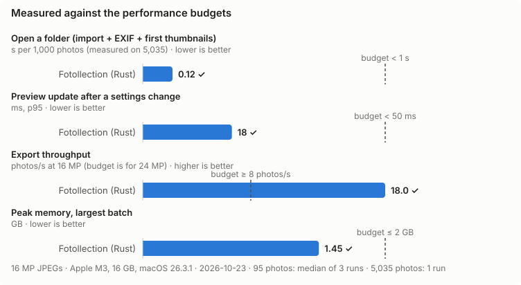
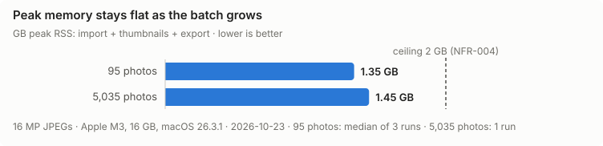
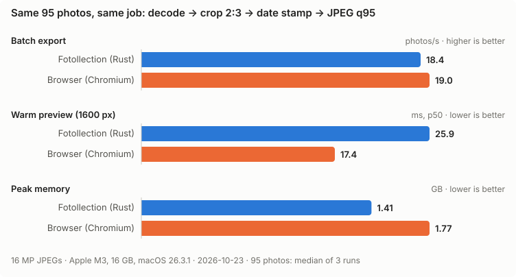
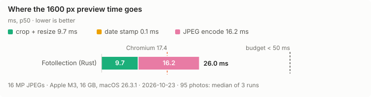
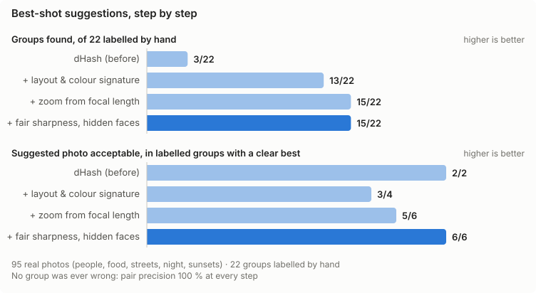
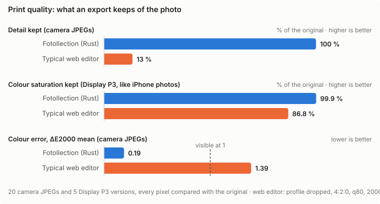
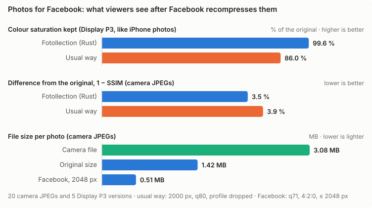
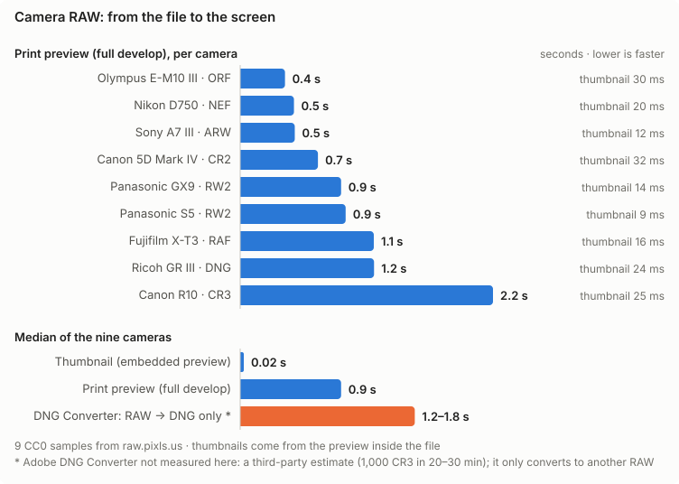

# Measured Results — Fotollection

> **Status:** Living · **Last reviewed:** 2026-11-12
>
> The **latest measured numbers** for speed and memory, in one readable page. Each number links to the run that produced it.
> This page is a summary. The append-only history of every measurement is the benchmark log in [OPTIMIZATION.md §5](OPTIMIZATION.md#5-benchmark-log), and the budgets are defined in [OPTIMIZATION.md §3](OPTIMIZATION.md#3-budgets). When a new run changes a number, update this page and add the row to §5 in the same commit.

## 1. Test setup

| Item | Value |
|------|-------|
| Machine | REF-MAC: Apple M3 (8 cores), 16 GB RAM, macOS 26.3 |
| Photos | 95 real JPEGs, 4608 × 3456 (16 MP), 287 MB in total, Canon |
| Large batch | The same 95 photos hard-linked 53 times: **5,035 photos** with distinct paths (no extra disk space) |
| Build | `cargo build --release`; Rust 1.99.1 |
| Tools | `measure_folder` (core pipeline), `/usr/bin/time -l` (peak RSS), `bench/run.sh` (Rust vs browser, 6 vs 8 in flight), `bench/batch.sh` (large batch), `bench/chart.mjs` (charts) |
| Date | 2026-10-23, all numbers from one session after the machine had cooled down |

## 2. Against the budgets



| What | Budget ([NFR](PRD.md#7-non-functional-requirements)) | Measured | |
|------|--------|----------|---|
| Open a folder: import + EXIF + embedded thumbnails | NFR-001: < 1 s per 1,000 photos | 0.12 s per 1,000 (5,035 photos: import 383 ms + thumbnails 236 ms) | ✓ |
| Preview update (warm) | NFR-002: < 50 ms p95 | p95 18 ms, p50 17 ms (was 26 ms before the screen encoder, §5); cold (first open) 120 ms | ✓ |
| Export throughput | NFR-003: ≥ 8 photos/s at 24 MP | 18.0 photos/s at 16 MP (runs: 17.8–18.4) | ✓ |
| Peak memory | NFR-004: ≤ 2 GB at any batch size | 1.35 GB (95 photos), 1.45 GB (5,035 photos) | ✓ |
| Best-shot analysis per photo, one thread (2026-10-24) | NFR-014: ≤ 20 ms, ≤ 40 ms with faces | p50 17.4 ms / p95 18.0 ms (56 photos without faces); p50 27.8 ms / p95 36 ms (39 with faces); whole pool ≈ 110–125 photos/s | ✓ |
| PNG decode, 16 MP | — | 122 ms (JPEG: 45 ms) | — |

## 3. Large batches: 5,035 photos

Memory must not grow with the number of photos ([NFR-004](PRD.md#nfr-004--memory-ceiling)). The library stores a few bytes per photo, thumbnails go to a disk cache, the preview cache is a bounded LRU, and export decodes at most 6 photos at a time. `bench/batch.sh` checks that design on 53 times the usual batch.



| Phase | 95 photos (median of 3) | 5,035 photos |
|-------|-----------|--------------|
| Import + EXIF | 5 ms, RSS 7 MB | 383 ms, RSS 13 MB |
| T1 thumbnails (400 px, disk cache) | 47.8 photos/s, RSS 681 MB | 46.4 photos/s, RSS 803 MB |
| Export at 6 in flight | 18.0 photos/s | 15.4 photos/s (327 s), 0 failed, RSS 1.33 GB |
| Peak RSS of the whole run | 1.35 GB | **1.45 GB** |

**Result: memory does not grow with the batch.** 53 times more photos cost 0.1 GB more at peak, and the library itself stays at 13 MB for 5,035 photos. The large export is slower per photo because it runs for more than 5 minutes and the M3 throttles under sustained load.

Not yet measured: the whole app with 5,035 photos (shell + WebKit). The grid is virtualized, and each photo summary is roughly 200 bytes of JSON, so the webview is expected to add little. That run needs a separate app-data directory so it does not overwrite the user's session project, and it is tracked in [STATUS.md](STATUS.md).

## 4. Native Rust vs the browser

The same job (decode → crop 2:3 → date stamp → JPEG q95) on the same 95 photos, in Fotollection and in headless Chromium 156 with one Web Worker per core. Median of 3 runs ([OPTIMIZATION.md §2.1](OPTIMIZATION.md#21-measured-the-same-job-in-chromium)):



| | Fotollection (Rust) | Chromium 156 | |
|---|---:|---:|---|
| Batch export | 18.0 photos/s (6 in flight, 4:4:4, files written) | 17.9 photos/s (8 workers, 4:2:0, blobs only) | About the same |
| Warm preview, 1600 px (p50) | 17.4 ms | 18.5 ms | Fotollection faster |
| Cold preview (first open) | 120 ms | 119 ms | About the same |
| Peak memory | 1.35 GB | 1.78 GB | Fotollection 24 % lower |

## 5. Where the preview time goes



| Step (1600 px preview from the cached 2048 px image) | Time | Share |
|------------------------------------------------------|-----:|------:|
| Crop + Lanczos resize | 9.7 ms | 58 % |
| Date stamp | < 0.1 ms | ≈ 0 % |
| JPEG encode q85, 4:2:0, plain Huffman | 7.0 ms | 42 % |
| **Total** | **16.7 ms** | Budget 50 ms; Chromium 18.5 ms |

How the preview went from 26 ms to 17 ms (Stage 2, each step measured on the same 1600 px image):

| Encoder setting for previews | Encode time |
|------------------------------|------------:|
| Before: 4:4:4 + optimized Huffman (the export settings) | 16.2 ms |
| Plain Huffman tables | 11.7 ms |
| Plain Huffman + 4:2:0 chroma (**kept**) | 7.0 ms |

- Previews are only shown on screen, so 4:2:0 is safe there. A 3× crop of the date stamp looks the same in both. Exports keep 4:4:4 (`EncodeOptions::print`), with the standard Huffman tables since 2026-11-04 (§20).
- A cheaper resize filter was tried as well: CatmullRom took **12.5 ms** against 9.7 ms for Lanczos3 in `fast_image_resize` on M3, so Lanczos3 stays.

## 6. Export concurrency

| Photos in flight | Throughput (median of 3; runs) | Peak RSS (16 MP) | Decision |
|-----------------:|-------------------------:|-----------------:|----------|
| 6 | 18.0 photos/s (17.8–18.4) | 1.35 GB (1.30–1.41) | **Kept** |
| 8 | 19.5 photos/s (19.1–19.6) | 1.72 GB (1.70–1.77) | Rejected: +8 % speed for +0.4 GB, which would pass 2 GB with 24 MP photos |

## 7. Reproduce

```bash
# Rust vs browser and 6 vs 8 in flight, median of 3 runs; writes bench/results/ and all charts
bench/run.sh ~/Pictures/some-folder 3
# Large batch: hard-links the folder 53 times (no extra disk), exports with --discard-output
bench/batch.sh ~/Pictures/some-folder 53
# Redraw the charts (English and Vietnamese) from bench/results/*.json
node bench/chart.mjs
# One-off run of the core pipeline on any folder (read-only)
/usr/bin/time -l target/release/examples/measure_folder ~/Pictures/some-folder
# Best-shot analysis time and the groups it finds (FR-041, NFR-014)
target/release/examples/measure_folder ~/Pictures/some-folder --analyze
```

The scripts build `measure_folder` themselves. Photos are only read, and never copied into the repository; `bench/results/` holds numbers only. Let the machine cool down before a run: the M3 throttles under sustained load.

## 8. Best-shot accuracy

Best-shot suggestions ([FR-041](PRD.md#fr-041--best-shot-suggestions)) are scored against 95 photos labelled by hand: 22 groups of one moment, and for 6 of them the photo to keep (`bench/bestshot/truth-103_09.json`; file names only, the photos are private). Pairs labelled as ambiguous are ignored. Results are in `bench/results/bestshot.json`, and the decision is in [ADR-0019](adr/0019-grouping-by-visual-signature.md).



| Step | Groups found (of 22) | Pair recall | Pair precision | Extra groups | Acceptable picks |
|------|-----:|-----:|-----:|-----:|-----:|
| dHash, focal split (before) | 3 | 9 % | 100 % | 0 | 2/2 |
| + layout and colour signature | 13 | 67 % | 100 % | 2 | 3/4 |
| + zoom from focal length | 15 | 73 % | 100 % | 2 | 5/6 |
| + fair sharpness, hidden faces | **15** | **73 %** | **100 %** | 2 | **6/6** |

- **Extra groups:** both are pairs labelled as ambiguous (0485/0486, 0504/0505), not mistakes.
- **Still missed:** 0430/0431, 0447/0448, 0452/0453, 0465/0466, 0472/0473, 0502/0503 and 0516/0517. In each, the pose or the framing changes a lot (food shot again from the other side, a selfie upside down, a cat approached on foot).
- **Picks** in the labelled groups: 0426 over a squint, 0440 over a profile with a hand at the mouth, 0463 over closed eyes, 0524 over a defocused night shot, 0525 over a soft zoomed shot, and 0533 among four sunsets.
- **Speed after the change:** 17.4 ms per photo, 27.6 ms with faces (NFR-014: 20 / 40 ms).

```bash
cargo run --release -p fotollection-core --example eval_bestshot -- ~/Pictures/some-folder labels.json
# --explain: score parts per photo; --pairs: time gap, layout and colour similarity of neighbours
```

## 9. Print quality

[NFR-009](PRD.md#nfr-009--colour-fidelity) asks for the ICC profile to be kept and a colour error of at most 1. `bench/quality/audit.py` checks this pixel by pixel:

- **What is exported:** each photo goes through the real export path at its own size, with no stamp or frame (`examples/quality_export.rs`).
- **How it is read:** both images are decoded with libjpeg and converted to CIELAB in floating point through their profiles.
- **What it is compared with:** a typical web-editor export (profile dropped, 4:2:0, q80, 2000 px, upscaled back for print).
- **Where the numbers are:** `bench/results/quality.json`.



| Median | Fotollection, 20 sRGB JPEGs | Web editor | Fotollection, 5 Display P3 | Web editor |
|------|-----:|-----:|-----:|-----:|
| PSNR | 52.6 dB | 37.9 dB | 50.8 dB | 37.0 dB |
| ΔE2000 mean | **0.19** | 1.39 | **0.31** | 2.15 |
| ΔE2000 95th percentile | 1.06 | 3.50 | 1.50 | 4.81 |
| Chroma kept | 100 % | 99.9 % | 99.9 % | **86.8 %** |
| Contrast kept | 100 % | 99.9 % | 100 % | 99.9 % |
| Detail kept (Laplacian variance) | 99.8 % | **13 %** | 100 % | 18 % |
| Tonal levels kept | 100 % | 100 % | 100 % | 100 % |

- **Result:** NFR-009 is met. The ICC profile is kept 25 / 25, sampling is 4:4:4, quality is 95, and the mean ΔE2000 is 0.19–0.31, well under 1.
- **Where the 95th percentile comes from:** the larger errors sit on sharp edges, where JPEG re-encoding works hardest, not in flat colour.
- **What it explains:** the web-editor export loses 87 % of the fine detail through the down- and upscale, and 13 % of the saturation of P3 photos when it drops the profile. These are the two usual causes of flat, blotchy prints.
- **Limits:** the source photos are from one camera. Real HEIC files from an iPhone, and prints measured with a spectrophotometer, are still to come.

```bash
cargo run --release -p fotollection-core --example quality_export -- /tmp/out ~/Pictures/some-folder/*.JPG
uv run bench/quality/audit.py ~/Pictures/some-folder /tmp/out --json bench/results/quality-run.json
```

## 10. Photos for social media

The share export ([FR-053](PRD.md#fr-053--export-for-social-media)) has to make light files that still look like the photo once Facebook has recompressed them. `bench/quality/share_audit.py` checks this on the same 20 camera JPEGs (16 MP, about 3 MB each) and 5 Display P3 versions:

- **Reference:** the original in sRGB, resized to the export's size with Lanczos, never compressed: the best that size can look.
- **After Facebook:** the export recompressed as Facebook does (q71, 4:2:0, at most 2048 px), next to the usual way (a web editor saving 2000 px at q80 without the profile, then the same recompression).
- **Measures:** SSIM (structural similarity; 1 is identical, and blur, blocking and ringing all lower it), ΔE2000 and colour saturation kept. The sharpness count of §9 is not used here: on recompressed files it counts JPEG artefacts as detail.
- **Data:** `bench/results/share.json`.



| Median | Original size | Facebook, 2048 px | Instagram, 1080 px |
|------|-----:|-----:|-----:|
| File size (camera JPEGs, 3.08 MB) | 1.42 MB (46 %) | 0.51 MB (16 %) | 0.24 MB (8 %) |
| SSIM against the reference | 0.981 | 0.979 | 0.982 |
| ΔE2000 mean / 95th percentile | **0.96** / 2.51 | 1.27 / 3.34 | 1.58 / 4.34 |
| Colour saturation kept (Display P3) | 100 % | 99.8 % | 99.8 % |
| Export speed, 16 MP | 14 photos/s | 23 photos/s | 32 photos/s |

| After Facebook recompresses (median) | Fotollection | Usual way |
|------|-----:|-----:|
| SSIM, camera JPEGs | **0.965** | 0.961 |
| ΔE2000 mean, camera JPEGs / Display P3 | **1.67 / 1.62** | 1.74 / 2.20 |
| Colour saturation kept, Display P3 | **99.6 %** | 86.0 % |

- **Settings, chosen by measurement:** quality 88 with 4:2:0 for resized photos, sharpening 0.2 after the downscale (0.35 scored lower SSIM, q84 and q80 lost more than they saved), and quality 80 for *Original*, which keeps ΔE2000 under 1 at half the file size.
- **Result:** the *Original* preset meets its targets (ΔE2000 < 1, about half the size of an already compressed compact-camera JPEG; larger, less compressed camera files shrink more). Resized photos keep SSIM ≈ 0.98, but their ΔE2000 of 1.27–1.58 is above 1: 4:2:0 chroma, which Facebook applies to every upload anyway, softens colour edges.
- **What viewers see:** after Facebook's own recompression, Fotollection's file stays closer to the photo than the usual way (SSIM 0.965 against 0.961), and keeps the colour of Display P3 photos (99.6 % against 86 %), which the usual way loses by dropping the profile.

```bash
cargo run --release -p fotollection-core --example quality_export -- --share facebook /tmp/share ~/Pictures/some-folder/*.JPG
uv run bench/quality/share_audit.py ~/Pictures/some-folder /tmp/share --json bench/results/share-run.json
```

## 11. Preview and zoom cost (v0.6.0)

Measured before building the zoom path ([FR-057](PRD.md#fr-057--zoom-in-the-preview)) and the start-up screen ([FR-060](PRD.md#fr-060--start-up-screen)), to answer one question: what does looking at a big photo cost a weak machine? `examples/measure_preview.rs`, median of 5, REF-MAC (M3), one camera JPEG at 16 MP and the same photo resized to 26 MP and 32 MP (q92). Peak RSS is the whole benchmark process under `/usr/bin/time -l`.

| Photo | Full decode | Decoded RAM | Preview, first time | Preview, cached | Full-size render | Visible part, 2560 × 1600 | Peak RSS |
|------|-----:|-----:|-----:|-----:|-----:|-----:|-----:|
| 16 MP (4608 × 3456) | 46 ms | 48 MB | 105 ms | 17 ms | 4 ms | 17 ms | 222 MB |
| 26 MP (6240 × 4160) | 68 ms | 78 MB | 139 ms | 18 ms | 8 ms | 18 ms | 314 MB |
| 32 MP (6960 × 4640) | 84 ms | 97 MB | 154 ms | 18 ms | 9 ms | 17 ms | 371 MB |

- **The preview is already safe.** It never holds more than a 2048 px copy (about 12 MB) and sends 1600 px, so a 32 MP photo costs the same 18 ms as a 16 MP one once cached; only the first open grows with the photo (decode). A preview "at 32 MP" is never built.
- **Full detail only on zoom.** The original costs 3 bytes per pixel decoded, 97 MB at 32 MP, so it is decoded only when the user zooms past the preview, and at most about 200 MB of originals stay cached. Rendering it at full size is cheap (4–9 ms, unstraightened; straightening adds about 53 ms at 16 MP, OPTIMIZATION §5), and the part a screen shows encodes in 17 ms whatever the photo's size: the first zoom on a 32 MP photo is about 100 ms, the next pans about 20 ms.
- **A weak machine:** the threads do not change these numbers (`RAYON_NUM_THREADS=2` and `=1` give the same times): one photo is one core's work. A machine with a core 3–4× slower than an M3 would take about 0.3–0.4 s for the first zoom on 32 MP. The zoomed preview stays on screen during that time, so nothing blanks or blocks.

```bash
cargo run --release -p fotollection-core --example measure_preview -- photo-16mp.jpg photo-32mp.jpg
```

## 12. Camera RAW (v0.7.0)

Measured before building RAW input ([FR-016](PRD.md#fr-016--raw-input), [ADR-0023](adr/0023-raw-through-os-codecs.md)), on nine CC0 samples from [raw.pixls.us](https://raw.pixls.us/), one per format (`bench/raw-samples.json`, fetched and checked by `scripts/fetch-raw-samples.py`). `examples/measure_raw.rs` calls the macOS codec through `fotollection-oscodec`; median of 5, REF-MAC (M3), macOS 26.

| Sample | Developed size | Full develop | Embedded preview ≤ 400 px | Preview ≤ 2048 px | EXIF read today |
|------|-----:|-----:|-----:|-----:|:-----:|
| Panasonic GX9 (RW2, 20 MP) | 5184 × 3888 | 867 ms | 14 ms | 28 ms (1920 px) | ✗ |
| Panasonic S5 (RW2, 24 MP) | 6000 × 4000 | 906 ms | 9 ms | 19 ms (1920 px) | ✗ |
| Canon 5D Mark IV (CR2, 31 MP) | 6720 × 4480 | 668 ms | 32 ms | 79 ms | ✓ |
| Canon R10 (CR3, 24 MP) | 6000 × 4000 | 2172 ms | 25 ms | 62 ms | ✗ |
| Nikon D750 (NEF, 24 MP) | 6016 × 4016 | 462 ms | 20 ms | 64 ms | ✓ |
| Sony A7 III (ARW, 24 MP) | 6000 × 4000 | 469 ms | 12 ms | 20 ms (1616 px) | ✓ |
| Fujifilm X-T3 (RAF, 26 MP) | 6240 × 4160 | 1148 ms | 16 ms | 42 ms | ✗ |
| Olympus E-M10 III (ORF, 16 MP) | 4608 × 3456 | 385 ms | 30 ms | 80 ms | ✗ |
| Ricoh GR III (DNG, 24 MP) | 6000 × 4000 | 1150 ms | 24 ms | 62 ms | ✓ |

Peak RSS of one process developing one file five times: 1.29 GB (CR2, 31 MP), 810 MB (CR3), 579 MB (RW2, GX9).



The chart (`bench/results/raw.json`) sets the medians against **Adobe DNG Converter**, which was not run here: its 1.2–1.8 s per file is a third-party estimate (1,000 CR3 files in 20–30 minutes "on modern hardware", machine not stated, from convertintomp4.com's blog post on batch RAW-to-DNG conversion), and it only turns one RAW file into another, before anything is seen or printed. Fotollection needs no conversion step.

- **Two paths.** The preview every RAW carries comes back 30 to 100 times faster than a full develop, and it is what thumbnails and best-shot analysis need. The develop (0.4–2.2 s) is kept for the print preview, zoom and export, which work on one photo at a time; a preview already on screen re-renders from its cached copy in 17 ms, like a JPEG.
- **Memory.** One develop can hold more than 1 GB, so RAW photos are developed a few at a time, not six at once like JPEG, to stay under the 2 GB ceiling (NFR-004).
- **The type hint matters.** Without the file's type identifier, ImageIO read a NEF as a plain TIFF (its 160 × 120 thumbnail) and could not open an ARW; with it, all nine develop at full size.
- **EXIF.** The current reader understands the TIFF-based RAW files only; RW2, CR3, RAF and ORF need their containers handled before the date stamp and the info frame can use their EXIF.

```bash
python3 -I scripts/fetch-raw-samples.py /tmp/raw
cargo run --release -p fotollection-core --example measure_raw -- /tmp/raw/*
```

## 13. Camera over USB, Step 0 (FR-062, FR-063)

Both shipped in v0.8.0 (Windows, Sony a6400 first). Measured before building camera support ([ADR-0026](adr/0026-cameras-through-the-os-usb-stack.md)) with `crates/oscamera/examples/probe_camera.rs` on the owner's bodies, by USB cable, through ImageCaptureCore (no driver), REF-MAC (M3), macOS 26. Details per maker in [cameras/](cameras/README.md).

| Body, USB mode | Session open | GetDeviceInfo | Maker operations | Capture from the computer | Shutter on the body | Live view over USB |
|------|-----:|-----:|-----|-----|-----|-----|
| Sony a6400, PC Remote | 44 ms | 23 ms | 5 (Sony extension) | After the maker's handshake; RAW read 1.7 s and JPEG 1.4 s after the shutter command (Imaging Edge Remote, Windows, [sony.md](cameras/sony.md)) | Reported (`0xC201`) once the handshake is done | Yes: about 4.8 fps, 30–45 KB frames (Remote) |
| Panasonic GX9, PictBridge (PTP) | 21 ms | 20 ms once the card is listed (no answer in 10 s before) | None | Not possible | Locked (PictBridge screen) | Not possible |

- **No driver is needed** to reach either body; the OS stack carries any PTP operation, so path A is open for every maker whose protocol we learn.
- **The GX9 cannot be tethered over USB** by anyone: it declares no capture or live-view operation. Live view needs an HDMI capture card; photos come by import after the shoot.

### 13.1 Sony a6400 from Fotollection's own code (Windows)

`examples/sony_remote.rs` through WPD (Windows's own driver) on a Lenovo 20U9002NUS: i7-10610U, 4 cores, 16 GB, Windows 10. The details are in [cameras/sony.md](cameras/sony.md).

| Step | Result |
|------|--------|
| Session open, handshake | 1–2 ms; 20–60 ms (0.96 s the first time after plugging in) |
| Settings block (`0x9209`, 62 properties) | 2–14 ms |
| Shutter to photo announced (shot state `0x8001`) | 0.94–1.57 s, mostly the 3 × 300 ms gaps autofocus needs |
| Photo read | JPEG 4.3 MB in 145 ms; RAW 24.8 MB in 760 ms (≈ 32 MB/s) |
| Shutter to photo in memory | JPEG 1.1–1.7 s, RAW 1.7 s |
| Live view | 30.3 fps, 1024 × 680 JPEG, 78 KB per frame |

- **NFR-019's 15 fps is met** by the a6400 over USB (30 fps). The time from scene to screen is still to measure.
- **NFR-018:** the photo is in memory 1.1–1.7 s after the press, before decoding and showing it; the "about 2 s for JPEG" target looks reachable.

## 14. Places and time (v0.8.0, measured first)

Measured before building FR-030, FR-031 and FR-058 with `crates/core/examples/measure_places.rs`, REF-MAC (M3), release build. Parts B–D use 96 of the owner's GX9 JPEGs, read only and kept in memory.

| What | Result |
|------|--------|
| Sort by capture time (`sorted_ids`) | 0.2 ms at 5,035 photos, 0.9 ms at 70,000 |
| Recompute an effective-time column (EXIF time + camera offset) | 0.05 ms at 70,000 photos |
| Visual signature from a T1 thumbnail (decode 400 px, reduce to 256 px, sign) | 1.06 ms per photo (max 1.31) |
| One scene comparison (layout over 5 zooms + colour) | 1.33 ms; the colour check alone is a few µs |
| Matching pass: each camera photo against its 8 nearest photos in time, colour first | 1.24 ms per camera photo on all cores (5.8 ms on one) |
| Looking for `.xmp` sidecars on import (two checks per photo) | 1 µs per photo |

**Same scene, proxy.** Each photo against a closer (1.3–2×), 3:2, off-centre and darker crop of itself: layout score median 0.97, colour median 0.84; with layout ≥ 0.6 and colour ≥ 0.65, 93 of 96 are found. Of 637 pairs five or more frames apart, 16 pass, but those include later shots of the same spot, which give the right place anyway. Real phone and camera pairs differ more (lens, perspective, processing), so the threshold is provisional until 20 real GX9 + phone pairs are scored.

- Effective time costs nothing measurable: it is computed as a column, and sorting already reads one.
- Place inference fits in the background: about 1.2 s per 1,000 camera photos, so NFR-020 is set at 2 s.
- XMP lookup on import is free (1 ms per 1,000 photos).

## 15. Camera RAW built in: rawler (v0.8.0, measured first)

Measured before rawler was wired in ([ADR-0029](adr/0029-raw-through-rawler-then-our-own-decoder.md)) with `crates/core/examples/measure_rawler.rs` and `bench/quality/raw_compare.py`, on the nine CC0 samples of §12, REF-MAC (M3), release build, median of 3. rawler's develop is finished by `raw_finish` with the camera's embedded JPEG; colour and structure are scored on 1600 px copies against that JPEG, the camera's own rendering.

| Sample | ImageIO develop | rawler + finish | rawler preview | ΔE2000 rawler / ImageIO vs the JPEG | SSIM rawler / ImageIO vs the JPEG |
|------|-----:|-----:|-----:|-----:|-----:|
| Canon 5D Mark IV (CR2) | 334 ms | 549 ms | 57 ms | **4.16** / 5.51 | 0.997 / 0.966 |
| Canon R10 (CR3) | 503 ms | 349 ms | 43 ms | 5.64 / **2.67** | 0.982 / 0.987 |
| Fujifilm X-T3 (RAF) | 541 ms | 474 ms | 40 ms | **7.56** / 10.10 | 0.889 / 0.779 |
| Nikon D750 (NEF) | 337 ms | 390 ms | 33 ms | **1.18** / 2.41 | 0.997 / 0.987 |
| Olympus E-M10 III (ORF) | 371 ms | 277 ms | none in the file | 16.03 / **5.43** | 0.521 / 0.927 |
| Panasonic GX9 (RW2) | 606 ms | 215 ms | 10 ms | **3.00** / 4.56 | 0.955 / 0.967 |
| Panasonic S5 (RW2) | 722 ms | 239 ms | 8 ms | 6.76 / **3.47** | 0.737 / 0.947 |
| Ricoh GR III (DNG) | 572 ms | 624 ms | 63 ms | **4.08** / 5.22 | 0.987 / 0.968 |
| Sony A7 III (ARW) | 429 ms | 221 ms | 11 ms | 4.35 / **3.42** | 0.985 / 0.967 |

- **Unfinished, rawler is far off** (ΔE 10–16 from the JPEG): it applies no exposure, tone curve or lens shading. Matching each channel to the embedded JPEG fixes the look at no visible cost.
- **Low SSIM on the Olympus and the S5 is geometry, not quality:** ImageIO corrects lens distortion, which those lenses rely on; rawler does not. The Olympus has no embedded image either, so it gets the default curve.
- **Size:** the macOS app binary is 36.0 MB without rawler, 39.5 MB with it, and 44.7 MB with `panic = "unwind"` (needed to catch a panic inside rawler).
- Decision (ADR-0029): rawler first on Windows (RAW with nothing to install), ImageIO first on macOS (distortion corrected), each the other's fallback.

## 16. Our own RAW decoder, DNG (v0.8.0, measured first)

Measured before `Own` took DNG over ([ADR-0030](adr/0030-our-own-raw-decoder.md)) with `crates/core/examples/measure_rawler.rs`, `raw_memory.rs`, `raw_phases.rs` and `bench/quality/raw_compare.py`, on the Ricoh GR III sample of §12, REF-MAC (M3), release build, median of 3. Each develop is finished to the camera's embedded JPEG; colour and structure are scored on 1600 px copies.

| Ricoh GR III (DNG) | rawcore | rawler + finish | ImageIO |
|------|-----:|-----:|-----:|
| Develop, with the look | **355 ms** | 640 ms | 554 ms |
| Peak memory (`/usr/bin/time -l`) | **526 MB** | 1.33 GB | 668 MB |
| ΔE2000 to the embedded JPEG | **2.67** | 4.08 | 5.22 |
| ΔE2000, colour only (200 px, detail averaged out) | **1.76** | 2.84 | 4.66 |
| SSIM to the embedded JPEG | 0.992 | 0.987 | 0.968 |
| SSIM to ImageIO | 0.976 | | |

- **Where the time goes** (`raw_phases`): lossless JPEG 109 ms (241 ms before a 12-bit Huffman lookup table), demosaic 34 ms (179 ms before reading from a padded buffer), finish 48 ms (123 ms before an sRGB encode table), the look fit and the embedded JPEG the rest.
- **Lens shading was the biggest error:** with colour and tone matched but no shading, ΔE was 3.8, the centre 4 L\* too bright and the corners 1.5 too dark. Fitting `exp(a·r² + b·r⁴)` from the JPEG brings every region within ±0.5 L\*.
- **Robustness:** the sample cut short at 256 places never panics, and 10 minutes of mutation testing (`examples/mutate.rs`: cuts, flipped bytes, extreme values in the directories, damaged compressed data) ran 1,597 inputs with no panic.
- **Grey baseline for RW2** (Panasonic S5 sample, the six grey patches of its SpyderCheckr 24, mean C\*; 0 is a perfect grey): embedded JPEG 1.26, ImageIO 1.38, rawler + finish 2.43 (worst patch 4.48). rawcore must reach ≤ 1.5 when it takes RW2.
- Decision (ADR-0030): DNG goes to our own decoder first on both systems; ImageIO and rawler stay the fallback for every other format and for DNG variants it refuses.

## 17. Borrowed places (v0.8.0)

Measured while building FR-031 with `crates/core/examples/measure_borrow.rs`, REF-MAC (M3), release build, median of 5. A synthetic trip: 1,000 camera photos without GPS and 1,000 phone photos with GPS, one of each per minute, visual signatures already computed (as after a best-shot analysis). The time is the whole pass: candidates, comparisons and the reverse geocode of each place found.

| Case | Donors per photo | Pass for 1,000 camera photos |
|------|-----:|-----:|
| Same scenes (each camera photo has a matching phone photo) | 8 | 2,338 ms, before stopping early |
| Same scenes | 8 | 56 ms, stopping at the first sure match and the first zoom that is sure enough |
| Worst case: every donor has the same colours but another layout | 8 | 2,265 ms |
| Worst case | **4** | **1,113 ms** |
| Same scenes | **4** | **54 ms** |

- **The cost is the layout comparison:** colour passes, so every donor is compared over 5 zooms, 3 scales and 49 shifts. Stopping at the first sure match makes the common case 40 times faster, but not the worst one.
- **Four nearest donors** brings the worst case within NFR-020 (2 s). A phone photo of the same scene is usually seconds from the camera's, so the nearest four hold it.
- The thresholds (applied at layout ≥ 0.75, colour ≥ 0.8, five minutes; suggested at 0.6 and 0.65) are still the provisional ones of §14 until real camera and phone pairs are scored.

## 18. Collage sheets (v0.9.0)

Measured while building FR-035 with `crates/core/examples/measure_sheet.rs`, REF-MAC (M3), release build, median of 5, on two 26 MP demo photos (`baeren-tuebingen-1.jpg`, `grevy-zebras-in-der-wilhelma-3.jpg`), 10 × 15, default settings. Swap was high but steady during the runs (9.7 GB used after the build, unchanged by them).

| Step | Photo A alone | Photo B alone | A + B | Sheet | NFR-021 budget |
|------|-----:|-----:|-----:|-----:|-----:|
| Preview, warm cache (1600 px) | 17 ms | 19 ms | 36 ms | **24 ms** | ≤ 38 ms (2 × the slower photo) |
| Export render and encode, q95 | 302 ms | 331 ms | 633 ms | **214 ms** | ≤ 633 ms |

- **The sheet is cheaper than its two photos** because it is smaller: at 600 DPI, a 10 × 15 sheet is 2362 × 3543 px (8.4 MP, 2.8 MB), while each photo alone exports at its full 26 MP. Decoding the two photos costs the same either way, so it is left out of both columns.
- The 600 DPI cap of ADR-0032 is twice what a lab prints at; it keeps the files small without a visible loss on paper.

**The grid after a change of setting** (`crates/core/examples/measure_sheet_grid.rs`, 2026-11-01): ten sheets of twenty demo photos at the grid's 640 px.

| Source of each sheet's photos | First pass | After a change |
|------|-----:|-----:|
| The 2048 px preview sources (cache of 8 photos) | 4,095 ms | 4,088 ms |
| The photos' T1 thumbnails (cache of 64) | 42 ms | **29 ms** |

The preview sources missed every time: twenty photos do not fit a cache of eight, so each sheet decoded its two 26 MP photos again, about 200 ms each. A grid tile needs a few hundred pixels, which the thumbnail already has.

## 19. JPEG layouts and the reference decoder (v0.8.1)

A v0.8.0 user saw JPEGs as green stripes: they were saved with one scan per component, which `zune-jpeg` 0.5.15 decodes wrongly without an error ([ADR-0033](adr/0033-reference-jpeg-decoder.md)). Measured with `crates/core/examples/measure_jpeg_layout.rs` and `tests/jpeg_layouts.rs`, REF-MAC (M3), release build, median of 5.

| Layout (fixture, 250 × 186, quality 90) | Mean error per channel against the picture, 0.8.0 | 0.8.1 |
|---|---:|---:|
| Baseline 4:4:4, 4:2:2, 4:2:0, 4:4:0, 4:1:1, progressive, restart markers, optimised tables, grey | within 8 (zune) | the same (zune) |
| **Baseline, one scan per component, 4:2:0** | **111.9 (green stripes)** | within 8 (reference decoder) |
| Baseline, one scan per component, 4:4:4 (and a real 4:2:2 photo saved that way) | within 8 | within 8 (reference decoder) |

| Cost | Time |
|---|---:|
| Reading the layout from the header | 0.18 µs a file (96 camera JPEGs, all on zune) |
| Decode 4608 × 3456, as the camera saved it (zune) | 45 ms |
| The same photo with one scan per component (reference decoder) | 88 ms |

- **The bug needs both:** one scan per component and colour halved vertically (4:2:0). A 16 MP camera photo (4:2:2) rewritten with one scan per component by `jpegtran` decodes right on 0.8.0; the same photo saved 4:2:0 that way comes out as the user saw it, green with horizontal stripes. Every one-scan-per-component baseline goes to the reference decoder anyway: the allowlist holds only what the corpus proves.
- The fast path is unchanged for the usual files; a rare layout costs twice as much and decodes right.
- Small flat images that the app encodes itself (thumbnails) decode right on 0.5.15 (`fr_001_our_own_small_flat_jpegs_keep_their_colour`), so zune-image #496 does not touch us.

## 20. A real trip (Prague, GX9)

One folder exactly as it came off the card of a Lumix DC-GX9 after a weekend in Prague, November 2026: 396 JPEGs at 20 MP (5184 × 3888, 4:2:2 baseline, about 11 MB each) and 26 RW2 files beside them, 4.7 GB in all. The photos are the owner's (© @hoangphi01, all rights reserved) and stay outside git ([TESTING.md §3](TESTING.md#3-sample-corpus)). `bench/trip.sh` runs `measure_folder --discard-output` on the folder three times and `measure_raw` on its RAW files, and writes the medians to `bench/results/trip.json` (counts, times and memory only). REF-MAC (M3, 16 GB), release build, 2026-11-03, with the editor and a browser open and swap nearly full.

| What | Measured | Budget |
|---|---:|---|
| Import + EXIF, 422 files | 0.23 s | NFR-001 ✓ (< 1 s for 1,000) |
| Embedded thumbnails (T0) | 21 ms | ✓ |
| T1 thumbnails (full decode → 400 px) | 22 photos/s | background |
| Preview re-render, warm p50 / p95 | 17.9 / 18.8 ms | NFR-002 ✓ (< 50 ms) |
| RAW: full develop / embedded preview ≤ 400 px / ≤ 2048 px (median of 26) | 350 / 9 / 19 ms | NFR-017 ✓ |
| Ten postcards redrawn from thumbnails (`measure_sheet_grid`, `POSTCARD=1`) | 21 ms | NFR-021 ✓ (< 100 ms) |
| **Export, the 396 JPEGs, 6 in flight** (median of 3, 2026-11-04) | **10.1 photos/s** (9.0–11.8) | **NFR-003 ✓** (≥ 8 at 24 MP) |
| Export, JPEG and RAW together (the 26 RAWs develop one at a time, NFR-017) | 7.9 photos/s | — |
| **Peak RSS of the whole run, JPEG and RAW** | **1.31 GB** | **NFR-004 ✓** (≤ 2 GB) |
| Peak RSS during the JPEG export | 0.86–0.92 GB | — |

- **Before (2026-11-03): both budgets missed,** export 7.6 photos/s and 2.14 GB at peak. Measured again the same way on 2026-11-04 before the fix: 5.0 photos/s and 1.73 GB during the export of the JPEGs.
- **Where the time and memory went:** per 20 MP photo, the decode takes about 100 ms, the crop 2 ms, and the print encode 203 ms. The encoder's optimized Huffman tables are a second pass over coefficients it keeps for the whole image, about 160 MB a photo; six in flight held about 1.5 GB. With the standard tables it writes in strips: 138 ms, the files **0.9 % larger**, the error against the rendered image the same (0.755 in both, mean absolute difference per channel). Prints now use the standard tables ([OPTIMIZATION.md §5](OPTIMIZATION.md#5-benchmark-log)).
- **The "1.27 GB after thumbnails" was the benchmark's own:** `measure_folder` made T1 thumbnails on every core and kept its preview measurements alive through the export. On the app's two background threads, and with those let go, 0.35–0.39 GB stays before the export starts.
- **Photos in flight** now follow the largest photo of the export (`export::inflight_for`): six for these, fewer for very large ones (two at 60 MP), so the peak stays under the ceiling at any size.
- The 16 MP Canon set (95 photos) is faster too: 23.5 photos/s at 0.66 GB, against 18.0 and 1.30 GB.
- The machine was loaded (swap 12–13 GB of 13 GB used) in every run, before and after, so speeds may be low and vary from run to run; the memory is the process's own.

## 21. Colour looks: the table (v0.10.0, session 8)

The engine of [FR-079](PRD.md#fr-079--colour-adjustments) and [FR-070](PRD.md#fr-070--looks-from-lut-files) ([ADR-0038](adr/0038-moderate-colour-editor-on-one-lut-engine.md)): every per-pixel adjustment becomes one 33³ table of u16, applied with tetrahedral interpolation in integers, a row at a time on rayon (`looks.rs`). Measured with `examples/measure_look.rs`, a strong look (every channel changed), median of 5, REF-MAC (M3) loaded (swap 12–13 GB of 13 GB used), 2026-11-05:

| What | 8 threads | 2 threads | Budget |
|---|---|---|---|
| Build the table (35,937 points) | 0.18–0.67 ms | 0.21 ms | — |
| Apply, 1600 × 1067 preview (made up) | 1.78–2.20 ms | 4.23–4.40 ms | ≤ 5 ms |
| Apply, 6000 × 4000 (24 MP, made up) | 23.6–24.1 ms | 58.7–59.1 ms | ≤ 60 ms |
| Apply, 6240 × 4160 (26 MP, a CC0 demo photo) | 25.3 ms | 64.2 ms (≈ 59 ms for 24 MP) | ≤ 60 ms on 24 MP |

- **First version, then one change:** the first loop computed each of the four corners' index from three grid steps: 5.08 ms and 70.6 ms on two threads, over budget. Taking the cell's index once and adding fixed steps for the corners gave 4.23 ms and 59.1 ms; nothing else was changed.
- **Accuracy:** the identity table gives back every grey and a sample of 256³ exactly; against tetrahedral interpolation in f64 on a strong table, 200,000 random pixels differ by at most one level (`fr_079_*` in `looks.rs`).
- The cost does not depend on what is set: more sliders only change the table, kept by the hash of what built it. **Session 9 (2026-11-05):** with the sliders' real maths (warmth and tint in linear light, the tone curve, saturation and vibrance in OKLab, fade, both tints), building the table with every slider set takes 2.56 ms on 8 threads and 5.03 ms on 2, so a drag step costs about 5 ms on the preview, table and apply together.
- **A drag that follows the pointer (2026-11-05):** the owner found the preview "not smooth like Lightroom" while dragging. Measured, one step of a drag (a new look, the 1600 px preview JPEG, `measure_preview` with `LOOK_DRAG=1`, two 26 MP CC0 photos): **23.5 and 20.8 ms**, of which the look was 3–5 ms; the rest was the same resize at every step. The preview now keeps the cropped and resized photo and only applies the look, the stamp and the encode again: **15.6 and 11.1 ms**. Two more causes were not in Rust's time: every step wrote `settings.json` with an fsync (about 4 ms measured on this disk) on the main thread, now written by the autosave thread within 250 ms; and the webview started a new image for every step and dropped the one loading, so none landed during a drag: one now loads at a time, the newest next (`use-shown-src.ts`, LESSONS).

## 22. The GPU while editing, and every core for exports (2026-11-05)

Measured on REF-MAC (M3) loaded, before the GPU path was built ([ADR-0039](adr/0039-gpu-for-editing-cpu-for-exports.md)); the numbers are in `bench/results/`.

**One step of a colour slider's drag** (`measure_preview` with `LOOK_DRAG=1`, two 26 MP CC0 photos; `bench/gpu/run.mjs`):

| Part | CPU path today | GPU path |
|---|---|---|
| The look's table | 0.9–1.3 ms (Rust) | the same table, 140 KB to the webview |
| The look, the stamp, a copy | 2.2 ms (Rust) | 1 ms WebKit, 2 ms Chromium Metal, 16.5 ms SwiftShader |
| Screen JPEG encode | 7.4–10.6 ms (261–765 KB) | none |
| Webview decode of the 1600 px JPEG | 9 ms Chromium, 15 ms WebKit | none |
| Once per drag | — | upload the plain photo and its mask: 30 ms WebKit, 7–66 ms Chromium |

**Parity of the GPU look** (`look_parity` → `bench/gpu/parity.mjs` → `bench/quality/look_parity.py`), a strong look on every slider with the border and the stamp on, 1600 × 1067: ΔE2000 on the photo mean **0.131**, p99 **0.774**, in WebKit and Chromium alike; 15 of 1.5 million pixels over 2, by the stamp's soft shadow. The stamp, the border and the frame are left out by the mask. The machine's own test (`GpuLook.worthIt`) chose the GPU in WebKit and Chromium Metal and Rust's path with SwiftShader.

**Export, photos in flight** (`measure_folder --discard-output --inflight N`):

| In flight | 2 | 4 | 6 | 8 |
|---|---|---|---|---|
| 22 CC0 JPEGs, 24–26 MP | 4.94 /s, 485 MB | 9.35 /s, 829 MB | 11.50 /s, 940 MB | 12.50 /s, 1,214 MB |
| The Prague trip (396 JPEG + 26 RW2) | | | 9.54 /s, 1.28 GB | 9.21–9.31 /s, 1.43–1.48 GB |

The app chose 4 for the 26 MP photos (the memory budget); with a 1.6 GB budget it chooses 6: **10.82 photos/s** instead of 8.91 (+21 %), peak 1.08 GB.

**A RAW develop's phases** (`raw_phases`, a 24 MP Ricoh GR III DNG, warm runs): parse and decompress 107–109 ms (serial, the CPU's), demosaic 38–51, develop 153–155, embedded JPEG 52–53, the camera's look 77, finish 49–63 ms.

## 23. The demosaic's score card (v0.11.0, session 15)

Synthetic charts whose truth is known, mosaicked to a Bayer RGGB sensor (12-bit, no noise), demosaiced, and compared with the truth on sRGB values inside an 8-pixel margin (`cargo run --release -p fotollection-rawcore --example charts`, `bench/results/raw-quality.json`, REF-MAC, 2026-11-05). Each new method (RCD, then Markesteijn on an X-Trans version of the charts) is scored on the same charts ([ADR-0040](adr/0040-neutral-raw-colour-and-gpu-develop.md)).

| Chart (768 px) | What it shows | Bilinear | Malvar (ours today) |
|---|---|---|---|
| Zone plate, grey, up to green's Nyquist | PSNR; false colour (mean chroma, 0–255) | 13.0 dB; 65.9 | 17.3 dB; 43.0 |
| Siemens star, grey, 72 spokes | PSNR; false colour | 21.3 dB; 9.4 | 25.2 dB; 8.4 |
| Saturated colour bars on grey, three directions | PSNR; mean error within 2 px of an edge | 31.1 dB; 11.6 | 27.5 dB; 21.6 |
| Smooth colour ramps | PSNR | 78.9 dB | 77.5 dB |
| Flat grey, the two greens 2 % apart | Spread of green (maze) | 0.38 | 0.38 |

- Malvar is about 4 dB better than bilinear on grey detail, as published, but worse on saturated colour edges: its correction borrows the green channel's detail, which is wrong where the colours do not move together. RCD and the false-colour step (session 17) are scored against both.
- Neither method removes the maze: green's spread on the flat chart comes from the 2 % Gr/Gb gap. That is the job of the green equilibration before demosaic.
- The bilinear here is the scorer's own floor, not rawler's PPG; rawler's develop is scored on the nine real samples with `raw_compare.py`.

## 24. One develop path for every RAW format (v0.11.0, session 16)

Our own develop now takes every Bayer format: rawler only unpacks the sensor's data (`rawlgpl::unpack`), and `rawcore::develop_mosaic` demosaics (Malvar) and converts it with the camera's matrices, then the camera's look is fitted to its embedded JPEG as before ([ADR-0040](adr/0040-neutral-raw-colour-and-gpu-develop.md)). Measured on REF-MAC, loaded, on the nine CC0 samples (`measure_rawler`, median of 3; `raw_compare.py`, ΔE2000 mean to the camera's JPEG at 1600 px; `bench/results/raw-own.json`):

| Sample | Ours | rawler | ImageIO | ΔE ours | ΔE rawler | ΔE ImageIO |
|---|---|---|---|---|---|---|
| Canon 5D Mark IV (CR2) | 462 ms | 565 ms | 418 ms | **1.93** | 4.16 | 5.51 |
| Canon R10 (CR3) | 293 ms | 360 ms | 1,647 ms | 4.88 | 5.64 | **2.67** |
| Nikon D750 (NEF) | 340 ms | 402 ms | 412 ms | 2.26 | **1.18** | 2.41 |
| Olympus E-M10 III (ORF) | 211 ms | 364 ms | 1,164 ms | 18.6 | 16.0 | **5.4** |
| Panasonic GX9 (RW2) | 184 ms | 216 ms | 436 ms | 3.99 | **3.00** | 4.56 |
| Panasonic S5 (RW2) | 202 ms | 301 ms | 1,044 ms | 6.58 | 6.76 | **3.47** |
| Ricoh GR III (DNG) | 333 ms | 650 ms | — | **2.69** | 4.10 | (ours before) |
| Sony A7 III (ARW) | 211 ms | 241 ms | 488 ms | 3.50 | 4.35 | **3.42** |
| Fujifilm X-T3 (RAF, X-Trans) | — | 524 ms | 1,339 ms | — | 7.56 | 10.10 |

- **Speed:** ours is the fastest develop on every sample but the 5D IV, where ImageIO is 10 % faster.
- **The develop or the fit?** Swapping one part at a time: our develop finished with rawler's three-curve fit scores D750 1.16, GX9 2.86, R10 5.20 and 5D IV 3.78, at least as well as rawler's develop with the same fit. The differences in the table are the fit: our one curve and fitted matrix win on the Canons, three curves on the D750 and the GX9. The look "Like the camera's JPEG" (session 17) keeps the better of the two per file.
- **Neutral greys:** the S5's grey patches have a mean C\* of 1.42 (rawler 2.43, ImageIO 1.38, the camera's JPEG 1.26).
- **ORF and RW2:** the E-M10 III file has no embedded image, so neither develop is fitted, and ImageIO's lens correction changes its geometry (SSIM 0.5). On macOS, RW2 and ORF keep ImageIO first for that correction until [FR-085](PRD.md#fr-085--lens-distortion-correction).

## 25. A better Bayer demosaic (v0.11.0, session 17a)

Four steps, each kept only once the score card (§23, now with a sixth chart, `hot`: a soft texture with about one site in 2,000 stuck at white) showed it wins (`cargo run --release -p fotollection-rawcore --example charts`, `bench/results/raw-quality.json`; `raw_phases`; `bench/results/raw-demosaic.json`), REF-MAC loaded, 2026-11-05:

- **Hot pixels** (`prepare::hot_pixels`): a site more than twice as bright as every same-colour neighbour and every touching one, plus 3 % of white, takes the median of its same-colour neighbours; a 3 × 3 point of light is kept.
- **Green balance** (`prepare::green_balance`): where the two greens around a green site agree within 6 %, it moves halfway to the other green's local mean.
- **Directional demosaic** (`directional.rs`): RCD's vertical/horizontal decision from first and second differences, green from Hamilton–Adams estimates on each side weighted against their gradients, red and blue from colour differences.
- **False colour** (`falsecolour::suppress`): one 3 × 3 median of red − green and blue − green.

| Chart | Malvar | RCD as described | Directional | The whole chain |
|---|---|---|---|---|
| Zone plate: PSNR / false colour | 17.31 dB / 43.0 | 15.31 / 40.4 | 16.61 / 31.2 | 16.53 / **18.7** |
| Siemens star: PSNR / false colour | 25.23 dB / 8.4 | 32.48 / 2.6 | 37.87 / 0.25 | **37.89 / 0.16** |
| Colour bars: PSNR / edge error | 27.52 dB / 21.6 | 28.56 / 11.2 | 28.37 / 10.4 | 28.35 / **10.5** |
| Ramps: PSNR | 77.53 dB | 77.86 | 77.53 | 78.44 |
| Flat grey, greens 2 % apart: PSNR / maze | 54.23 dB / 0.38 | 54.24 / 0.38 | 54.23 / 0.38 | 58.06 / **0** |
| Texture with hot pixels: PSNR / left per 10,000 | 33.72 dB / 66.5 | 36.93 / 15.4 | 37.03 / 15.4 | **72.67 / 0** |

- **RCD as described, then the variant kept.** RCD's ratio-corrected green was written first and was the weakest of the three on the zone plate; replacing it with each side's green corrected by the site's own Laplacian, weighted against the side's gradient, scored best on the star and the colour edges. The zone plate's PSNR stays 0.8 dB below Malvar's, near green's Nyquist where every method aliases, while its false colour halves.
- **On the nine samples**, through the same fit (`measure_rawler`, `raw_compare.py`), ΔE2000 to the camera's JPEG went from Malvar's to the chain's: 5D IV 1.96 → 1.88, R10 4.88 → 4.42, D750 2.31 → 2.26, E-M10 III 18.58 → 18.35, GX9 3.99 → 3.85, S5 6.58 → 6.45, GR III 2.69 → 2.70, A7 III 3.56 → 3.29; the S5's grey patches mean C\* 1.42 → 1.41.
- **Time on 24 MP** (the GR III DNG): balance 8 ms, hot pixels 12, green balance 16, directional 87 (Malvar 34), false colour 56 (72 before a fixed median network and computing the difference planes once): about 180 ms against Malvar's 42, within the 400 ms budget. The whole develop went from 153–155 to 313–325 ms; a full RAW preview takes 0.33–0.68 s on the eight Bayer samples, under a nearly full swap.

## 26. A real trip's RAW through our develop, and damaged files (2026-11-05)

**The Prague trip's 26 RW2 files** (Lumix GX9, the owner's, measured locally) through our own develop, bypassing the macOS order that gives Panasonic to ImageIO (`measure_rawler`, median of 3; `raw_compare.py` against each file's embedded JPEG): all 26 develop; ours takes 310–370 ms (median 330), rawler 180–318 (197), ImageIO 336–857 (736). ΔE2000 to the camera's JPEG, median and worst: ours 4.88 and **7.49**, rawler 5.23 and 10.14, ImageIO 4.87 and 13.86; SSIM 0.973 for ours and rawler, 0.942 for ImageIO, whose lens correction moves the geometry. The whole folder (396 JPEG and 26 RW2) then went through import, thumbnails, the print preview and the export with no error (`check_files`).

**Damaged files made from one good RW2** (and two CC0 samples), each through the app's steps (`check_files`), before and after the fix below:

| File | Before | After |
|---|---|---|
| Cut to 10 % or 90 % | preview and export made by ImageIO, the missing part as coloured stripes | refused, `ERR-IMG-0002` |
| A CR2 cut to 20 % or 50 % (its image data ends at 53 %) | developed by rawler with diagonal stripes in place of the missing data | refused, `ERR-IMG-0002` |
| A NEF cut to 60 % | refused | refused |
| Header zeroed, empty, text with a `.RW2` name | refused at import | refused at import |
| A JPEG renamed `.RW2` | read as the JPEG it is | the same |
| 1,000 bits flipped, a third of the data overwritten | developed, the damage visible where it is | the same: without a checksum the damage cannot be told from a picture |
| Extreme values in the header, the directory offset past the end | `ERR-IMG-0002` | the same |

**Mutation testing** of every format through the app's chain (`raw_mutate`, 3 Prague RW2 and the 9 CC0 samples): before the fix, 393 inputs in 600 s, 0 panics in our code, 69 of rawler's caught by its crate, none slower than 10 s, 19 refused (5 %); after it, 174 inputs in 300 s, 0 panics, 31 of rawler's caught, none slow, 51 refused (29 %).

- **The fix:** `rawcore::cut_short` checks every strip and tile of a TIFF-based RAW against the file's end before any develop (Panasonic's placeholder strip followed to its own offset tag), and `raw::intact` has rawler or our DNG reader read the sensor data through before the system's codec is asked. Reading the size of a RW2 through it adds no time ImageIO's own spread (336–894 ms) lets us see.
- **Still open:** a cut-short X-Trans RAF or CR3 is refused today because rawler refuses it; neither is TIFF-based, so `cut_short` says nothing about them.

## 27. RAW colour: neutral or like the camera's JPEG (v0.11.0, session 17b)

ΔE2000 mean to each sample's embedded JPEG at 1600 px (`measure_rawler`, `raw_compare.py`), on the same develop as session 17a, REF-MAC, 2026-11-05 (`bench/results/raw-look.json`):

| Sample | Like the camera's JPEG | Before (one curve and a matrix) | Fit taken | Neutral |
|---|---|---|---|---|
| Canon 5D Mark IV | 1.88 | 1.88 | curve and matrix | 3.23 |
| Canon R10 | 4.42 | 4.42 | curve and matrix | 5.55 |
| Nikon D750 | **1.16** | 2.26 | three curves | 4.46 |
| Panasonic GX9 | **2.76** | 3.85 | three curves | 4.40 |
| Panasonic S5 | 6.45 | 6.45 | curve and matrix | 6.61 |
| Ricoh GR III | 2.70 | 2.70 | curve and matrix | 2.78 |
| Sony A7 III | 3.29 | 3.29 | curve and matrix | 3.99 |

- **Choosing the fit:** both are made on a copy 480 px across and scored against the JPEG averaged down to it, ΔE2000 pixel by pixel (`examples/raw_fits.rs`); only the closer one is rendered at full size. A first score on 48 × 32 block averages (CIE76) picked the worse fit for the R10 and the A7 III (4.76 and 4.44 instead of 4.42 and 3.29); per pixel it picks right for all seven. On the Prague trip's 26 RW2: three curves for 22, one curve and a matrix for 4, a mean score of 2.69 against 3.17 and 2.91 for either fit alone.
- **Neutral:** the camera's matrix, the lens shading and the exposure of its JPEG (the median brightness), and a gentle tone: a soft shoulder, an S of half strength, and a soft toe `d²/(d + 0.01)`. The S5's grey patches, L\* white to black, neutral 85.8 74.6 61.0 45.1 27.5 12.9 against the camera's 86.2 75.6 62.6 46.3 25.0 8.1, colour cast C\* 1.39 (the camera's JPEG 1.26). Tried and dropped: no S (black at L\* 24); a black offset (0.004 to 0.014) that matched the S5's black but crushed the D750's shadows (SSIM 0.987 → 0.77–0.92).
- **Time:** a full develop with either choice takes 0.29–0.69 s on the eight Bayer samples (the finish 100–210 ms of it); both choices stay in the preview cache, so switching back is instant.

## 28. RAW edited in linear light (v0.10.0, FR-088)

The same edits made the old way, by the look's 33³ table on the finished 8-bit picture, and the new way, in scene-linear light before the tone (`cargo run --release -p fotollection-core --example raw_depth`, `bench/results/raw-depth.json`), REF-MAC, 2026-11-05. In each photo's near-white pixels (luma ≥ 250 at rest) and dark pixels (luma ≤ 30): distinct levels / standard deviation, and for the shadows the empty histogram bins between their darkest and brightest (banding).

| Sample | Highlights −100, old | new | Shadows +100, old | new |
|---|---|---|---|---|
| Canon 5D Mark IV | 11 / 2.5 | 19 / 9.5 | 38 / 11.8, 11 gaps | **58** / 10.8, **4 gaps** |
| Canon R10 | 12 / 1.5 | **40 / 11.8** | 52 / 14.4 | 67 / 12.0 |
| Nikon D750 | 12 / 2.5 | **49 / 13.0** | 53 / 14.3 | 67 / 14.4 |
| Ricoh GR III | 11 / 2.5 | 4 / 0.9 | 43 / 9.7, 9 gaps | **62** / 8.1, **5 gaps** |
| Sony A7 III | 12 / 2.7 | **42 / 11.0** | 17 / 4.4, 6 gaps | 15 / 2.8, **0 gaps** |
| Panasonic GX9 (ImageIO on a Mac) | 9 / 2.7 | 2 / 0.3 | 51 / 10.6 | 51 / 8.7 |

- **Highlights:** where a photo has near-white areas, pulling them down now brings back gradation (40 to 49 levels with a spread of 11 to 13, against 12 levels and 1.5 to 2.7): the develop keeps each channel up to its own clip and sends what nears it to white, and the slider acts before the tone compresses it. On the GR III and the 5D IV almost nothing is near white (under 0.1 %).
- **Shadows:** lifted before the tone, the dark tones keep more levels and fewer gaps.
- **Not on a Mac's RW2 and ORF:** macOS's ImageIO develops them to 8 bits, so there is no headroom to bring back (FR-085).
- **Speed:** one step of a RAW slider re-finishes the kept 2048 px develop in 4.3–11.0 ms, drawn by Rust (the GPU's shader only applies the table).
- **The camera's look, fitted on the same 2048 px copy as the preview** so the print matches it: ΔE2000 to the camera's JPEG 5D IV 1.88, R10 4.40, D750 1.12, GX9 2.73, S5 6.52, GR III 2.77, A7 III 3.32 (session 17b: 1.88, 4.42, 1.16, 2.76, 6.45, 2.70, 3.29). The fits are scored on a 1024 px copy: at 480 px the A7 III's close call went the wrong way (3.80).

## 29. Instant previews (v0.11.0, FR-091)

Each photo of the owner's Prague trip (396 JPEG and 26 RW2 from a GX9, 20 MP) opened as the preview window gets it, rendered and encoded at 1600 px, on the M3 (`cargo run --release -p fotollection-core --example measure_browse -- <folder>`, [bench/results/browse.json](../bench/results/browse.json), [ADR-0041](adr/0041-instant-previews-disk-and-memory.md)).

| Step | JPEG p50 / p95 | RAW p50 / p95 |
|---|---|---|
| v0.9.0, built from its tag: open a photo with nothing kept | 274 / 286 ms | 531 / 550 ms |
| v0.10.0: open a photo with nothing kept (before FR-091) | 278 / 293 ms | 440 / 471 ms |
| Make its standard preview on disk (background) | 276 / 293 ms | 437 / 453 ms |
| **Open it from its standard preview** | **27 / 32 ms** | **27 / 30 ms** |
| Open it again from memory | 27 / 32 ms | 28 / 30 ms |

- **Against v0.9.0** (built from its tag, same folder and machine; its RAW through macOS ImageIO): ten times faster for a JPEG, twenty times for a RAW.
- **Any photo, near or far, in a tenth of the time** for a JPEG and a sixteenth for a RAW, within NFR-012's 100 ms. Reading the disk copy costs as little as memory: what is left is the preview's own crop, resize, look and encode.
- **Disk:** 0.66 MB a photo (JPEG q90), about 280 MB for this trip; the cache limit is now 5 GB.
- **Pixels:** a preview made from the disk copy differs from a fresh one by 1.35 levels of 255 on average (20 photos).
- **Memory:** the run peaked at 3.3 GB with a 4 GB budget, the quarter of a 16 GB machine the app gives the preview.

## 30. Export quality on a print (v0.13.0, FR-092)

Twelve of the owner's Prague photos (GX9, 20 MP), each sized for a 20 × 30 cm print at 300 DPI (3,543 px), encoded as prints are (4:4:4) at each quality, decoded, and compared with the quality-100 encode: ΔE as the OKLab distance × 100 (a just noticeable difference is about 2), on the M3 (`cargo run --release -p fotollection-core --example measure_quality -- <folder> 12`, 2026-11-06).

| Quality | Mean ΔE | Worst 99th percentile ΔE | Mean size |
|---|---|---|---|
| 60 | 1.71 | 12.21 | 1.0 MB |
| 65 | 1.65 | 11.49 | 1.1 MB |
| 70 | 1.56 | 11.49 | 1.3 MB |
| 75 | 1.48 | 11.49 | 1.4 MB |
| 80 | 1.35 | 10.67 | 1.7 MB |
| 85 | 1.18 | 10.67 | 2.0 MB |
| 90 | 0.94 | 9.69 | 2.6 MB |
| 95 | 0.58 | 6.72 | 3.8 MB |
| 100 | 0 | 0 | 7.7 MB |

**The default (owner, 2026-11-06):** prints were exported at 95, the camera's JPEG often weighed less; the default became **90**, a mean ΔE of 0.94 (under a visible step) at 2.6 MB instead of 3.8 MB, a third less, still *Prints beautifully*; 95 and 100 stay a slide away.

The export dialog's badges follow from it:

- **90 and above, *Prints beautifully*:** the mean stays under 1, half a just-noticeable step.
- **75 to 89, *Prints well*:** the mean is still under 1.5, the worst pixels (fine texture, edges) start to show at a close look.
- **Below 75, *Screens only*:** the size falls slowly while the difference keeps growing.

90, the default since 2026-11-06 (95 before), keeps a third of the size of 100 at a difference no eye sees on paper.

## 31. A file-size limit on a print (v0.13.0, FR-105)

The same twelve photos at the same print size, at the default quality 90, through `export::encode_within`, the code the export uses: under the limit, one encode; over it, the highest quality from 60 up that fits, by bisection (`measure_quality -- <folder> 12 --limit`, the core optimized in the dev profile, 2026-11-06). "An export" is reading, decoding and sizing the photo plus its encodes.

| Limit | Encodes per photo | Time against one encode | Time against an export | Over the limit at 60 |
|---|---|---|---|---|
| 5 MB | 1.0 | 1.0× | 1.0× | 0 |
| 2 MB | 3.9 | 3.8× | 2.1× | 0 |
| 1 MB | 4.5 | 4.3× | 2.3× | 6 of 12 |

- **A limit costs nothing until it binds,** and then about twice the export's time, under the 3× the plan allowed; it is off by default.
- **Guessing the quality from the sizes either side** (interpolation) took more encodes, 4.3 at 2 MB, since a file grows fastest near the top of the scale: bisection stays.
- **A 20 × 30 cm print rarely fits 1 MB:** half the photos stay over it even at 60, and the result says how many.

## 32. The histogram's cost (v0.13.1, FR-098)

The develop view's histogram is counted from the preview's resized photo (1,600 px on its long edge) through its look, on every pixel or on a grid of them (`measure_histogram -- "PRAGUE 11.26" 24`, release build, 24 of the trip's JPEGs, a look of eight sliders, 20 runs each, 2026-11-07, REF-MAC with 9.6 GB of swap in use). The gap is the largest difference, over the 256 levels of red, green, blue and light, between a level's share in the sampled count and in the full one.

| Pixels counted | p50 | p95 | Largest gap of a level's share |
|---|---|---|---|
| Every pixel | 3.32 ms | 3.66 ms | 0 |
| Every second of every second row | 0.89 ms | 1.03 ms | 0.88 ‰ |
| Every third of every third row | 0.44 ms | 0.52 ms | 1.31 ‰ |

- **Every second pixel of every second row** is kept (`preview::HISTOGRAM_STEP`): a third of the 3 ms budget, and a curve 64 px high cannot show a gap under one per mille (a pixel of its height is 16 ‰).
- **Counting every pixel would cross the budget,** with the look's table run on each one; the look runs on the sampled pixels only, never on a copy of the photo.
- The stamp, frame and border are drawn after the photo is counted, so they never enter it (`fr_098_the_histogram_counts_the_photo_not_the_stamp_or_border`).

## 33. RAW shadows without steps (v0.13.3, FR-088)

The RAW tone curve is a table of 4,096 bins over 0–4 in linear light, so one bin spans about three 8-bit levels near black; a pixel read its bin alone, which left steps in the shadows. It is now read between its two nearest bins (`Curve::at`, `fr_088_a_dark_ramp_has_no_steps`: a dark ramp had steps of 4 levels, now 1 at most). Same run as §28 (`raw_depth` on the nine CC0 samples, release build, REF-MAC loaded with 9.6 GB of swap in use, 2026-11-07), before and after the change; the dark pixels' distinct levels / standard deviation / empty bins after *Shadows +100*, made the two ways of §28:

| Sample | By the look's table, before | after | In linear light, before | after |
|---|---|---|---|---|
| Canon 5D Mark IV | 38 / 11.8 / 11 | **49 / 10.8 / 0** | 58 / 10.8 / 4 | **60 / 10.3 / 0** |
| Canon R10 | 52 / 14.4 / 0 | 53 / 13.9 / 0 | 67 / 12.0 / 0 | 65 / 11.7 / 0 |
| Nikon D750 | 53 / 14.3 / 0 | 53 / 13.9 / 0 | 67 / 14.4 / 0 | 67 / 14.1 / 0 |
| Ricoh GR III | 43 / 9.7 / 9 | **49 / 9.1 / 0** | 62 / 8.1 / 5 | **64 / 7.9 / 1** |
| Sony A7 III | 17 / 4.4 / 6 | **21 / 3.7 / 0** | 15 / 2.8 / 0 | 14 / 2.5 / 0 |

- **The gaps are gone** where there were any (35 across the nine, now 1: 26 → 0 by the look's table, 9 → 1 in linear light); the X-T3, E-M10 III, GX9 and S5 had none and are unchanged within one level.
- **The highlights are unchanged** (the same levels and spread as §28): interpolation only matters where one bin spans more than a level.
- **The cost:** one slider step 4.3–12.9 ms (before 4.3–11.2 in the same run), within NFR-002's 50 ms.
- **Not changed:** the encode table (65,536 steps, a twentieth of a level near black; the identity curve in the test shows no gap) and `raw_finish`'s curves, whose 4,096 bins are in the encoded domain (a sixteenth of a level each).
- The standard previews' version went to 3 so RAW previews are made again (`preview::STANDARD_VERSION`).

## 34. The Looks card's tiles (v0.14.0, FR-079)

Each look is shown as the photo through it: the photo's small source (its thumbnail, 400 px, kept per photo for the collage grid too), its centre square fitted to 192 px, the look's table applied, a JPEG at quality 85 (`preview::look_tile`). `measure_look_tiles` on 24 of the Prague trip's JPEGs, the eight built-in looks, 20 runs each, release build, REF-MAC with 10 GB of swap in use, 2026-11-07:

| Step | p50 | p95 |
|---|---|---|
| One tile | 0.68 ms | 0.72 ms |
| One tile, its look's table built first | 0.69 ms | 1.64 ms |
| The card's eight tiles | 5.39 ms | 5.54 ms |

- **Well inside the budget** (≤ 3 ms a tile, ≤ 40 ms the card): no tile is kept on disk, and the webview keeps each one, since a tile's address changes only with the photo or the look.
- **A camera RAW's tile:** its thumbnail is the camera's own JPEG, its preview our neutral develop (FR-072). `measure_raw_tiles` on the nine CC0 samples, both cut the tile's way, mean ΔE2000 apart (*Original* / *Warm old film*): 5D IV 3.18 / 3.23, R10 3.99 / 3.81, X-T3 **9.02** / 8.29, D750 3.95 / 3.86, E-M10 III 2.63 / 2.36, GX9 4.23 / 3.81, S5 2.74 / 2.60, GR III 2.06 / 2.06, A7 III 2.26 / 2.06; a develop to make one costs 0.3–1.2 s. So a RAW's tile is cut from its standard preview (our develop, in memory or on disk, made in the background, FR-091) once it exists, never from a develop of its own; the thumbnail only until then (`fr_079_a_raw_tile_comes_from_the_develop_once_there_is_one`).

## 35. The built-in looks, checked by measurement (v0.14.0, FR-079)

Before the owner's eye, three checks with numbers (`measure_looks` on 24 of the Prague trip's JPEGs at 400 px, release build, 2026-11-07): the cast a look lays on a grey ramp (mean ΔE2000 against the same ramp made grey; under 2 unless the look is meant to tint), the pixels it pushes to 255 beyond those already there (at most 0.5 %), and the closest other look on the photos (mean ΔE2000; at least 3, so no two tiles look alike). Three rounds, the first proposal then two of stronger sliders:

| Look | Grey cast | New clipping | Closest look, first proposal | Closest look, kept |
|---|---|---|---|---|
| Original | 0 | 0 | Clear 0.68 | C200 Natural 1.79 |
| C200 Natural | 1.60 | 0.16 % | Clear 1.46 | Original 1.79 |
| Warm old film | 4.18 (meant) | 0.16 % | Faded 2.64 | Original 3.12 |
| Clear | 0 | 0.47 % | Original 0.68 | C200 Natural 2.85 |
| Cool | 5.18 (meant) | 0 | Original 1.19 | Original 2.98 |
| Faded | 0 | 0 | Warm old film 2.64 | Warm old film 4.84 |
| B&W red filter | 0 | 0 | B&W soft 3.40 | B&W soft 3.40 |
| B&W soft | 0 | 0 | B&W red filter 3.40 | B&W red filter 3.40 |

- **The first proposal was too timid:** *Clear* was 0.68 from *Original*, invisible on a tile. Clear, Cool, Warm old film and Faded were made stronger until each passed or met another limit: *Clear* stops at 2.85, its new clipping at 0.47 % of the 0.5 % allowed; *Cool* at 2.98.
- **C200 Natural is the owner's GX9 recipe** (FR-039), each camera step taken as 10 on our sliders, a guess: 1.79 from *Original*. Whether a step is worth more is the owner's call when he looks at them.

## 36. A look given to many photos (v0.14.0, FR-114)

What `apply_look_to_photos` does under the library's write lock: each photo's edits read, its look set, one History step; then its undo. `measure_look_batch` on a synthetic library (half the photos cropped, a third with a look of their own), release build, REF-MAC (M3) loaded with 10 GB of swap, median of 10, 2026-11-08:

| Photos | Apply | Undo |
|---|---|---|
| 1,000 | 0.44 ms | 0.22 ms |
| 10,000 (the most a batch takes) | 7.35 ms | 3.36 ms |

- **Well inside the budget** (≤ 50 ms for 10,000): the batch itself renders nothing; its thumbnails are coloured afterwards in the background (§37); the previews and sheets that show the photos draw again from the new revision, as after any edit.

## 37. Thumbnails through their look (v0.14.0, FR-114, ADR-0047)

The grid's thumbnail made from the plain 400 px T1 when served: decoded, the look's table applied, encoded at q82 (`look_thumbs::tint_jpeg`). `measure_look_thumbs` on 24 of the Prague trip's JPEGs, C200 Natural, release build, REF-MAC (M3), 10 runs, 2026-11-08:

| Step | Time |
|---|---|
| One thumbnail, p50 | 1.08 ms |
| One thumbnail, p95 | 1.19 ms |
| 500 thumbnails on two threads (the background pool) | 373 ms |

- **Within the budget** (≤ 5 ms a thumbnail, ≤ 2 s for 500): a batch of 500 photos is coloured in under half a second after it is given, and a tile scrolled into view costs about a millisecond.

## 38. The colour mixer in the look's table (v0.14.0, FR-079)

The Color Mixer is one function of a pixel in `f32` (`colour_ops::MixerParams::apply`), called for each of the table's 33³ points, so a drag rebuilds the table as any slider does. `measure_look`, release build, REF-MAC (M3), median of 5, 2026-11-08:

| Table | 8 threads | 2 threads |
|---|---|---|
| Every slider set | 2.73 ms | 7.47 ms |
| Every slider and every hue of the mixer | 3.08 ms | 7.10 ms |

- **The mixer costs about 0.35 ms on eight threads**, inside the 5 ms budget. On two threads both builds were slower than the earlier 5.0 ms (RESULT §21) with the machine loaded and swapping; the mixer adds nothing measurable there, and the two-thread figure is to measure again on an idle machine.

## 39. Lightroom presets against Lightroom's renders, and Dehaze (v0.14.0, FR-089, FR-115)

`preset_bench` (`crates/core/examples/preset_bench.rs`) puts a preset read by Fotollection next to Lightroom's own render. The owner's reference material is private and never committed (`Material Fotollection/`, gitignored); only numbers and generic labels are written here. The measurement is ΔE2000 per pixel at 1000 px, its mean, p95, and the mean in the dark, middle and light thirds (by the reference's L). Release build, REF-MAC (M3), 2026-11-09.

**Pairs.** A pair counts only when the preset's settings in the edited export's XMP equal the preset file's (checked key by key): **S1**, a Sony ARW, and **C1**, a Canon CR2 (80/80 and 86/86 settings equal). The other Canon exports were left out: two carried no preset (their XMP all zero, their pixels identical to the plain export), one had the preset plus hand edits. Pairing by the lowest ΔE picked the wrong preset for C1, so pairs come from the XMP, never from ΔE.

**Track A**, the preset alone: the compiled look applied to Lightroom's plain export (Adobe Color, as shot), against Lightroom's export with the preset. The baseline is the plain export as it is.

| | S1 mean | S1 p95 | C1 mean | C1 p95 |
|---|---|---|---|---|
| No look (baseline) | 8.21 | 14.25 | 14.04 | 21.43 |
| Before: white balance against 5,500 K, Highlights 1:1 | 7.56 | 13.10 | — | — |
| White balance left out | 7.30 | 13.36 | 14.81 | 20.99 |
| **Shipped:** white balance and Highlights left out, Dehaze 1:1 | **6.57** | 11.72 | **13.83** | 19.85 |

- **White balance.** Both presets give only an absolute balance (Custom 4,950 K and 5,028 K). Taken against daylight it became warmth −10, but the photos were shot at 4,650 K and 4,600 K, so Lightroom made them *warmer*: the sign was wrong. Against each photo's own as shot both get closer (S1 6.74 at 1 per 10–15 K; C1 13.78 at 1 per 5 K), but the two disagree on the scale, so an absolute balance is now named as *not applied* until the photo's as shot is known (v0.14.1).
- **Highlights.** Every step towards 0 brought both photos closer (S1 7.30 → 6.57, C1 14.81 → 13.83, the light third most). Lightroom's Highlights is local; ours, the same curve on every pixel, cannot follow it at any strength, so a preset's Highlights is named as *not applied* (FR-115's local tools are its place).
- **Left in both:** a group left out at a time, exposure, shadows and the mixer each help on both; the baked table (curve, grading) helps S1 (8.76 without) and hurts C1 (12.13 without); contrast and saturation are within 0.4. The middle third stays the largest error (S1 9.3, C1 17.0), where clarity, which no look holds yet, works.
- **Dehaze** of S1's preset is +2: 0.07 apart with or without, within noise. Its strength against Lightroom's waits for one-slider exports (Dehaze ±50, +100).

**Track B**, the app's whole path on S1: our develop of the ARW (`RawLook::Camera`) against Lightroom's plain export, **3.66** mean (p95 5.82); with the look, against the preset render, **5.16**.

**Dehaze** (`dehaze.rs`, the dark channel prior of He, Sun and Tang, 2009, with He's fast guided filter, 2015): the veil estimated on a copy at most 512 px across (a mean of square blocks on rayon), its coefficients read over the full photo row by row. Before the look's table, so the GPU preview, which draws the table over a base that has it, keeps Rust's order. `measure_dehaze`, a synthetic scene behind a known veil (t = e^(−β·depth), the truth known), ΔE2000 below its sky against the clear scene:

| β | Veiled | +25 | +50 | +75 | +100 |
|---|---|---|---|---|---|
| 0.5 | 9.57 | 7.16 | 4.59 | 2.23 | 2.54 |
| 1.2 | 20.34 | 17.12 | 13.04 | 7.70 | 1.65 |
| 2.0 | 28.38 | 25.49 | 21.43 | 15.06 | 3.34 |

- **Time**, amount 60, median of 10: **6.2 ms** on a 1600 × 1067 preview, **30 ms** on 6000 × 4000, within the budgets (8 ms, 80 ms). The first version took 21.9 and 97.7 ms: a 512 px copy made by `fit_long_edge` (28 ms at 24 MP) and filters on one thread; a parallel block mean, filters on rayon by rows and columns, and the coefficients read once per row brought it in.
- **The same at any size** (`fr_115_dehaze_is_the_same_at_any_size`): a 3200 px photo's result made small is within 1.5 ΔE of the 800 px photo's own.

## 40. Grain and vignette on the print (v0.14.1 session 13, FR-079, FR-118)

**Read first** (owner, 2026-11-09): darktable's grain (noise on lightness, a mid-tones bias, its grain following the image's pixels), RawTherapee's vignetting filter (on the crop; feather; roundness from a rounded rectangle to a circle), Lightroom's grain (Size, Roughness, following pixels) and post-crop vignette (Midpoint, Roundness, Feather, Highlight Priority), AV1's film grain synthesis (`Y′ = Y + f(Y)·G`, a table on lightness) and Newson et al. 2017 (a physical grain model, far too slow for 24 MP in 40 ms). No code was read.

**Chosen** (`crates/core/src/effects.rs`):

- **Grain in millimetres on the print**, not in pixels: value noise on a lattice whose cell is 0.02–0.12 mm (the size slider), three octaves weighted by the roughness, a cell under a pixel averaged to white noise; the same step on the three channels (the hue kept), weighted `(4L(1 − L))^0.7`. Seeded from the photo's capture time: the same grain at every export, whatever the threads (`fr_079_grain_is_deterministic`).
- **Vignette on the crop:** a mask from `smoothstep` round the midpoint with the feather, the shape from `|u|^p + |v|^p` (p 2–10 by roundness), darkening up to two stops in linear light keeping some highlights, lightening towards white.
- **Order:** dehaze, the look's table, vignette, grain, then the stamp, the frame and the credit (`fr_079_effects_keep_the_stamp_clean`).

**Measured** (`fr_079_*` in `effects.rs` and `render.rs`):

- **The same millimetres at every print size:** the grain's autocorrelation length on a grey print at 40 and at 80 pixels a millimetre is the same in millimetres within 10 % (it fails, 0.074 against 0.037 mm, with the size taken in pixels).
- **Time**, REF-MAC, 8 threads, median of 5, grain 60 and vignette −40 on a 10 × 15 print: **2.59 ms** on a 1600 × 1067 preview and **38.2 ms** on 6000 × 4000, within the budgets (3 and 40 ms). The first version took 22.7 and 317 ms: nine powers a pixel (the vignette's shape, sRGB to linear and back, the grain's weight) and four hashes a pixel for the finest octave. Each cost was measured alone (`FX=grain`, `FX=vignette`) and taken out at its cause: the shape's powers a column and a row with its mask from a table, the conversions and the weights in tables, a 2-D table (mask level × byte) for a vignette that keeps no highlights, the lattice hashed once into a tile of at most 1024 cells a side, the octaves under a pixel merged into one, and the grain added on the bytes.
- **The GPU draws what Rust draws:** `effects::gpu_map` carries the vignette's step, the grain's step and the highlights kept; decoded as `gpu-look.ts` decodes them they give `shade`'s colours within a level (`fr_079_the_gpu_map_draws_what_rust_draws`), and `apply` gives `shade`'s within two (`apply_draws_what_shade_draws`).
- **Left:** the size's millimetres against Lightroom's exports (FR-118's pairs from the owner) and the owner's test prints at 10 × 15 and 20 × 30.

## 41. Highlight recovery, measured (v0.14.1 session 10c, FR-112)

**Read first** (owner, 2026-11-07 and 2026-11-09), methods only, no code: darktable's highlight reconstruction (*inpaint opposed*, its default since 4.2: the clipped channels from the unclipped ones with the mean colour of the pixels next to the clipped areas; *segmentation*: a colour of each area's own, and a rebuild where all three clipped; guided Laplacians, slow), RawTherapee's *Luminance Recovery* (grey), *Color Propagation* (the colour around spread in, slow, prone to bleeding) and its *inpaint opposed* (5.10), Masood, Zhu and Tappen 2009 (the ratios of a pixel's channels change slowly across a surface). Rouf, Lau and Heidrich 2012 is patented (US8861851) and left out. The truth as pixls.us and Eisemann 2020 make it: a frame that did not clip, clipped by hand, compared with itself.

**Harness** (`crates/core/examples/highlights_bench.rs`, `bench/results/highlights.json`):

- **Real frames:** the CC0 samples, each developed whole (the truth) and again with its sensor clipped at 60 % of white; scored where the clip changed a pixel and the truth itself had not clipped (3.85 million pixels over eight frames; the X-T3 is X-Trans, not read).
- **Synthetic:** a blue sky with a sun, a warm lamp beside a blue light, a cloud (all three clipped), skin; in white-balanced camera RGB, each channel clipped at its gain.
- **Scores:** the error of `ln(R/G)` and `ln(B/G)`, of luminance in EV, CIEDE2000 after −2 EV (what pulling down shows), the step across the clipped area's edge against the truth's, the colour invented where the truth had clipped (*guess*: none is right, but a magenta sky shows here), and the time of the recovery alone at 24 MP. `--png` writes each method's pictures.

**Candidates**, all after the demosaic on white-balanced camera RGB, where a channel clips at its gain (`rawcore::highlights::Method`): **White**, the fade of FR-088 (the baseline); **Global**, one colour for the frame from every clipped area's edge; **Regions**, each area (pixels joined by their edges, union-find over row runs) the colour of its own edge; **Local**, the edge's colour in 32 px tiles, empty tiles filled from coarser ones (pull-push) and read bilinearly. Each: `L = mean(ln v_u − k_u)` over the unclipped channels, a clipped one `max(v, exp(L + k_c))`; all three clipped: neutral, as bright as its own area's brightest rebuilt pixel.

**Scores** (eight real frames; synthetic ΔE2000 after −2 EV):

| Method | chroma | EV | ΔE −2 EV | guess | sky and sun | two lamps | cloud | skin | 24 MP, none / half clipped |
|---|---|---|---|---|---|---|---|---|---|
| White (before) | 0.057 | 0.044 | 1.67 | 0.003 | 21.85 | 18.29 | 3.66 | 11.12 | 13.4 / 16.0 ms |
| **Global (chosen)** | **0.042** | **0.025** | **1.13** | **0.103** | 0.30 | 2.08 | 2.15 | 0.00 | **3.0 / 54.9 ms** |
| Regions | 0.044 | 0.025 | 1.18 | 0.147 | 0.30 | 2.08 | 2.15 | 0.00 | 3.0 / 56.5 ms |
| Local | 0.043 | 0.024 | 1.14 | 0.161 | 0.30 | 1.84 | 2.15 | 0.00 | 3.2 / 82.5 ms |

**Swept** (`--sweep`): the threshold that marks a channel clipped (0.85–0.99 of its clip: lower was better down to 0.90, then flat), the edge's width (1–10 px: wider better), the tile (16–128 px), the floor under which an edge pixel is too dark (0.1–0.5 of green's clip), how close to the clip an edge pixel may be (0.5–0.9) and how many edge pixels a tile needs (8–4096); the last three changed nothing for the better. Chosen: threshold 0.90, edge 10 px.

**Looked at, and why the scores alone misled:** the first choice, Local, scored as well as Global and kept two lamps apart best, but on the A7 III's overcast sky between bare branches it drew magenta blotches two stops down. That sky had clipped in the truth too, so no score covered it; the *guess* column and the pictures were added after. Probing the pixels: green clipped, red not, and the brown branches at the edge gave a colour with green under red. Two fixes followed: a colour that would put a clipped channel under its clip leans to neutral, by how far (`fr_112_a_white_sky_by_branches_stays_white` fails without it), and one colour for the frame, which averages over far more edge and draws the sky a pale blue, its truth's colour (blue over red 1.47).

**Tests** (`crates/rawcore/src/highlights.rs`), each failing on the fade: a clipped blue sky keeps its blue, brightness above white kept (the gradient survives), two colours side by side each nearer their truth than the fade, all three clipped neutral and above every clip, and a frame with nothing clipped left bit for bit. Standard previews version 4.

**Left:** the owner's real trial, a RAW with a blown sky pulled down in the app; the owner's bracketed 0 / −2 EV pairs as a second truth.
