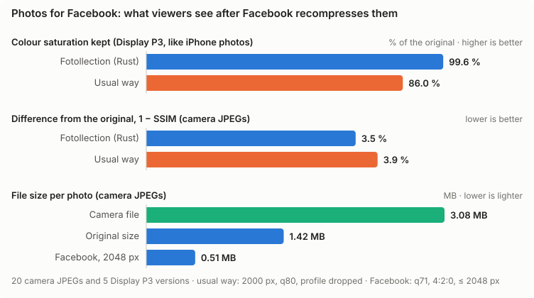
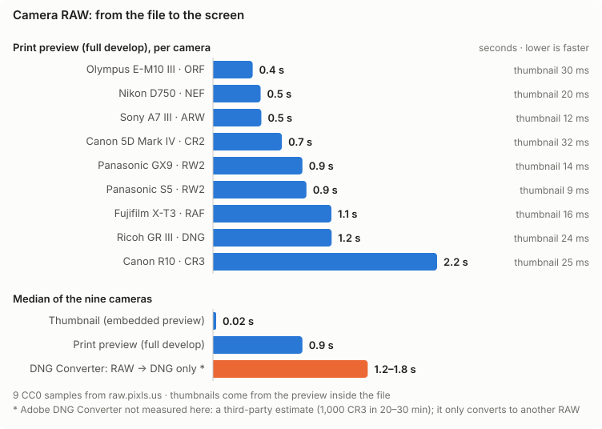

# Measured Results — Fotollection

> **Status:** Living · **Last reviewed:** 2026-10-25
>
> The **latest measured numbers** for speed and memory, in one readable page. Each number links to the run that produced it.
> This page is a summary. The append-only history of every measurement is the benchmark log in [OPTIMIZATION.md §5](OPTIMIZATION.md#5-benchmark-log), and the budgets are defined in [OPTIMIZATION.md §3](OPTIMIZATION.md#3-budgets). When a new run changes a number, update this page and add the row to §5 in the same commit.

## 1. Test setup

| Item | Value |
|------|-------|
| Machine | REF-MAC: Apple M3 (8 cores), 16 GB RAM, macOS 26.3 |
| Photos | 95 real JPEGs, 4608 × 3456 (16 MP), 287 MB in total, Canon |
| Large batch | The same 95 photos hard-linked 53 times: **5,035 photos** with distinct paths (no extra disk space) |
| Build | `cargo build --release`; Rust 1.99.1 |
| Tools | `measure_folder` (core pipeline), `/usr/bin/time -l` (peak RSS), `bench/run.sh` (Rust vs browser, 6 vs 8 in flight), `bench/batch.sh` (large batch), `bench/chart.mjs` (charts) |
| Date | 2026-10-23, all numbers from one session after the machine had cooled down |

## 2. Against the budgets


| What | Budget ([NFR](PRD.md#7-non-functional-requirements)) | Measured | |
|------|--------|----------|---|
| Open a folder: import + EXIF + embedded thumbnails | NFR-001: < 1 s per 1,000 photos | 0.12 s per 1,000 (5,035 photos: import 383 ms + thumbnails 236 ms) | ✓ |
| Preview update (warm) | NFR-002: < 50 ms p95 | p95 18 ms, p50 17 ms (was 26 ms before the screen encoder, §5); cold (first open) 120 ms | ✓ |
| Export throughput | NFR-003: ≥ 8 photos/s at 24 MP | 18.0 photos/s at 16 MP (runs: 17.8–18.4) | ✓ |
| Peak memory | NFR-004: ≤ 2 GB at any batch size | 1.35 GB (95 photos), 1.45 GB (5,035 photos) | ✓ |
| Best-shot analysis per photo, one thread (2026-10-24) | NFR-014: ≤ 20 ms, ≤ 40 ms with faces | p50 17.4 ms / p95 18.0 ms (56 photos without faces); p50 27.8 ms / p95 36 ms (39 with faces); whole pool ≈ 110–125 photos/s | ✓ |
| PNG decode, 16 MP | — | 122 ms (JPEG: 45 ms) | — |

## 3. Large batches: 5,035 photos

Memory must not grow with the number of photos ([NFR-004](PRD.md#nfr-004--memory-ceiling)). The library stores a few bytes per photo, thumbnails go to a disk cache, the preview cache is a bounded LRU, and export decodes at most 6 photos at a time. `bench/batch.sh` checks that design on 53 times the usual batch.


| Phase | 95 photos (median of 3) | 5,035 photos |
|-------|-----------|--------------|
| Import + EXIF | 5 ms, RSS 7 MB | 383 ms, RSS 13 MB |
| T1 thumbnails (400 px, disk cache) | 47.8 photos/s, RSS 681 MB | 46.4 photos/s, RSS 803 MB |
| Export at 6 in flight | 18.0 photos/s | 15.4 photos/s (327 s), 0 failed, RSS 1.33 GB |
| Peak RSS of the whole run | 1.35 GB | **1.45 GB** |

**Result: memory does not grow with the batch.** 53 times more photos cost 0.1 GB more at peak, and the library itself stays at 13 MB for 5,035 photos. The large export is slower per photo because it runs for more than 5 minutes and the M3 throttles under sustained load.

Not yet measured: the whole app with 5,035 photos (shell + WebKit). The grid is virtualized, and each photo summary is roughly 200 bytes of JSON, so the webview is expected to add little. That run needs a separate app-data directory so it does not overwrite the user's session project, and it is tracked in [STATUS.md](STATUS.md).

## 4. Native Rust vs the browser

The same job (decode → crop 2:3 → date stamp → JPEG q95) on the same 95 photos, in Fotollection and in headless Chromium 156 with one Web Worker per core. Median of 3 runs ([OPTIMIZATION.md §2.1](OPTIMIZATION.md#21-measured-the-same-job-in-chromium)):


| | Fotollection (Rust) | Chromium 156 | |
|---|---:|---:|---|
| Batch export | 18.0 photos/s (6 in flight, 4:4:4, files written) | 17.9 photos/s (8 workers, 4:2:0, blobs only) | About the same |
| Warm preview, 1600 px (p50) | 17.4 ms | 18.5 ms | Fotollection faster |
| Cold preview (first open) | 120 ms | 119 ms | About the same |
| Peak memory | 1.35 GB | 1.78 GB | Fotollection 24 % lower |

## 5. Where the preview time goes


| Step (1600 px preview from the cached 2048 px image) | Time | Share |
|------------------------------------------------------|-----:|------:|
| Crop + Lanczos resize | 9.7 ms | 58 % |
| Date stamp | < 0.1 ms | ≈ 0 % |
| JPEG encode q85, 4:2:0, plain Huffman | 7.0 ms | 42 % |
| **Total** | **16.7 ms** | Budget 50 ms; Chromium 18.5 ms |

How the preview went from 26 ms to 17 ms (Stage 2, each step measured on the same 1600 px image):

| Encoder setting for previews | Encode time |
|------------------------------|------------:|
| Before: 4:4:4 + optimized Huffman (the export settings) | 16.2 ms |
| Plain Huffman tables | 11.7 ms |
| Plain Huffman + 4:2:0 chroma (**kept**) | 7.0 ms |

- Previews are only shown on screen, so 4:2:0 is safe there. A 3× crop of the date stamp looks the same in both. Exports keep 4:4:4 and optimized tables (`EncodeOptions::print`).
- A cheaper resize filter was tried as well: CatmullRom took **12.5 ms** against 9.7 ms for Lanczos3 in `fast_image_resize` on M3, so Lanczos3 stays.

## 6. Export concurrency

| Photos in flight | Throughput (median of 3; runs) | Peak RSS (16 MP) | Decision |
|-----------------:|-------------------------:|-----------------:|----------|
| 6 | 18.0 photos/s (17.8–18.4) | 1.35 GB (1.30–1.41) | **Kept** |
| 8 | 19.5 photos/s (19.1–19.6) | 1.72 GB (1.70–1.77) | Rejected: +8 % speed for +0.4 GB, which would pass 2 GB with 24 MP photos |

## 7. Reproduce

```bash
# Rust vs browser and 6 vs 8 in flight, median of 3 runs; writes bench/results/ and all charts
bench/run.sh ~/Pictures/some-folder 3
# Large batch: hard-links the folder 53 times (no extra disk), exports with --discard-output
bench/batch.sh ~/Pictures/some-folder 53
# Redraw the charts (English and Vietnamese) from bench/results/*.json
node bench/chart.mjs
# One-off run of the core pipeline on any folder (read-only)
/usr/bin/time -l target/release/examples/measure_folder ~/Pictures/some-folder
# Best-shot analysis time and the groups it finds (FR-041, NFR-014)
target/release/examples/measure_folder ~/Pictures/some-folder --analyze
```

The scripts build `measure_folder` themselves. Photos are only read, and never copied into the repository; `bench/results/` holds numbers only. Let the machine cool down before a run: the M3 throttles under sustained load.

## 8. Best-shot accuracy

Best-shot suggestions ([FR-041](PRD.md#fr-041--best-shot-suggestions)) are scored against 95 photos labelled by hand: 22 groups of one moment, and for 6 of them the photo to keep (`bench/bestshot/truth-103_09.json`; file names only, the photos are private). Pairs labelled as ambiguous are ignored. Results are in `bench/results/bestshot.json`, and the decision is in [ADR-0019](adr/0019-grouping-by-visual-signature.md).


| Step | Groups found (of 22) | Pair recall | Pair precision | Extra groups | Acceptable picks |
|------|-----:|-----:|-----:|-----:|-----:|
| dHash, focal split (before) | 3 | 9 % | 100 % | 0 | 2/2 |
| + layout and colour signature | 13 | 67 % | 100 % | 2 | 3/4 |
| + zoom from focal length | 15 | 73 % | 100 % | 2 | 5/6 |
| + fair sharpness, hidden faces | **15** | **73 %** | **100 %** | 2 | **6/6** |

- **Extra groups:** both are pairs labelled as ambiguous (0485/0486, 0504/0505), not mistakes.
- **Still missed:** 0430/0431, 0447/0448, 0452/0453, 0465/0466, 0472/0473, 0502/0503 and 0516/0517. In each, the pose or the framing changes a lot (food shot again from the other side, a selfie upside down, a cat approached on foot).
- **Picks** in the labelled groups: 0426 over a squint, 0440 over a profile with a hand at the mouth, 0463 over closed eyes, 0524 over a defocused night shot, 0525 over a soft zoomed shot, and 0533 among four sunsets.
- **Speed after the change:** 17.4 ms per photo, 27.6 ms with faces (NFR-014: 20 / 40 ms).

```bash
cargo run --release -p fotollection-core --example eval_bestshot -- ~/Pictures/some-folder labels.json
# --explain: score parts per photo; --pairs: time gap, layout and colour similarity of neighbours
```

## 9. Print quality

[NFR-009](PRD.md#nfr-009--colour-fidelity) asks for the ICC profile to be kept and a colour error of at most 1. `bench/quality/audit.py` checks this pixel by pixel:

- **What is exported:** each photo goes through the real export path at its own size, with no stamp or frame (`examples/quality_export.rs`).
- **How it is read:** both images are decoded with libjpeg and converted to CIELAB in floating point through their profiles.
- **What it is compared with:** a typical web-editor export (profile dropped, 4:2:0, q80, 2000 px, upscaled back for print).
- **Where the numbers are:** `bench/results/quality.json`.


| Median | Fotollection, 20 sRGB JPEGs | Web editor | Fotollection, 5 Display P3 | Web editor |
|------|-----:|-----:|-----:|-----:|
| PSNR | 52.6 dB | 37.9 dB | 50.8 dB | 37.0 dB |
| ΔE2000 mean | **0.19** | 1.39 | **0.31** | 2.15 |
| ΔE2000 95th percentile | 1.06 | 3.50 | 1.50 | 4.81 |
| Chroma kept | 100 % | 99.9 % | 99.9 % | **86.8 %** |
| Contrast kept | 100 % | 99.9 % | 100 % | 99.9 % |
| Detail kept (Laplacian variance) | 99.8 % | **13 %** | 100 % | 18 % |
| Tonal levels kept | 100 % | 100 % | 100 % | 100 % |

- **Result:** NFR-009 is met. The ICC profile is kept 25 / 25, sampling is 4:4:4, quality is 95, and the mean ΔE2000 is 0.19–0.31, well under 1.
- **Where the 95th percentile comes from:** the larger errors sit on sharp edges, where JPEG re-encoding works hardest, not in flat colour.
- **What it explains:** the web-editor export loses 87 % of the fine detail through the down- and upscale, and 13 % of the saturation of P3 photos when it drops the profile. These are the two usual causes of flat, blotchy prints.
- **Limits:** the source photos are from one camera. Real HEIC files from an iPhone, and prints measured with a spectrophotometer, are still to come.

```bash
cargo run --release -p fotollection-core --example quality_export -- /tmp/out ~/Pictures/some-folder/*.JPG
uv run bench/quality/audit.py ~/Pictures/some-folder /tmp/out --json bench/results/quality-run.json
```

## 10. Photos for social media

The share export ([FR-053](PRD.md#fr-053--export-for-social-media)) has to make light files that still look like the photo once Facebook has recompressed them. `bench/quality/share_audit.py` checks this on the same 20 camera JPEGs (16 MP, about 3 MB each) and 5 Display P3 versions:

- **Reference:** the original in sRGB, resized to the export's size with Lanczos, never compressed: the best that size can look.
- **After Facebook:** the export recompressed as Facebook does (q71, 4:2:0, at most 2048 px), next to the usual way (a web editor saving 2000 px at q80 without the profile, then the same recompression).
- **Measures:** SSIM (structural similarity; 1 is identical, and blur, blocking and ringing all lower it), ΔE2000 and colour saturation kept. The sharpness count of §9 is not used here: on recompressed files it counts JPEG artefacts as detail.
- **Data:** `bench/results/share.json`.



| Median | Original size | Facebook, 2048 px | Instagram, 1080 px |
|------|-----:|-----:|-----:|
| File size (camera JPEGs, 3.08 MB) | 1.42 MB (46 %) | 0.51 MB (16 %) | 0.24 MB (8 %) |
| SSIM against the reference | 0.981 | 0.979 | 0.982 |
| ΔE2000 mean / 95th percentile | **0.96** / 2.51 | 1.27 / 3.34 | 1.58 / 4.34 |
| Colour saturation kept (Display P3) | 100 % | 99.8 % | 99.8 % |
| Export speed, 16 MP | 14 photos/s | 23 photos/s | 32 photos/s |

| After Facebook recompresses (median) | Fotollection | Usual way |
|------|-----:|-----:|
| SSIM, camera JPEGs | **0.965** | 0.961 |
| ΔE2000 mean, camera JPEGs / Display P3 | **1.67 / 1.62** | 1.74 / 2.20 |
| Colour saturation kept, Display P3 | **99.6 %** | 86.0 % |

- **Settings, chosen by measurement:** quality 88 with 4:2:0 for resized photos, sharpening 0.2 after the downscale (0.35 scored lower SSIM, q84 and q80 lost more than they saved), and quality 80 for *Original*, which keeps ΔE2000 under 1 at half the file size.
- **Result:** the *Original* preset meets its targets (ΔE2000 < 1, about half the size of an already compressed compact-camera JPEG; larger, less compressed camera files shrink more). Resized photos keep SSIM ≈ 0.98, but their ΔE2000 of 1.27–1.58 is above 1: 4:2:0 chroma, which Facebook applies to every upload anyway, softens colour edges.
- **What viewers see:** after Facebook's own recompression, Fotollection's file stays closer to the photo than the usual way (SSIM 0.965 against 0.961), and keeps the colour of Display P3 photos (99.6 % against 86 %), which the usual way loses by dropping the profile.

```bash
cargo run --release -p fotollection-core --example quality_export -- --share facebook /tmp/share ~/Pictures/some-folder/*.JPG
uv run bench/quality/share_audit.py ~/Pictures/some-folder /tmp/share --json bench/results/share-run.json
```

## 11. Preview and zoom cost (v0.6.0)

Measured before building the zoom path ([FR-057](PRD.md#fr-057--zoom-in-the-preview)) and the start-up screen ([FR-060](PRD.md#fr-060--start-up-screen)), to answer one question: what does looking at a big photo cost a weak machine? `examples/measure_preview.rs`, median of 5, REF-MAC (M3), one camera JPEG at 16 MP and the same photo resized to 26 MP and 32 MP (q92). Peak RSS is the whole benchmark process under `/usr/bin/time -l`.

| Photo | Full decode | Decoded RAM | Preview, first time | Preview, cached | Full-size render | Visible part, 2560 × 1600 | Peak RSS |
|------|-----:|-----:|-----:|-----:|-----:|-----:|-----:|
| 16 MP (4608 × 3456) | 46 ms | 48 MB | 105 ms | 17 ms | 4 ms | 17 ms | 222 MB |
| 26 MP (6240 × 4160) | 68 ms | 78 MB | 139 ms | 18 ms | 8 ms | 18 ms | 314 MB |
| 32 MP (6960 × 4640) | 84 ms | 97 MB | 154 ms | 18 ms | 9 ms | 17 ms | 371 MB |

- **The preview is already safe.** It never holds more than a 2048 px copy (about 12 MB) and sends 1600 px, so a 32 MP photo costs the same 18 ms as a 16 MP one once cached; only the first open grows with the photo (decode). A preview "at 32 MP" is never built.
- **Full detail only on zoom.** The original costs 3 bytes per pixel decoded, 97 MB at 32 MP, so it is decoded only when the user zooms past the preview, and at most about 200 MB of originals stay cached. Rendering it at full size is cheap (4–9 ms, unstraightened; straightening adds about 53 ms at 16 MP, OPTIMIZATION §5), and the part a screen shows encodes in 17 ms whatever the photo's size: the first zoom on a 32 MP photo is about 100 ms, the next pans about 20 ms.
- **A weak machine:** the threads do not change these numbers (`RAYON_NUM_THREADS=2` and `=1` give the same times): one photo is one core's work. A machine with a core 3–4× slower than an M3 would take about 0.3–0.4 s for the first zoom on 32 MP. The zoomed preview stays on screen during that time, so nothing blanks or blocks.

```bash
cargo run --release -p fotollection-core --example measure_preview -- photo-16mp.jpg photo-32mp.jpg
```

## 12. Camera RAW (v0.7.0)

Measured before building RAW input ([FR-016](PRD.md#fr-016--raw-input), [ADR-0023](adr/0023-raw-through-os-codecs.md)), on nine CC0 samples from [raw.pixls.us](https://raw.pixls.us/), one per format (`bench/raw-samples.json`, fetched and checked by `scripts/fetch-raw-samples.py`). `examples/measure_raw.rs` calls the macOS codec through `fotollection-oscodec`; median of 5, REF-MAC (M3), macOS 26.

| Sample | Developed size | Full develop | Embedded preview ≤ 400 px | Preview ≤ 2048 px | EXIF read today |
|------|-----:|-----:|-----:|-----:|:-----:|
| Panasonic GX9 (RW2, 20 MP) | 5184 × 3888 | 867 ms | 14 ms | 28 ms (1920 px) | ✗ |
| Panasonic S5 (RW2, 24 MP) | 6000 × 4000 | 906 ms | 9 ms | 19 ms (1920 px) | ✗ |
| Canon 5D Mark IV (CR2, 31 MP) | 6720 × 4480 | 668 ms | 32 ms | 79 ms | ✓ |
| Canon R10 (CR3, 24 MP) | 6000 × 4000 | 2172 ms | 25 ms | 62 ms | ✗ |
| Nikon D750 (NEF, 24 MP) | 6016 × 4016 | 462 ms | 20 ms | 64 ms | ✓ |
| Sony A7 III (ARW, 24 MP) | 6000 × 4000 | 469 ms | 12 ms | 20 ms (1616 px) | ✓ |
| Fujifilm X-T3 (RAF, 26 MP) | 6240 × 4160 | 1148 ms | 16 ms | 42 ms | ✗ |
| Olympus E-M10 III (ORF, 16 MP) | 4608 × 3456 | 385 ms | 30 ms | 80 ms | ✗ |
| Ricoh GR III (DNG, 24 MP) | 6000 × 4000 | 1150 ms | 24 ms | 62 ms | ✓ |

Peak RSS of one process developing one file five times: 1.29 GB (CR2, 31 MP), 810 MB (CR3), 579 MB (RW2, GX9).



The chart (`bench/results/raw.json`) sets the medians against **Adobe DNG Converter**, which was not run here: its 1.2–1.8 s per file is a third-party estimate (1,000 CR3 files in 20–30 minutes "on modern hardware", machine not stated, from convertintomp4.com's blog post on batch RAW-to-DNG conversion), and it only turns one RAW file into another, before anything is seen or printed. Fotollection needs no conversion step.

- **Two paths.** The preview every RAW carries comes back 30 to 100 times faster than a full develop, and it is what thumbnails and best-shot analysis need. The develop (0.4–2.2 s) is kept for the print preview, zoom and export, which work on one photo at a time; a preview already on screen re-renders from its cached copy in 17 ms, like a JPEG.
- **Memory.** One develop can hold more than 1 GB, so RAW photos are developed a few at a time, not six at once like JPEG, to stay under the 2 GB ceiling (NFR-004).
- **The type hint matters.** Without the file's type identifier, ImageIO read a NEF as a plain TIFF (its 160 × 120 thumbnail) and could not open an ARW; with it, all nine develop at full size.
- **EXIF.** The current reader understands the TIFF-based RAW files only; RW2, CR3, RAF and ORF need their containers handled before the date stamp and the info frame can use their EXIF.

```bash
python3 -I scripts/fetch-raw-samples.py /tmp/raw
cargo run --release -p fotollection-core --example measure_raw -- /tmp/raw/*
```

## 13. Camera over USB, Step 0 (planned FR-062, FR-063)

Measured before building camera support ([ADR-0026](adr/0026-cameras-through-the-os-usb-stack.md)) with `crates/oscamera/examples/probe_camera.rs` on the owner's bodies, by USB cable, through ImageCaptureCore (no driver), REF-MAC (M3), macOS 26. Details per maker in [cameras/](cameras/README.md).

| Body, USB mode | Session open | GetDeviceInfo | Maker operations | Capture from the computer | Shutter on the body | Live view over USB |
|------|-----:|-----:|-----|-----|-----|-----|
| Sony a6400, PC Remote | 44 ms | 23 ms | 5 (Sony extension) | After the maker's handshake (to learn) | Locked until the handshake | After the handshake (to learn) |
| Panasonic GX9, PictBridge (PTP) | 21 ms | 20 ms once the card is listed (no answer in 10 s before) | None | Not possible | Locked (PictBridge screen) | Not possible |

- **No driver is needed** to reach either body; the OS stack carries any PTP operation, so path A is open for every maker whose protocol we learn.
- **The GX9 cannot be tethered over USB** by anyone: it declares no capture or live-view operation. Live view needs an HDMI capture card; photos come by import after the shoot.

## 14. Places and time (v0.8.0, measured first)

Measured before building FR-030, FR-031 and FR-058 with `crates/core/examples/measure_places.rs`, REF-MAC (M3), release build. Parts B–D use 96 of the owner's GX9 JPEGs, read only and kept in memory.

| What | Result |
|------|--------|
| Sort by capture time (`sorted_ids`) | 0.2 ms at 5,035 photos, 0.9 ms at 70,000 |
| Recompute an effective-time column (EXIF time + camera offset) | 0.05 ms at 70,000 photos |
| Visual signature from a T1 thumbnail (decode 400 px, reduce to 256 px, sign) | 1.06 ms per photo (max 1.31) |
| One scene comparison (layout over 5 zooms + colour) | 1.33 ms; the colour check alone is a few µs |
| Matching pass: each camera photo against its 8 nearest photos in time, colour first | 1.24 ms per camera photo on all cores (5.8 ms on one) |
| Looking for `.xmp` sidecars on import (two checks per photo) | 1 µs per photo |

**Same scene, proxy.** Each photo against a closer (1.3–2×), 3:2, off-centre and darker crop of itself: layout score median 0.97, colour median 0.84; with layout ≥ 0.6 and colour ≥ 0.65, 93 of 96 are found. Of 637 pairs five or more frames apart, 16 pass, but those include later shots of the same spot, which give the right place anyway. Real phone and camera pairs differ more (lens, perspective, processing), so the threshold is provisional until 20 real GX9 + phone pairs are scored.

- Effective time costs nothing measurable: it is computed as a column, and sorting already reads one.
- Place inference fits in the background: about 1.2 s per 1,000 camera photos, so NFR-020 is set at 2 s.
- XMP lookup on import is free (1 ms per 1,000 photos).
