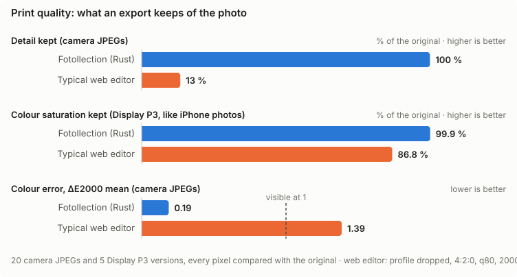

# Measured Results — Fotollection

> **Status:** Living · **Last reviewed:** 2026-10-23
>
> The **latest measured numbers** for speed and memory, in one readable page. Each number links to the run that produced it.
> This page is a summary. The append-only history of every measurement is the benchmark log in [OPTIMIZATION.md §5](OPTIMIZATION.md#5-benchmark-log), and the budgets are defined in [OPTIMIZATION.md §3](OPTIMIZATION.md#3-budgets). When a new run changes a number, update this page and add the row to §5 in the same commit.

## 1. Test setup

| Item | Value |
|------|-------|
| Machine | REF-MAC: Apple M3 (8 cores), 16 GB RAM, macOS 26.3 |
| Photos | 95 real JPEGs, 4608 × 3456 (16 MP), 287 MB in total, Canon |
| Large batch | The same 95 photos hard-linked 53 times: **5,035 photos** with distinct paths (no extra disk space) |
| Build | `cargo build --release`; Rust 1.99.1 |
| Tools | `measure_folder` (core pipeline), `/usr/bin/time -l` (peak RSS), `bench/run.sh` (Rust vs browser, 6 vs 8 in flight), `bench/batch.sh` (large batch), `bench/chart.mjs` (charts) |
| Date | 2026-10-23, all numbers from one session after the machine had cooled down |

## 2. Against the budgets


| What | Budget ([NFR](PRD.md#7-non-functional-requirements)) | Measured | |
|------|--------|----------|---|
| Open a folder: import + EXIF + embedded thumbnails | NFR-001: < 1 s per 1,000 photos | 0.12 s per 1,000 (5,035 photos: import 383 ms + thumbnails 236 ms) | ✓ |
| Preview update (warm) | NFR-002: < 50 ms p95 | p95 18 ms, p50 17 ms (was 26 ms before the screen encoder, §5); cold (first open) 120 ms | ✓ |
| Export throughput | NFR-003: ≥ 8 photos/s at 24 MP | 18.0 photos/s at 16 MP (runs: 17.8–18.4) | ✓ |
| Peak memory | NFR-004: ≤ 2 GB at any batch size | 1.35 GB (95 photos), 1.45 GB (5,035 photos) | ✓ |
| Best-shot analysis per photo, one thread (2026-10-24) | NFR-014: ≤ 20 ms, ≤ 40 ms with faces | p50 17.4 ms / p95 18.0 ms (56 photos without faces); p50 27.8 ms / p95 36 ms (39 with faces); whole pool ≈ 110–125 photos/s | ✓ |
| PNG decode, 16 MP | — | 122 ms (JPEG: 45 ms) | — |

## 3. Large batches: 5,035 photos

Memory must not grow with the number of photos ([NFR-004](PRD.md#nfr-004--memory-ceiling)). The library stores a few bytes per photo, thumbnails go to a disk cache, the preview cache is a bounded LRU, and export decodes at most 6 photos at a time. `bench/batch.sh` checks that design on 53 times the usual batch.


| Phase | 95 photos (median of 3) | 5,035 photos |
|-------|-----------|--------------|
| Import + EXIF | 5 ms, RSS 7 MB | 383 ms, RSS 13 MB |
| T1 thumbnails (400 px, disk cache) | 47.8 photos/s, RSS 681 MB | 46.4 photos/s, RSS 803 MB |
| Export at 6 in flight | 18.0 photos/s | 15.4 photos/s (327 s), 0 failed, RSS 1.33 GB |
| Peak RSS of the whole run | 1.35 GB | **1.45 GB** |

**Result: memory does not grow with the batch.** 53 times more photos cost 0.1 GB more at peak, and the library itself stays at 13 MB for 5,035 photos. The large export is slower per photo because it runs for more than 5 minutes and the M3 throttles under sustained load.

Not yet measured: the whole app with 5,035 photos (shell + WebKit). The grid is virtualized, and each photo summary is roughly 200 bytes of JSON, so the webview is expected to add little. That run needs a separate app-data directory so it does not overwrite the user's session project, and it is tracked in [STATUS.md](STATUS.md).

## 4. Native Rust vs the browser

The same job (decode → crop 2:3 → date stamp → JPEG q95) on the same 95 photos, in Fotollection and in headless Chromium 156 with one Web Worker per core. Median of 3 runs ([OPTIMIZATION.md §2.1](OPTIMIZATION.md#21-measured-the-same-job-in-chromium)):


| | Fotollection (Rust) | Chromium 156 | |
|---|---:|---:|---|
| Batch export | 18.0 photos/s (6 in flight, 4:4:4, files written) | 17.9 photos/s (8 workers, 4:2:0, blobs only) | About the same |
| Warm preview, 1600 px (p50) | 17.4 ms | 18.5 ms | Fotollection faster |
| Cold preview (first open) | 120 ms | 119 ms | About the same |
| Peak memory | 1.35 GB | 1.78 GB | Fotollection 24 % lower |

## 5. Where the preview time goes


| Step (1600 px preview from the cached 2048 px image) | Time | Share |
|------------------------------------------------------|-----:|------:|
| Crop + Lanczos resize | 9.7 ms | 58 % |
| Date stamp | < 0.1 ms | ≈ 0 % |
| JPEG encode q85, 4:2:0, plain Huffman | 7.0 ms | 42 % |
| **Total** | **16.7 ms** | Budget 50 ms; Chromium 18.5 ms |

How the preview went from 26 ms to 17 ms (Stage 2, each step measured on the same 1600 px image):

| Encoder setting for previews | Encode time |
|------------------------------|------------:|
| Before: 4:4:4 + optimized Huffman (the export settings) | 16.2 ms |
| Plain Huffman tables | 11.7 ms |
| Plain Huffman + 4:2:0 chroma (**kept**) | 7.0 ms |

- Previews are only shown on screen, so 4:2:0 is safe there. A 3× crop of the date stamp looks the same in both. Exports keep 4:4:4 and optimized tables (`EncodeOptions::print`).
- A cheaper resize filter was tried as well: CatmullRom took **12.5 ms** against 9.7 ms for Lanczos3 in `fast_image_resize` on M3, so Lanczos3 stays.

## 6. Export concurrency

| Photos in flight | Throughput (median of 3; runs) | Peak RSS (16 MP) | Decision |
|-----------------:|-------------------------:|-----------------:|----------|
| 6 | 18.0 photos/s (17.8–18.4) | 1.35 GB (1.30–1.41) | **Kept** |
| 8 | 19.5 photos/s (19.1–19.6) | 1.72 GB (1.70–1.77) | Rejected: +8 % speed for +0.4 GB, which would pass 2 GB with 24 MP photos |

## 7. Reproduce

```bash
# Rust vs browser and 6 vs 8 in flight, median of 3 runs; writes bench/results/ and all charts
bench/run.sh ~/Pictures/some-folder 3
# Large batch: hard-links the folder 53 times (no extra disk), exports with --discard-output
bench/batch.sh ~/Pictures/some-folder 53
# Redraw the charts (English and Vietnamese) from bench/results/*.json
node bench/chart.mjs
# One-off run of the core pipeline on any folder (read-only)
/usr/bin/time -l target/release/examples/measure_folder ~/Pictures/some-folder
# Best-shot analysis time and the groups it finds (FR-041, NFR-014)
target/release/examples/measure_folder ~/Pictures/some-folder --analyze
```

The scripts build `measure_folder` themselves. Photos are only read, and never copied into the repository; `bench/results/` holds numbers only. Let the machine cool down before a run: the M3 throttles under sustained load.

## 8. Best-shot accuracy

Best-shot suggestions ([FR-041](PRD.md#fr-041--best-shot-suggestions)) are scored against 95 photos labelled by hand: 22 groups of one moment, and for 6 of them the photo to keep (`bench/bestshot/truth-103_09.json`; file names only, the photos are private). Pairs labelled as ambiguous are ignored. Results are in `bench/results/bestshot.json`, and the decision is in [ADR-0019](adr/0019-grouping-by-visual-signature.md).


| Step | Groups found (of 22) | Pair recall | Pair precision | Extra groups | Acceptable picks |
|------|-----:|-----:|-----:|-----:|-----:|
| dHash, focal split (before) | 3 | 9 % | 100 % | 0 | 2/2 |
| + layout and colour signature | 13 | 67 % | 100 % | 2 | 3/4 |
| + zoom from focal length | 15 | 73 % | 100 % | 2 | 5/6 |
| + fair sharpness, hidden faces | **15** | **73 %** | **100 %** | 2 | **6/6** |

- **Extra groups:** both are pairs labelled as ambiguous (0485/0486, 0504/0505), not mistakes.
- **Still missed:** 0430/0431, 0447/0448, 0452/0453, 0465/0466, 0472/0473, 0502/0503 and 0516/0517. In each, the pose or the framing changes a lot (food shot again from the other side, a selfie upside down, a cat approached on foot).
- **Picks** in the labelled groups: 0426 over a squint, 0440 over a profile with a hand at the mouth, 0463 over closed eyes, 0524 over a defocused night shot, 0525 over a soft zoomed shot, and 0533 among four sunsets.
- **Speed after the change:** 17.4 ms per photo, 27.6 ms with faces (NFR-014: 20 / 40 ms).

```bash
cargo run --release -p fotollection-core --example eval_bestshot -- ~/Pictures/some-folder labels.json
# --explain: score parts per photo; --pairs: time gap, layout and colour similarity of neighbours
```

## 9. Print quality

[NFR-009](PRD.md#nfr-009--colour-fidelity) asks for the ICC profile to be kept and a colour error of at most 1. `bench/quality/audit.py` checks this pixel by pixel:

- **What is exported:** each photo goes through the real export path at its own size, with no stamp or frame (`examples/quality_export.rs`).
- **How it is read:** both images are decoded with libjpeg and converted to CIELAB in floating point through their profiles.
- **What it is compared with:** a typical web-editor export (profile dropped, 4:2:0, q80, 2000 px, upscaled back for print).
- **Where the numbers are:** `bench/results/quality.json`.



| Median | Fotollection, 20 sRGB JPEGs | Web editor | Fotollection, 5 Display P3 | Web editor |
|------|-----:|-----:|-----:|-----:|
| PSNR | 52.6 dB | 37.9 dB | 50.8 dB | 37.0 dB |
| ΔE2000 mean | **0.19** | 1.39 | **0.31** | 2.15 |
| ΔE2000 95th percentile | 1.06 | 3.50 | 1.50 | 4.81 |
| Chroma kept | 100 % | 99.9 % | 99.9 % | **86.8 %** |
| Contrast kept | 100 % | 99.9 % | 100 % | 99.9 % |
| Detail kept (Laplacian variance) | 99.8 % | **13 %** | 100 % | 18 % |
| Tonal levels kept | 100 % | 100 % | 100 % | 100 % |

- **Result:** NFR-009 is met. The ICC profile is kept 25 / 25, sampling is 4:4:4, quality is 95, and the mean ΔE2000 is 0.19–0.31, well under 1.
- **Where the 95th percentile comes from:** the larger errors sit on sharp edges, where JPEG re-encoding works hardest, not in flat colour.
- **What it explains:** the web-editor export loses 87 % of the fine detail through the down- and upscale, and 13 % of the saturation of P3 photos when it drops the profile. These are the two usual causes of flat, blotchy prints.
- **Limits:** the source photos are from one camera. Real HEIC files from an iPhone, and prints measured with a spectrophotometer, are still to come.

```bash
cargo run --release -p fotollection-core --example quality_export -- /tmp/out ~/Pictures/some-folder/*.JPG
uv run bench/quality/audit.py ~/Pictures/some-folder /tmp/out --json bench/results/quality-run.json
```
